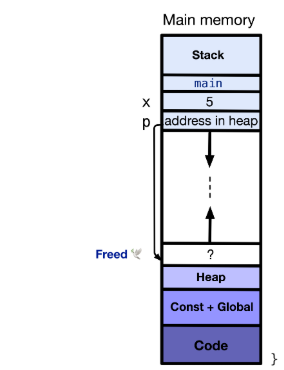
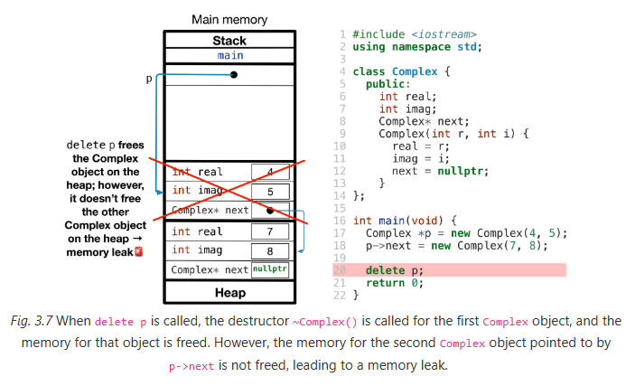
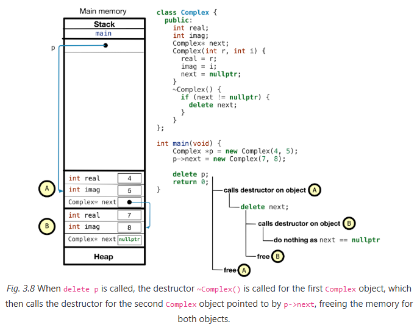

# OOPC3.DynamicMemoryAllocation&Classes

> Last Edit: 9/28/25
> 

# 3.1 Freeing an Object from Memory Explicitly

- Recall what happened during a program is running

## 3.1.1 Recap: Dynamic Memory Allocation

- When the program start, computer allocates memory in Random Access Memory (RAM)
- 大概有四种 Segment 出现
    - **Stack**: Stores the Local Variables and Objects of a function
    - **Heap:** Stores the dynamically allocated memory
    - **Global + Const** **Variables**: Obviously Stores the Variables
    - **Code**: Store instruction of the program

### Step 1： Stack Only

- 首先先有代码 `main.cpp`

```cpp
#include <iostream>
using namespace std;

int main(){
    int x = 10;      // Allocate x in stack with value 10
    int* p = NULL;   // Add a pointer in stack with NULL
    p = &x;          // Let P point to x
    *p = 5;          // Dereference P and change x's value
}
```

- So far everything is in stack

### Step 2: Dynamic Memory Allocation

Change `main.cpp` into 

```cpp
#include <iostream>
using namespace std;

int main(){
    int x = 10;       // Allocate x in stack with value 10
    int* p = NULL;    // Add a pointer in stack with NULL
    p = &x;           // Let P point to x
    *p = 5;           // Dereference P and change x's value
    p = new int;      // Dynamically allocate a value of int in heap
    *p = 20;          // Change the value of p to 20

    cout << "Value at p: " << *p << endl;  // print 20
    cout << "Value of x: " << x << endl;   // print 7
}
```

- `p = new int;` → allocate a new int space on heap, which is a dynamically allocated memory, then return its value to p
- So now on, the p is pointing to the space in **heap**

### Step 3. Freeing Memory

at the end, need to manually deleted the memory in heap

```cpp
#include <iostream>
using namespace std;

int main(){
    int x = 10;       // Allocate x in stack with value 10
    int* p = NULL;    // Add a pointer in stack with NULL
    p = &x;           // Let P point to x
    *p = 5;           // Dereference P and change x's value
    p = new int;      // Dynamically allocate a value of int in heap
    *p = 20;          // Change the value of p to 20

    cout << "Value at p: " << *p << endl;  // print 20
    cout << "Value of x: " << x << endl;   // print 7
    
    delete p;
}
```

- `delete p`  is freeing the memory p is pointing to on **HEAP**
- However the pointer p itself remains



### Step4. Resolve Dangling Pointer

- Dangling Pointer 悬空指针 happened when **pointer** is pointing to a **memory** which has been already **freed**

```cpp
#include <iostream>
using namespace std;

int main(){
    int x = 10;       // Allocate x in stack with value 10
    int* p = NULL;    // Add a pointer in stack with NULL
    p = &x;           // Let P point to x
    *p = 5;           // Dereference P and change x's value
    p = new int;      // Dynamically allocate a value of int in heap
    *p = 20;          // Change the value of p to 20

    cout << "Value at p: " << *p << endl;  // print 20
    cout << "Value of x: " << x << endl;   // print 7
    
    delete p;      
    p = NULL;         
    return 0;
}
```

- Basically, Set p to `NULL`  to resolve this problem

### 3.1.1.1 Dynamic Memory Allocation of Arrays

- The way to allocate one int in heap has been shown above, with the code  `int* p = new int;`
- Whereas to delete it, use `delete p;`
- Instead, when allocating Arrays, use `int* p = new int[size];` , so that now pointer p can be pointing to the first element in the Array
- Likewise, use `delete[] p;`  to free the memory pointer pointing to

## 3.1.2 Explicitly Calling Destructor

To API `new`  and `delete` basically Explicitly called Destructor and Constructor

```cpp
#include <iostream>
using namespace std;

class Student {
public:
    Student() {
        cout << "Constructor called" << endl; 
    }

    ~Student() {
        cout << "Destructor called" << endl;   
    }
};

int main(void) {
    Student* p = new Student;  
    delete p;                
    return 0;
}
```

# 3.2 Why do we need Destructors?

As known, a constructor is used when an object is being initialized, whereas destructor is used to clean everything up

If there’s no Destructor in the life cycle of the code when some memory has been dynamically called, the MEMORY LEAK will occur

```cpp
class Student {
private:
    int* grades;
public:
    Student(int size) {
        grades = new int[size]; // Dynamically Aloocated the Array
    }
};

int main(void) {
    Student x(3); // Constructed Array with three ints
    return 0;     // Program ENDED WITHOUT DESTRUCTOR
}
```

- As seen, some memory has been dynamically allocated on HEAP, however there’s no Destructor, meaning the memory on HEAP will remain and has not been freed, this is being called **MEMORY LEAK**

# 3.3 Objects Owning Other Dynamically Allocated Objects

## 3.3.1 Recall: When are Destructors Called ?

- Recall that Destructors are called when:
    - Goes out of Scope
    - Using Delete

## **3.3.2. Recall: Why Do We Need Destructors?**

- Destructors are needed to be define if object **has dynamically allocated memory that needs to be freed**

## **3.3.3. Why Do We Need Destructors for Objects Owning Other Dynamically Allocated Objects?**

```cpp
class Complex {
public:
    int real;
    int imag;
    Complex* next;   // Pointer pointing to another Complex Object

    Complex(int r, int i) {
        real = r;
        imag = i;
        next = nullptr;
    }
};

int main() {
    Complex* p = new Complex(4, 5);
    p->next = new Complex(7, 8);
    delete p; // This will only free the first Complex
    return 0;
}
```



- Now the problem is that there exist two Complex in the heap, that if only delete the first one, the second one will cause a memory leak

### Solution

The solution is to somehow use RECURSIVE

```cpp
class Complex {
public:
    int real;
    int imag;
    Complex* next;

    Complex(int r, int i) {
        real = r;
        imag = i;
        next = nullptr;
    }

    ~Complex() {
        cout << "Destructor called for Complex("
             << real << ", " << imag << ")" << endl;
        if (next != nullptr) {
            delete next;   // RECURSIVE Condition
        }
    }
};

int main() {
    Complex* p = new Complex(4, 5);
    p->next = new Complex(7, 8);
    delete p;
    return 0;
}
```



# 3.4 Arrays of Pointers

Double Pointers can be used in creating arrays of pointers

## 3.4.1 Double Pointers

```cpp
using namespace std;

int main() {
    int** p2p;    // Double Pointer, Pointing to a integer
    int * p;
		int * q; 
		
    p = new int;  // Dynamic Allocation
    *p = 5;       

    p2p = &p;     // p2p point to pointer p
    q = *p2p;     // Give the Address of Pointer p to q
                  // Now q is also pointing the int

    *q = 8;       // Change Vaule of q's pointing value to 

    cout << "*p = " << *p << endl;
    cout << "*q = " << *q << endl;
    cout << "**p2p = " << **p2p << endl;

    delete p;     
    return 0;
}

```

- After this, all codes will become 8

```cpp
*p = 8
*q = 8
**p2p = 8
```

## 3.4.2 Array of Pointers

- A Array which every members are Pointers

### Array of Integers

```cpp
int* arr = new int[size]
```

- This will call for a Dynamic Memory on HEAP that stores `size` of integers

### Array of Pointers

```cpp
int** arr = new int*[size];
```

- This will call for a Dynamic Memory on HEAP that stores `size` of Pointers
- That every single Element `arr[i]` is one Integer Pointer