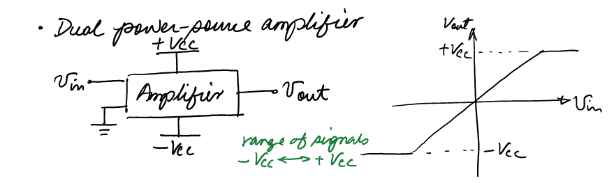
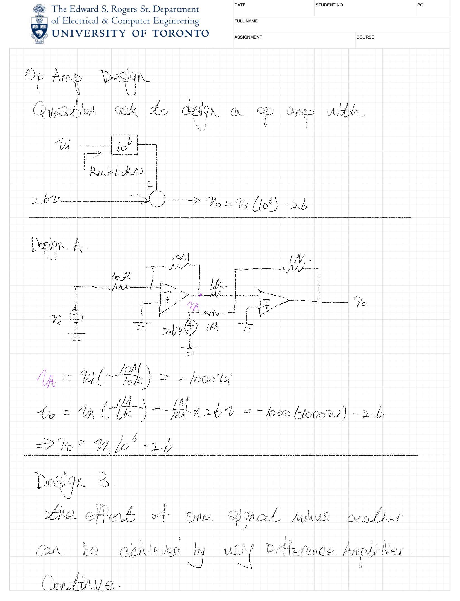
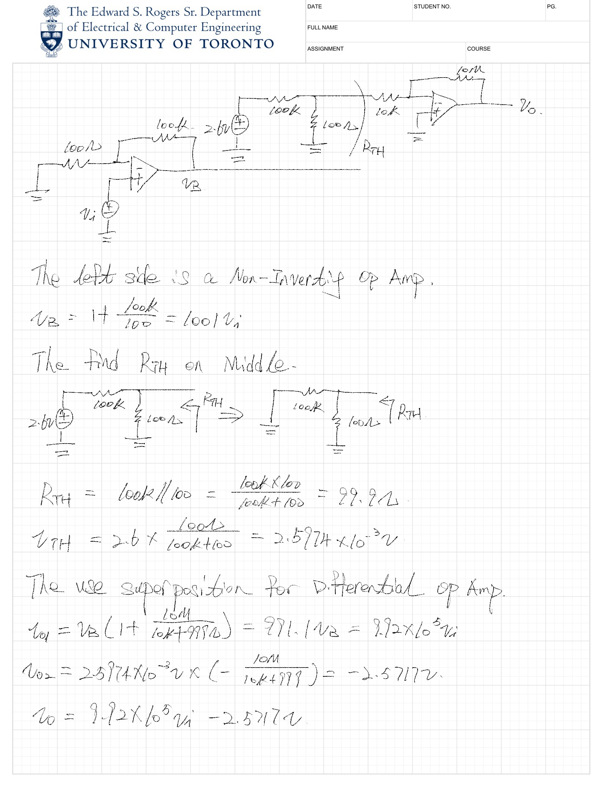

> Last Edit: 1/22/26

# Amplifier transfer characteristics

## Differential Amplifier

# Operational Amplifier

Operational Amplifier, has few main things to remember

## Op Amp’s Properties

### Virtual Short

The Open Loop Gain $A$, is a very Large Amplifier, that **Ideally Infinite**, this states that, based on the equation $V_{out}=A(V_p-V_n)$, the Positive and Negative Voltage has to be identical to make the output within the Operational Area 

- Thus Virtual Short States

$$
V_{p}=V_{n}
$$

### Ideal Op Amp

An Ideal Op Amp have following assumptions

$$
R_{in}=\infty,\quad R_{out}=0,\quad A=\infty
$$

## Effects of finite open-loop Op Amp gain (A)

If an Op Amp is no longer Idea, then what will happened is that 

Thus the Closed Loop Gain for Non-Ideal Op Amp is 

$$
\frac{v_0}{v_s} = \frac{(R_1 + R_2) / R_2}{1 + \frac{(R_1 + R_2) / R_2}{A}}
$$

# Op amp analysis

## Buffer

Buffer is the device to keep the Signal the same linking from two devices

- The circuit above is a Voltage Divider with no Buffer, the Output Voltage is

$$
V_o = \frac{R_L}{R_s + R_L} V_s
$$

- As we want to make $V_o=V_s$, the Value of two Resistors really matters in such case

- While if we put a Buffer in between, then

$$
V_x = V_{\text{sig}} \cdot \frac{\infty}{R_{\text{sig}} + \infty} = V_{\text{sig}}
$$

- In such case, the input Signal remains the same
- While for the output part

$$
V_{\text{out}} = V_o \cdot \frac{R_L}{R_{\text{out}} + R_L} \approx V_o
$$

- So that’s how A Buffer keeps the Voltage

## Inverting Amplifier

Inverting Amplifier has the Closed Loop Gain of

$$
\frac{v_o}{v_i} = -\frac{R_2}{R_1}
$$

### Inverting Amplifier in Cascade

If the input Voltage $v_i$ comes from another Circuit, the previous circuit’s Output Resistor and the Inverting Amplifier’s Resistor will form a Voltage Divider, having the effect

$$
V=\frac{R_1}{R_1+R_0}
$$

- To make the input Voltage V as same as possible, we then need to make $R_1$ **as large as possible**
- However, if we want to make an Amplifier, then the Closed Loop Gain is $R_2/R_1$, then $R_2$ has to be something even bigger, i.e. $100M\Omega$, this is kind of hard and will cause Distortion
- Thus it’s kind of hard for Inverting Amplifier to satisfied both at once

## Inverting summer

$$
v_o = -\left( \frac{R_F}{R_1}v_1 + \frac{R_F}{R_2}v_2 \right)
$$

## Non-Inverting Summer

$$
V_o = \frac{R_A + R_B}{R_A} \cdot \frac{V_1 + V_2}{2}
$$

## Differential amplifier or subtractor

$$
V_o = \left( \frac{1 + R_2/R_1}{1 + R_3/R_4} \right) \left( \frac{R_4}{R_3} \right) V_2 - \left( \frac{R_2}{R_1} \right) V_1
$$

- To simplify into a subtractor, we will made $\frac{R_4}{R_3} = \frac{R_2}{R_1} = a$, thus

$$
V_o = a(V_2 - V_1)
$$

# Capacitor

Parallel-Plate Capacitor is the most common seen model, its Capacitance is determine by

Capacitor have three important property in circuit

1. Open-Circuit Under DC Conditions
2. Dynamic Effect
3. Voltage Must be continuous over time

---

| **Time Instant** | **Capacitor Voltage vC(t)** | **Resistor Voltage vR(t)** | **Key Observation** |
| --- | --- | --- | --- |
| **$0^-$** (Pre-switching) | $0\text{V}$ | $0\text{V}$ | Initial relaxed state. |
| **$0^+$** (Post-switching) | $0\text{V}$ | $V_s$ | **Continuity:** v_C cannot change instantaneously. |
| **$\infty$** (Steady State) | $V_s$ | $0$ | Capacitor acts as an open circuit. |

Thus we can write it as a integral form

$$
v_C(t) = \frac{1}{C} \int_{-\infty}^{t} i(\tau) \, d\tau = v_C(0) + \frac{1}{C} \int_{0}^{t} i(\tau) \, d\tau
$$

## Power and Energy

$$
P_c(t) = v_c(t) \cdot i_c(t)= v_c(t) \cdot C \frac{dv_c(t)}{dt}= \frac{d}{dt} \left( \frac{1}{2} C v_c^2(t) \right)
$$

This is the power of Capacitor

$$
u_c(t) = \frac{1}{2} C v_c^2(t)
$$

Whereas the Energy it stores is the one inside derivative

- This indicates that Power is the derivative of energy by time t

<aside>
❗

Capacitors and inductors have kind of duality, i.e. Capacitor voltage $\iff$ Inductor current

</aside>

# Inductor

Inductor is actually a Solenoid with length L, the Inductance has been defined as

$$
L = \mu_0 n^2 \ell A
$$

When the current go through the Solenoid, it will then creates a Magnetic Field that induct the EMF

$$
v_L(t) = L \frac{di_L(t)}{dt}
$$

## Property of Inductor

- Is **Short** Circuit under DC
- Only have **Voltage** when C**urrent** is changing
- $i_L(t^-) = i_L(t^+)$

$$
i_L(t) = i_L(0) + \frac{1}{L} \int_{0}^{t} v_L(\tau) d\tau
$$

## Energy

$$
U_L(t) = \frac{1}{2} L i_L^2(t)
$$

# Series and Parallel Combinations

# Dynamic Op Amp circuits

Using Capacitor and Inductor, we can create Op Amp with more operations

## Inverting Integrator

To Find the Closed Gian, start with the KCL at the $V_-$ Node, with virtual short, that is 

$$
i_c=-i_s
$$

Also known from above that the current from a Capacitor is being defined as

$$
i_c=C \frac{dv_c(t)}{dt}
$$

Combine the two equations to get that

$$
-i_s=C \frac{dv_c(t)}{dt}= -\frac{v_s}{R}\Rightarrow \frac{dv_c(t)}{dt} = -\frac{1}{RC} v_s
$$

Integrate both side to get

$$
v_o(t) = -\frac{1}{RC} \int_{0}^{t} v_s(\tau) d\tau
$$

## Inverting Differentiator

Similarly, do the KCL at Node $V_-$

$$
C \frac{dv_s(t)}{dt} = -\frac{v_o}{R}\Rightarrow v_o(t) = -RC \frac{dv_s(t)}{dt}
$$

Thus is a Differentiator