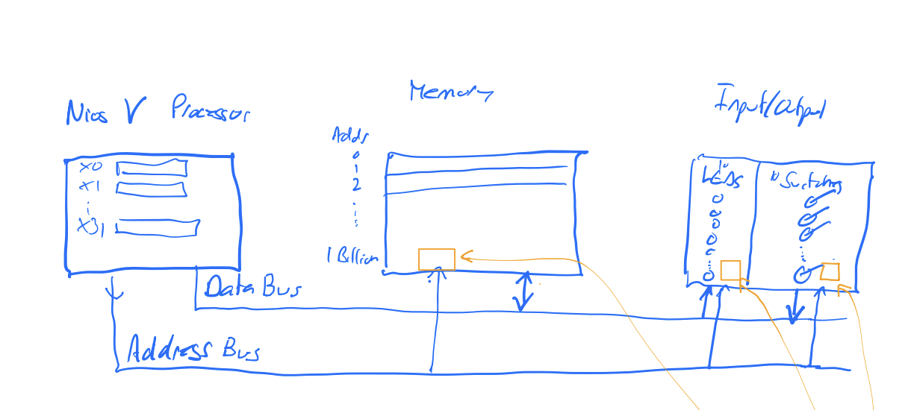
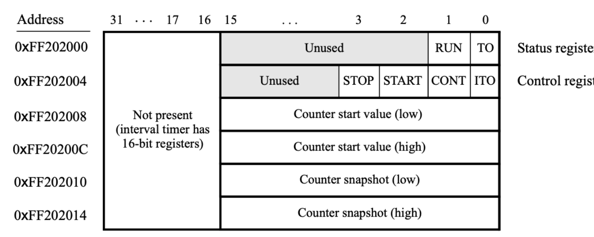
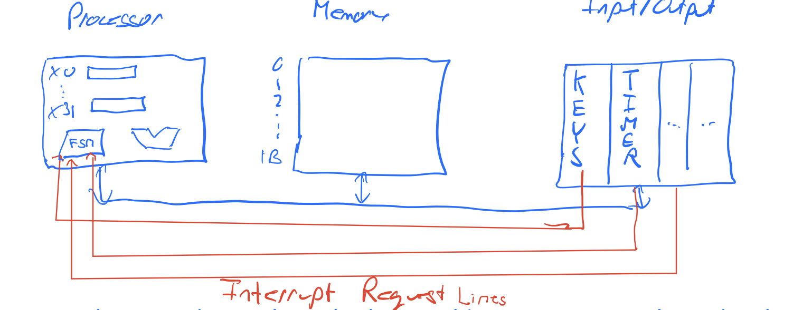
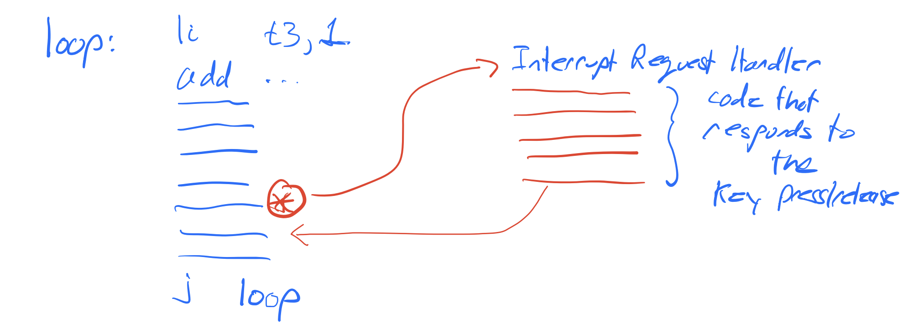
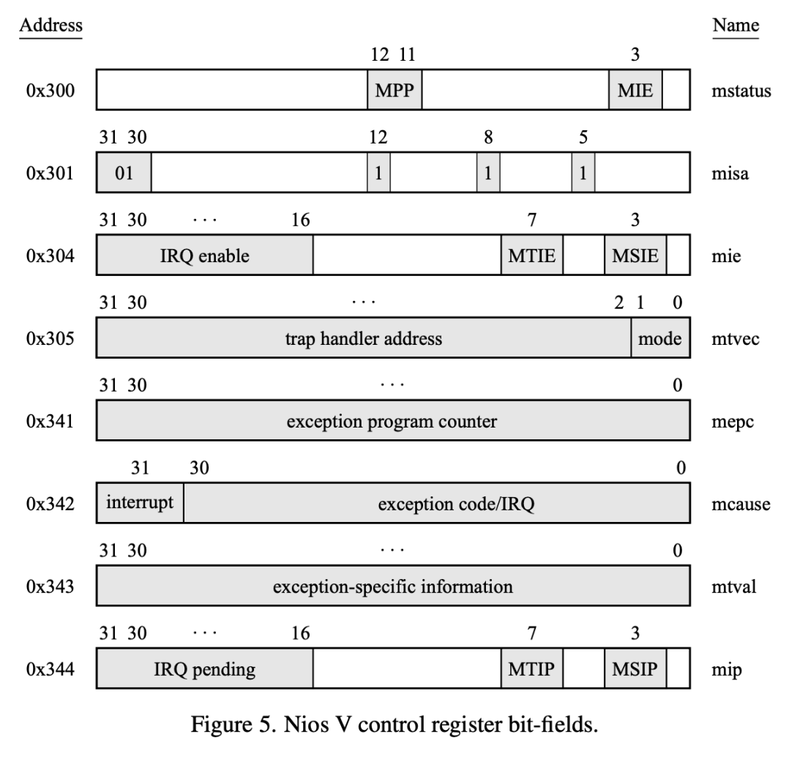
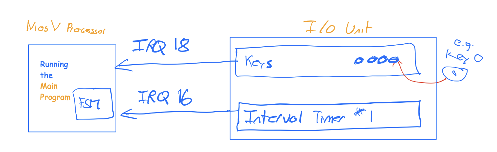

> Last Edit: 2/5/26

The Input and Output are the connection between the virtual world and the physical world

Recall on DE1-Soc Board, we have I/Os

- 10 LEDs
- 10 Slider Switches
- 4 Buttons
- 6 Seven Segment Displays

# Memory Mapped I/O

Recall the Computer Structure



The three main parts of Computer are communicating with the `Bus` , and there are address bus, which the `lw` will call when processor want to load something from the memory to the registers

The majority of address are associated to the memory that are being reserved for processors

- They are bing classified by a circuit (the orange box) before entering

While there are few of addresses that are mapped to connect to the Input/Output

---

For example, the state (ON/OFF) of LEDs are mapped to the low order 10 bits at address `oxFF20000` , and that is just what we called the memory mapped I/O

## Code Example: Using of I/O

```nasm
# Define hardware register addresses
.equ LEDs, 0xFF200000  # Base address for the 10 LEDs (Output)
.equ SW,   0xFF200040  # Base address for the 10 Slider Switches (Input)

_start: 
    la t0, LEDs        # Load the memory-mapped address of LEDs into register t0
    la t1, SW          # Load the memory-mapped address of Switches into register t1

# Main loop to synchronize switches and LEDs
# In Memory Mapped I/O, the hardware uses the address to determine if 
# lw/sw refers to actual memory or a hardware device.
loop: 
    lw t2, (t1)        # Read the current state of the 10 switches into register t2
    sw t2, (t0)        # Write the value from t2 to the LEDs, turning them ON/OFF

    j loop             # Jump back to 'loop' to repeat indefinite
```

# Memory in Subroutines

Recall the Nested Subroutines which used the `ra` register to store the return address, there’s actually an issue with the **Registers**

- If both the caller and the callee want to use one same register `t0` , then an overwrite will occur
- Thus we make rules for everyone and follows them

### Transmission of Parameters

Recall in C, the function prototype is `int Your_Sub(int a, int b){`

- This defines the input and output

### Argument Registers

In Assembly, to send parameters from caller to callee, we begin with first 8 parameters into register `a0, a1 … a7`

- If there’s more than 8 of them, then use the stack
- The caller is responsible for both the pushing and popping

While when returning, put to the `a0,a1 … a7` too

### Temporary Registers

---

The registers we frequently used `t0 - t6` are the Temporary, the **caller** is responsible to preserve them for use 

---

### Callee Saved Registers

As for the `s0-s11`, those are called the saved Register, that if the callee want to make use, they will need to

- Saved those on stack
- Then use them
- Make sure to restore everything before giving back to caller, so that for the caller, those are the same before and after calling

# Interrupt

In the previous code example, we used the way of polling to get the change of Keys, that is keep while loop to detect the change

This Polling method is bad as its keep wasting the processor source, so we need a better way, and that is just interrupt

---

Interrupt means that the processor will keep doing it own task, until some thing interrupt it 

# Special Registers

## Data Reg (`0xFF200050` )

Only the last 4 bits is valid

- Reflects the key status
- When Key 0 is pressed , the bit 0 set to 1
- When Key 0 released, then set to 0

## Edge Capture Reg (`0xFF20005C`)

Saved the pressed status

- If key 0 is pressed, then set key 0 to 1
- And it keeps to be 1 until Explicit Reset

This Reg is designed as the CPU’s operating rate might be slower than the press operation, thus we want to record that action of pressing

- To reset the bit to 0, send a 1 into it, otherwise it remains

---

## Detect the Key change

Thus there will be two ways for detecting the key change

- Data Reg
- Edge Capture Reg

### Polling using Data Reg

```nasm
.equ KEY_BASE, 0xFF200050  # Define the base memory-mapped address for the KEY pushbuttons

la  t0, KEY_BASE           # Load the base address of the KEY port into register t0

# Polling loop: Wait here until Key 1 is detected as pressed
poll:
    lw   t1, (t0)          # Read the current state of the Data Register into t1
    
    andi t1, t1, 0x2       # Bitwise AND with 0x2 (binary 0010) to mask all bits except Bit 1
                           # This isolates the status of Key 1

    beqz t1, poll          # If t1 is 0 (Key 1 is not pressed), branch back to 'poll'
    
    # Execution reaches this point only after Key 1 is pressed
```

### Polling using Edge Capture Reg

```nasm
.global _start

.equ KEY_BASE, 0xFF200050    # Base address for the Pushbutton KEY parallel port
.equ LEDs,     0xFF200000    # Base address for the Red LED parallel port

_start:
    la  t0, KEY_BASE         # Load address of the KEY port into t0
    la  t1, LEDs             # Load address of the LED port into t1
    li  t2, 0x1              # Initialize LED pattern: start with LED 0 turned ON

# Main polling loop to check for edge capture events
poll:
    lw   t3, 0xC(t0)         # Load the Edge Capture Register (offset 0xC from base) into t3
    andi t3, t3, 0x4         # Mask Bit 2 to specifically check the status of Key 2
    beqz t3, poll            # If result is 0 (Key 2 not pressed/released), continue polling

    # Reaching here means Key 2 was pressed and released
    sw   t2, (t1)            # Store the current pattern in t2 to the LED data register
    xori t2, t2, 0x1         # XOR with 1 to toggle the state of Bit 0 for the next press

    # Critical Step: Reset the Edge Capture bit
    li   t4, 0x4             # Prepare a value with Bit 2 set to 1
    sw   t4, 0xC(t0)         # Write 1 to Bit 2 of the Edge Capture Reg to clear it (Write-1-to-Clear)

    j    poll                # Return to the start of the loop to wait for the next event
```

# Hardware Timer

There are several ways to time

- Software Delay Loop: use loop to approximate time
    - Notice as CPU frequency change, this will change
- Hardware Timer: Use specific hardware for timing

There are two things needed, a **Crystal Oscillator** and a **Counter Reg**

## Example

Consider a counter with $100MHz$, it’s period is then

$$
T = \frac{1}{f} = \frac{1}{100 \times 10^6 \text{ Hz}} = 10 \text{ ns}
$$

To count to one, we will need

$$
100,000,000 \text{ times} \times 10 \text{ ns} = 1 \text{ s}
$$

which is 100 million times

So what we do is to start with 100 million and subtract one after each period

## On Memory

As indicated, the I/O are being mapped on Register, there’s a Internal Timer that has six memory-mapped Registers which are **16 bits** each

But we are operating everything in 32 bits, that means we need to do everything twice



After knowing the structure, here’s how to make it work

### 1. Split High and Low

Split Everything into high and low 16 bits

### 2. Set and Start

Change the Control Reg bit 2 (START) to 1, and bit 1 (CONT) to 1

- `START` : Start
- `CONT` : Repeat after count to zero

Can be done one simply write `0x6`

### 3. Polling

Polling to check if `T0 == 1` , if its true, then the time is up

### 4. Reset

Load 1 to `T0` to reset it

## Code Example: Hardware Counter

```nasm
# --------------------------------------------------------------------------------
# Program: LED Blinking with Hardware Interval Timer
# Platform: DE1-SoC (Nios V / RISC-V)
# Function: Toggles LED0 every 1 second using a 100MHz hardware timer.
# --------------------------------------------------------------------------------

.global _start

# Memory-mapped register addresses and constants
.equ TIMER_BASE,    0xff202000      # Base address of the Interval Timer
.equ LEDS,          0xff200000      # Base address of the Parallel Port for LEDs
.equ COUNTER_DELAY, 100000000       # 100,000,000 ticks = 1 second at 100MHz

_start:
    la      t5, TIMER_BASE          # Load timer base address into t5
    la      t6, LEDs                # Load LEDs base address into t6
    
    # 1. Initialize Timer
    sw      zero, 0(t5)             # Clear the TO (Time Out) bit in the Status register
    li      t0, COUNTER_DELAY       # Load the 32-bit delay value (100M) into t0

    # 2. Split and Store the 32-bit counter value into 16-bit hardware registers
    # The hardware requires writing the Low 16 bits and High 16 bits separately.
    sw      t0, 0x8(t5)             # Store bits [15:0] to Counter Start Value (Low)
    srli    t1, t0, 16              # Shift right by 16 bits to align the upper bits
    sw      t1, 0xc(t5)             # Store bits [31:16] to Counter Start Value (High)

    # 3. Configure and Start the Timer
    # We write 0b0110 (0x6) to the Control register:
    # Bit 2 (START) = 1: Starts the timer
    # Bit 1 (CONT)  = 1: Enables continuous mode (auto-reload)
    li      t0, 0b0110              # Load configuration bits
    sw      t0, 0x4(t5)             # Write to the Control register

    li      t2, 1                   # Initial state for LED0 (1 = ON)

tloop:
    # 4. Update the LED state
    sw      t2, (t6)                # Store the current value to the LED register
    xori    t2, t2, 1               # Flip the LSB of t2 (Toggle between 0 and 1)

    # 5. Polling Loop: Wait for 1 second to pass
ploop:
    lw      t0, 0(t5)               # Load the Timer Status register
    andi    t0, t0, 0b1             # Mask all bits except the TO bit (bit 0)
    beqz    t0, ploop               # If TO == 0, keep checking (timer still counting)

    # 6. Reset the Timer Status
    # Once TO is detected as 1, it must be manually cleared by writing 0 to it.
    sw      zero, 0(t5)             # Clear the TO bit for the next cycle
    
    j       tloop                   # Jump back to toggle LED and wait again
```

# Interrupts

Polling is a kind of Mindless Loop that keep the processor keep tracking the change of button

This executed a lot and has a very low efficiency 

## Interrupt-Driven Input/Output



In the Computer organization, there will be several wires called Interrupt Request Lines that directly interrupt the Processor

## Flow Chart



After getting the interrupt instruction, the main loop will first finish the current instruction, then goes to the Interrupt Request Handler and then come back 

One thing need to make sure is that we can’t **overwrite the registers that the main loop is using**, thus we have to find a way to store them

## mtvec Register

Under Nios V, we need to let FSM knows where to switch to when the interruption happens, and that’s provided by the `mtvec` Regester

`mtvec` having the full name of Machine Trap Vector, it stores the address of Interrupt Handler the main loop should jump to

- While interruption is included inside Trap, Exception is also a kind of trap

## mepc Register

If we are jumping into somewhere else, we also need to find the path to go back after the interruption handler finished, and `mepc` does that

Unlike the `pc` Register, `mepc` is called Machine exception program counter that specifically response for the Counter related to machines 

## Stack

As indicated, we always need to store registers on stack before going into interruptions, and restore it after jumping back

This need to be implemented manually by code

## Enable & Mask

Some details for interruption to works include

- Enable the Interrupt function (this will be include later) while making sure there’s no interruption happens between Enable the interrupt and setting the `mevec` , otherwise FSM doesn’t know where to jump to and will make it crush
- The Input will have their own instruction of where to go to

## Privilege

In real world, `mepc` has a large power, thus user normally can’t get such power

## Control Registers



## Interrupt Request



There will be wires from input to FSM to help it figure out which device is sending the interrupt

- Each Hardware is connected to its own IRQ

## The Interrupt Sequence

### Initialisation

Before Everything happens, we need initialize things first

1. Enable Interruption (still not covered yet)
2. Set up which device we want to used for interruption

---

Starting with the Instruction `*` , so the interrupt happens since

1. The external hardware will pull up the IRQ wire to `1` to request the interrupt
2. Processor check `mstatus` reg to see the `mie` is 0 or 1
3. Check the `mie` reg to see if the required device is being enable
4. Set `mstatus.MIE` to zero to avoid interruption during interrupt
5. First the processor will finish the current instruction `*` 
6. Then store the next address into the `mepc` Register
7. Store the reason for interruption to `mcause` 
8. Looking at the `mtvec` Register to find the address of interrupt handler

---

Since now we have jump into the Handler

1. goes to the address `mtvec` is pointing to
2. Stack Protection, we store every register used in main loop into stack
3. Execute things inside the Handler

---

Then comes to the return stage

1. `mret` run, change the `pc` to address in `mepc`
2. Reset `mstatus.MIE` to 1

## Control and Status Register Command

Similarly, those special registers in memory can’t be operated by normal instructions, instead they should be called by `csr`, commonly seen commands are

- `csrr` : Read
- `csrw` : Write
- `csrs/csrc` : Set/Clear

## MIE Register

Machine Interrupt Enable Register, is correspond to the IRQ, setting the given digit to one can make the Interruption for that hardware enable

## Code Example

```nasm
/* The simplest interrupt-driven program:
 * When Push button Key 1 is pressed, cause an interrupt
 * Each time, Toggle LED 3. (i.e. go on and off with each Key 1 press) */
.global _start
_start:

.equ LEDs, 0xFF200000
.equ KEY_BASE, 0xFF200050

    la sp, 0x20000        # Initialize the Stack Pointer

    csrw mstatus, zero    # turn off bit 3 of mstatus -
                          # disable processor interrupts
    #(in case it was on, just being cautious, while we set everything else up)

# Now, enable interrupts from the KEY device,
# using the Interrupt Mask Register: Bit i of mask register on means
# cause an interrupt when edge capture bit i goes to a 1
# This tells the device when to *request* an interrupt on wire IRQ18

    la t1, KEY_BASE       # address of KEY registers base into t1
    li t0, 0b0010         # just want bit 1 -> Key 1 to have enabled interrupts
    sw t0, 8(t1)          # Set interrupt enable in interrupt mask for Key 1 -
                          # i.e. have it request an interrupt when edge on key 1

    sw t0, 12(t1)         # clear Edge Capture bit of Key 1 in case it is already on

# Enable interrupts from the processor side - enabled in 2 ways:
    li t0, 0x40000        # 0x40000 corresponds to bit 18 of 32 bit word being 1
                          # (The Keys request interrupts on line 18)

    csrs mie, t0          # this sets bit 18 of the MIE to 1,
                          # enabling interrupts specifically from KEYs

    la t0, interrupt_handler # put addr of interrupt handler routine into t0
    csrw mtvec, t0        # set MTVEC to contain that address -
                          # so proc knows where to go when interrupt happens

    li t0, 0b1000         # turn on bit three of register t0
    csrs mstatus, t0      # use it to turn on bit 3 of MSTATUS -
                          # the MIE bit to enable processor interrupts

Main_loop: 
    li t0, 1              # this loop doesn't do anything except set t0
                          # and t1, and we can check that the
                          # interrupt program doesn't disturb them
    li t1, 2
    j Main_loop           # Just do that over and over

/* this is where the processor will execute when interrupt occurs: */

interrupt_handler:        # Note that, upon an interrupt,
                          # the MIE bit in MSTATUS is set to 0,
                          # preventing a further interrupt.
    # First reserve room on the stack for three words (3 words x
    # 4 bytes/word = 12) for the three registers we'll use t0, t1 and ra
    addi sp, sp, -12
    sw t0, 0(sp)          # Push t0 onto the stack
    sw t1, 4(sp)          # Push t1 onto the stack
    sw ra, 8(sp)          # Push ra onto the stack

    li t0, 0x7FFFFFFF     # Next, check if the interrupt was caused
                          # by devices we were expecting (KEYS in this case)
                          # by looking at the code placed into the low 31 bits of MCAUSE
    csrr t1, mcause       # read MCAUSE into t1

    and t1, t1, t0        # "zero out" bit 31 (leave every other bit the same)
    li t0, 18             # code for KEYs in MCAUSE should be 18
    bne t1, t0, end_interrupt # if MCAUSE low 31 bits aren't 18,
                              # something's wrong, just return

    call KEY_ISR          # otherwise call the KEY interrupt service routine

# restore the registers that were used back from the stack
end_interrupt:
    lw t0, 0(sp)
    lw t1, 4(sp)
    lw ra, 8(sp)

    addi sp, sp, 12       # move the stack pointer now that we've copied the values

    mret                  # return from interrupt -
                          # this copies the MEPC register into the PC
                          # it also restores the MIE bit back to be 1, re-enabling interrupts

KEY_ISR:
    la t0, KEY_BASE       # gets keys port address into t0
    lw t1, 12(t0)         # Load the edge capture register and check
                          # if it is Key 1 pushed (just checking)

    andi t1, t1, 0b0010
    # ... (Note: The provided images end here, the rest of the ISR to toggle the LED is missing)
```