> Last Edit: 3/10/26

The former course is about to use Assembly and C language to view the processor in terms of a programmer, now the course has been switched into view processor hardware using digital design knowledge

# Computer Architecture

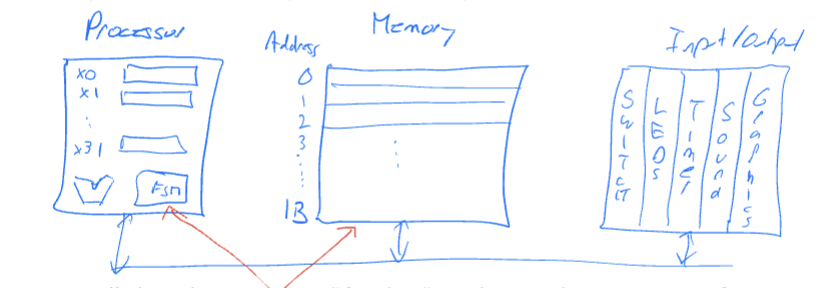

Recall the architecture we have, what the processor does is

1. Fetch from the memory to get Machine Code instructions
2. Execute the instructions
3. Interact with memory

---

Now we are going to use logic gates to rebuild this

# Simple Processor Design

The processor we are working on will be a 8 bit one, with one 4 Registers, `R0 - R3` 

- By setting the processor to 8 bit, it means that its word size is 8 bits
- As the memory address also only have 8 bits, thus there’ll be $2^8=256$ memories
- The same applies to `pc`

## Instruction Set

There’s gonna be 10 kinds of instruction, with also fixed size of 8 bits

- And the instruction is going to look like `add R1, R2 # R1 = R1 + R2`

## Condition Flags

There’s going to be two 1 bits flag

- **Z Bit (Zero)**: If the last instruction result is zero, `z = 1` , else is `z = 0`
- **N Bit (Negative)**: If the last instruction result is negative, `N = 1` , else `N = 0`

> Nios V doesn’t use this method
> 

# Datapath

Before starting, here’s some part of the processor that we have to get

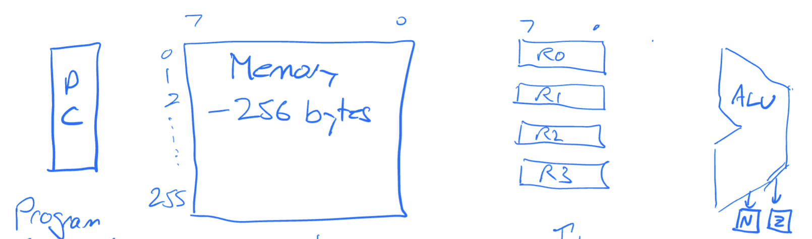

- PC
- Memory
- Register
- ALU

## Data Flows

### Fetch Path

- Starting from `pc` , it send the required address to `memory`
- Then `memory` output the Instruction to `Instruction Register`  and `Memory Data Register`

### Execution Path

- Then `Register File` will choose to read one of `regA` and `regB`
- Then using `Multiplexers` to decided which data to pass through
- Lastly use `ALU` to get the final result

# Instruction Formats

As indicated, there’s 8 kinds of instructions, where they can be extracted into two types

## Reg - Reg ones

The operation between two Registers, i.e. `add R1, R2` , inside the instruction, there will be 

- `Opcode` (4 bits): Choosing operation
- `regA` (2 bits): Target Register
- `regB` (2 bits): Source Register

## Immediate ones

The operation between Register and Constants, i.e. `addi R1, 5` 

- `Opcode` (4 bits): Choosing Operation
- `regA` (2 bits): Target Register
- `regB` (2 bits): Immediate Number (Notice the range is $2^2$  which is $0-4$

## Semantics

Regardless of `add Ra, Rb`  or `sub Ra, Rb` , they are having similar operations

### Arithmetic Operation

Calculate the operation result first

### Flags

Then update two status bits, `Zero`  and `Negative`

---

Then update `pc = pc + 1` 

## Encoding of Machine Code

**One instruction** will be extract into **three parts in a 8 bit Register**

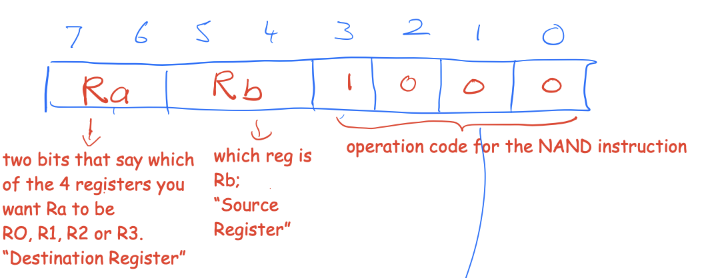

## Or immediate Operation

The General Form of Or Immediate Operation is `ori imm5` , notice

- There’s **NO Given Register** for this command
- There’s **5 bits on immediate number**

---

Firstly the **Register issue**, we fix the Register of this operation to `R1` to **save two 2 bit of space**

Secondly, as there’s **only 3 bits for Opcode** and it’s `111` ,thus we have **5 bits for this constant**

---

### Execution Steps

1. $R1 \leftarrow R1 \ OR \ ZE(Imm5)$
    - Here `ZE` means Zero Extend, **add three zero in front of 5 immediate to make it 8 bits**
2. Update the `Z` and `N` bit 
3. Update `PC` : $PC \leftarrow PC + 1$

### Ex. ori 0x7

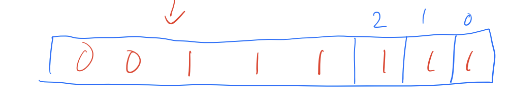

# Memory Instructions

There’s two Memory Instructions used `load` and `store` , it’s similar to `lw` and `sw` , but notice for the Memory Instructions, the `Z` and `N` bit won’t be set **as there’s no ALU logic**

## Load Operation

The general form of **Load Operation** is `load Ra, (Rb)` , and will be encoded in the form of

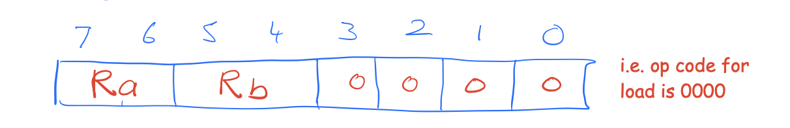

## Store Operation

The general form of Store Operations is `store Ra, (Rb)` , will be encoded in the form of

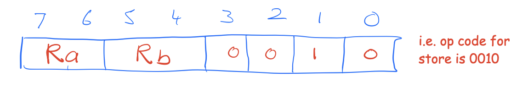

# Conditional Branches

Recall the instruction `bne r5, r0, loop` , this is a **branch if not zero instruction**, that branch to a different address (other than `pc+1`) if result of **last operation in ALU is not zero**

In this Simple Processor, we can tell this by using the `Z` bit, thus here’s the full step for Branch

---

Running the instruction `bnz Imm4` 

1. Check the `Z` bit, if `Z == 0` (The result is not zero), then **JUMP**
    1. If `Z == 1` (The result is zero), then `PC <- PC + 1` 
2. Jumping process is **using an offset** that `PC <- PC + SE(Imm4)` , here `SE` is Sign Extension
3. Here we are using Relative Addressing

---

This having the Encoding of

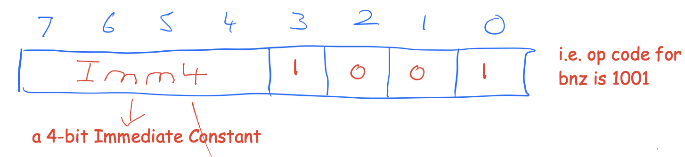

There’s up four bits for `Imm4` - **4 bits constant**, and lower 4 bits `Opcode` with `bnz = 1001` 

While there’s also an Instruction `bpz imm4` which is Branch if Positive with `Opcode` of `1101`

# Design Example

Here’s a full code **comparing two value in Memory and see if they subtract to zero**

| **Address** | **Label** | **Instruction** | **Comment** | **Encoding** |
| --- | --- | --- | --- | --- |
| **0** | loop: | `load R2,(R0)` | `R2 <- [R0]` | `0x80` |
| **1** |  | `load R3,(R1)` | `R3 <- [R1]` | `0xd0` |
| **2** |  | `sub R2, R3` | `R2 <- R2 - R3` | `0xb6` |
| **3** |  | `bnz loop` |  | `0xd9` |

The hardest thing here is to calculate `Imm4` for Encoding `bnz` , notice `loop` is at address `0` , when running til `bnz loop` , `PC` is already `3` m thus we want 

$$
PC + Imm4 = Target\rightarrow3 + Imm4 = 0
$$

Thus we get $Imm4 = -3$, in **2’s Complement,** -3 is just `1101` , thus this Encoding code will be `1101 1001 = 0xd9`

<aside>
❗

**Notice in this part, PC is pointing to current Instruction address instead of next instruction’s** 

</aside>

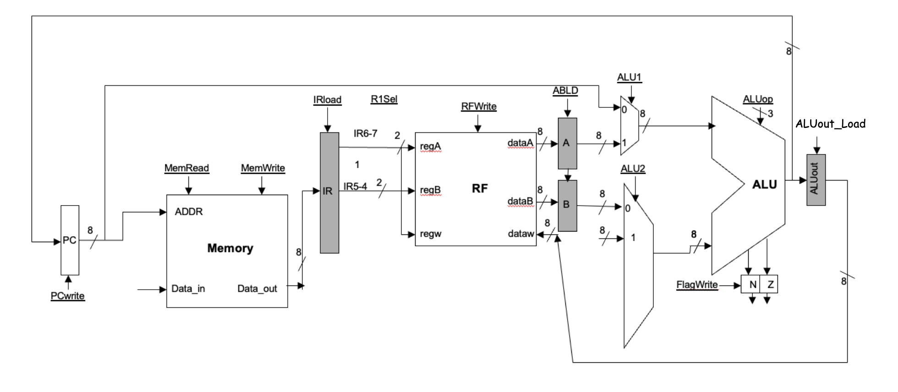

## Register

Recall the implementation of a **Register**, its fundamental unit is a **D** **Flip-Flop**

### D Flip-Flop

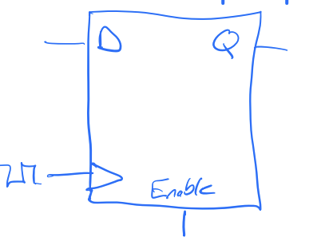

This Flip-Flop contains an `input D`, `output Q`, `clock` and a `Enable` , this Flip-Flop will update when there’s a positive edge of clock, then check if `Enable = 1` , then `Q <- D` , otherwise the `output Q` will remains the same

In this Processor, as we indicated is a 8 bit register, there’s gonna be 8 Flip-Flops together, sharing the same `Enable`  and `Clock`

The `Clock` ’s frequency depends on the device we are running at, its $50MHz$ for Nios V, and $2GHz$ for normal computers

## Multiplexer

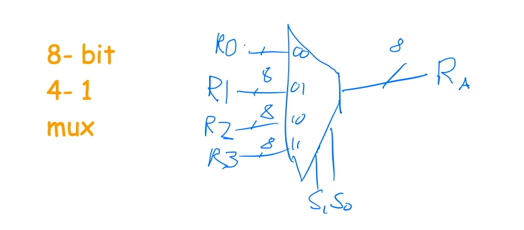

# Instructions

## add

Recall the execution of the add instruction `add Ra, Rb # Ra <- Ra + Rb` , with the encoding of 

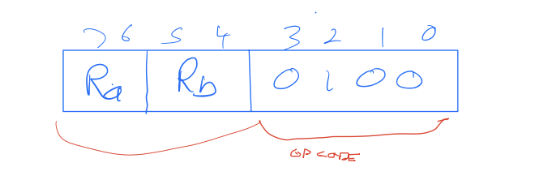

Suppose the `add R1, R2` is being coded into `01 10 0100` , which is `0x64` in HEX, and this instruction is stored at address `0x05` , there’ll be six steps for this instruction

1. Fetch: Read from memory of what `PC` is pointing to, then activate `MemRead` and `IRLoad` 
2. Decode: Recognise which instruction is inside
3. Read: Read the value of `R1` and `R2` , turn on `ABld` 
4. Compute: Set the `ALUop` into additional mode, and calculate `ALUout = R1 + R2` , the signals are `ALU_A = 1` , `ALU_B = 0` , `ALULoad = 1` . After computed, set the `Z` and `N` bit based on the result (need to enable `Flagwrite = 1` )
5. Write: Write back the result of `ALUout` back to `Ra` (`RFwrite = 1` )
6. Compute PC: Update the `PC` 

## sub

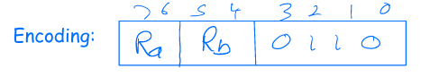

1. **Fetch** and Increment PC: `MemRead=1` , `PCwrite=1`
2. **Decode** & register fetch
3. **Compute**: Use `ALU_Op=001` to tell ALU to do subtraction, and store it in `ALUOut` , at the same time, it will update the `Flags` ( zero or negative)
4. **Write**: `RFWrite=1` 

## OR Immediate

Unlike `sub` , there’s a `Immediate Value` now, and it requires one more period than `sub` 

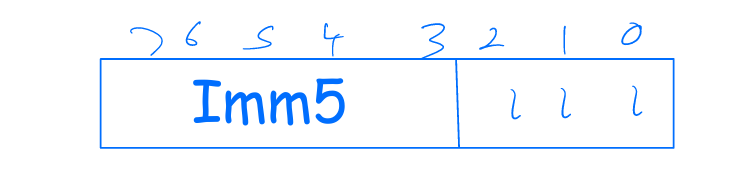

1. Fetch: Then same, active `MemRead` , `IRload`  `PC <- PC + 1 ALU_A=0, ALU_B=1, ALU_Op = add = 001 PCwrite=1` 
2. **Decode & register fetch**:  Read `Ra` and `Rb` from the Register File  
- 这次读取是**浪费的 (Wasted)**
- 对于 `ori` 指令，我们需要读的是寄存器 `R1`（通常对应编码中的某个位置），而硬件逻辑在这一步还没准备好。

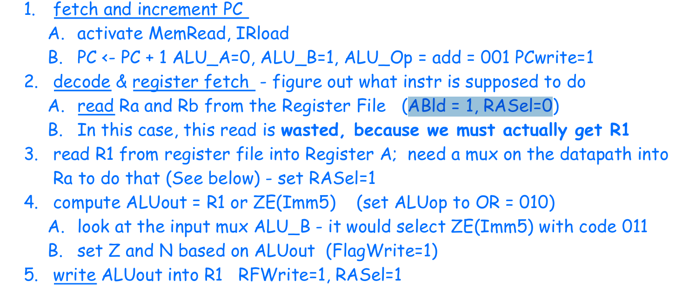

## Load

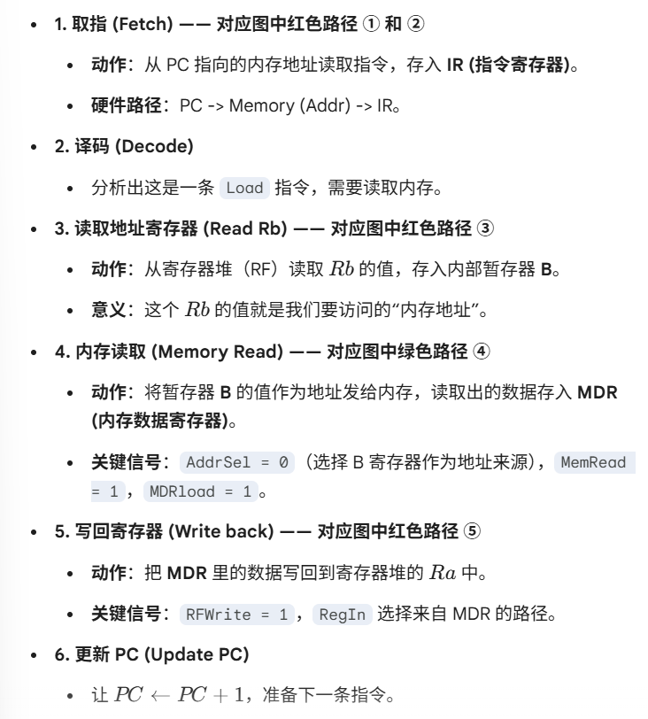

## Store

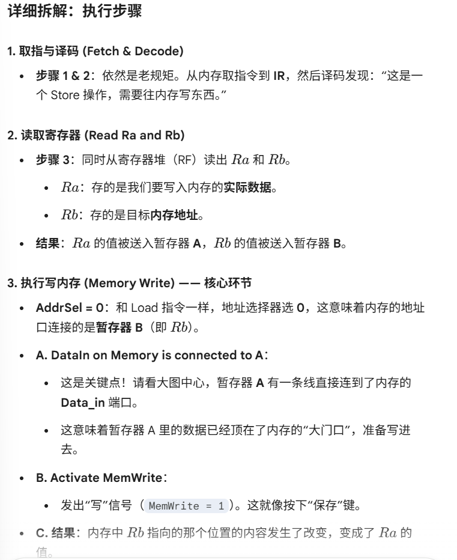

## BNZ

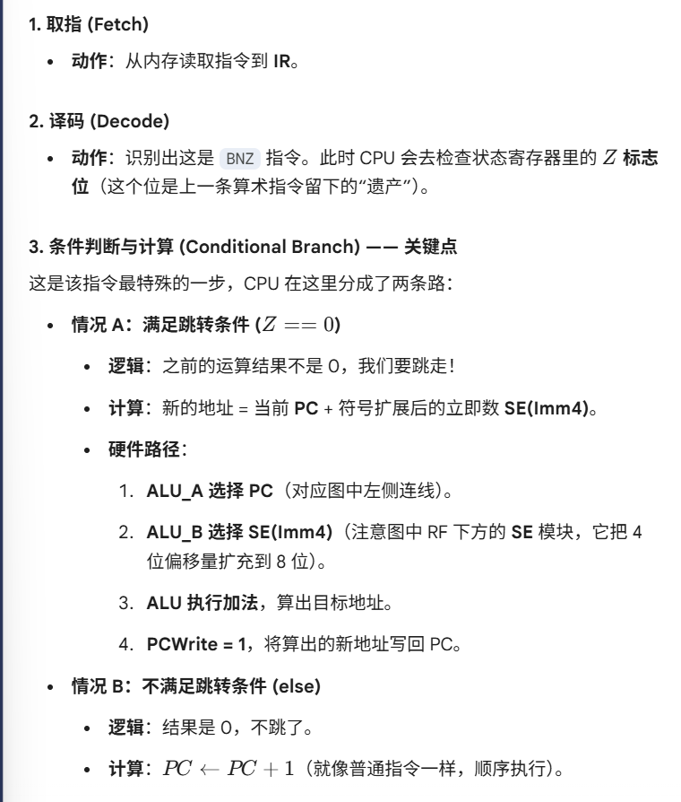

## Shift L/R Ra, Imm2

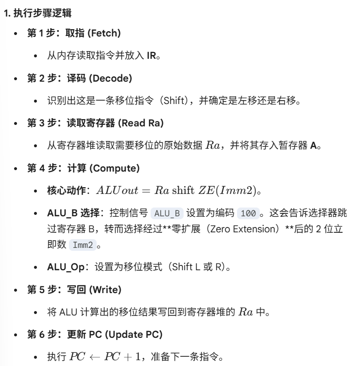

# FSM Cycles

## Load

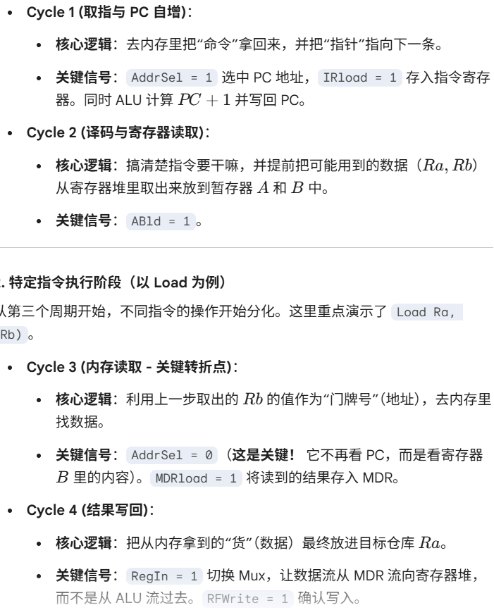

## BNZ Imm4

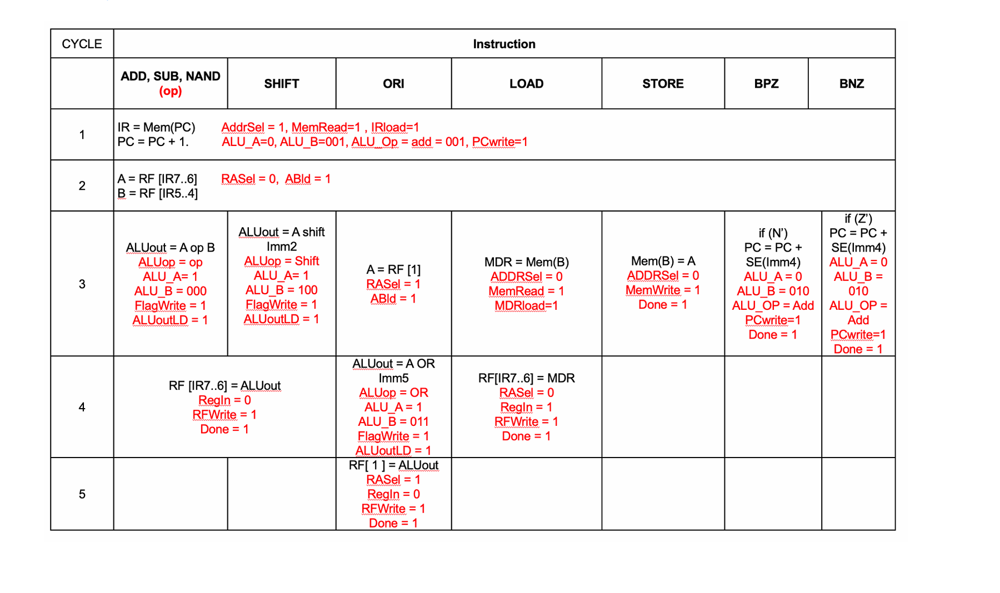

# Processor elements

## Register File

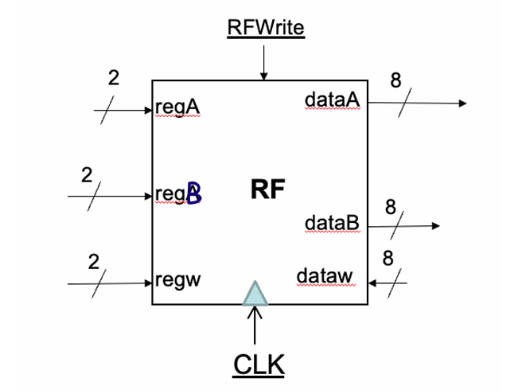

- 通过 `regA` 和 `regB` 两个 2-bit 输入信号，分别从 `dataA` 和 `dataB` 端口同时输出两个 8-bit 数据
- 通过 `regw`（2-bit）选择目标寄存器，在 `RFWrite` 信号有效且时钟 `CLK` 到达时，将 `dataw`（8-bit）的数据写入

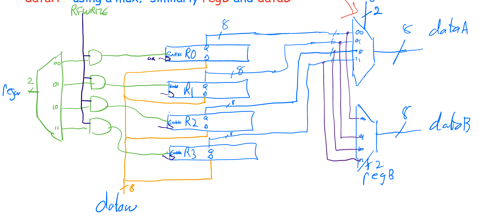

- `regA` 信号作为上方 Mux 的选择端，决定 `dataA` 输出哪个寄存器的值
- `regB` 信号作为下方 Mux 的选择端，决定 `dataB` 输出哪个寄存器的值
- 左侧的 2-bit 输入 `regw` 连接到一个译码器，将其转换为四条选通线（00, 01, 10, 11）。
- 每条选通线与 `RFWrite` 全局信号通过一个 **AND 门** 相连。
- **使能控制**：只有当 `RFWrite` 为 1 且译码器选中该寄存器时，对应寄存器的 **Enable（使能）** 端才会被激活。
- **数据输入**：`dataw`（橙色线）连接到所有四个寄存器的输入端，但只有被使能的那个寄存器会在时钟触发时保存该值

## ALU

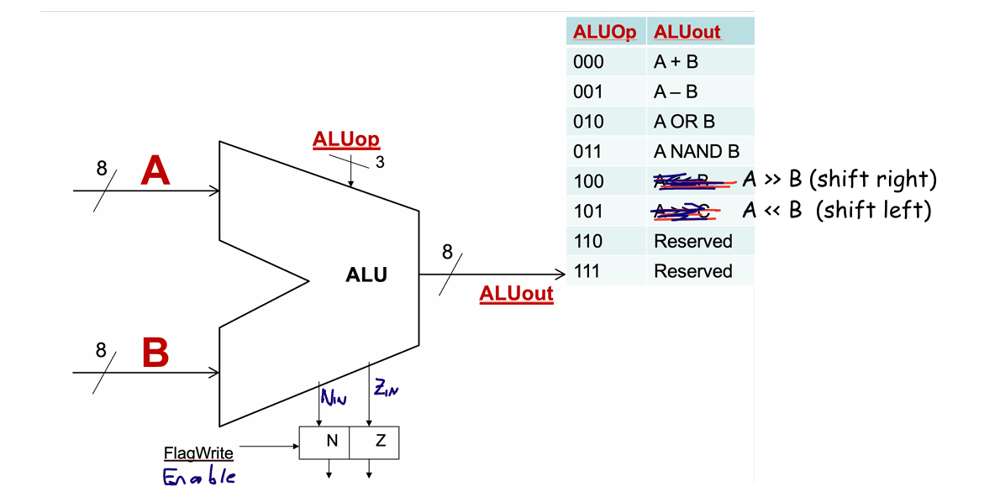

- **输入输出**：拥有两个 8-bit 输入端口（**A** 和 **B**），一个 8-bit 输出端口（**ALUout**）。
- **控制信号**：`ALUop` 是一个 3-bit 的选择信号，决定当前的运算类型

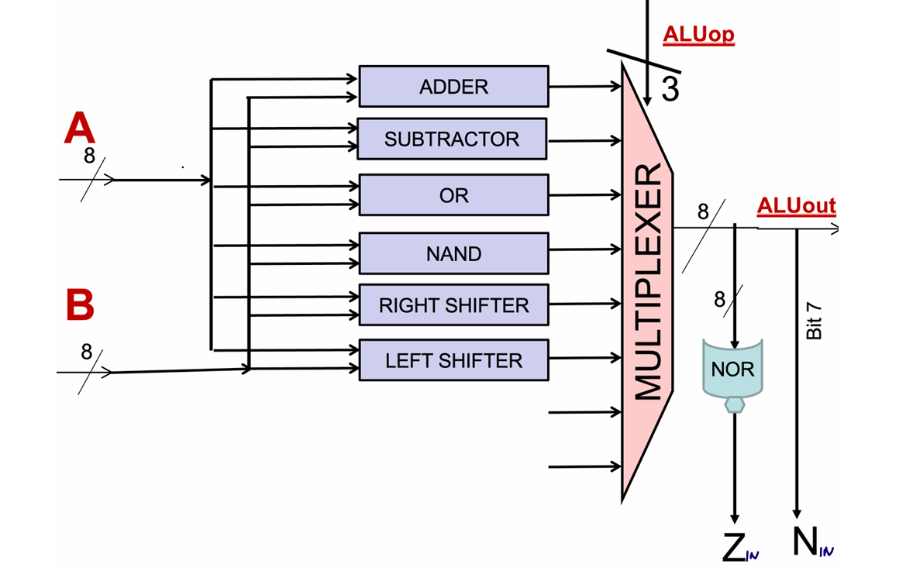

- **并行运算层**：输入 A 和 B 同时进入所有的运算模块（加法器、减法器、或门、与非门、移位器）。这意味着**所有运算是同时发生的。**
- `ALUop` 信号连接到 Mux 的选择端。它的作用是从上方所有运算模块的结果中，**只选出一个**作为最终的 `ALUout` 输出

## FSM & Memory

- **读 (`Memread = 1`)**：地址输入后，数据在**同一个时钟周期**内从 `DATAout` 输出。
- **写 (`MemWrite = 1`)**：地址和 `DATAin` 输入后，数据在**时钟周期结束时**完成更改。