> Last Edit: 4/25/26

# Physics of Memory

- 存储容量越大，访问速度越慢
- 进行一次主存访问大约需要消耗 **300 个处理器时钟周期**。这意味着如果没有优化，处理器在执行一条加载指令（如 `lw`）后需要闲置等待 300 个周期，软件运行将极其缓慢
- 为了解决上述矛盾，课件提出了核心洞察：**小容量存储器比大容量存储器快。**
- **解决方案：** 在处理器和主内存之间放置一个“小而快”的存储器，即 **Cache**。
- **工作机制：** 将**当前活跃（currently active）**的内存位置保留在 Cache 中，从而确保处理器发出的内存请求能得到快速响应。

# Cache Memory

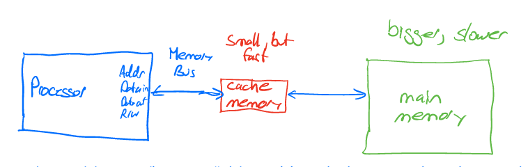

## Locality of Reference

缓存之所以有效，是因为大多数软件程序在特定时间内只使用主内存中有限的一部分数据。

- **定义：** 处理器的读写操作（引用）在程序执行的较长时间内，往往集中在有限的一组地址范围内。
- **空间局部性 (Spatial Locality)：** 指被访问的内存单元在**地址空间上相互邻近**（即访问了某个地址，很快可能会访问其附近的地址）。
- **时间局部性 (Temporal Locality)：** 指同一个内存单元在**时间上被重复访问**（即刚才访问过的数据，很快又会被访问）。

## Logic of Cache

### 1. 缓存读数据的操作逻辑

当处理器请求读取地址 **A** 的数据时，流程如下：

- **情况 A：缓存缺失（Cache Miss）**
    - 缓存中没有地址 A 的副本。
    - **动作：** 缓存向主内存请求地址 A 的数据，并**同时请求 A+1, A+2, A+3**（这是一种基于未来可能需要的“猜测”）。
    - **结果：** 内存（缓慢地）做出响应。缓存将 A 的数据传给处理器，并将 A 到 A+3 的所有数据存入自己内部。
    - **评价：** 这个过程很慢，设计目标是尽量减少其发生频率。
- **情况 B：缓存命中（Cache Hit）**
    - 缓存中存有地址 A 的值。
    - **动作：** 缓存直接将数据发送给处理器。
    - **效率：** 仅需 **1 或 2 个处理器周期**。
    - **评价：** 速度极快，设计目标是让这种情况占据绝大多数时间。

# Direct-Mapped Caches

## Blocks of Bytes

**基本原理：** 当缓存向主存（MM）请求数据时，它请求的是连续的一组字节，而不仅仅是一个地址。

- **内存组织：** 主内存被划分为多个 **Block**。
- **示例：** 假设块大小为 **16 字节**：
    - **Block 0：** 包含字节 0 - 15
    - **Block 1：** 包含字节 16 - 31
    - **Block 2：** 包含字节 32 - 47

## The Direct-Mapped Cache

课件开始引入最简单的缓存结构：

- **结构视图：** 可以将缓存想象成由“行”和“列”组成的表格。
- **Cache Line（缓存行）：** 缓存中的每一行称为一个 **Cache Line**。
- **对应关系：** 每一个缓存行包含的字节数与主内存的块大小**完全相同**。
- **术语区分：** * 在主内存（MM）中，这一组字节被称为 **Block**。
    - 当这组字节存入缓存后，它驻留在 **Cache Line** 中。
    - **核心结论：** MM 块大小（Block size）永远等于缓存行大小（Cache line size）。

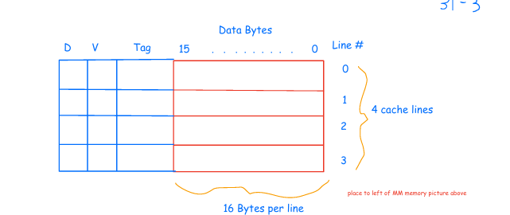

课件提出了一个架构上的关键问题：主存块（MM Block）允许驻留在缓存的什么位置？

- **规则：** 在直接映射缓存中，一个特定的 MM Block 只能进入**一个特定的缓存行**。
- **优点（Good）：** 查找非常简单，处理器只需要检查一个固定的地方。
- **缺点（Bad）： 由于缓存行很少，不同的主存块会争抢同一个位置，导致频繁的“踢出（Kicked out）”操作。**
- Tag 来记录**当前这里住的到底是哪位**

<aside>
❗

排序方式类似 Hash Table

</aside>

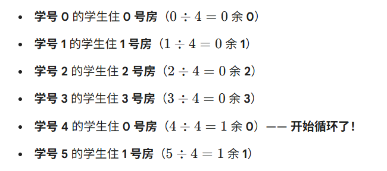

<aside>
❗

一个块 **16 Bytes**，一个 Word 则是 4 Bytes，所以一个 Block 中有 4 个 Words

</aside>

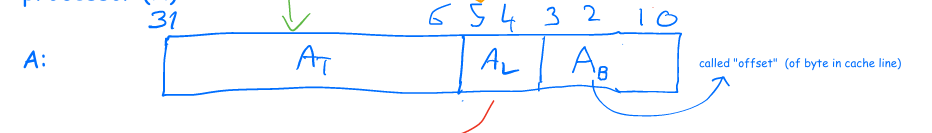

### Ex. `0x00000054`

我们将十六进制地址展开为 32 位二进制（重点看最后 8 位）：`0000 ... 0000 0101 0100`

- **右边第 1-4 位（Offset）**：`0100`（十进制的 **4**）
    - **意义**：这告诉处理器，你要的数据在这个 16 字节块里的**第 4 个字节**位置。
    
    <aside>
    ❗
    
    Offset 告诉了一个 Word 在 block 中的位置
    
    </aside>
    
- **中间第 5-6 位（Index）**：`01`（十进制的 **1**）
    - **意义**：这对应 $j \mod 4$ 的结果。它告诉硬件：这个地址**只能**存放在缓存的 **Line 1**（2 号房）。
- **左边剩余所有位（Tag）**：`0000 ... 01`
    - **意义**：这是这个块的“唯一身份证号”。硬件会把它存入 Line 1 的 **Tag** 区域。

## Processor Read Access

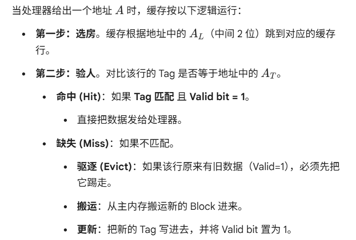

## Write Policies

- 当一个新的块要进来，必须踢走旧的行时，我们需要考虑：**这个旧行在“住在缓存期间”，有没有被处理器修改过（**即执行了 Store 操作）？
- **逻辑**：
    - **如果没改过**：直接扔掉，因为主内存里还有一份一模一样的。
    - **如果改过**：不能直接扔，否则你的修改就丢失了！必须先把它写回主内存。

### Dirty Bit

- **定义**：这就是每个缓存行里 **Dirty bit** 的用途。
- **规则**：
    ◦ 一旦缓存行中**任何一个字**被修改，Dirty bit 就会被置为 **1**。
    ◦ 在驱逐时，硬件会检查这个位。如果 $D=1$，则将该行内容复制回主内存。

| **策略** | **Write-back（写回法）** | **Write-through（写直方法）** |
| --- | --- | --- |
| **核心逻辑** | 仅在被驱逐且“变脏”时才写回内存。 | 每次处理器写缓存时，**同步**写回内存。 |
| **脏位需求** | **需要**（用来标记是否被改过）。 | **不需要**（内存永远是最新的）。 |
| **性能** | **快**（减少了访问慢速内存的次数）。 | **慢**（如果写入频繁，主存访问会成为瓶颈）。 |

## Hit Rate

- **Supermarket (超市) = Main Memory (主存)**：货全、量大，但距离远，去一趟很慢。
- **Fridge at home (家里的冰箱) = Cache (缓存)**：容量小，只能装常用的食物，但在厨房伸手就能拿到，速度极快。

**理想状态**：如果能把处理器想要的数据大部分都提前放进缓存，程序就会运行得飞快。**命中率公式**

$$
\text{Hit Rate} = \frac{\text{命中次数 (\# hits)}}{\text{总访问次数 (\# accesses)}}
$$

## Reprise of Read Access

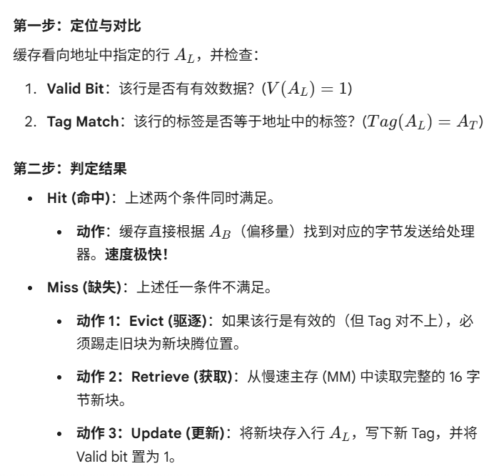

## Ex. Hit and Miss

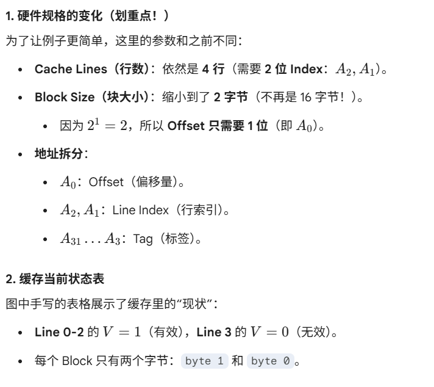

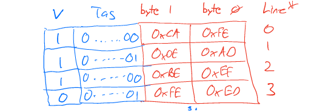

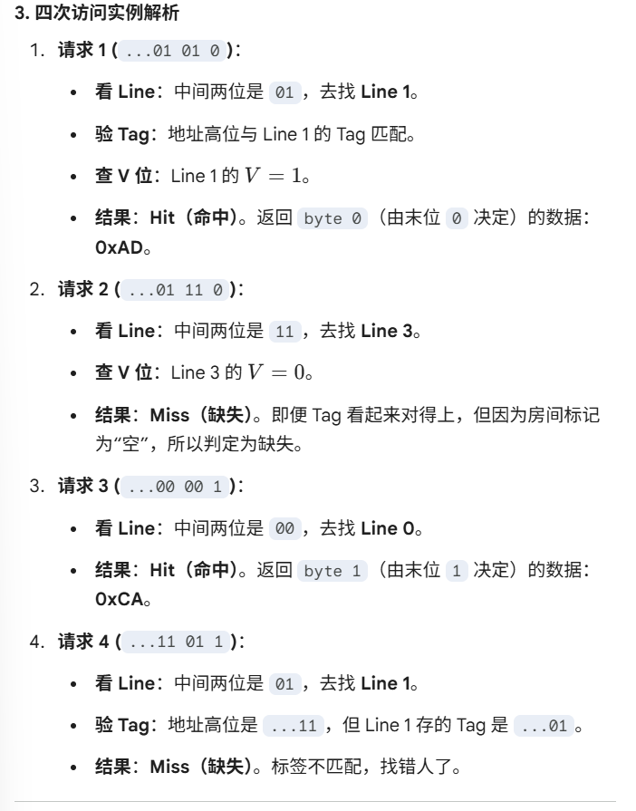

# Associative Caches

## Direct-Mapped 的优缺点

**规则**：每个主存块（MM Block）只能存放在**唯一固定**的一个缓存行（Cache Line）中

- **Good（优点）**：硬件实现简单、速度快。处理器只需要看一个地方就知道数据在不在。
- **Bad（缺点）**：容易发生**冲突（Conflict）**。如果两个常用的块不幸映射到了同一个行，它们就会不停地互相“踢出（Eviction）”，导致性能大幅下降

## Fully-Associative Cache

- **规则**：每个主存块可以存放在**任何（Any）**缓存行中。
- **Good（优点）**：极大地减少了冲突。只要缓存还有空位，新块就能住进来，不需要踢走别人。
- **Bad（缺点）**：**硬件极其昂贵**。
    - 处理器不能再“一跳直达”，而是需要**同时搜索（Search）**整个缓存。
    - 需要大量的**比较器（Comparators）**并行工作，同时对比地址 Tag 和缓存里所有的 Tag

## M-way Set-Associative Cache

由于直接映射太死板，全关联太贵，于是有了这个“中间地带”：

- **规则**：将缓存分成若干组，每个主存块被限制在一组较小的缓存行集合中（即 **M 个位置**）。
- **术语**：如果一个块可以放在 M 个不同的位置，就叫 **“M 路组相联”**。
- **常见值**：M 通常为 2 到 16（而总缓存行数可能有成千上万个）

### Ex. Example of M-way Set-Associative Cache

课件给出了一个具体的缓存配置，我们需要通过计算来还原它的“设计图”：

- **Cache 总容量**：$32\text{ KB}$（即 32,768 字节）
- **每行大小 (Line Size)**：32 字节（意味着 MM Block 也是 32 字节）。
- **关联度 (M)**：4-way（即每组有 4 条行）。

### **2. 结构推导计算**

通过以上三个参数，我们可以得出：

1. **总行数 (N)**：$32\text{ KB} \div 32\text{ Bytes/Line} = 1,024$ 条行。

2. **组数 (Sets)**：$1,024\text{ Lines} \div 4\text{ Lines/Set} = 256$ 组。

- 意味着缓存被分成了 **Set 0** 到 **Set 255**。
- **规则**：任何特定的 MM Block 只能进入它对应的那个 **Set**，但在该 Set 内的 **4 个车位（Lines）** 中可以随便停。

### **3. 映射逻辑图示**

右侧的手绘图展示了这种多对多的映射：

• **MM Block 0** 映射到 **Set 0**。但在 Set 0 内部，它有 4 个位置（Line 0, 1, 2, 3）可以选择。

• 同理，**MM Block 256** 也会映射到 **Set 0**（因为 $256 \mod 256 = 0$）。

• **对比**：在直接映射中，Block 0 和 256 会打架；但在 4 路组相联中，如果 Block 0 已经占了一个位，Block 256 进来时可以坐剩下的 3 个位中的任何一个。**冲突大大减少！**

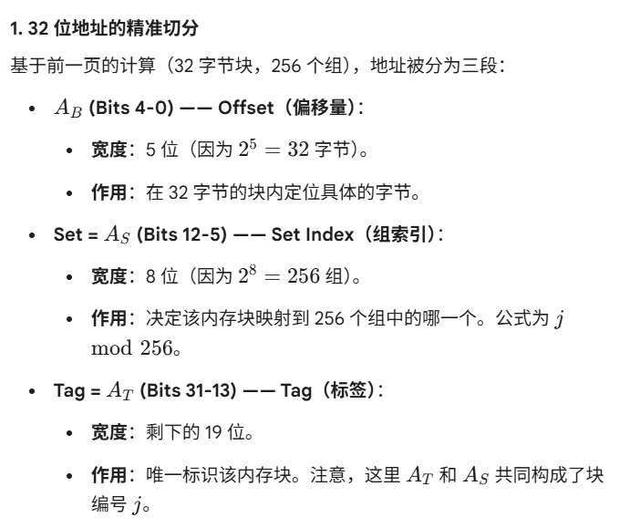

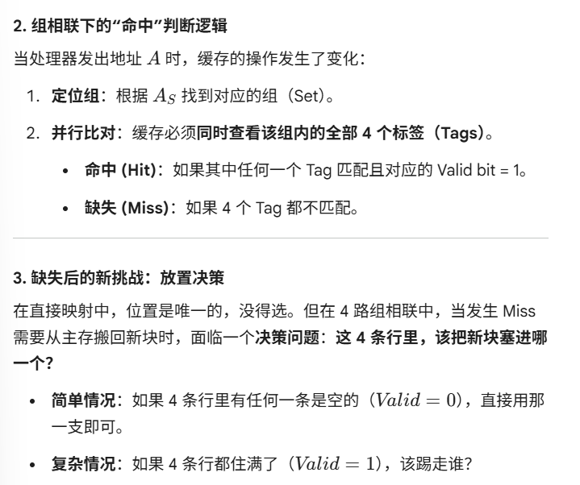

## Cache Replacement Policies

<aside>
❗

如果一个组（Set）里的 4 个位置都住满了，新数据进来时到底该**踢走谁**

</aside>

### LRU 算法：最近最少使用 (Least Recently Used)

它的逻辑是：**如果一个数据很久没被访问了，那它未来被访问的概率也很低**

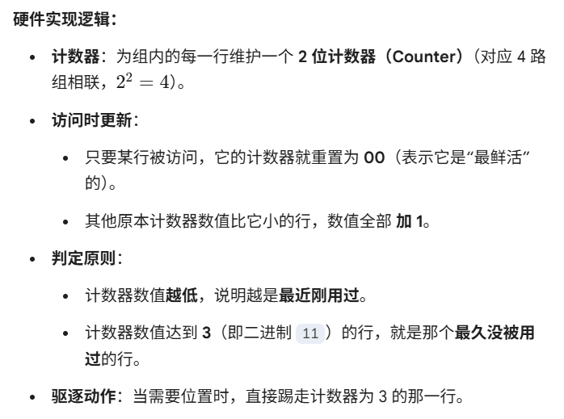

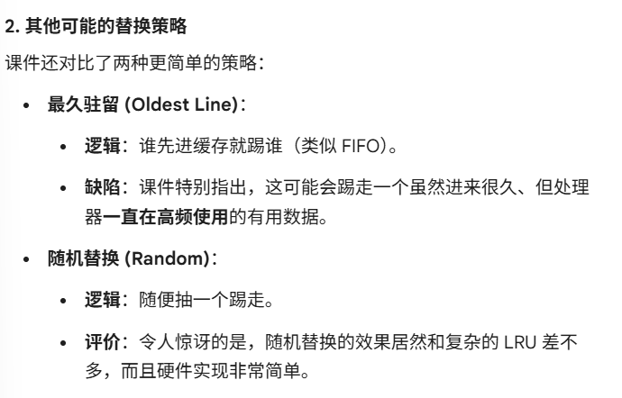

## Matric for Cache: Hit Time & Miss Penalty

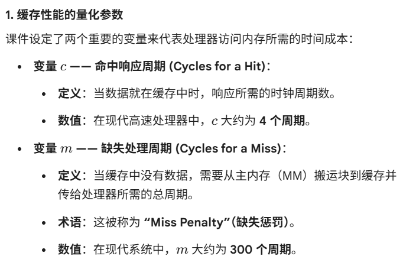

## AAC

$$
\text{AAC} = h \times c + (1-h) \times m
$$

- **h (Hit Rate)**：命中率（比如 0.9 代表 90% 的请求在缓存里找到了）。
- **c (Hit Time)**：命中时的开销（例子中为 **4 周期**）。
- **1-h (Miss Rate)**：缺失率（命中率剩下的部分）。
- **m (Miss Penalty)**：缺失时的惩罚（例子中为 **300 周期**）。

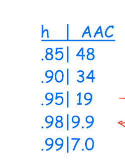

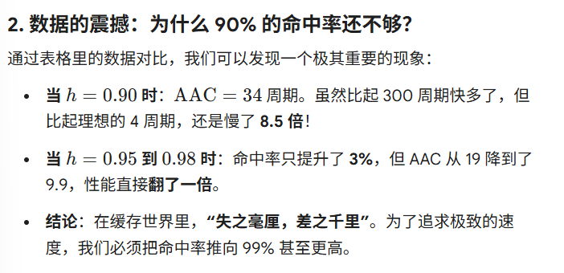

## L2 Cache

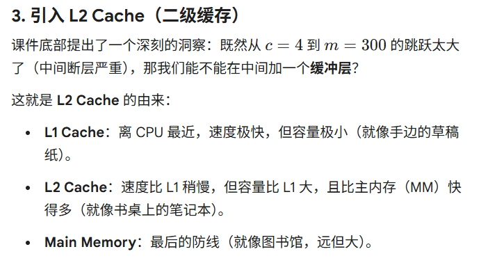

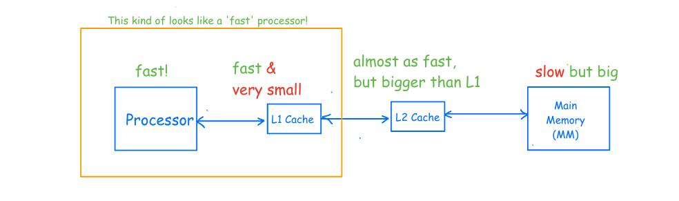

## Multi-level Cache Hierarchy

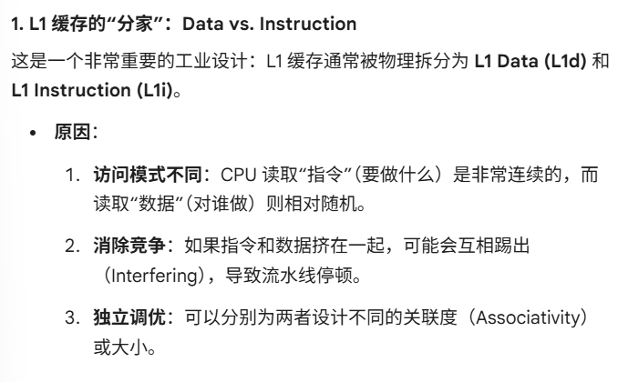

| **元素** | **访问周期 (#cycles)** | **容量 (Size)** | **关联度 (Organization)** |
| --- | --- | --- | --- |
| **L1 (Data/Inst)** | **5** | 48K / 32K | 12-way (非常灵活) |
| **L2 Cache** | **13** | 512K | 8-way |
| **L3 Cache** | **41** | 8M | 16-way (容量大，命中率高) |
| **Main Memory** | **391** | 16G | n/a (极其缓慢) |

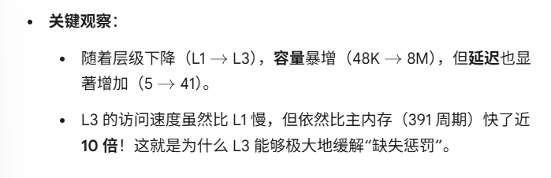

## Conflicting accesses

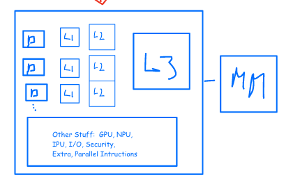

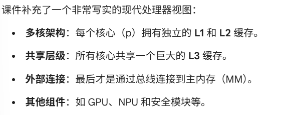

### Cache Thrashing

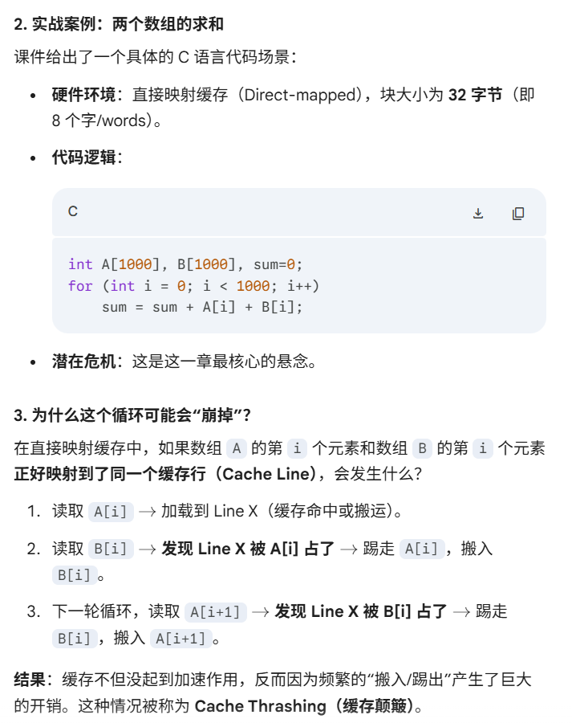

### Trashing

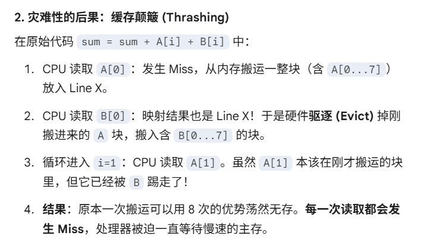

### 解决方案

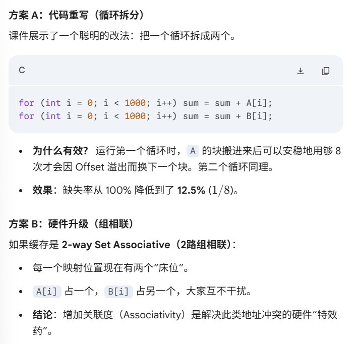

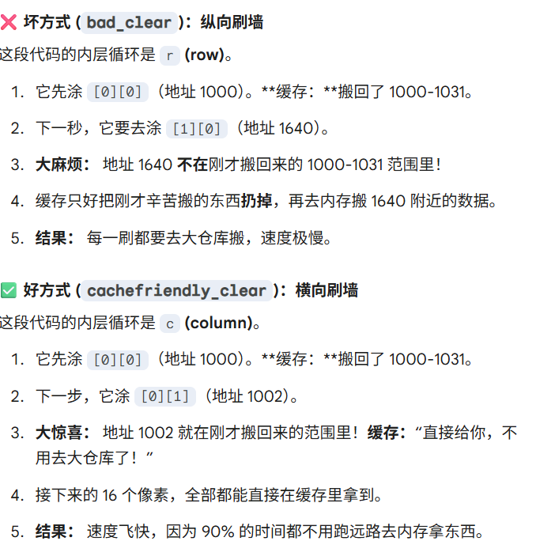

## Cache 与外部设备的冲突

- **CPU (Nios V)**：它看世界是通过 Cache 的。它改了数据，可能只改在了 Cache 里。
- **VGA 控制器**：它是一个外部硬件，它**看不见** Cache，它只盯着 **主内存 (MM)** 看，并把内存里的内容画到屏幕上

### “幽灵”是怎么产生的？

1. **写回策略 (Write Back)**：当你代码里“擦除”一个方块时，CPU 只是在 Cache 里把那块区域改成了黑色。
2. **不同步**：此时主内存里还是原来的旧颜色。VGA 控制器从主内存读数据，依然画出了原来的方块。
3. **延迟生效**：只有当这个 Cache 行因为太挤被“驱逐”回主内存时，屏幕才会突然变黑。
4. **结论**：这就是所谓的“幽灵”。在处理像显存（Frame Buffer）这种需要实时展示的数据时，通常我们要么**关闭 Cache**，要么使用 **Write Through（写直通）** 模式。