> Linear circuit analysis techniques

### Element, KCL, KVL, Nodal analysis

#### KCL

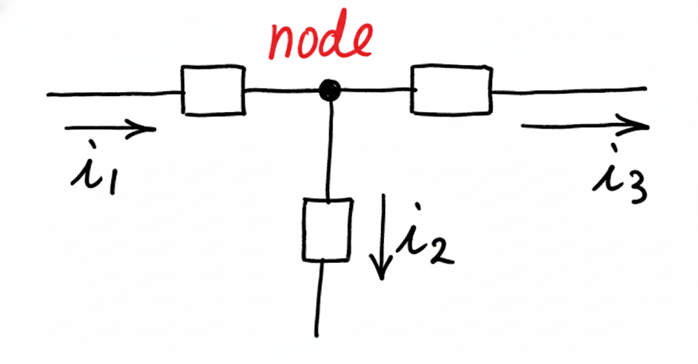

The algebraic sum of all currents entering and leaving a node is equal to zero

#### KVL

The algebraic sum of all voltages around any closed loop in a circuit is equal to zero

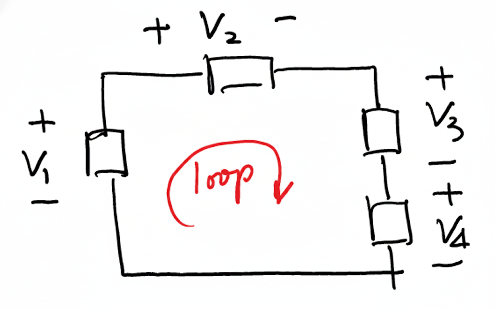

#### Super Node

When applying Nodal Analysis, if there’s a Voltage Source between two Nodes, then the current inside can’t be written, thus we need Super Node

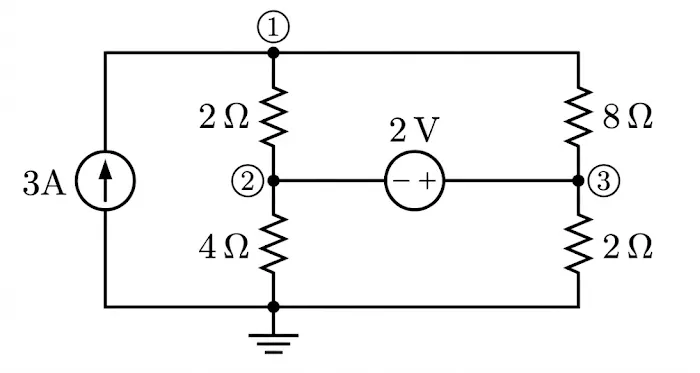

- We treat Two Nodes linked by Voltage Source as a Super Node

#### Super Mesh

The same applies on Mesh Analysis, when having two Mesh sharing one Current Source, then a Super Mesh is needed

- We discard the wire with the Current Source and treat the rest as one Mesh

#### Superposition

The circuit we deal with are Linear, thus each Source can be analysis individually

- Voltage Source: Short Circuit
- Current Source: Open Circuit

#### Equivalent resistance

Any complicated circuit can be treated as one Resistance, and to find that Resistance, we have three methods

##### Inject Voltage Source

- Discard the Source inside the circuit, i.e. short or open
- Apply a Voltage Source at AB
- Write out the current inside and thus find \\(R=\frac vi\\)

##### Inject Current Source

- The same with Above, but instead put a Current Source inside

##### Direct Analysis

- This **Doesn’t** work for circuit with Dependent Source

#### Voltage division (for resistors connected in series)

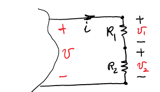

$$
v_1 = \frac{R_1}{R_1 + R_2} v,\quad v_2 = \frac{R_2}{R_1 + R_2} v

$$

#### Current division (for resistors connected in parallel)

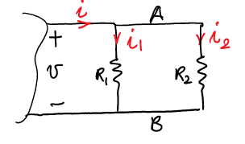

$$
i_1 = \frac{R_2}{R_1 + R_2} i,\quad i_2 = \frac{R_1}{R_1 + R_2} i
$$

### Thevenin/Norton equivalent circuit

The key concept of those two are, no matter how difficult the circuit is, when looking inside, it can always be simplified as a few elements

#### Thevenin

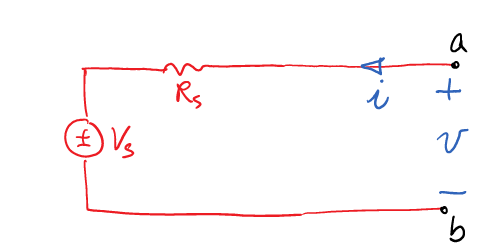

Thevenin simply the circuit into a Resistor and a Voltage Source, thus

$$
v=V_s+R_si
$$

#### Norton

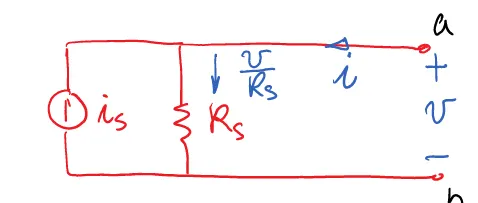

Norton simply the circuit into a Resistor Parallel a Current Source, thus

$$
i = \frac{v}{R_s} - i_s
$$

##### Ex. Finding Equivalent Circuit

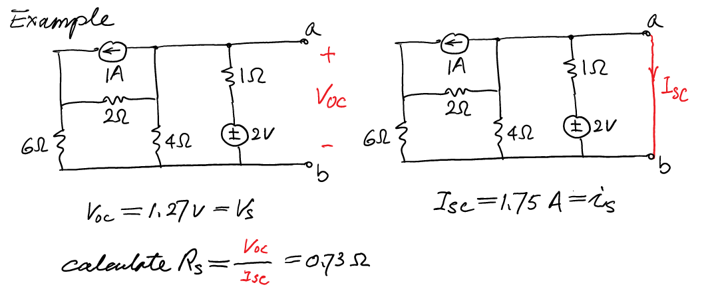

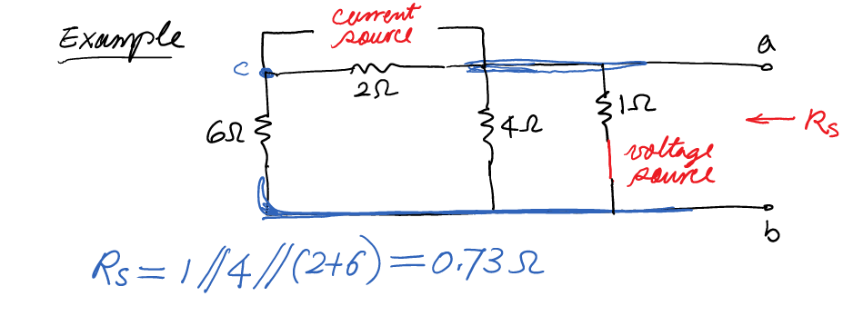

#### Maximum power transfer

As what’s being indicated in Thevenin, the whole circuit can be transfer into two elements

- In such case, we would like to further investigate what should the Load Resistance \\(R_L\\) be to gain the maximum power from the circuit

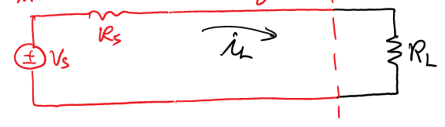

- Knowing that \\(i_L = \frac{V_s}{R_s + R_L}\\), we can find the formula of Power is

$$
P = R_L \cdot i_L^2 = R_L \left( \frac{V_s}{R_s + R_L} \right)^2
$$

- This equation have the curve of

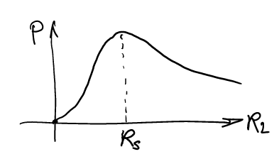

- Thus the Power gain its maximum when \\(R_L=R_s\\), thus

$$
P_{max} = R_s \left( \frac{V_s}{2R_s} \right)^2 = \frac{V_s^2}{4R_s}
$$

### Circuit analysis with controlled source

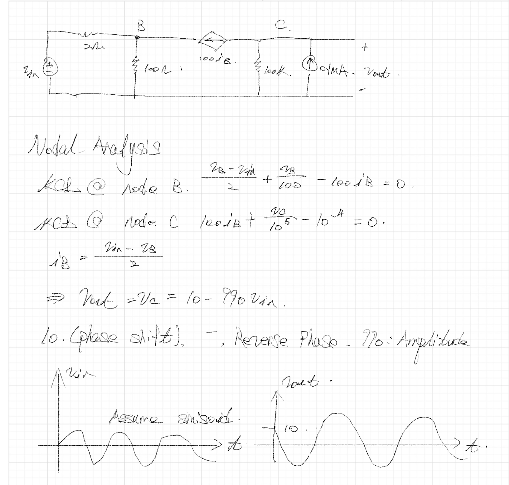

#### Circuit with only dependent source

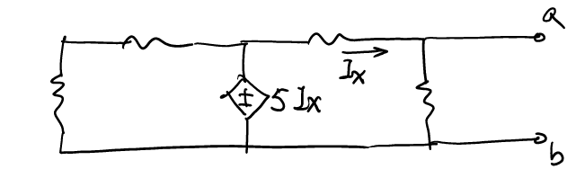

Those Circuit only have dependent sources, that they can be treated as a simple Resistor R, with no Voltage or Current Source inside

- If we want to find the Value of the Resistor, we can

A. Inject a Test Current \\(i_{test}\\)

B. Inject a Test Voltage \\(v_{test}\\)

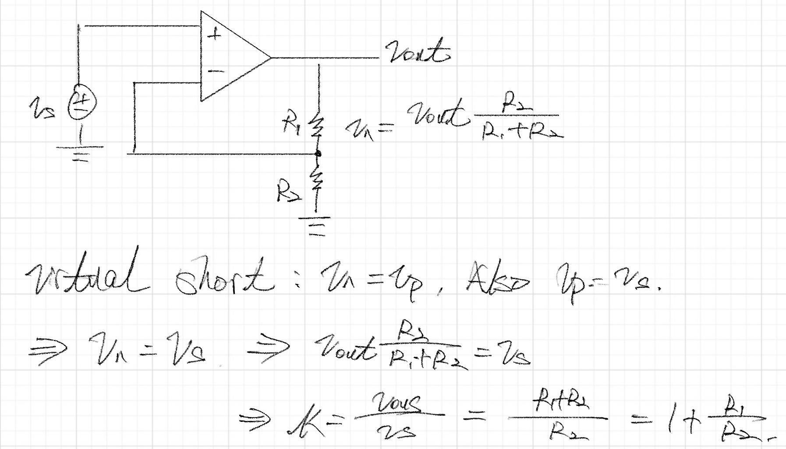