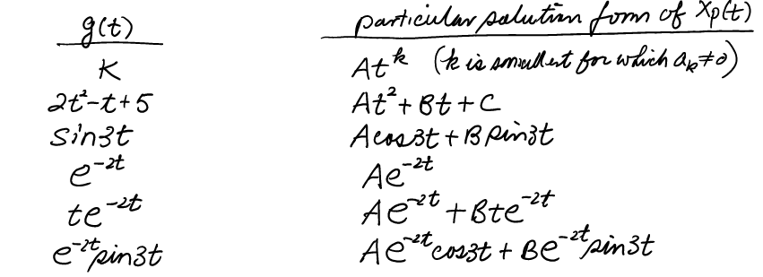
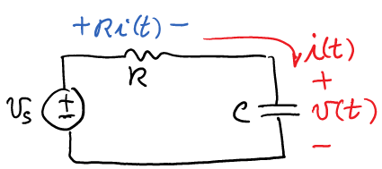
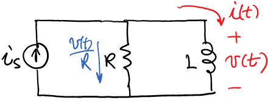
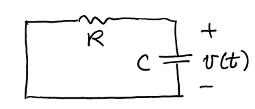
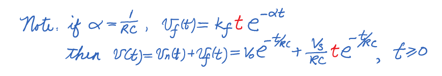
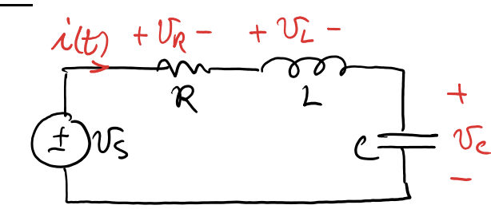
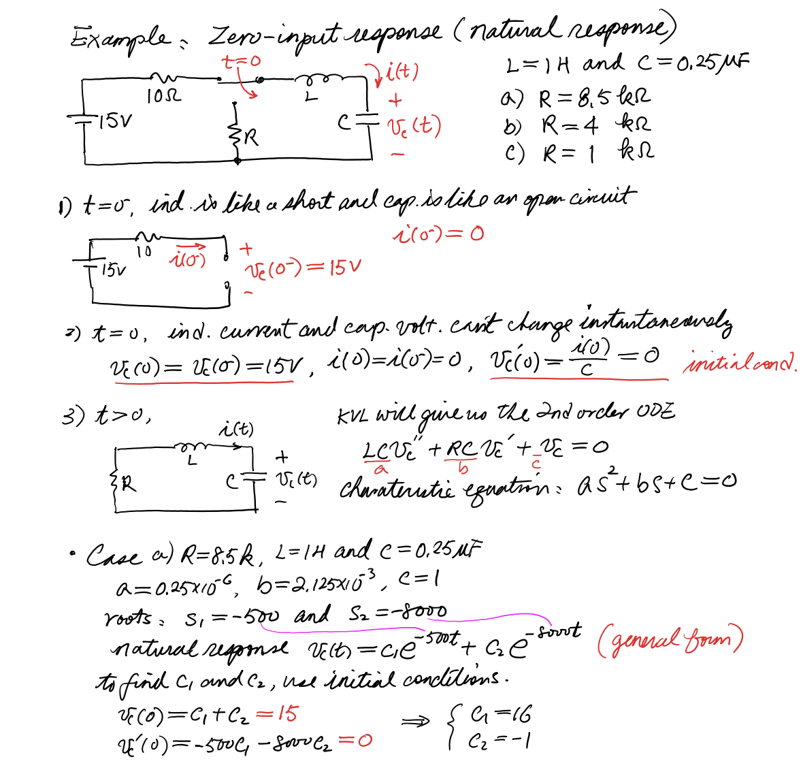
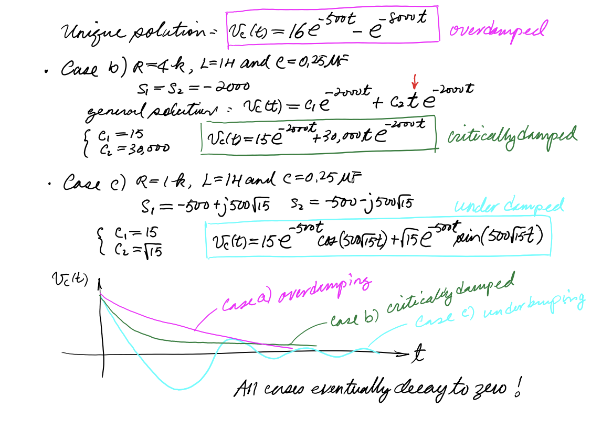
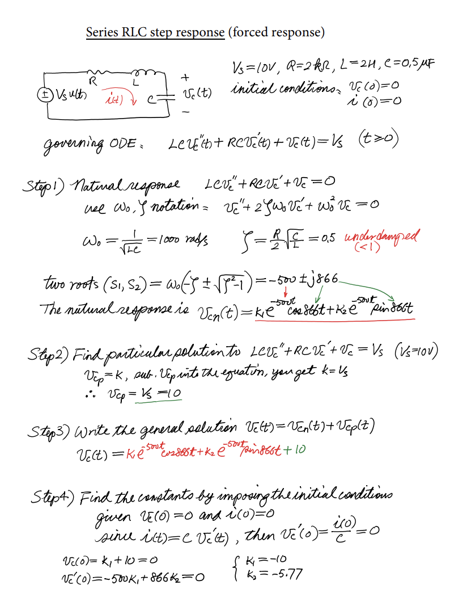
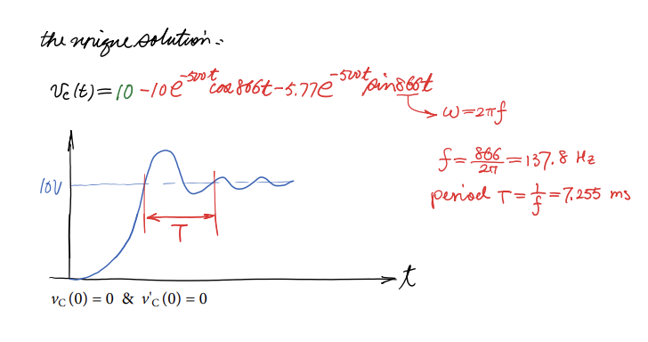

> Last Edit: 2/9/26

# Linear Ordinary Differential Equation, ODE

$$
a_n x^{(n)} + a_{n-1} x^{(n-1)} + \dots + a_1 x^{(1)} + a_0 x = g(t)
$$

$x^{(n)}$: x’s n th derivative for t

$g(t)$: Forcing Term, if $g(t)\neq 0$, then this ODE is a Non-Homogeneous Function

## Complementary Function

If $g(t)$  is zero, in which the ODE is a Homogeneous Function, then the function is aka Complementary Function

$$
a_n x^{(n)} + a_{n-1} x^{(n-1)} + \dots + a_1 x^{(1)} + a_0 x = 0
$$

It describe the behavior of function when no outer influence

Whereas the solution to this function is then called the Complementary Solution $x_c(t)$

$$
x_c(t) = C_1 x_1(t) + C_2 x_2(t) + \dots + C_n x_n(t)
$$

The Complementary Solution is the n th solution’s **Linear Combination**

Whereas the Coefficient C is determined by the Initial Conditions

## Particular Solution

The solution satisfied when $g(t)\neq 0$

The Particular Solution can be solved using Superposition, that is analysis two terms of $g(t)$ individually and add up later

### Pick solution for particular type of g(t)

### Ex. Finding Coefficient for Particular Solution

Suppose having function $x'' - 2x' + 3x = 3t^2 + 2t$

Based on the table, we guess the solution is in the form of $x_p(t) = At^2 + Bt + C$, this solution has the first derivative as $2At+B$ and second derivative as $2A$, thus

$$
(2A) - 2(2At + B) + 3(At^2 + Bt + C) = 3t^2 + 2t
$$

Arrange LHS and we can get $x_p(t) = t^2 + 2t + \frac{2}{3}$

### Exception for Particular Solution

If the assumed Particular Solution has already been mentioned in Complementary solution, then we need to time the guess to a $t^k$ (k normally = 1) until it’s not equal to Complementary solution

## General Solution

$$
x(t) = x_c(t) + x_p(t)
$$

## First-order homogeneous ODE

A Particular ODE in the form of 

$$
ax' + bx = 0
$$

This function is being solved by the characteristic function, by letting $x(t) =e^{st}$

$$
a(se^{st}) + b(e^{st}) = 0\Rightarrow as + b = 0
$$

# First-order RC/RL circuits

## RC Circuit

Starting with the KVL, we get $R \cdot i(t) + v(t) = v_s(t)$, then known the relationship between Capacitor and current $i(t) = C \frac{dv(t)}{dt}$, sub in this to get the Differential Equation

$$
RC \frac{dv(t)}{dt} + v(t) = v_s(t)
$$

## RL Circuit

In RL Circuit we use KVL instead to get $\frac{v(t)}{R} + i(t) = i_s(t)$, knowing the relation between Inductor’s Voltage and Current to get

$$
\frac{L}{R} \frac{di(t)}{dt} + i(t) = i_s(t)
$$

---

Those two RC and RL Circuit are just 1st Order Non-Homogenous ODE

Now we can first analysis the case when it’s Homogenous to find complementary solution

## RC circuit zero input response

When the outer battery has been removed, the equation is now 

$$
RC v'(t) + v(t) = 0
$$

With the Initial Condition that $v_c=0$, we can get the solution which is 

$$
v(t) = V_0 e^{-t/RC} \quad (t \ge 0)
$$

Notice that there’s a Coefficient $RC$ shifting the response rate of circuit which is $\tau = RC$ 

A key point is when $t=\tau$, $v_o$ will goes to 0.37 $v_0$ at this stage

## RC circuit step response

Now going back to case when the external Voltage Source exist, as we want to analysis a source which only occur then $t>0$, thus we will need a Unit Step Function $u(t)$

$$
RCv'(t) + v(t) = V_s u(t)
$$

And this equation will have the solution of $v(t) = v_c(t) + v_p(t)$, where $v_c$  is the **Natural Response**, and $v_p$ is $v_f$, the Force Response

- Natural Response $v_n$: Has the form of $v_n(t) = K e^{-t/RC}$
- Forced Response $v_f$: As $t\rightarrow \infty$, the particular solution will then be $V_s$

Thus the general solution will then be

$$
v(t) = K e^{-t/RC} + V_s
$$

This K is just the coefficient C in ODE, that can be determined by sub in $v(0) =v_0$, so we get

$$
v(t) = (V_0 - V_s)e^{-t/RC} + V_s
$$

## Different Interpertations

We can treat this Reaction in two different perspectives

### Natural + Forced

$$
v(t) = \underbrace{V_0 e^{-t/\tau}}_{\text{Zero-Input (ZIR)}} + \underbrace{V_s(1 - e^{-t/\tau})}_{\text{Zero-State (ZSR)}}
$$

This form is more like a mathematic interpretation, that this is Complementary + Particular

### Zero Input + Zero State

$$
v(t) = \underbrace{V_0 e^{-t/\tau}}_{\text{Zero-Input (ZIR)}} + \underbrace{V_s(1 - e^{-t/\tau})}_{\text{Zero-State (ZSR)}}
$$

Describe the Capacitor under **Initial Condition** and **Outer Input Source**

---

We can conclude this RC Circuit by one formula

$$
v(t) = (v_{\text{initial}} - v_{\text{final}}) e^{-t/\tau} + v_{\text{final}}
$$

## Response to exponential input

Now that $g(t)$ has become a exponential function

$$
RC v'(t) + v(t) = V_s e^{-\alpha t}
$$

Solving this by Complementary + Particular can get

$$
v(t) = \left( V_0 - \frac{V_s}{1 - \alpha RC} \right) e^{-t/RC} + \frac{V_s}{1 - \alpha RC} e^{-\alpha t}
$$

A special case is given by when $\alpha =1/RC$m this can be solved by timing a t at Forced Response, that is 

$$
v(t) = V_0 e^{-t/RC} + \frac{V_s}{RC} t e^{-t/RC}
$$

# 2nd-Order DE

The standard 2nd Order DE formula is given by

$$
ax'' + bx' + cx = 0 \quad (a \neq 0)
$$

This equation can also be solved by using the Characteristic Equation

$$
as^2 + bs + c = 0
$$

Known that this equation will have the solution of $(s_1, s_2) = \frac{-b \pm \sqrt{b^2 - 4ac}}{2a}$

There will be several different kind of solutions based on the Sign of $D = b^2 - 4ac$

## Case 1: Over-damped

Two District Real Roots: $b^2 - 4ac > 0$, having the General Solution of

$$
x(t) = c_1 e^{-\alpha_1 t} + c_2 e^{-\alpha_2 t}
$$

This means that the Damp is high that the System won’t Oscillate, and it will goes to equilibrium

## Case 2: Critically Damped

Two Identical Real Roots: $b^2 - 4ac = 0$, having General Solution of 

$$
x(t) = c_1 e^{-\alpha t} + c_2 t e^{-\alpha t}
$$

The fastest condition for system to go back to equilibrium

## Case 3: Underdamped

One Conjugated Complex Roots:  $b^2 - 4ac < 0$, having General Solution of

$$
x(t) = c_1 e^{-\alpha t} \cos(\beta t) + c_2 e^{-\alpha t} \sin(\beta t)
$$

The system will Oscillate and then goes to Equilibrium

# Series RLC Circuit

Now we can use the 2nd Order DE to analysis the Series RLC Circuit

Known the KVL is $v_L(t) + v_R(t) + v_C(t) = V_s(t)$

There’s 3 Circuit Element in the RLC Circuit, and we can analyse their voltage one by one

- Firstly we know in this series Circuit the current is $i = C \frac{dv_c}{dt}$
- **Inductor**: $v_L = L \frac{di}{dt}$, as $i = C \frac{dv_c}{dt}$, we have $v_L = LC v_c''$
- **Resistor**: $v_R = Ri = RC v_c'$

Then add up everything to get

$$
LC v_c''(t) + RC v_c'(t) + v_c(t) = V_s(t)
$$

## Process of Solving

### Find the Complementary Solution

Letting Force to be zero

$$
LC v_c'' + RC v_c' + v_c = 0
$$

This have the characteristic equation of 

$$
as^2 + bs + c = 0
$$

### Find the Particular Solution

A Forced Solution when $V_s\neq 0$

### Use the Initial Condition

Use the Initial Condition to find the coefficient

## Ex. Zero-Input Response

## The Zeta and Omega Notation

From above we known that the Homogeneous ODE is 

$$
ax'' + bx' + cx = 0
$$

Now we substitute $\omega_0^2=\frac{c}{a}$ and $\zeta = \frac{b}{2\sqrt{ac}}$, we can get

$$
x'' + 2\zeta\omega_0 x' + \omega_0^2 x = 0
$$

As the a,b,c coefficient only represent the Physical Quantity, it doesn’t tells us about the system’s status, thus we introduce Zeta and Omega, whereas

- Zeta is the Phase
- Omega is the Speed

So now we can describe the system as 

| **State** | **Condition** | **Nature of Roots** | **Phenomenon Description** |
| --- | --- | --- | --- |
| **Overdamped** | $\zeta > 1$ | Two distinct negative real roots | The system returns slowly to the equilibrium position without any oscillation. |
| **Critically Damped** | $\zeta = 1$ | Two equal negative real roots | The system returns to the equilibrium position in the shortest possible time without oscillation. |
| **Underdamped** | $\zeta < 1$ | A pair of complex conjugate roots | The system oscillates around the equilibrium position, but the amplitude gradually decays over time. |

Now we can sub in the RLC to get $\omega_0 = \frac{1}{\sqrt{LC}}$, and $\zeta = \frac{R}{2}\sqrt{\frac{C}{L}}$

## Ex. Series RLC Step Response

