> Last Edit: 2/22/26

In a linear circuit, a sinusoidal input with frequency $\omega$ always produces sinusoidal steady-state outputs with the same frequency

Thus we can only analyze the Amplitude an Phase of elements, and the key of it is

1. If there’s multiple inputs, they must have the same frequency
2. No transient information will be given (only at steady state)
3. Have to use complex numbers

# Complex Number

## Rectangular Form

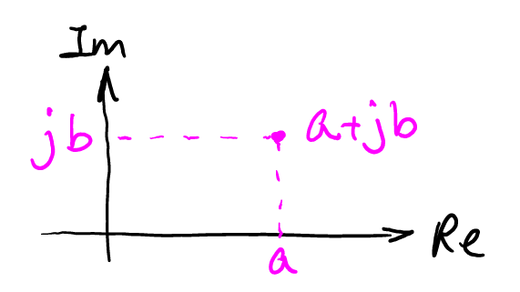

## Polar Form

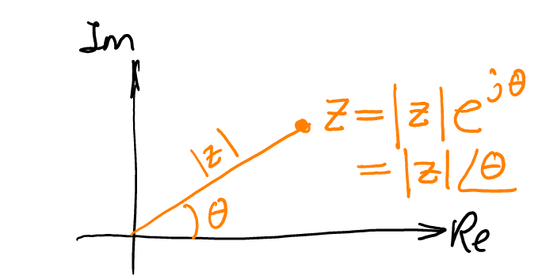

$$
z = |z|e^{j\theta} = |z|\angle\theta
$$

We can’t add or subtract in Polar Form, has to convert first

## Sinusoids

$$
v(t) = V_A \cos(\omega t + \theta)
$$

$V_A$: Amplitude

$\omega$: Angular Frequency

$\theta$: Phase

---

$f = \frac{\omega}{2\pi}$: Frequency

$T = \frac{1}{f}$: Period

## Euler's relationship

The complex number can be expressed by

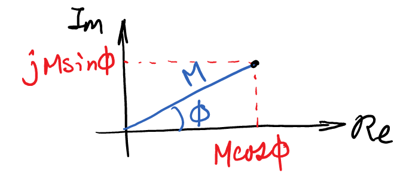

$$
Me^{j\phi} = M\cos\phi + jM\sin\phi
$$

Notice that this is one **Real** and one **Imaginary** term, and we only want the Real one

> In phasor analysis, we prefer Cosine function more
> 

Thus we can get

$$
V_A \cos(\omega t + \theta) = Re\{ V_A e^{j(\omega t + \theta)} \}=Re\{ V_A e^{j\theta} \cdot e^{j\omega t} \}
$$

### Phasor

The phasor term contains the Amplitude and Phase of a wave, which is the two variables we want, while getting rid of the Angular Frequency which stays the same for whole time

Phase can be expressed in several ways

1. Exponential form: ****$V_A e^{j\theta}$
2. Polar form: $V_A \angle \theta$
3. Rectangular form: $V_A \cos\theta + jV_A \sin\theta$

## Convert between Time and Phasor Domain

| **Time Domain** | **Phasor Domain** |
| --- | --- |
| $i(t) = I_A \cos(\omega t + \alpha)$ | $\overline{I} = I_A \angle \alpha$ |
| $v(t) = V_A \sin(\omega t + \psi)$ | $\overline{V} = V_A \angle (\psi - 90^\circ)$ |

# Complex Number Calculus

## Addition/Subtraction

It’s hard to calculate $V_1 \cos(\omega t + \theta_1) + V_2 \cos(\omega t + \theta_2)$, thus we can convert to Phasor Domain for simplification, that 

$$
\overline{V} = \overline{V}_1 \pm \overline{V}_2
$$

## Derivatives

Getting the derivative of $\frac{dv(t)}{dt}$, we can get

$$
\frac{dv(t)}{dt} = \frac{d}{dt} \{ Re [ \overline{V} e^{j\omega t} ] \} = Re \{ \overline{V} \frac{d}{dt} e^{j\omega t} \} = Re \{ j\omega \overline{V} e^{j\omega t} \}
$$

Can see that this is same to times a $j\omega$ in Phasor Domain

While getting the second derivative, we can get

$$
\frac{d^{2} v(t)}{dt^{2}} = \frac{d}{dt} [ Re \{ j\omega \overline{V} e^{j\omega t} \} ] = Re [ j\omega \overline{V} \frac{d}{dt} e^{j\omega t} ] = Re [ (j\omega)^{2} \overline{V} e^{j\omega t} ]
$$

That is timing a $(j\omega)^2$ in Phasor Domain

---

 If we bring back the result of Derivatives of Voltage back to RLC Circuit, we can then get

$$
LC v''(t) + RC v'(t) + v(t) = v_s(t)
$$

is then equals to 

$$
LC(j\omega)^2 \mathbf{V} + RC(j\omega) \mathbf{V} + \mathbf{V} = \mathbf{V_s}
$$

This totally get rid of the time and simplified the differential equation into an equation

# Time Domain vs. Phasor Domain

As the circuit change from Time Domain into Phasor Domain, the elements change too

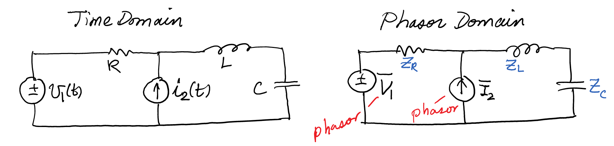

## Resistor

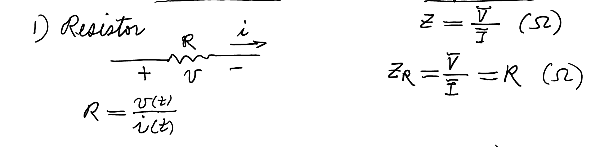

## Capacitor

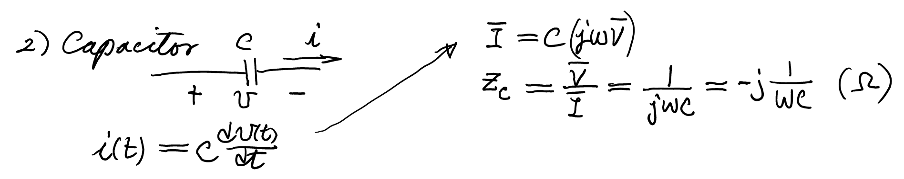

## Inductor

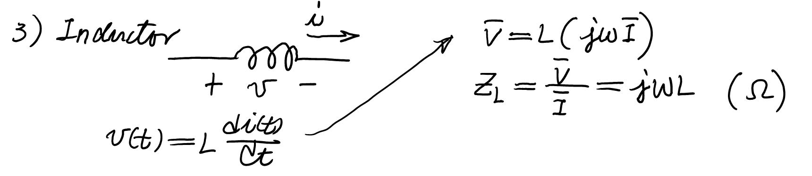

## Admittance

$$
 Y = \frac{1}{Z}
$$

Is useful in Parallel Circuit

## Impedance vs. Frequency

From the element’s Impedance formula, we can see their relation with $\omega$

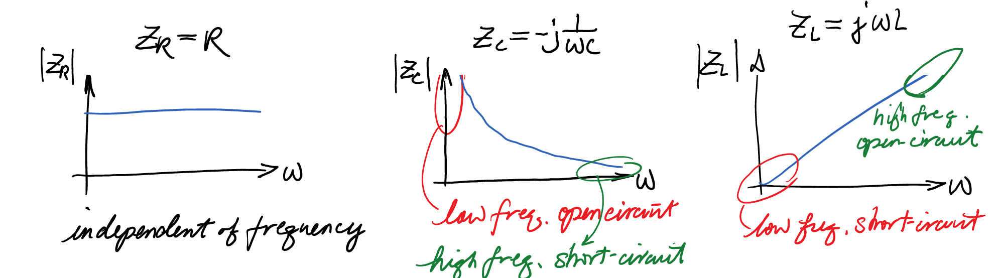

### Ex. RC Circuit

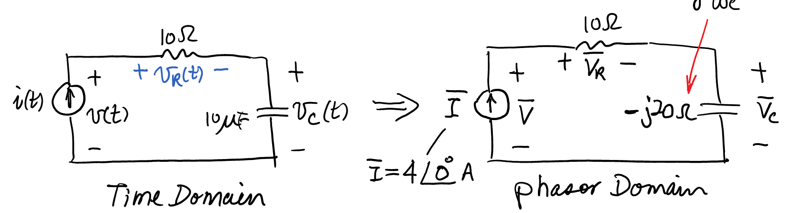

$$
\mathbf{\bar{V}} = 4\angle 0^\circ \times (10 - j20)
$$

Further using $tan$ and Mod formula we can get

$$
\mathbf{\bar{V}} \approx 89.44\angle -63.43^\circ
$$

Which is $v(t) = 89.44\cos(5000t - 63.43^\circ) \text{ V}$ in time domain

### Ex. RLC Circuit

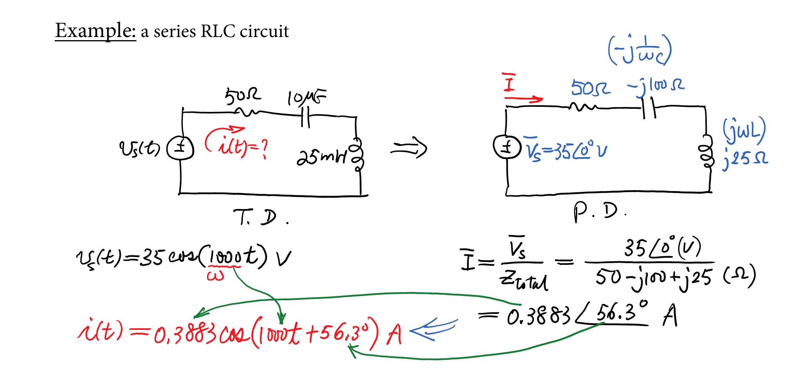

# Parallel and Series Connection

The Impedance of Z is the same as the Resistor

## Series

The Impedance in Series Circuit is

$$
Z_{eq} = \sum_{j=1}^{n} Z_j
$$

While the Voltage Division Rule will be

$$
\overline{V}_k = \frac{Z_k}{Z_{eq}} \overline{V}
$$

## Parallel

The Impedance in Parallel is 

$$
Z_{eq} = \frac{1}{\sum_{j=1}^{n} \frac{1}{Z_j}}
$$

And the Voltage Division rule is

$$
\overline{I}_k = \frac{Z_{eq}}{Z_k} \overline{I}
$$

# Thevenin/Norton equivalent circuits in phasor domain

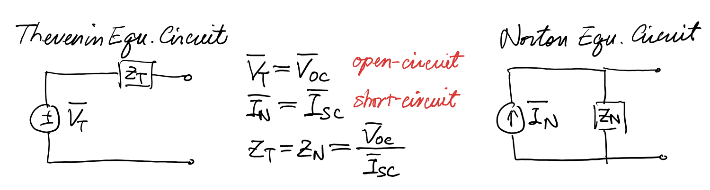

### Ex.

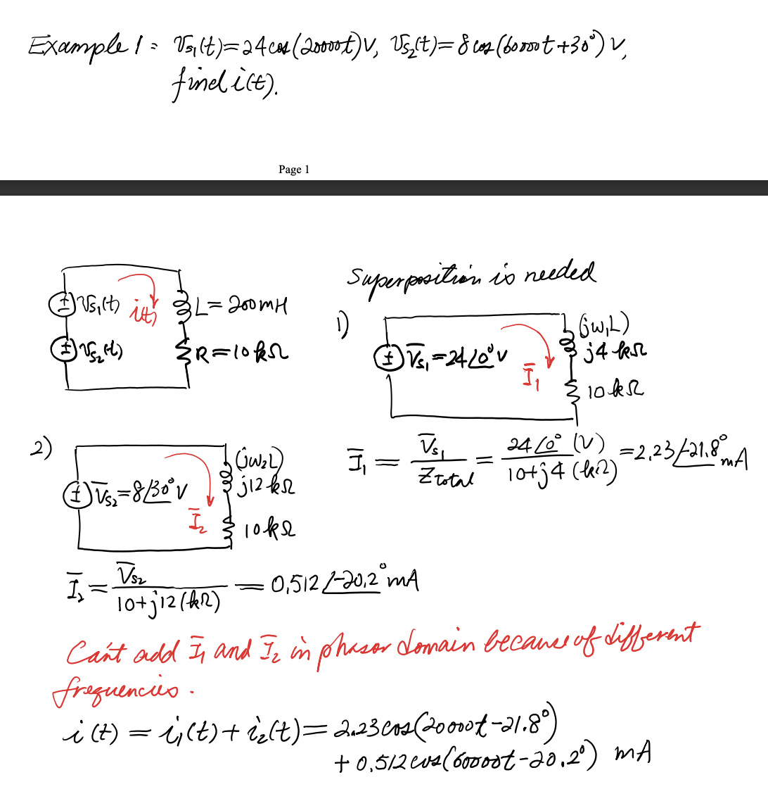

# Energy and Power

## Energy and Power for a Resistor

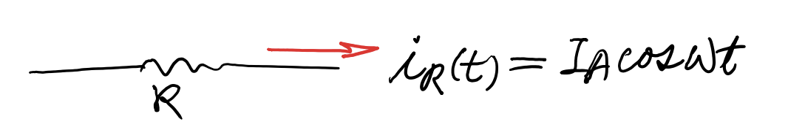

Known there’s a AC Current through Resistor with $i_R(t)=I_A\cos\omega t$, the power formula is then

$$
P_R(t) = R \cdot i_R^2(t) = R I_A^2 \cos^2(\omega t)= \frac{R I_A^2}{2} [1 + \cos(2\omega t)]
$$

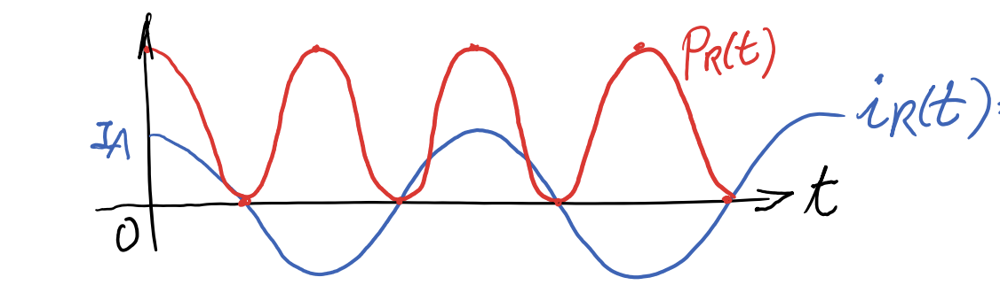

Thus we can conclude

- The Average Power of Resistor is $P_{avg} = \frac{R I_A^2}{2}$ as cosine’s avg in a period is zero
- Always dissipating energy: Unlike Capacitor or Inductor, Resistor only convert energy into heat
- Double in frequency: The frequency of Power is double of Current

## Energy and Power for an Inductor

The same current $i_R(t)=I_A\cos\omega t$ pass through the Inductor, and the Energy formula will be

$$
W_L(t) = \frac{1}{2} L I_A^2 \cos^2(\omega t)= \frac{L I_A^2}{4} [1 + \cos(2\omega t)]
$$

Find the Derivative of W (Energy) of time to get Power

$$
P_L(t) = -\frac{\omega L I_A^2}{2} \sin(2\omega t)
$$

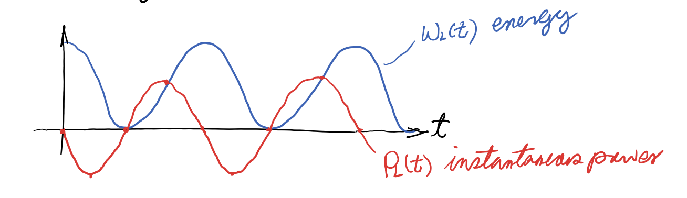

Thus we can conclude that

- The Energy Inductor absorb in a period is equal to the one it released, thus average Power is zero

## Energy and Power for a Capacitor

The Capacitor will have a AC Voltage across is $v_c(t) = V_A \cos\omega t$, using the same approach

$$
W = \frac{1}{2} C v^2 = \frac{C V_A^2}{4} [1 + \cos 2\omega t]
$$

Finding the Derivative of it to get

$$
P_c(t) = -\frac{\omega C V_A^2}{2} \sin 2\omega t
$$

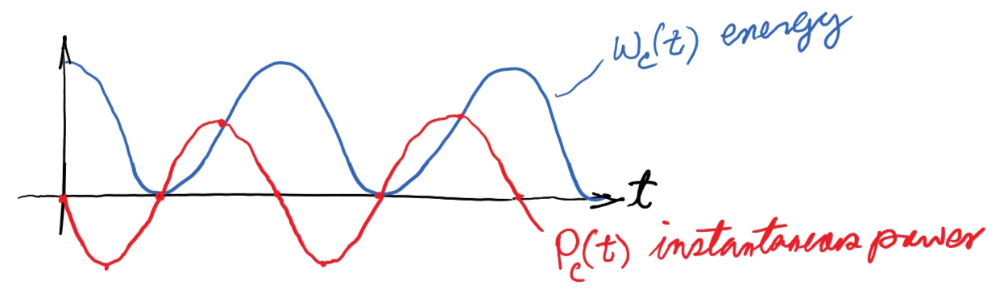

Thus we can get

- The average Power is zero
- Capacitor Absorb Energy in the Positive Power Cycle and return it back in the Negative Cycle

# Maximum Power Transfer

We first simplify the whole circuit into a Thevenin Equivalent circuit

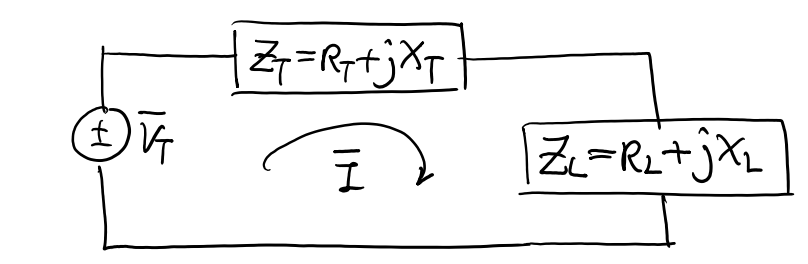

In this case, there will be two Impedance, $Z_T$ Theveinin Impedance and $Z_L$ Load Impedance

We need to find a condition of $Z_L$ to make it have the maximum power

Known that only the Resistor is consuming Power in a AC source, while the formula is $P_{ave} = R_L \frac{|\bar{I}|^2}{2}$, based on the formula $|\bar{I}| = \frac{|\bar{V}_T|}{|Z_T + Z_L|} = \frac{|\bar{V}_T|}{\sqrt{(R_T+R_L)^2 + (X_T+X_L)^2}}$, we can get

$$
P_{ave} = \frac{\frac{R_L}{2}|\bar{V}_T|^2}{(R_T+R_L)^2 + (X_T+X_L)^2}
$$

To make this formula largest, we can reduce the denominator

- Let $X_T + X_L = 0$ and $R_L = R_T$ (This is achieved by finding derivative)

Thus we can get, to maximum the power, we need a pair of Conjugate Impedance

$$
Z_L = Z_T^*
$$

Thus the final Power formula will become

$$
P_{max} = \frac{|\bar{V}_T|^2}{8R_T}
$$