> Last Edit: 3/11/26

# Self Inductance

When the Coil has a current change, it will create a induced emf and induced current 

due to current change in coil itself

$$
L = \frac{N\Phi}{i} \quad \text{or} \quad N\Phi = Li
$$

## The Self Inductance in a Coil

In a coil with length $l$, Cross-Sectional Area $A$ and $N$ turns, its Magnetic Flux will be 

$$
\Phi = B \cdot A = \mu_0 \frac{N}{l}iA
$$

Which sub in L will get 

$$
L = \frac{N}{i} \left( \mu_0 \frac{N}{l} i A \right) = \frac{\mu_0 N^2 A}{l}
$$

## Faraday’s Law

Faraday’s Law states once there’s a Change in Magnetic Flux, a Induced voltage will be created in inductor against that change

$$
v(t) = \frac{d(N\Phi)}{dt}
$$

Also sub in $N\Phi = Li$ to get 

$$
v(t) = \frac{d(Li)}{dt} = L\frac{di}{dt}
$$

# Mutual Inductance

On top of Faraday’s Law, if two Coil is very close

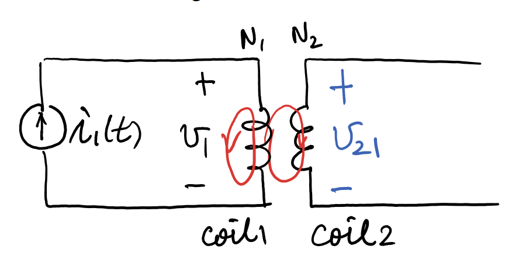

When there’s current change in one Inductor, it will cause the Magnetic Flux to change, in which make the second coil has a current change, that is

$$
v_{21} = N_2 \frac{d\phi_{21}}{dt} = M_{21} \frac{di_1}{dt}
$$

$v_{21}$: Means that this voltage is occur on **Coil 2** due to **Coil 1**

$N_2 \frac{d\phi_{21}}{dt}$: Faraday’s Law

$M_{21}$: Mutual Inductance Coefficient

---

So basically what happened is that

1. There’s a current change in Coil 1, $\frac{di_1}{dt}$
2. The current change cause the Magnetic Field in coil 1 changed, that influence the Magnetic Flux in coil 2 which is near coil 1
3. Thus based on Faraday’s Law, there will be a Induced Voltage in Coil 2 due to Coil 1’s current change, and that’s $v_{21}$

---

If Magnetic Medium in the coil is linear, then 

$$
M_{21}=M_{12}=M
$$

## Energy

The two Inductor forms a system with total energy of $W(t)$, and as energy can’t be negative, that gives us 

$$
M \le \sqrt{L_1 L_2}
$$

## Coupling Coefficient

Coupling Coefficient is from $[0,1]$ which measures how close was two coils

$$
k = \frac{M}{\sqrt{L_1 L_2}}
$$

> Perfect Couling is when $k=1$
> 

## Total Voltage

When there’s two inductors that are close, the voltage on the first inductor doesn’t simply depends on itself, but in the equation

$$
v_1(t) = L_1 \frac{di_1}{dt} \pm M \frac{di_2}{dt}
$$

### Sign Connection

When the Magnetic Flux from Coil 1 and Coil 2 are in the same direction, then use addition, otherwise apply the subtraction

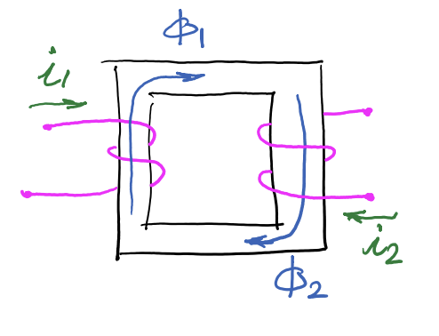

Seen in this image, two Magnetic Flux are having the same direction (CW), thus is an additive 

## The Dot Convention

By drawing the coils, it makes the problem too hard, so we can simplify using Dot Convention

### Addition

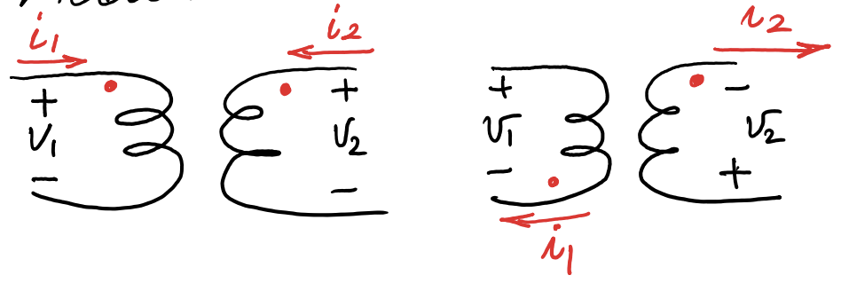

When dots are on the same Node

### Subtraction

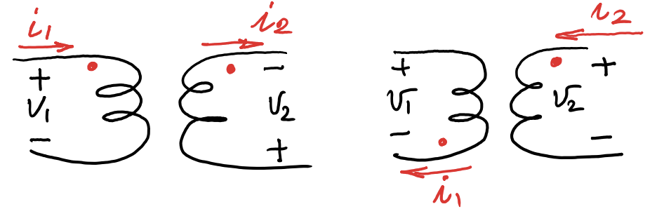

### Ex 1. Mutual Inductance

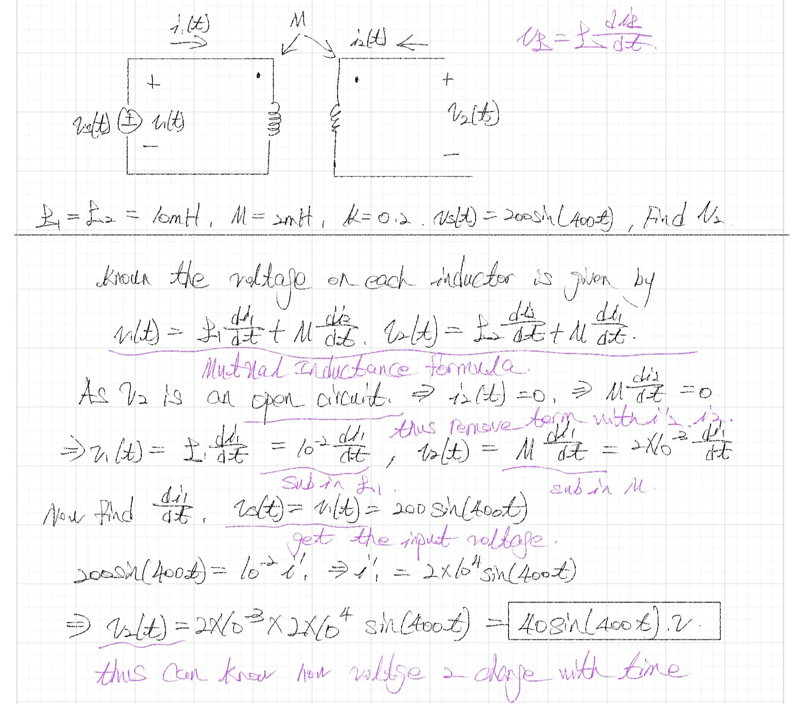

### Ex 2. Mutual Inductance

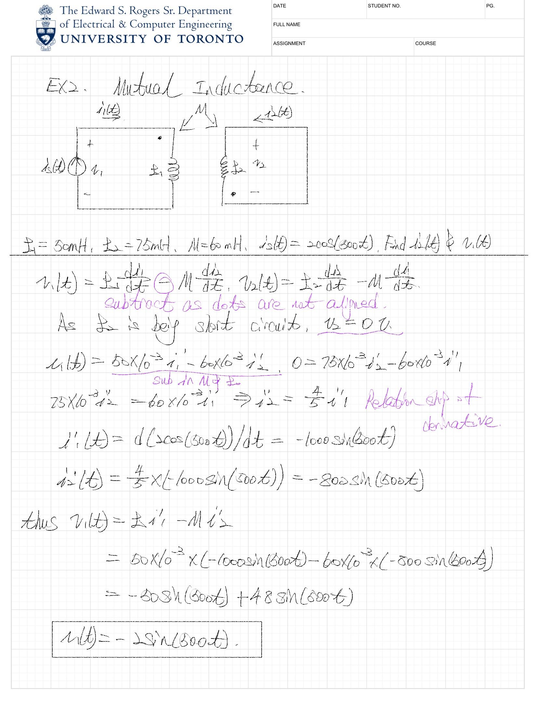

# Ideal Transformer

In ideal Transformer, we assume perfect coupling, making $k=1$, also $\Phi_1 = \Phi_2 = \Phi$, and there’s no heat loss

## Recall Coupled Coils

Coupled Coils has the property that 

$$
\Phi_1 = \Phi_{11} + \Phi_{12}
$$

The main function for Transformer is 

1. Isolation: There’s no connection between primary and secondary winding
2. Replication: The signal can be transform from one side to the other
3. Scaling: Resize the magnitude of Voltage or Current

## Turn Ratio

$$
n = \frac{N_2}{N_1}
$$

The ratio of Turns, this decided Transformer is raising of decreasing voltage

## Dot Convention

Voltage Ratio

$$
\frac{v_2(t)}{v_1(t)} = \pm n
$$

Current Ratio

$$
\frac{i_2(t)}{i_1(t)} = \mp \frac{1}{n}
$$

## Transformer in Phasor Domain

In Phasor Domain the Turn Ratio has the same equation

$$
\frac{\bar{V}_2}{\bar{V}_1} = \pm n,\quad \frac{\bar{I}_2}{\bar{I}_1} = \mp \frac{1}{n}
$$

## Types of Transformer

Based on the Turn Ratio, we can get three kinds of Transformer

| Type | Turn Ratio | Physical Behavior |
| --- | --- | --- |
| Isolation | n = 1 | i and V stay the same |
| Step-up | n > 1 | $V \uparrow$, $I \downarrow$ |
| Step-down | n < 1 | $V \downarrow$, $I \uparrow$ |

## Impedance in Phasor Domain

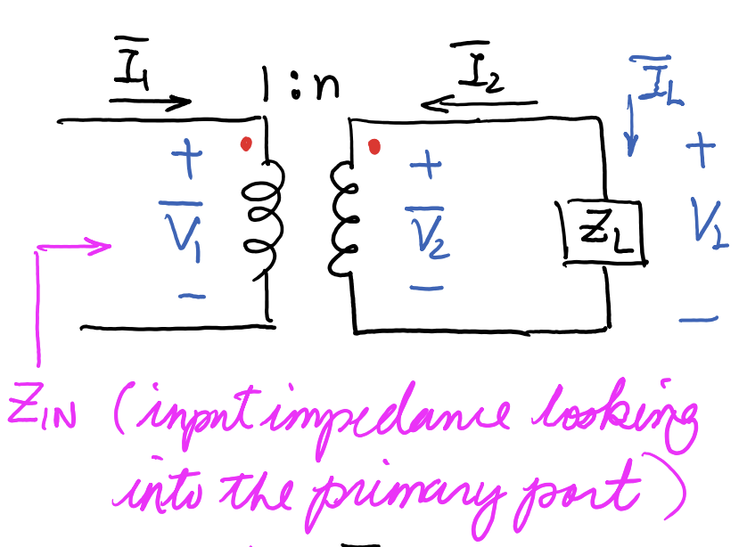

Based on the Secondary, $Z_L = \frac{\bar{V}_2}{\bar{I}_L}$, also we known that $\bar{V}_2 = n \bar{V}_1$ and $\bar{I}_L = \frac{\bar{I}_1}{n}$, thus

$$
Z_L = \frac{n \bar{V}_1}{\bar{I}_1 / n} = n^2 \frac{\bar{V}_1}{\bar{I}_1}=n^2 Z_{IN}
$$

### Ex.1 Finding Voltage and Current in Phasor Domain

### Ex 2.

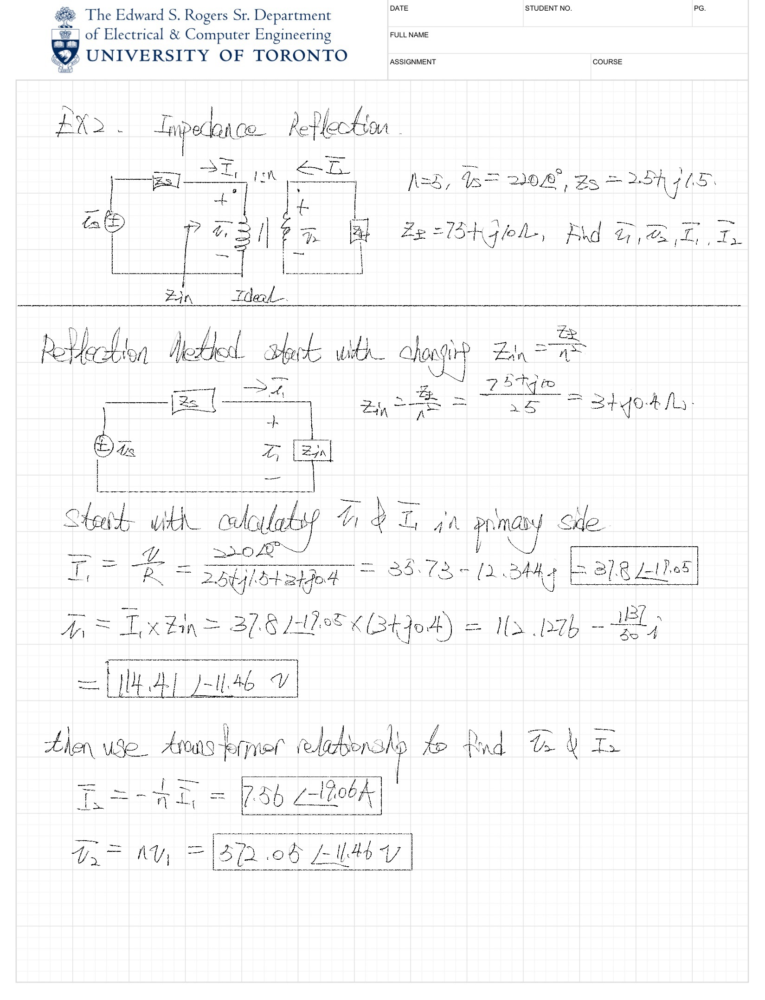

## Circuit Transformers

Transformer is the real element we used for resizing the voltage, whereas circuit transformer is the way we used to use a circuit to simulate the behavior of Transformer, and this is done by using Thevenin Equivalent Circuit

In the Circuit Transformer, we divided the circuit into left and right which are primary and secondary half, then we can either do Thevenin on the left side or the right side

## Thevenin Equivalent Circuit on Primary Side

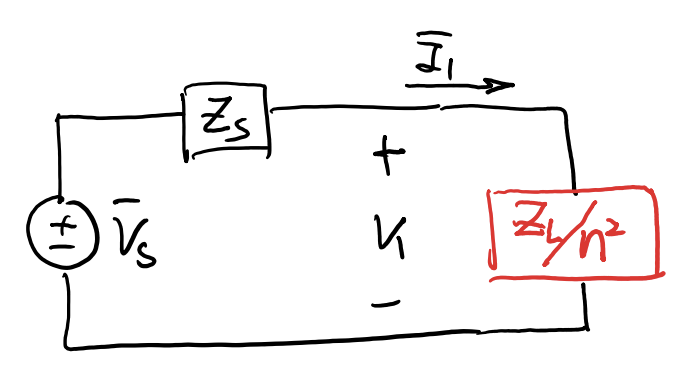

## Thevenin Equivalent Circuit on Secondary Side

The same can be applied on the Secondary Side, having 

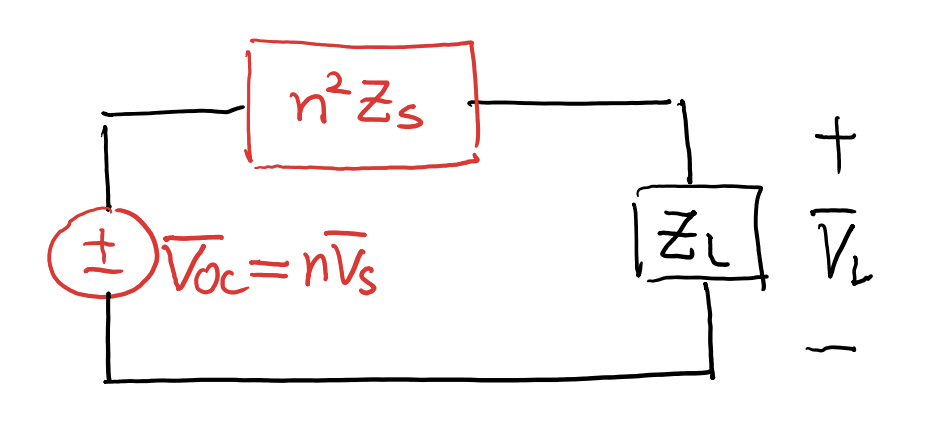

## Root-Mean-Square Value

RMS is the value used to evaluate the **Average Power** of the Signal

- As for the Instant Power, it’s $p(t) = v(t)i(t) = Ri^2(t) = \frac{v^2(t)}{R}$

Then we can use the Average Formula to find the RSM value

$$
P_{ave} = \frac{1}{T} \int_{0}^{T} p(t) dt=R( \frac{1}{T} \int_{0}^{T} i^2(t) dt)=\frac1R( \frac{1}{T} \int_{0}^{T} v^2(t) dt)
$$

$$
\Rightarrow P_{ave} = R \cdot I_{rms}^2=\frac{V_{rms}^2}{R} =V_{rms} \cdot I_{rms}
$$

### Special Case for Trig Functions

For those commonly seen Trig Functions, it’s RSM Value can be simplified to

$$
V_{rms} = \frac{V_A}{\sqrt{2}}
$$

## Transformer Design Example

Known the Voltage Source is $13.8kV$ and Wire is $R_{line}=5\Omega$, whereas the Secondary Requirement is $V_2= 240V$, with maximum current $I_L=200A$

---

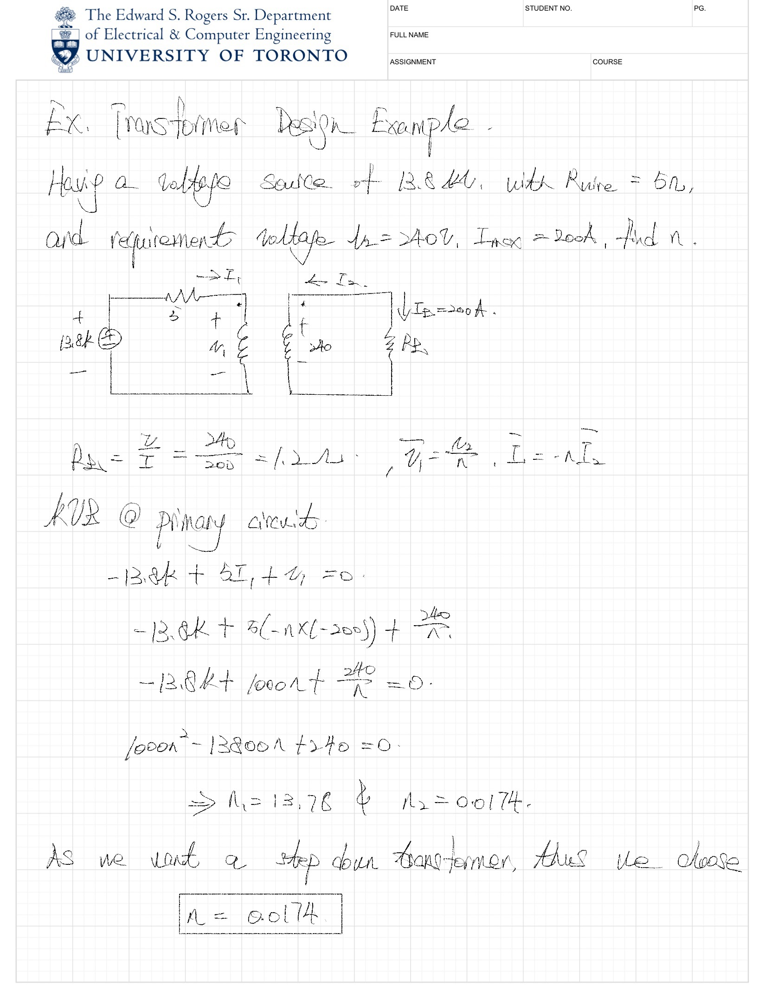

# Linear Transformers in Phasor Domain

Starting with the Voltage in Time domain, we have the equation

$$
v_1(t) = L_1 \frac{di_1(t)}{dt} \pm M \frac{di_2(t)}{dt}
$$

eThe first term is **Self-Induction** and Second term is **Mutual Induction**

Notice this is a **Differential Equation,** we wish to **transform this into phasor domain** to simplify the question, thus we will have

$$
\overline{V}_1 = j\omega L_1 \overline{I}_1 \pm j\omega M \overline{I}_2,\quad \overline{V}_2 = j\omega L_2 \overline{I}_2 \pm j\omega M \overline{I}_1 
$$

Now setting the Reactance to let $X_1 = \omega L_1$, $X_2 = \omega L_2$, and $X_M = \omega M$, we will then get

$$
\bar{V}_1 = jX_1 \bar{I}_1 \pm jX_M \bar{I}_2,\quad \bar{V}_2 = jX_2 \bar{I}_2 \pm jX_M \bar{I}_1
$$

## Coupling Coefficient in Phasor Domain

$$
k = \frac{M}{\sqrt{L_1 L_2}} = \frac{X_M}{\sqrt{X_1 X_2}}
$$

### Ex. Magnetically Coupled Circuits

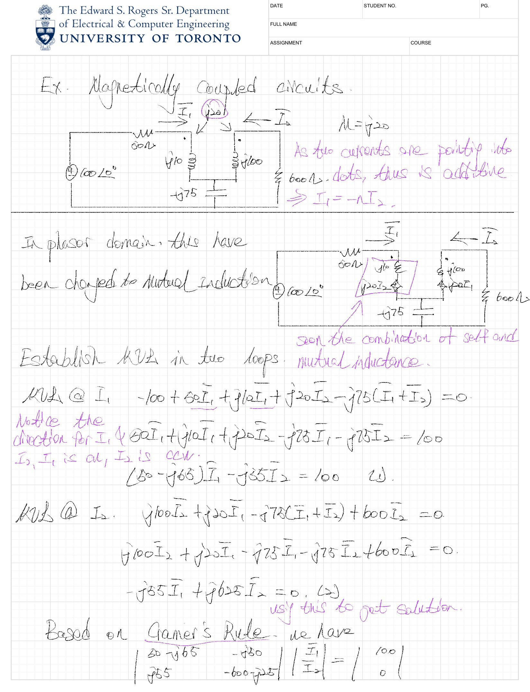

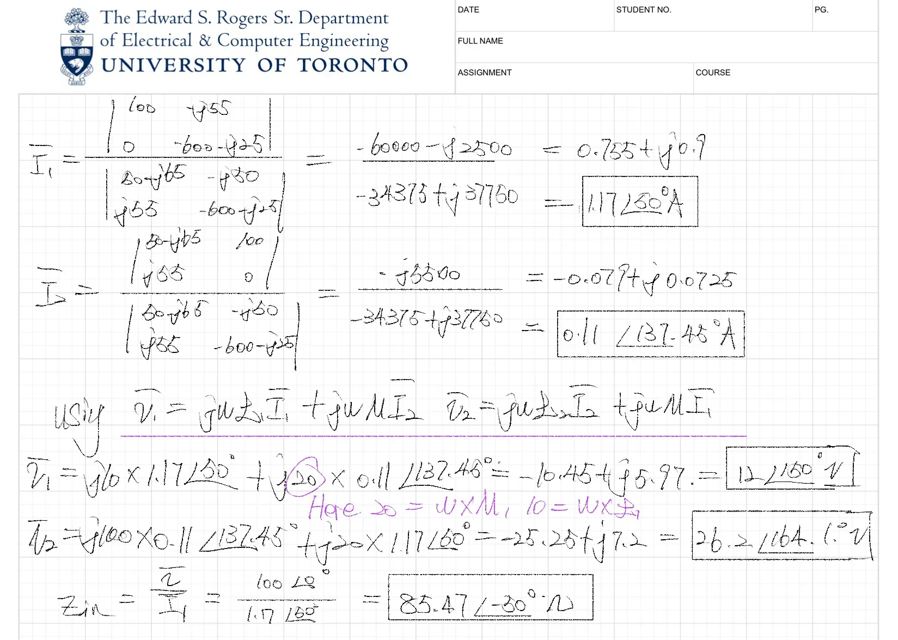

# Instantaneous and Average power

Giving a reference current with $i(t) = I_A \cos \omega t$, analyze the behavior of other elements’ ins and avg power

**Impedance** **has two parts $Z=R+jX$** 

- $R$: **Resistance** (Real), the **part really consuming energy**
    - Has the **same phase** for Current and Voltage
- $X$: **Reactance** (Imaginary), caused by the Electronic Field or Magnetic Field,
    - Has a **Phase difference** as over a period, the average of it will be induced back

| **Load** | Instantaneous Power | Average power |
| --- | --- | --- |
| Resistor | $\frac{V_A I_A}{2} [1 + \cos 2\omega t]$ | $\frac{V_A I_A}{2} = V_{rms} I_{rms} = R I_{rms}^2$ |
| Inductance | $-\frac{\omega L I_A^2}{2} \sin 2\omega t$a | 0 |
| Capacitor | $-\frac{\omega C V_A^2}{2} \sin 2\omega t$ | 0 |
- Average Power of Inductance and Capacitor over **a period will be zero out,** the Average Power is then zero
- Where as the Instantaneous Power **will have a phase difference of 90**

# AC Power System

Having a System of Sinusoidal Source $i(t) = I_A \cos(\omega t)$ and $v(t) = V_A \cos(\omega t + \theta)$, we are going to calculate its Ins and Average Power

## Instantaneous Power

Start with the equation $p(t) = v(t) \cdot i(t)$

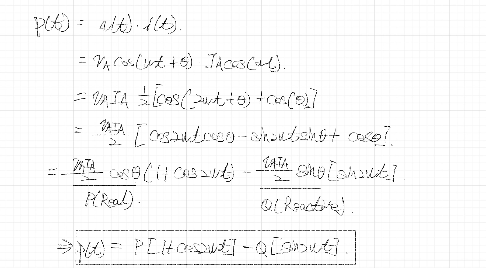

We can define two Power, Active and Reactive Power

- **Active Power**: **$P = \frac{V_A I_A}{2} \cos \theta$** , the power being consumed
- **Reactive Power**: **$Q = \frac{V_A I_A}{2} \sin \theta$** , the power transferring in Electro Field and Magnetic Field

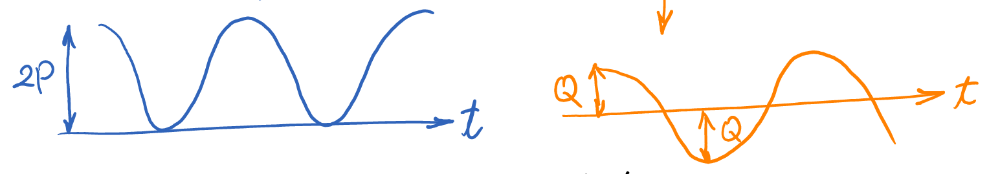

As indicated, the Blue one will be wasted, while orange one has the average of zero

## Average Power

The average is given by the Integral divided by Period, thus is 

$$
P_{ave} = \frac{1}{T} \int_{0}^{T} p(t)dt = \frac{V_A I_A}{2} \cos \theta
$$

<aside>
❗

**Notice Average Power is just Active Power**

</aside>

Here we can use the concept of **RMS**, and the fact that **$V_{rms} = \frac{V_A}{\sqrt{2}}$ and $I_{rms} = \frac{I_A}{\sqrt{2}}$** to get

$$
P_{ave} = V_{rms} I_{rms} \cos \theta
$$

In this equation, the **term $\theta$ is the only one deterring the number of Actual Work**, analyze it in different values

### Theta = 0

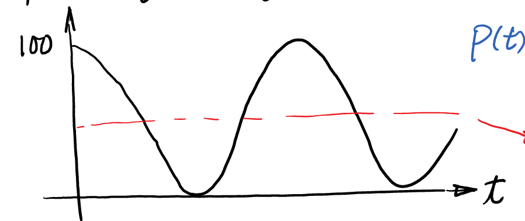

In this case, the Power is always on the top of t axis that makes the magnitude of Average Power to maximum

### Theta = 45

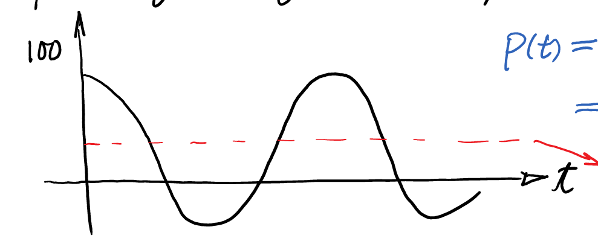

Part of the Power will be moved blow t axis, that means the power is return from the load to the source

## Average Power vs. Theta

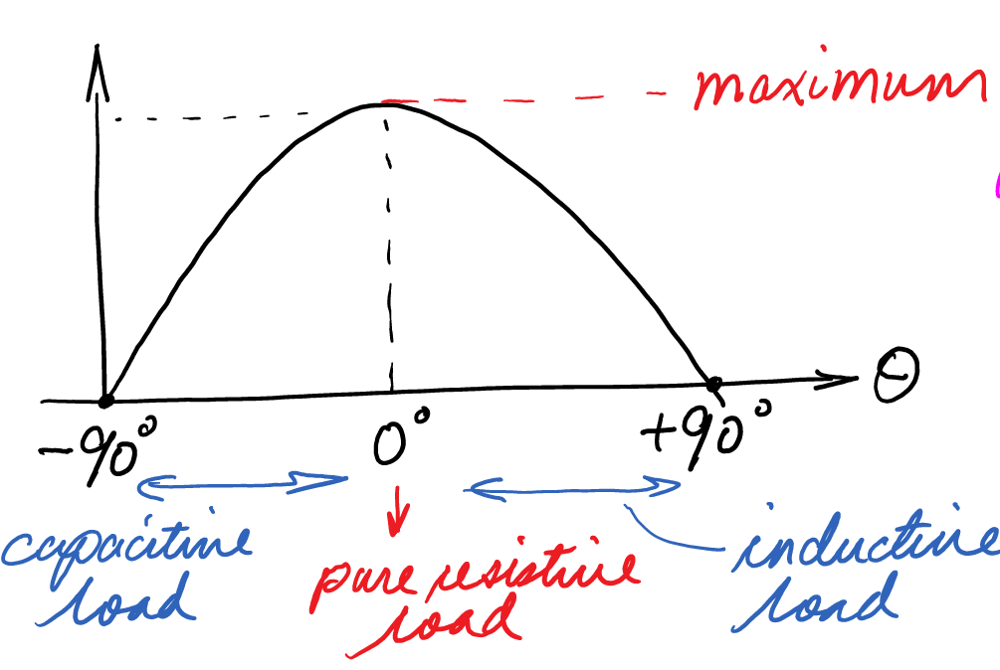

This is the graph of $cos\theta$ in the range from $[-\frac\pi2,\frac\pi2]$

## Lagging and Leading

$\theta$ basically tells if the system  has a lagging or leading in signal

- $\theta>0$: Voltage Phasor is larger than Current Phasor
- $\theta <0$: Current Phasor is large than Current Phasor

### Ex. Calculate the Power of System

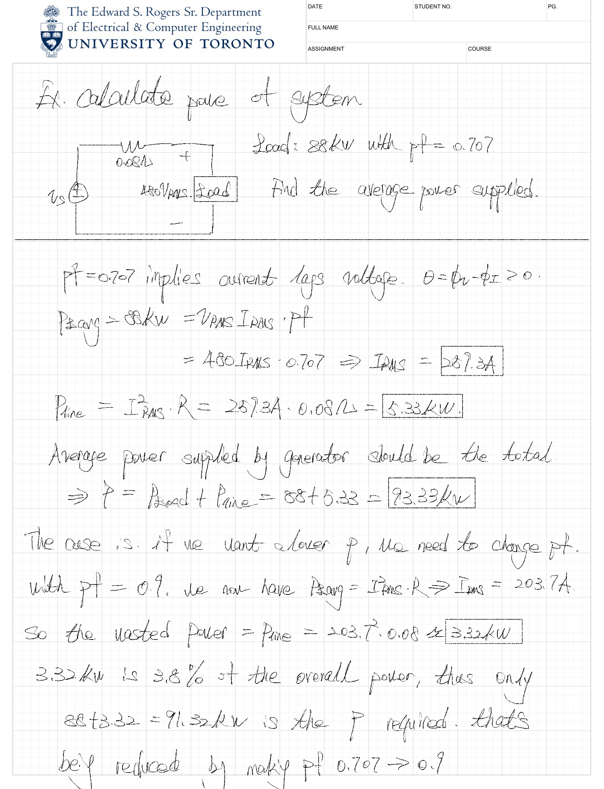

# Complex Power

Here we are going to summarize thing above, starting with the formula of Instantaneous Power

$$
p(t) = V_{rms}I_{rms}\cos\theta [1 + \cos 2\omega t] - V_{rms}I_{rms}\sin\theta [\sin 2\omega t]
$$

We now define the Complex Power as $\overline S=P+jQ$, whereas 

- $P$ is the Real Power, and the Average Power
- $Q$ is the Reactive Power
- Their magnitude $|\bar{S}| = \sqrt{P^2 + Q^2} = V_{rms} I_{rms}$, is the Apparent Power, that’s the capacity of power device have to have to make everything run
- $pf=\cos \theta$ is the Power Factor that determine the phase

## Analogy of beer

A good analogy for this Complex Power would be the beer

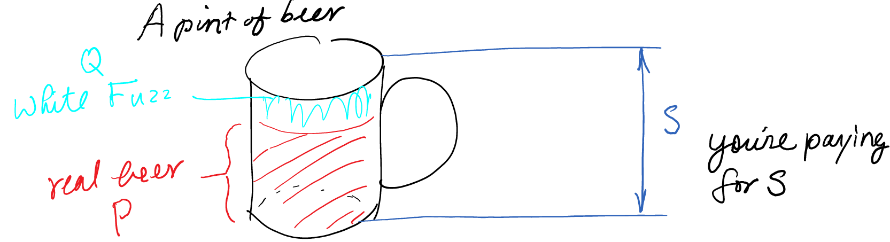

The Foam is the Reactive one and Real Beer is the Real (Active) one, whereas the size of the cup has to be S to hold both the fuzz and beer

## Complex Power in Phasor Domain

Now we can analysis the Instantaneous Power $p(t) = V_{rms}I_{rms}\cos\theta [1 + \cos 2\omega t] - V_{rms}I_{rms}\sin\theta [\sin 2\omega t]$  in Phasor Domain, as defined, the Complex Power is $\overline S=P+jQ$

$$
\Rightarrow \bar{S} = V_{rms} I_{rms} e^{j\theta} = V_{rms} I_{rms} \angle \theta= V_{rms} I_{rms} \angle (\phi_v - \phi_I)
$$

$$
\Rightarrow \overline S=V_{rms} \angle \phi_v \cdot I_{rms} \angle -\phi_I
$$

Known that $I_{rms} \angle -\phi_I = I^*_{rms}$, thus we get the final formula is

$$
\bar{S} = \bar{V}_{rms} \cdot \bar{I}_{rms}^*
$$

## The Power Triangle

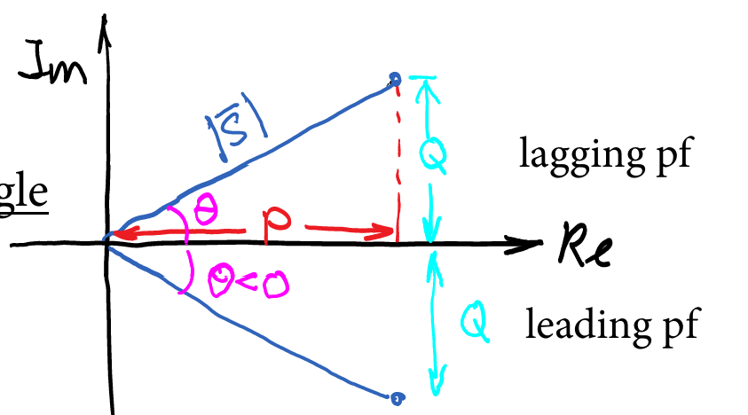

We can use a triangle on the complex plane to represent this Complex Power

### Ex. Calculating the Power Triangle for the system

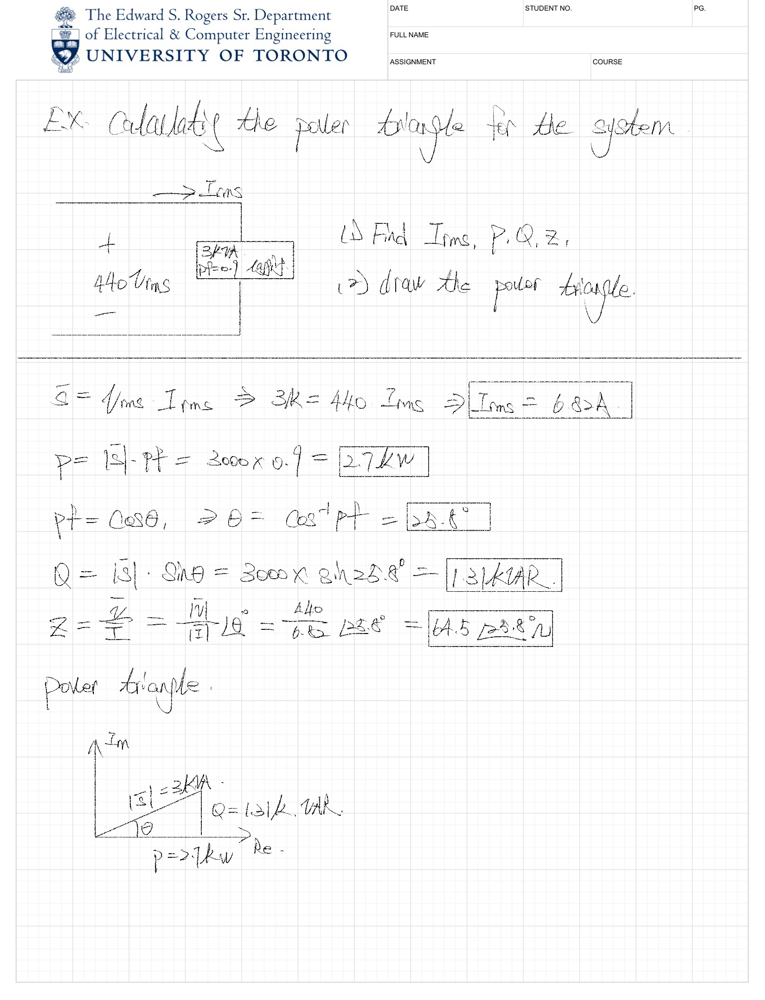

## Conservation of Complex Power in a System

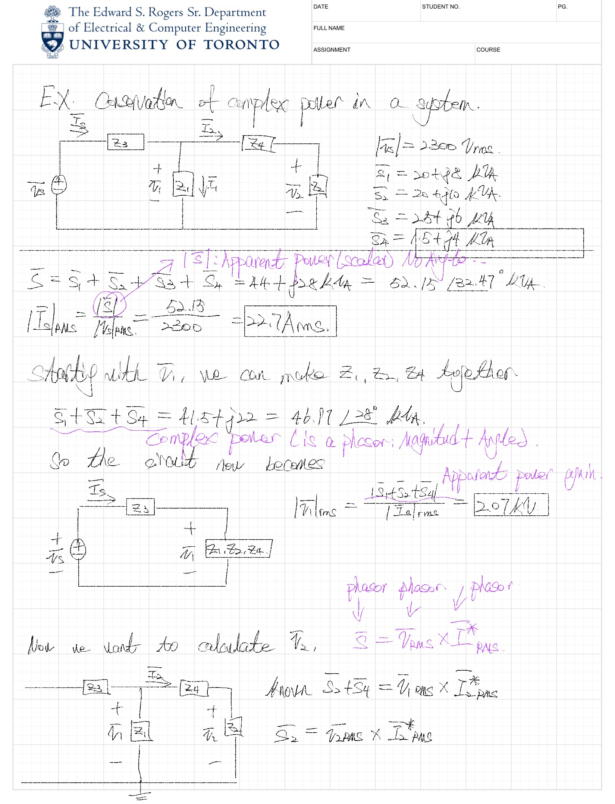

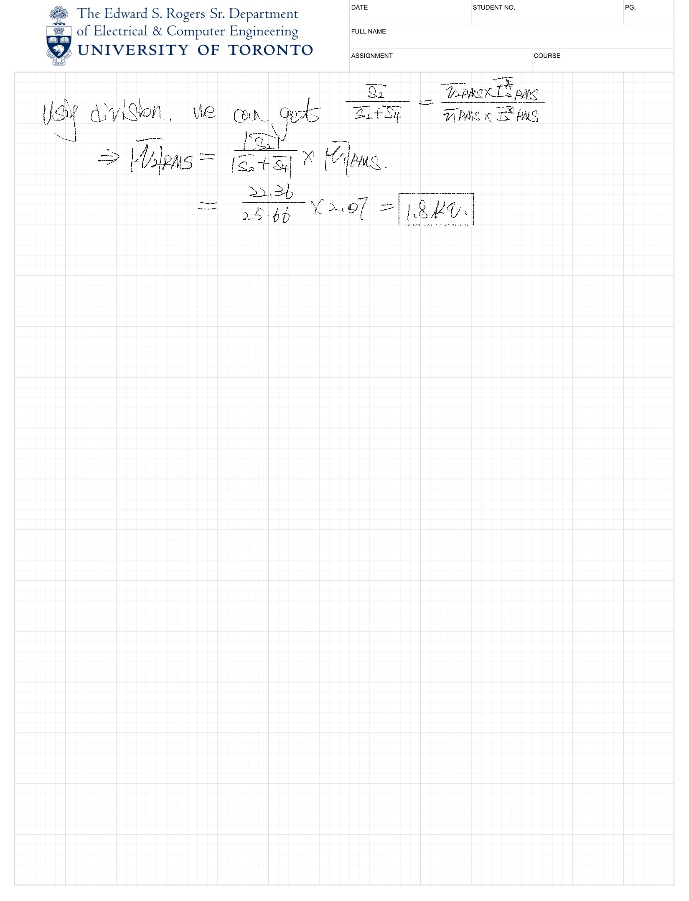

# Power Flow

Recall the ways we express the Power Flow, to begin with, we have four Powers

1. P: Active Power
2. Q: Reactive Power
3. $S_L$: Complex Power
4. $|S_L|$: Apparent Power
5. $\cos \theta$: Power Factor

## Given Active and Reactive Power

$$
\bar{S}_L = P_L + jQ_L
$$

## Given Apparent and Power Factor

$$
\bar{S}_L = P \pm jQ
$$

## Given Active and Power Factor

Use Active Power to find the Apparent Power $|\bar{S}_L| = \frac{P_L}{pf}$, then find the Reactive Power $|\bar{S}_L| = \frac{P_L}{pf}$

## Given Impedance and RMS

$$
\bar{S}_L = Z_L \cdot I_{rms}^2 = \frac{V_{rms}^2}{Z_L^*}
$$

## Ex. Source Voltage and Complex Power

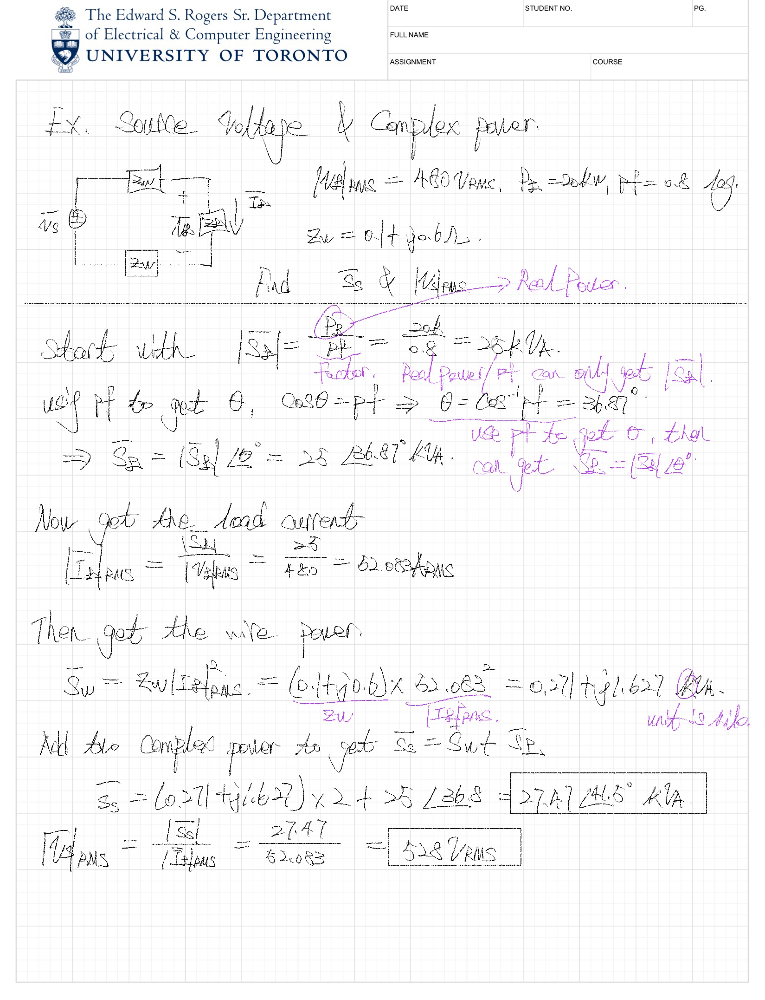

## Power Factor Correction

For most of time, the low Power Factor is not good, as the Real Power will be reduced, in order to transfer the same Real Power, it will need to transfer a larger transparent Power

On top of that, a larger current will increase the lose in the power line, thus we need to find a way to resize the Power Factor

---

**Power factor correction**: design feature that increases the pf without changing the real power

And the method we will apply is to parallel a Capacitor beside the Load Impedance

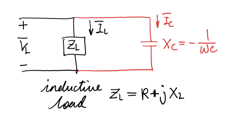

The Impedance for Load is $Z_L = R + jX_L$, and its Complex Power formula is 

$$
\bar{S}_L = P + jQ_L = R|\bar{I}_L|^2 + j\omega L \frac{|\bar{V}_L|^2}{|Z_L|^2}
$$

And for Capacitor, its Impedance is $X_C = -\frac{1}{\omega C}$, and its Complex Power Formula is

$$
\bar{S}_C = -j\omega C |\bar{V}_L|^2
$$

By adding them up, we will get

$$
\bar{S} = \bar{S}_L + \bar{S}_C = \underbrace{R|\bar{I}_L|^2}_{P} + \underbrace{j\omega \left( \frac{L}{|Z_L|^2} - C \right) |\bar{V}_L|^2}_{Q}
$$

Now, we would like to eliminate the $Q$ term to make the Charge Wire leave entirely to the Real Power, that’s the case when we need $C$ to be $C = \frac{L}{|Z_L|^2}$

Now we have complete the Power Factor Correction 

- without influencing the Power of Real Power
- Using Capacitor to eliminate the Reactive Power in Capacitor
- Make the Impedance into Resister

### Ex. Power Factor Correction

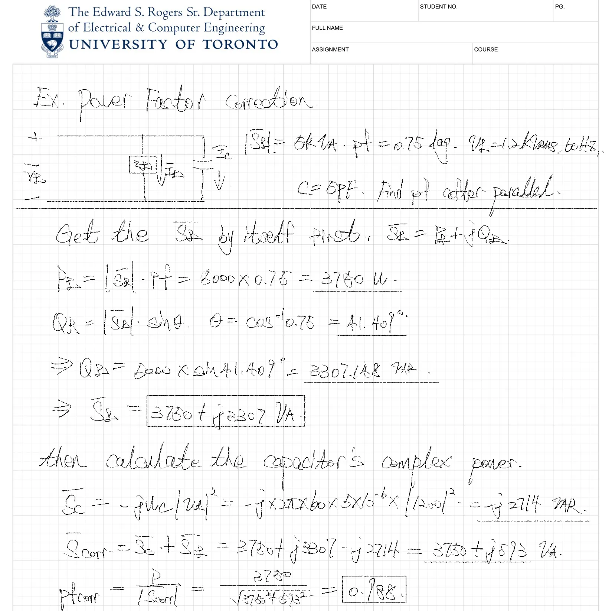

### Ex. Design Example for Power Factor Correction

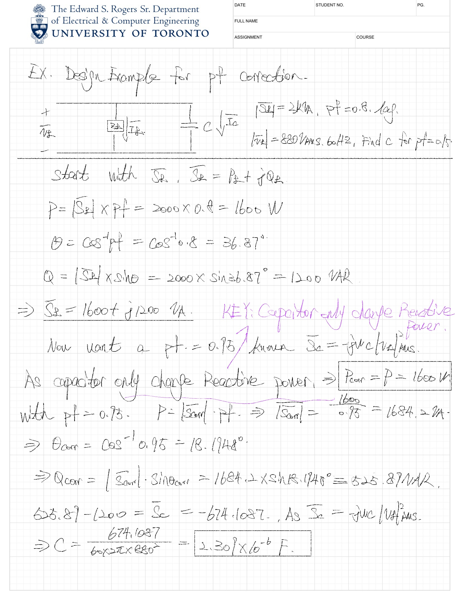