> Last Edit: 3/18/26

In the previous cases, we used transfer from Time Domain to Phasor Domains to analyze circuit with **Sinusoidal Steady-State**, but we suggest this method is too limited. To use Laplace Transform, we are able to deal with more general ones

Laplace Transform: Transfer circuit in Time Domain into Frequency Domain (s-Domain)

- In time domain the circuit is described by Differential Equations and in Frequency Domains they are Algebraic Equations
- We first use Laplace Transfer to change it into Frequency Domain, then get the result in Frequency Domain, and change it back to time Domain using Inverse Laplace

# Laplace Transform

$$
F(s) = \mathcal{L}\{f(t)\} = \int_{0^{-}}^{\infty} f(t) e^{-st} dt
$$

Notice the Interval of the Integral, with 0 as the lower bond, this means we assume $f(t)=0$ for all $t<0$

## The Inverse Laplace Transform

$$
f(t) = \mathcal{L}^{-1}\{F(s)\} = \frac{1}{2\pi j} \int_{\sigma-j\infty}^{\sigma+j\infty} F(s) e^{st} ds
$$

We actually never use this, instead we follow the Laplace Transform Pairs

| **信号名称 (Signal)** | **时域波形 f(t)** | **复频域变换 F(s)** |
| --- | --- | --- |
| **Impulse (单位冲击)** | $\delta(t)$ | 1 |
| **Step (阶跃函数)** | $u(t)$ | $1/s$ |
| **Ramp (斜坡函数)** | $t u(t)$ | $1/s^2$ |
| **Exponential (指数)** | $e^{-\alpha t} u(t)$ | $1/(s+\alpha)$ |
| **Sine (正弦)** | $\sin(\beta t) u(t)$ | $\beta/(s^2+\beta^2)$ |
| **Damped Sine (衰减正弦)** | $e^{-\alpha t}\sin(\beta t) u(t)$ | $\beta/[(s+\alpha)^2+\beta^2]$ |

## Uniqueness Property of Laplace Transform

Laplace Transform is a one to one function that

$$
If\quad \mathcal{L}\{f(t)\} = F(s)\quad  then\quad \mathcal{L}^{-1}\{F(s)\} = f(t)
$$

## Linearity of Laplace Transform

$$
\mathcal{L}\{a f_1(t) + b f_2(t)\} = a F_1(s) + b F_2(s)
$$

## Integration

Taking Integration in Time Domain equals to divided by s in s Domain

$$
\mathcal{L}\{\int_0^t f(\tau) d\tau\} = \frac{F(s)}{s}
$$

## Differentiation

Taking differentiation in Time Domain equals to timing s and subtract initial value din s domain

$$
\mathcal{L}\{\frac{df(t)}{dt}\} = sF(s) - f(0^-)
$$

## Translation Properties

There’s two shift for Laplace, one is shifting in Time Domain, the other is shifting in Frequency Domain

Frequency Damian Translation: 

$$
\mathcal{L}\{e^{\alpha t} f(t)\} = F(s - \alpha)
$$

Time Domain Translation

$$
\mathcal{L}\{f(t-\alpha) u(t-\alpha)\} = e^{-\alpha s} F(s)
$$

## Poles and Zeros

For linear Circuits, the Frequency Domain $F(s)$ tends to be a Rational Fraction

$$
F(s) = K \frac{(s - z_1)(s - z_2) \dots (s - z_m)}{(s - p_1)(s - p_2) \dots (s - p_n)}
$$

Whereas there are to kind of discontinuity in this Fraction, Zeros and Poles

- Zeros: When Nominator is zero
- Poles: When Denominator is zero

### Ex. Laplace Transform and their Discontinuity

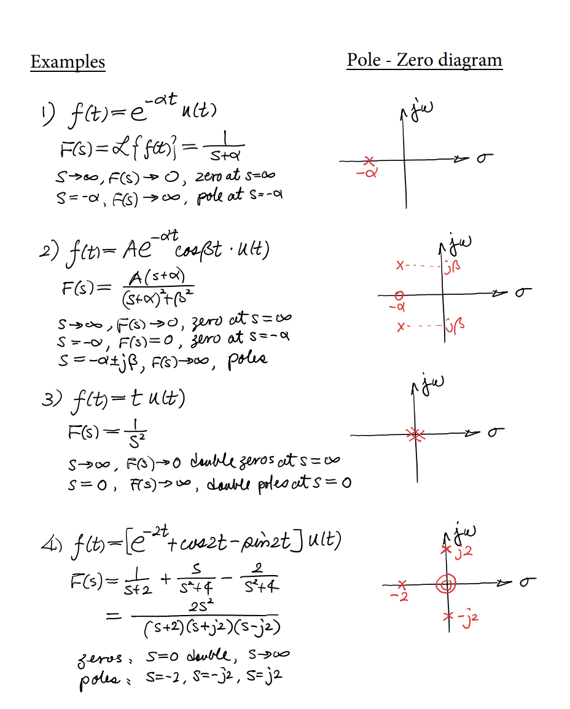

## Finding the Inverse Laplace Transform

As indicated, most of the Laplace Function we seen will have the form of

$$
F(s) = k \frac{(s-z_1)(s-z_2) \cdots (s-z_m)}{(s-p_1)(s-p_2) \cdots (s-p_n)}
$$

and there could be several cases for this function, but we need to make sure **the degree of nominator must be smaller than degree of denominator to begin**

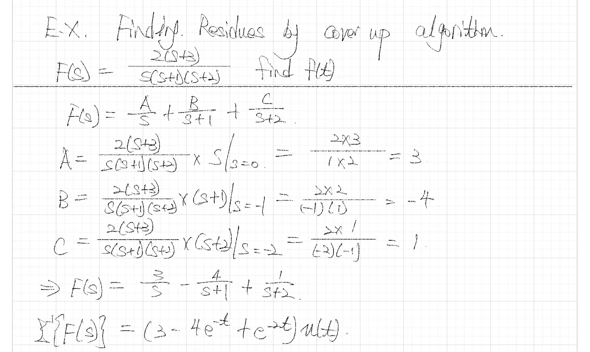

### Case 1: Distinct Poles

When all poles are the degree of one, thus we will have the function in the form of

$$
F(s) = \frac{k_1}{s-p_1} + \frac{k_2}{s-p_2} + \cdots + \frac{k_n}{s-p_n}
$$

Where the coefficients $k_1, k_2, \dots, k_n$ here are called Residues

---

And Covering Up Method is what we used for finding Residues

### Special Case 1: Complex Roots

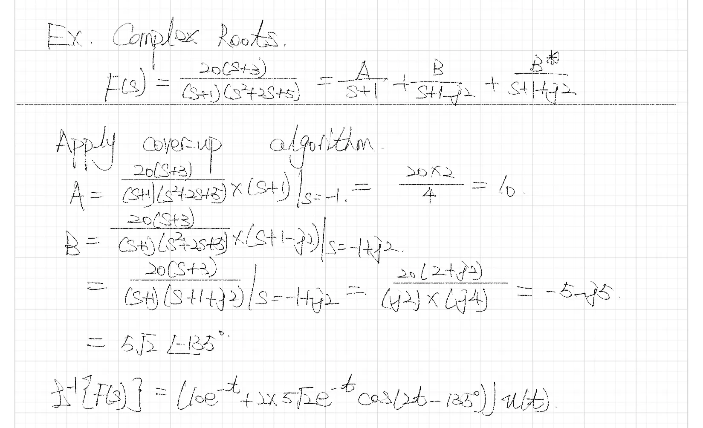

### Case 2: Repeated Roots

When one poles exist more than one times, then its a repeated root with the form

$$
F(s) = \frac{N(s)}{(s-p_1)^r (s-p_2) \cdots}
$$

In this case, for that $(s-p_1)$ term, we need to expand it into r terms, which is

$$
F(s) = \frac{k_{11}}{(s-p_1)^r} + \frac{k_{12}}{(s-p_1)^{r-1}} + \cdots + \frac{k_{1r}}{s-p_1} + \text{others}
$$

And in this case, we can’t use the Cover up method anymore, instead we need derivatives

$$
k_{1j} = \frac{1}{(j-1)!} \frac{d^{j-1}}{ds^{j-1}} \left[ (s-p_1)^r F(s) \right] \Bigg|_{s=p_1}
$$

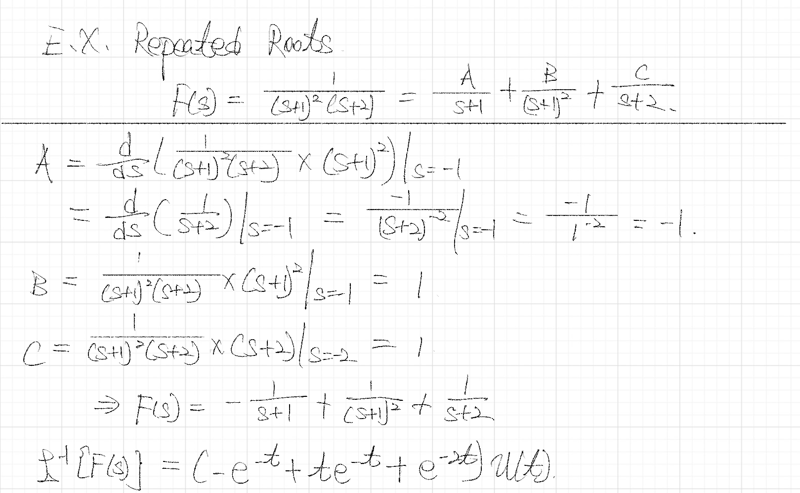

### Special Case 2: Two Complex Double Poles

When there’s Complex Root and there time is more than one, in the form of

$$
F(s) = \frac{K}{(s-p_j)^2(s-p_j^*)^2} = \frac{k}{(s+\alpha-j\beta)^2} + \frac{k^*}{(s+\alpha+j\beta)^2}
$$

It’s Laplace Inverse in time domain will then be a sinusoid signal with time linear decay 

$$
f(t) = 2|k| t e^{-\alpha t} \cos(\beta t + \theta) u(t)
$$

### Case 3: Improper Rational Function

Use long division first to get the fraction in the form of a Polynomial + a Real Fraction

# Laplace Circuit Analysis

## Fist Order Series RC Circuit

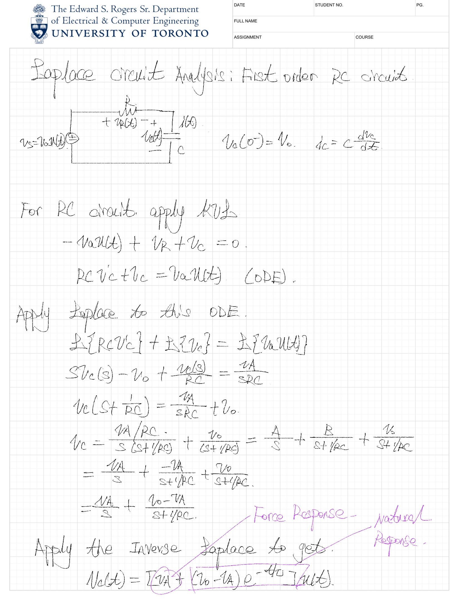

## Circuit Elements in S-domain

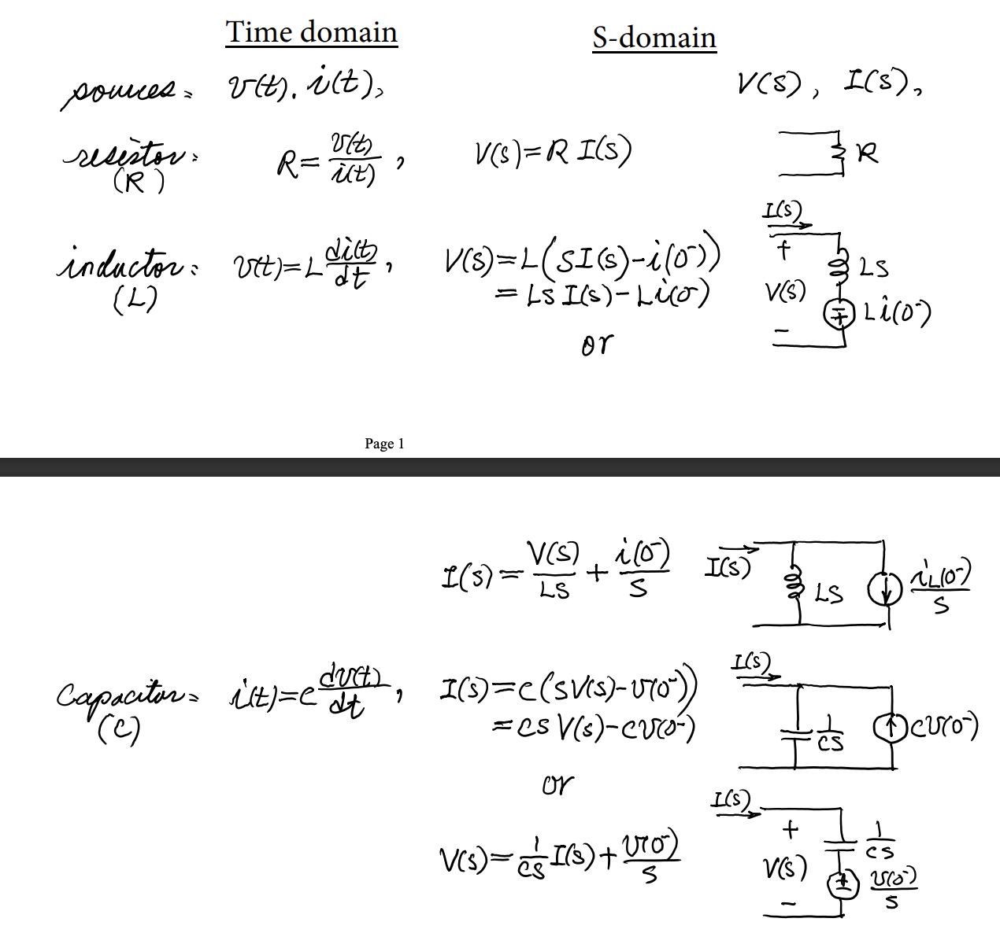

### Ex. A Inductor in S-domain

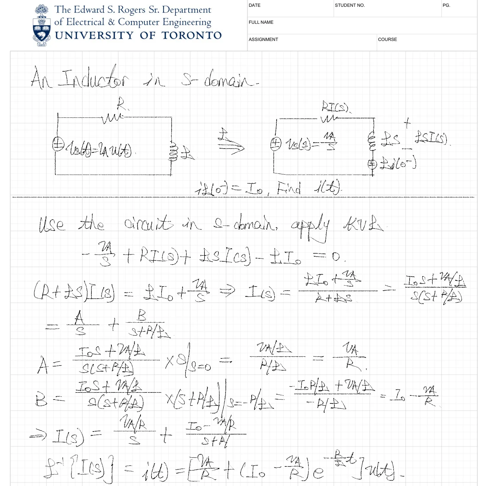

### Ex. Circuit Analysis in S-domain

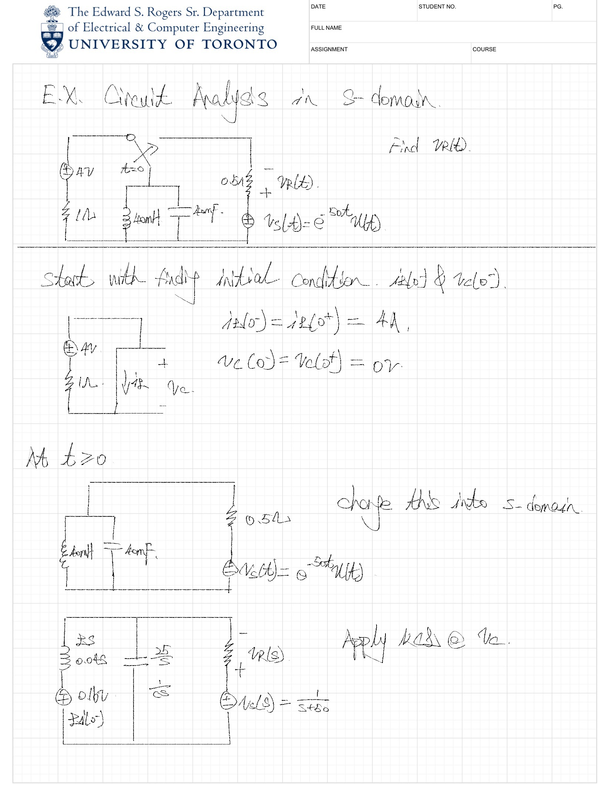

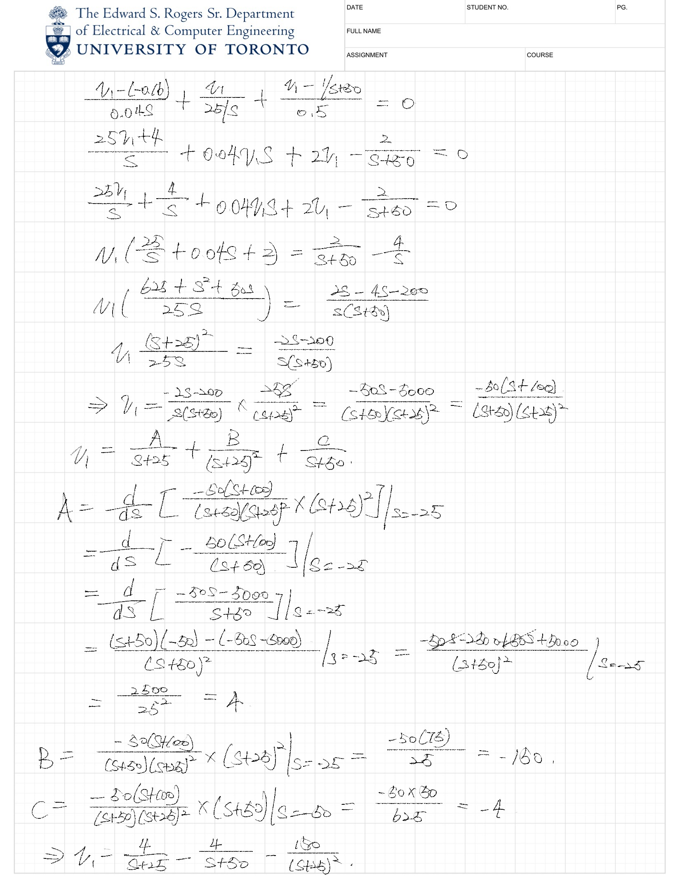

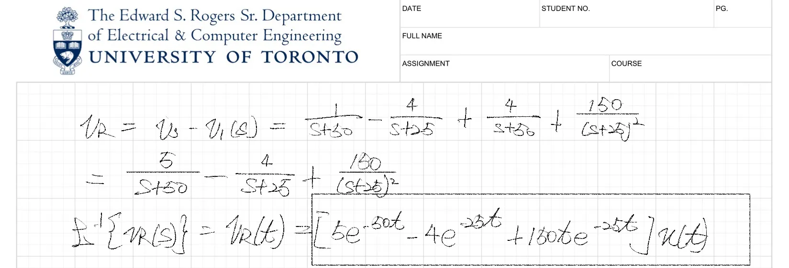

## Interesting feature: combine source & switch

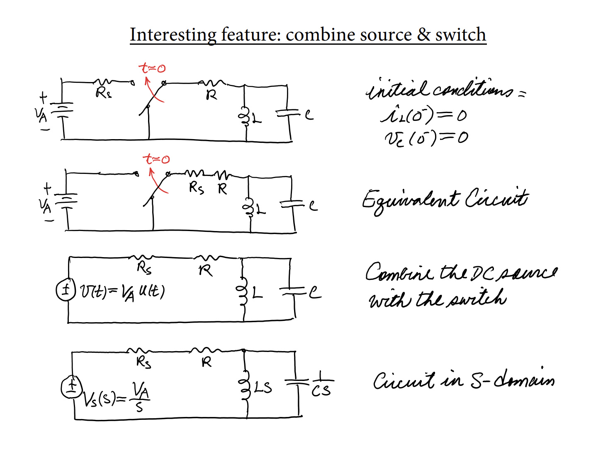

Thus in S-domain, the ODE becomes a DC circuit

## Techniques applicable in S-domain

There’s some same techniques we used in time domain that can be also apply on the S-domain

1. Series and Parallel Equivalence of Impedances
2. Voltage and Current division rules
3. Superposition
4. Nodal and Mesh Analysis
5. Thevenin and Norton Equivalent Circuits

### Ex. S-domain Circuit Analysis

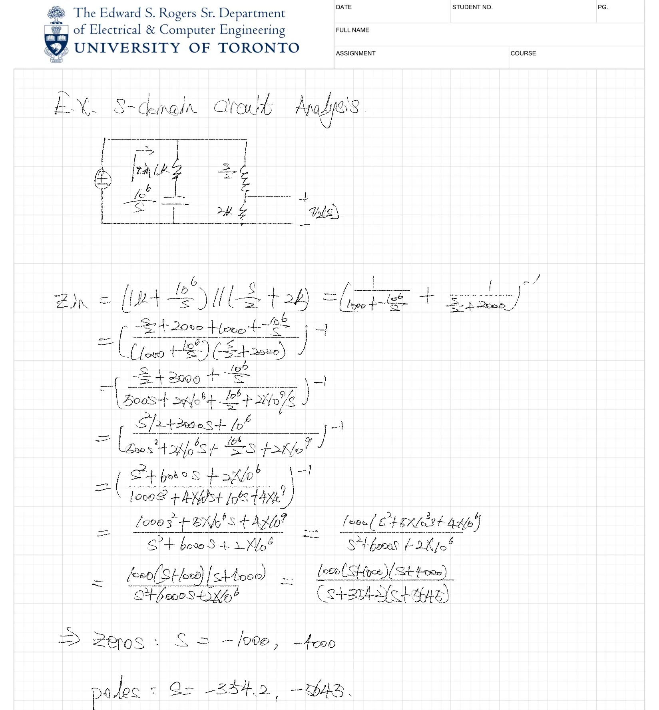