> Last Edit: 3/23/26

# Network function, Transfer function

Under Zero Initial Condition, the Network function is being defined as the ratio between input and output Laplace Transform

$$
T(s) = \frac{Y(s)}{X(s)}
$$

This function can be extract into two parts, Natural Poles and Forced Poles

- Natural Poles: Natural Response due to poles of $T(s)$
- Forced Poles: Forced Response due to poles of $X(s)$

## Observations

- Stable Circuit: If a circuit’s Natural Response dies down to zero as time pass, then it’s a Stable Circuit
- This is equivalent to all the poles of $T(s)$ is on the Left-Half Plane of S-domain
    - This is because $p = \sigma + j\omega$ is equivalent to $e^{pt} = e^{\sigma t}e^{j\omega t}$ in time domain, thus only a negative real part make this to zero eventually

### Forced Response & Steady-State

If the input signal $X(s)$’s poles is also on the left-half plane, then its Forced Response will also goes to zero

- Otherwise, this will form a Steady-State Response for those Forced Poles

### Ex. Find the Zero-State Response for RC circuit

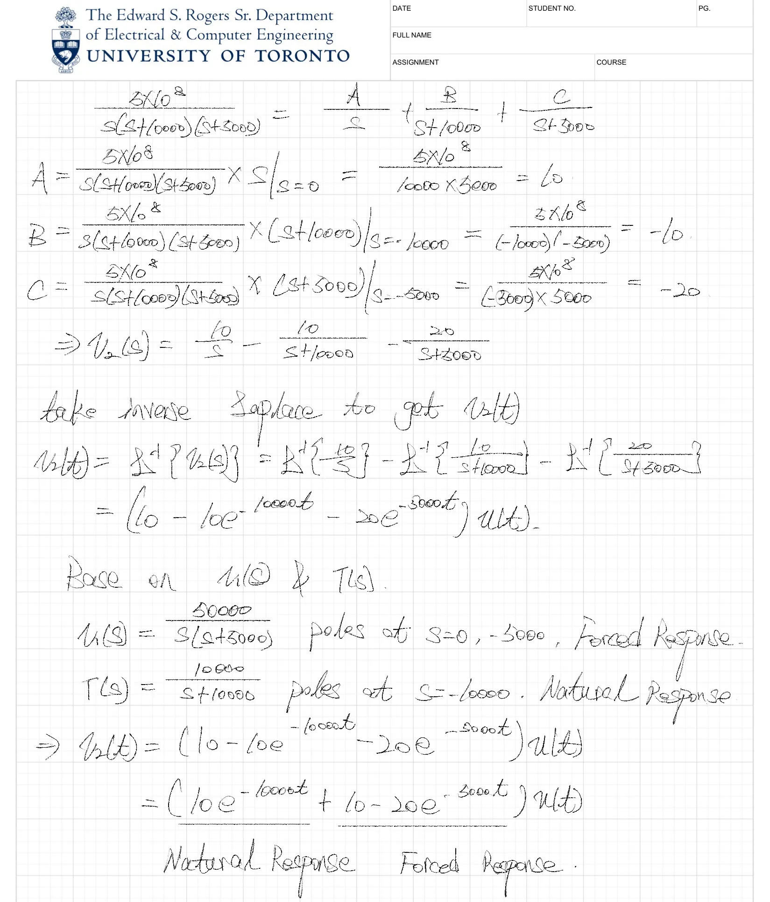

## Transfer Function

### One-port Network

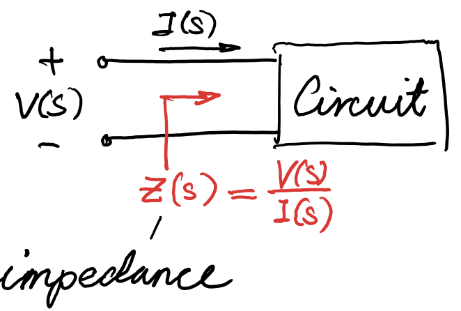

This Port’s Transfer Function is normally a Impedance, as there’s only one port, thus no transfer inside, instead all we get is a element by itself

### Two-port Network

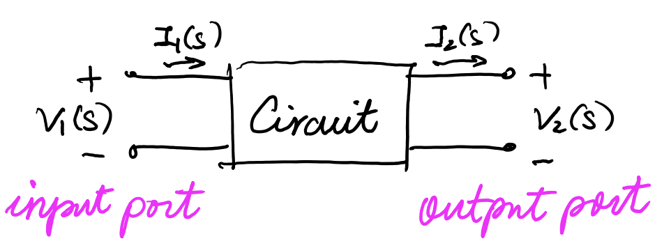

For Two-port Network, there’s an input and an output, based on the type for in and output, there could be four types of Transfer Function

1. Voltage Transfer Function: $T_V(s) = \frac{V_2(s)}{V_1(s)}$
2. Current Transfer Function: $T_I(s) = \frac{I_2(s)}{I_1(s)}$
3. Transfer Admittance: $T_Y(s) = \frac{I_2(s)}{V_1(s)}$
4. Transfer Impedance: $T_Z(s) = \frac{V_2(s)}{I_1(s)}$

## Forward and Reverse Transfer Function

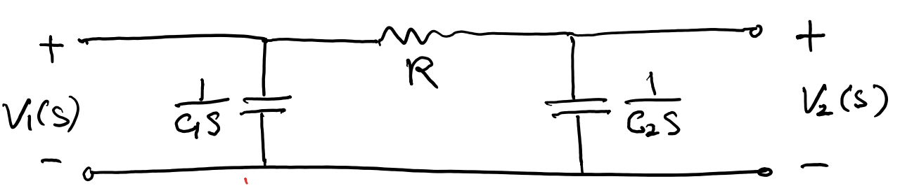

<aside>
❗

The logic is that, where ever the input source is, the element beside it will be neglect

</aside>

### Forward Transfer Function

If we use $v_1(s)$ as input, then $C_1$ is neglectable in this case, what’s remaining is then only a series circuit between R and C

$$
T(s) = \frac{V_2(s)}{V_1(s)} = \frac{\frac{1}{C_2 s}}{R + \frac{1}{C_2 s}} = \frac{1/RC_2}{s + 1/RC_2}
$$

### Reverse Transfer Function

Now we take $v_2(s)$ as the input, then $C_2$  is being discarded, thus

$$
T'(s) = \frac{\frac{1}{C_1s}}{R + \frac{1}{C_1s}} = \frac{1/RC_1}{s + 1/RC_1}
$$

---

<aside>
❗

Generally Speaking: $T(s) \neq T'(s)$

</aside>

## Examples of Transfer Functions

### Voltage Divider Circuit

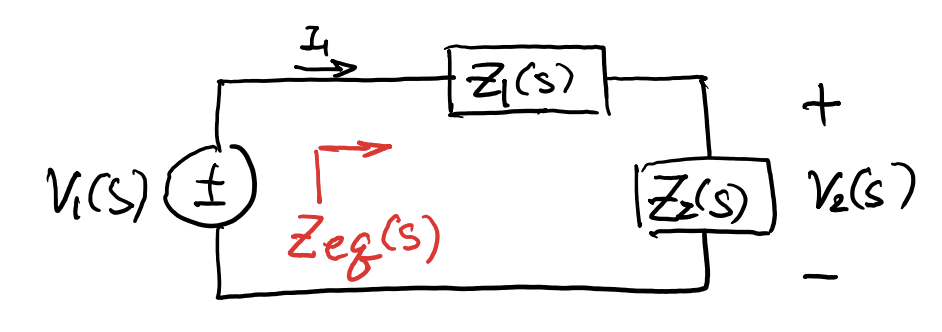

Its Voltage Transfer Function is: $T_V(s) = \frac{V_2(s)}{V_1(s)} = \frac{Z_2}{Z_1 + Z_2}$

Its Driving Point Admittance is then: $Z_{eq} = Z_1 + Z_2$

### Current Divider Circuit

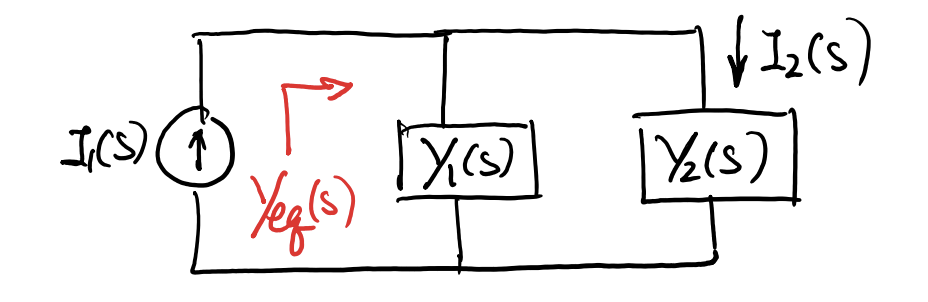

Its Current Transfer Function is $T_I(s) = \frac{I_2(s)}{I_1(s)} = \frac{Y_2}{Y_1 + Y_2}$

Its Driving-Point Admittance is $Y_{eq} = Y_1 + Y_2$

### Op-amp Circuits

There’s a lot kind of Op-amp, here we only analysis Inverting and Non-Inverting ones, but the key to analysis both of them is by Virtual Short that $(V_p=V_n, i_p=i_n=0)$

---

### Inverting Amplifier

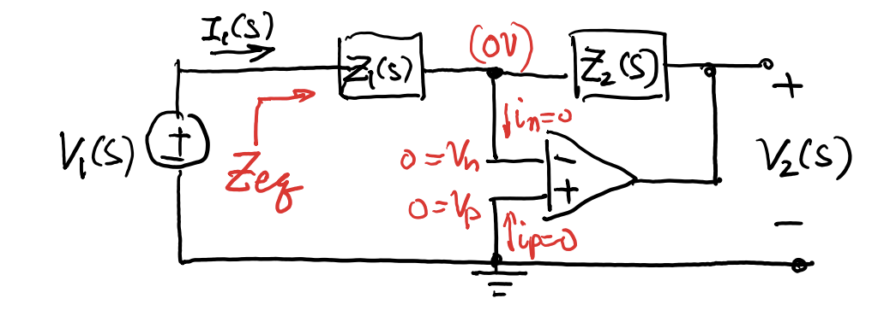

Known the closed gain for Inverting Amplifier is $T_V(s) = \frac{V_2(s)}{V_1(s)} = -\frac{Z_2}{Z_1}$

Whereas the Driving Impedance is $Z_{eq} = Z_1$

### Non-Inverting Amplifier

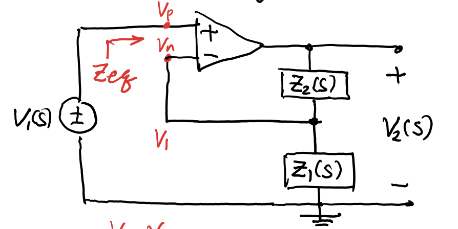

Its Transfer function is $V_1 = \frac{Z_1}{Z_1 + Z_2} V_2 \implies T_V(s) = \frac{Z_1 + Z_2}{Z_1} = 1 + \frac{Z_2}{Z_1}$

### Ex. Finding Transfer Function for a Circuit

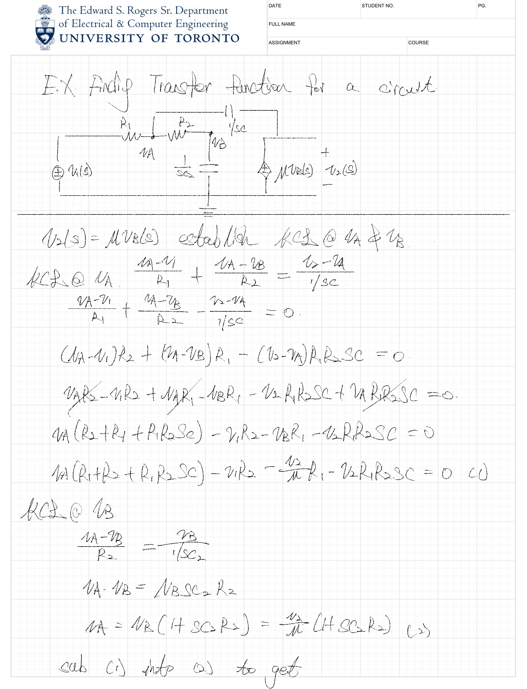

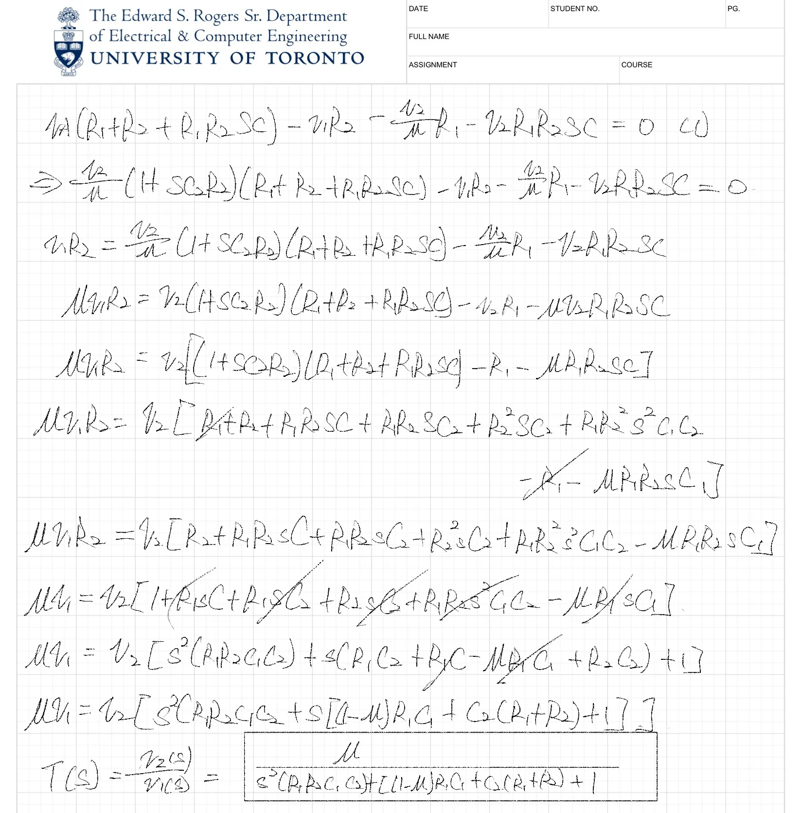

## Cascade Connection

Known that a Two-port Network has the Transfer Function of $V_2(s) = T_V(s) V_1(s)$, however, this is under a open circuit configuration, if there’s a Load on the output port, it will created a divider port then

$$
V_2(s) = \underbrace{V_1(s) T_V(s)}_{\text{Open Response}} \times \underbrace{\frac{Z_L}{Z_T + Z_L}}_{\text{Divider Factor}}
$$

This can be solved by adding a Buffer

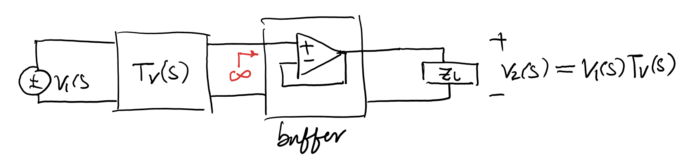

# Impulse Response, Convolution

## Definition of Impulse Function

Impulse function has the following property

- When **$t\neq 0$, $\delta(t)=0$**
- Integral **containing origin is always 1**

## Sifting Property of Impulse Function

Impulse function can **sifting** a point’s value of a function at given time $t_0$

$$
\int_{-\infty}^{\infty} f(t) \delta(t-t_0) dt = f(t_0)
$$

## Laplace Transform of Impulse Function

$$
D(s) = \mathcal{L}\{\delta(t)\} = \int_0^\infty \delta(t) e^{-st} dt=1
$$

Notice this integral is just the **Sifting of function $e^{-st}$ at $t=0$**, thus is equal to **one**

Thus we can also get **$\mathcal{L}^{-1}\{1\} = \delta(t)$**

## Impulse response of a circuit

Known in a circuit, with **$\delta (t)$ as the input, the output $h(t)$** shall be the **Impulse Response**

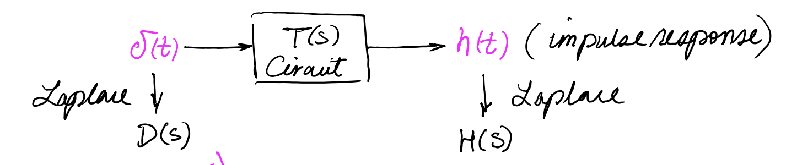

Then take both side for Laplace, we get the two S-domain function $D(s)$ and $H(s)$, notice $\mathcal L\{\delta (t)\} = D(s)=1$, thus we have the output as

$$
H(s) = T(s) \cdot D(s)=T(s)\cdot 1\Rightarrow H(s)=T(s)
$$

<aside>
❗

**The circuit transfer function is just the impulse response in S-domain**

</aside>

### Circuit response in S-domain

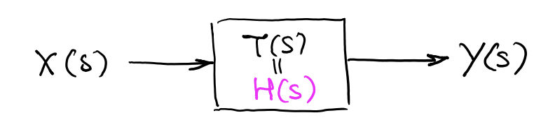

Based on the property $H(s)=T(s)$, we get $Y(s) = T(s)X(s) = H(s)X(s)$ 

### Circuit response in Time-domain

Taking the **Inverse Laplace** on both side to get 

$$
y(t) = \mathcal{L}^{-1}\{Y(s)\} = \mathcal{L}^{-1}\{H(s)X(s)\}
$$

### Ex. Finding the Time Domain output of LTI System using Laplace Transform

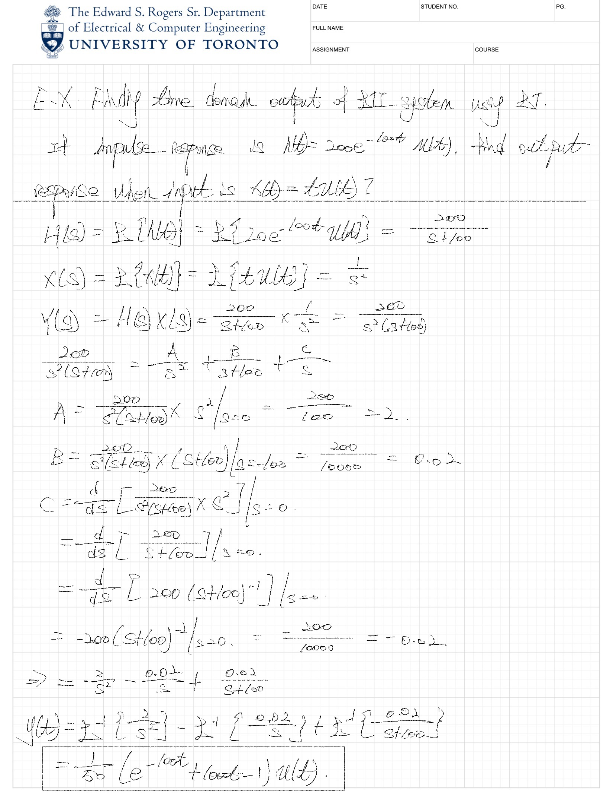

## Direct time-domain solution

This part contains a derivation, and its final claim is

$$
Y(s) = H(s)X(s) \iff y(t) = h(t) * x(t)
$$

## Convolution Integral

$$
h(t) * x(t) = \int_{0}^{t} h(t-\tau) x(\tau) d\tau
$$

### Property of convolution

1. **Commutative**: $f(t) * g(t) = g(t) * f(t)$
2. **Associative**: $f(t) * [g(t) * w(t)] = [f(t) * g(t)] * w(t)$
3. **Distributive**: $f(t) * [g(t) + w(t)] = [f(t) * g(t)] + [f(t) * w(t)]$
4. **Convolution** with an **impulse**: $f(t) * \delta(t-t_0) = f(t-t_0)$

### Ex. Finding the time domain output of LTI System using Convolution

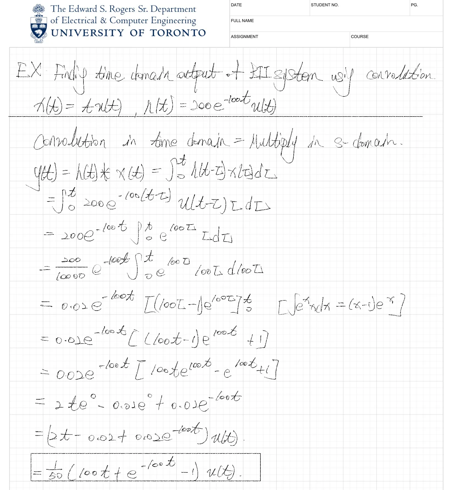

## The meaning of convolution

Result of convolution is an **addition of weighted function sampled points**

# Step Response

The $u(t)$  is a kind of **classic step function**

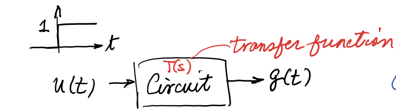

$$
G(s) = T(s) \cdot \mathcal{L}\{u(t)\} = T(s) \cdot \frac{1}{s}
$$

Known that $T(s)$ is normally a fraction with Poles $p_1,p_2,\dots,p_n$m, that can be extract into

$$
G(s) = \frac{k_0}{s} + \frac{k_1}{s-p_1} + \dots + \frac{k_n}{s-p_n}
$$

Taking the inverse Laplace Transform to get

$$
g(t) = k_0 u(t) + (k_1 e^{p_1 t} + \dots + k_n e^{p_n t}) u(t)
$$

This Time domain output contains two parts, **Forced Response** and **Natural Response**

- **Forced Respons**e: $k_0 u(t)$, caused by the **input signal**
- **Natural Response**: $(k_1 e^{p_1 t} + \dots + k_n e^{p_n t}) u(t)$, determined by the **poles of Transfer Function**

### Stable System

For a Stable System, the **Natural Response** will **decay to zero** as time passes, so that means as time $t\rightarrow \infty$, $g(\infty)\rightarrow k_0$ 

And $k_0$ can be found using the **Cover-up Algorithm** **$k_0 = s G(s) \big|_{s=0} = T(s) \big|_{s=0} = T(0)$**, thus eventually the Step Response can be represented by

$$
g(t) = T(0) u(t) + (k_1 e^{p_1 t} + \dots + k_n e^{p_n t}) u(t)
$$

## Relationship between Step response and Impulse response

<aside>
❗

**In Time Domain, Step Function is the integral of Impulse Function, and Impulse Function is the derivative of Step Function**

**In Frequency Domain, there’s a s term difference between Impulse and Step Function**

</aside>

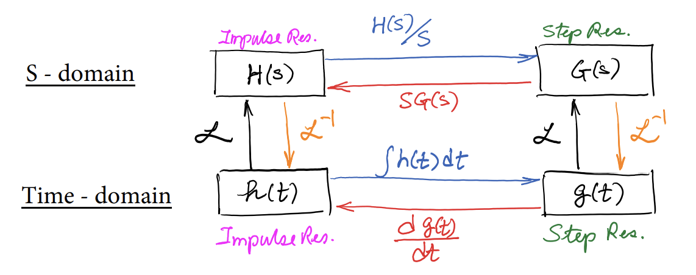

By this relationship, we can get that, if we want the **Impulse Response $h(t)$ of the System** which can **reveal the behavior of the System**, we can 

- Start with a **Step Function** input to get the **Step** **Response** of the System
- Then use a **Differentiator** **Circuit** to **get the Impulse Response $h(t)$**

### Ex. Find the Step Response

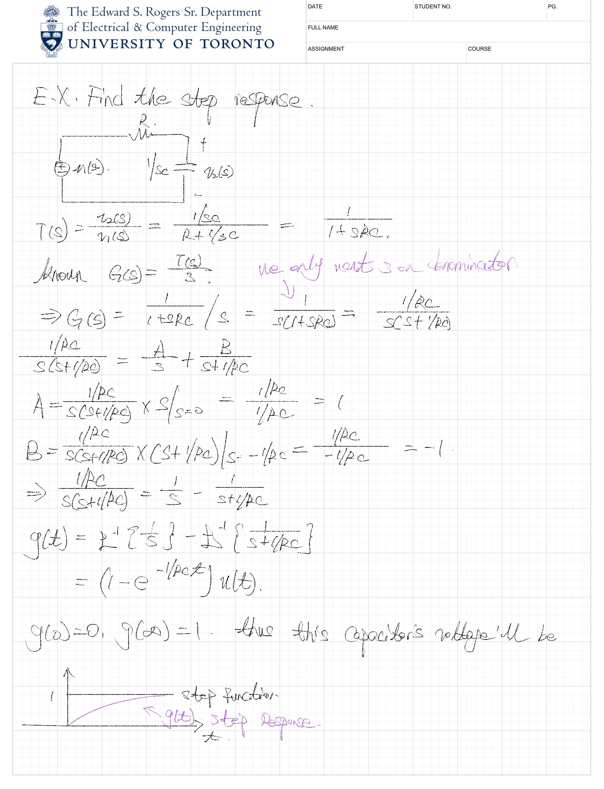

### Ex.

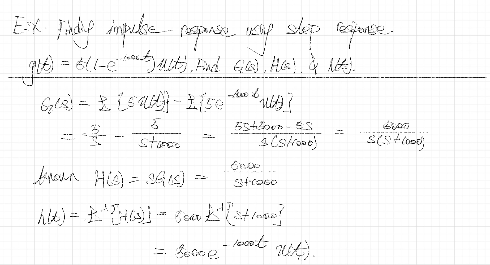

## Sinusoidal Response

Here we are trying to analysis when the input is a **Sinusoidal Signal**, in the **form of $x(t) = X_A \cos(\omega t + \phi)$,** base on the **Laplace Transform pair,** we can get $X(s)$

$$
X(s) = X_A \left[ \frac{s \cos \phi - \omega \sin \phi}{(s - j\omega)(s + j\omega)} \right]
$$

Notice the poles are **$(s - j\omega)(s + j\omega)$ on Complex Plane**

Recall the Response **contains Forced Poles and natural Poles**

- **Forced Poles**: $s = j\omega$ and $s = -j\omega$, in the form of **$\frac{k}{s - j\omega} + \frac{k^*}{s + j\omega}$,** taking the **Inverse Lapalce** will give us $y(t) = k e^{j\omega t} + k^* e^{-j\omega t}$
- **Natural Poles**: Due to the System itself
- **Steady-State Response**: When **Natural Response decay to zero**, then we get

$$
y_{ss}(t) = k e^{j\omega t} + k^* e^{-j\omega t}
$$

Then we shall we Cover-up Algorithm to calculate $k$, that will be $k = (s - j\omega) Y(s) \big|_{s = j\omega}$, and the result will be 

$$
y_{ss}(t) = X_A |T(j\omega)| \cos(\omega t + \phi + \theta)
$$

- **$X_A |T(j\omega)|$, Amplitude:** Determine by **Input Amplitude** and **System Gain**
- **$\phi + \theta$, Phase Angle:** Determine by **Input Phase** and **System Shifting**

<aside>
❗

**Recall, a System only have a Scaling of Amplitude and Shifting of Phase on input**

</aside>

### Ex.

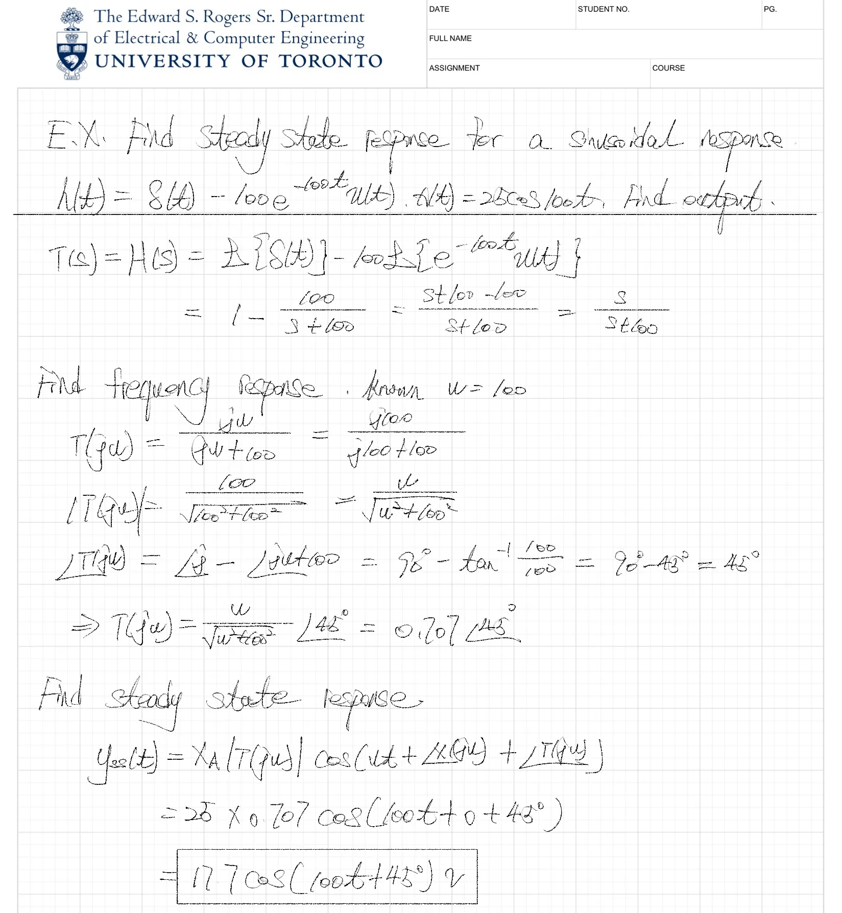

# Frequency Response

Recall the Transfer Function, with input as **Various Frequency Components**, the Transfer Function contains **Amplitude $|T(j\omega)|$ and Phase Change $\angle T(j\omega)$** two parts

What this **Transfer Function** does is called the **Frequency Response** which is a “profile” that capture how circuit “process” signal component to different frequencies

## Low Pass Filter

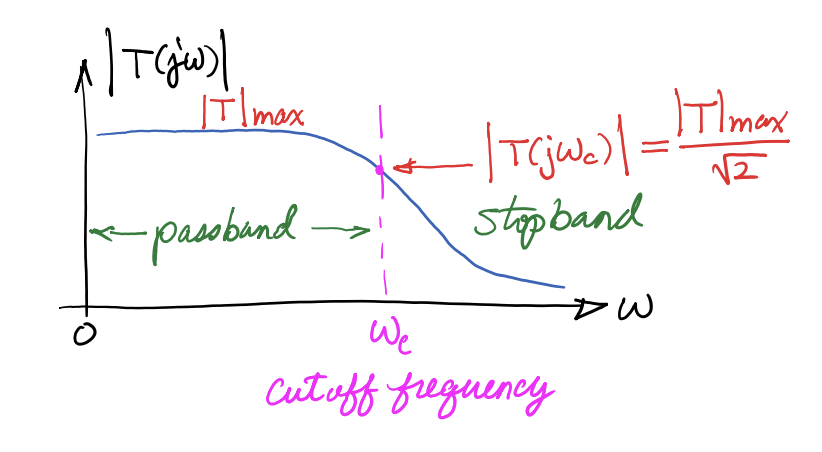

By setting a Cut Off Frequency $\omega_0$, we set up this **Low Pass Filter**, as **this is not an Ideal LPF**, we set up the frequency **out of the band with a decay model**

Different Filter will have there own passband Area

- **Low-pass**：$[0, \omega_c]$
- **High-pass**：$[\omega_c, \infty)$
- **Band-pass**：$[\omega_{c1}, \omega_{c2}$
- **Band-stop:** $[0, \omega_{c1}] \& [\omega_{c2}, \infty)$

## The Bode Diagrams

There’s **two kind of Bode Diagrams**, **Magnitude Plot** and **Phase Plot**, they both have **horizontal unit of frequency**, and with different Vertigo Components

- **Magnitude Plot**: $20 \log_{10} |T(j\omega)| \text{ decibel (dB)}$, use **Decibel**
- **Phase Plot**: $\angle T(j\omega) \text{ degree}$, use **Angle**

## Cascaded Systems

The **overall Transfer Function** is the **multiplication of all Transfer Functions**, in the form

$$
T(j\omega) = T_1(j\omega) \times T_2(j\omega) \times \dots \times T_n(j\omega)
$$

### Advantage of dB Scale

dB scale is a good way to compactly express both very large and very small values

# First-order Low Pass response

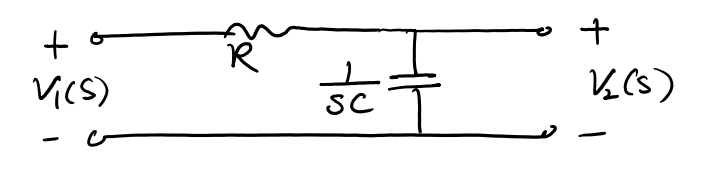

Given a RC circuit, the **Voltage Transfer Function** will be given as

$$
T(s) = \frac{V_2(s)}{V_1(s)} = \frac{1/sC}{R + 1/sC}= \frac{1}{1 + sRC}
$$

## General form of First-order low pass response

Known the **General form** of **First-order low pass response is $T(s) = \frac{K}{\alpha + s}$**  

- $s$: Complex Frequency
- $\alpha$: Poles, Cut off Frequency
- $K$: Gain Coefficient

## Frequency Response of First order low pass response

If the only thing we care is **how circuit deal with frequencies,** then we can s**implify the term $s = \sigma + j\omega$ into $s=j\omega$**, which is the **Frequency Response of the system**, now we get

$$
T(j\omega) = \frac{K/\alpha}{1 + j\omega/\alpha} = \frac{T(0)}{1 + j\omega/\alpha}
$$

## Bode Plot of the Magnitude

Start with the Transfer Function $T(j\omega) = \frac{K}{\alpha + j\omega}$, its Amplitude shall be the mod $|T(j\omega)| = \frac{|K|}{\sqrt{\alpha^2 + \omega^2}}$, then change into $|T(j\omega)| = \frac{|T(0)|}{\sqrt{1 + (\omega/\alpha)^2}}$

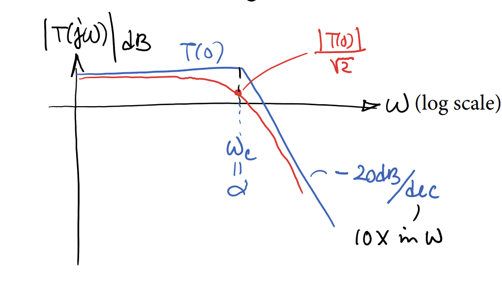

There’s three important region on this Graph

- $|T(j\omega)|_{\omega=0}$: The **DC term**, is equal to $|T(0)|$
- $|T(j\omega)|_{\omega=\alpha}$: At the **cut off frequency**, is equal to  $\frac{|T(0)|}{\sqrt{2}}$
- $|T(j\omega)|_{\omega=high~\omega}$: At the **region of cut off frequenc**y, is equal to $\frac{|K|}{\omega}$

For region larger than the cut off frequency, it is followed by the equation

$$
20\log |T(j\omega)| = |K|_{\text{dB}} - 20\log\omega
$$

this was approached by **taking $log$ on both side of equation** 

## Plot of the phase angle

Also start with $T(j\omega) = \frac{K}{\alpha + j\omega}$, then **overall phase is $\angle T(j\omega) = \angle K - \arctan(\omega/\alpha)$**, we can also analysis this overall phase under three frequencies

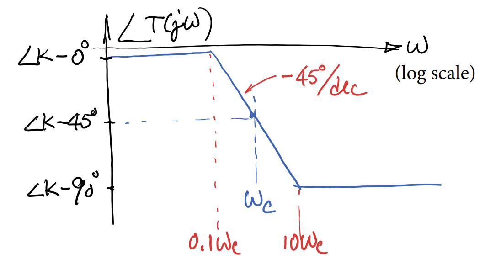

- $T(j\omega)|_{\omega=0}$: If $K$ is $+ve$, then its 0, else is $\pm 180$
- $T(j\omega)|_{\omega=\alpha}$: Phase is $\angle K - 45^{\circ}$
- $T(j\omega)|_{\omega\rightarrow \infty}$: Phase is $\angle K - 90^{\circ}$

# Current Interpretation

Recall the RC circuit, 

- At **Low Frequency**, the **Impedance** $\frac{1}{j\omega C}$ is very large that it’s an **open-circuit**, thus **$V_{out} \approx V_{in}$, $T(j\omega) \approx 1$, $\angle T(j\omega) = 0^{\circ}$**
- At **High Frequency**, **Impedance** is small that is a **short circuit**, **$T(j\omega) \approx \frac{1}{j\omega RC}$, $V_{out} \to 0$, $\angle T(j\omega) = 90^{\circ}$**

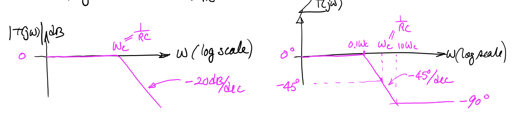

# Bandwidth (BW)

For the First Order Low Filter $T(j\omega) = \frac{T_o}{1 + j\omega/\omega_c}$, its Bode plot is 

Whereas $T_0$ is the **DC gain** and $\omega_c$ is the **Corner Frequency**  (AKA **Bandwidth,** **Cut off Frequency, 3dB Frequency**) 

> It’s called 3dB frequency because it’s **3dB lower than $T_0$**
> 

## Gain-Bandwidth Product (GBW)

<aside>
❗

**Gain-Bandwidth Product (GBW) = DC gain  $\times$ BW**

</aside>

This means that in a given First Order System, the **product of gain and BW is a constant**

## Op Amp’s Bandwidth

Based on the **Gain-Bandwidth Product**, we can get the Op Amp’s gain and Bandwidth once we know the other

### Open-loop

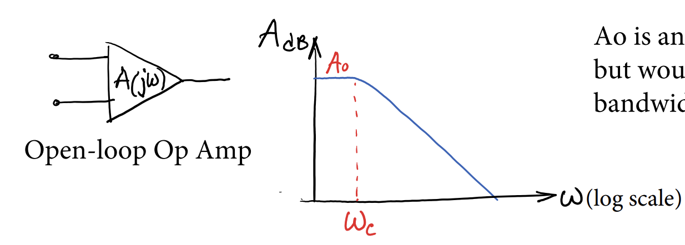

Open Loop Op amp has high gains, with **$A_0=10^5-10^6$, this makes it’s $\omega_c$ really small**

### Closed-loop

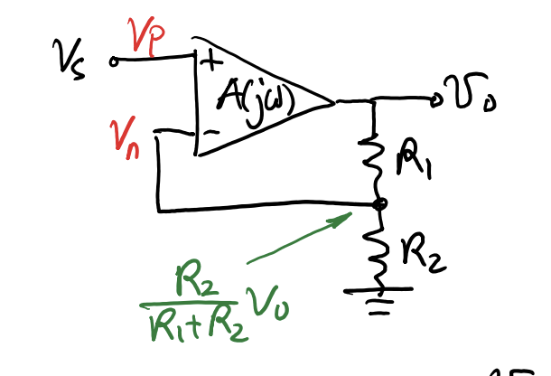

Known that the **feedback coefficient is $\beta = \frac{R_2}{R_1+R_2}$**, thus we can get the **closed-loop gain** from the formula **$V_o = A(j\omega)(V_p - V_n)$**

$$
\text{Closed-loop gain} = \frac{A(j\omega)}{1 + \beta A(j\omega)}
$$

Now sub in the formula for **First order low filter $A(j\omega) = \frac{A_o}{1 + j\omega/\omega_c}$** to get

- **DC gain**: $T_0=\frac{A_o}{1 + \beta A_o}$
- **Cut off Frequency**: $\omega_c(1 + \beta A_o)$

now we can get the new GBW formula as

$$
\text{GBW}_{closed} = \left( \frac{A_o}{1 + \beta A_o} \right) \times \left( \omega_c(1 + \beta A_o) \right) = A_o \omega_c
$$

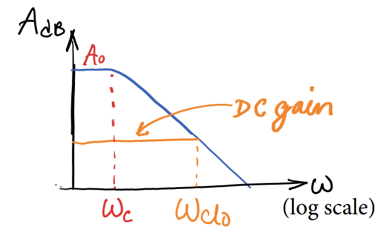

The blue line is the Frequency Response for the **open loop gain**, it’s also the **limit of the op amp**, whereas the orange one $\omega_{clo}$ is the **closed loop gain** in which, 1. **manually decrease the amplitude**, 2. but **having a widther bandwidth**

# First-order high-pass response

The Standard form of First-order high-pass response is

$$
T(s) = \frac{Ks}{s + \alpha} = \frac{Ks/\alpha}{1 + s/\alpha} \quad (\alpha > 0)
$$

- $\alpha$ : Cut off frequency ($\omega_c$)

---

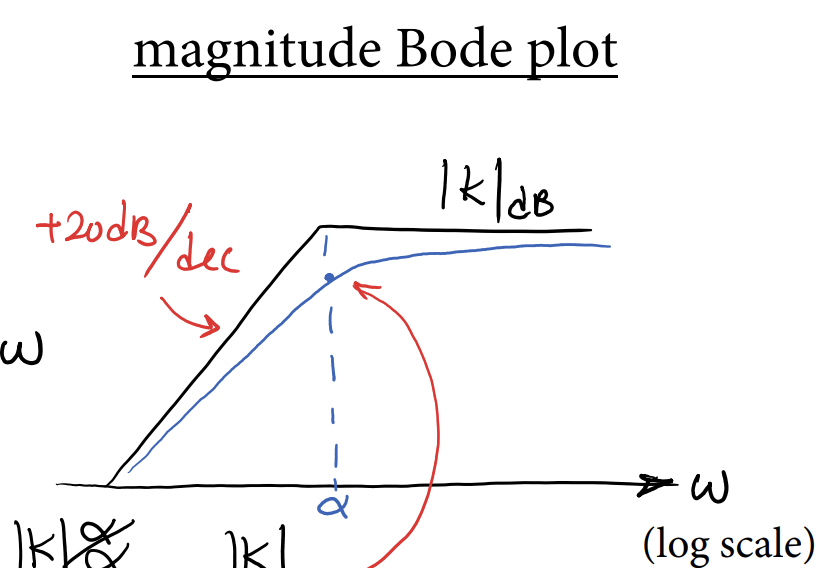

## Magnitude Response

**Taking the mod of** the **Transfer function** to get

$$
|T(j\omega)| = \frac{|K|\omega}{\sqrt{\alpha^2 + \omega^2}} = \frac{|K|\omega/\alpha}{\sqrt{1 + (\omega/\alpha)^2}}
$$

- $\omega \ll \alpha$: $|T(j\omega)|= \frac{|K|\omega}{\alpha}$, under **log scale,** it’s **increasing with the slope** of $+20\text{dB/dec}$
- $\omega \gg \alpha$: $|T(j\omega)|=|K|$, the **magnitude** is **approaching constant $K$**

## Phase Response

**Taking the phase of** the **Transfer function** to get

$$
\angle T(j\omega) = \angle K + 90^\circ - \tan^{-1}(\frac{\omega}{\alpha})
$$

- $\omega = 0$: $\angle T(j\omega) =\angle K + 90^\circ$
- $\omega = \alpha$: $\angle T(j\omega) =\angle K + 45^\circ$
- $\omega \to \infty$: $\angle T(j\omega) =\angle K + 90^\circ - 90^\circ = \angle K$

## Frequency Response

By letting $s=j\omega$, we get the Frequency Response as

$$
T(j\omega) = \frac{j\omega K}{\alpha + j\omega}
$$

### High-pass circuit example

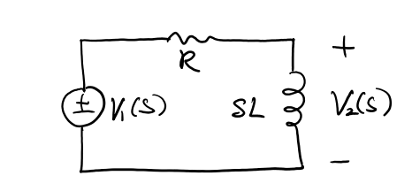

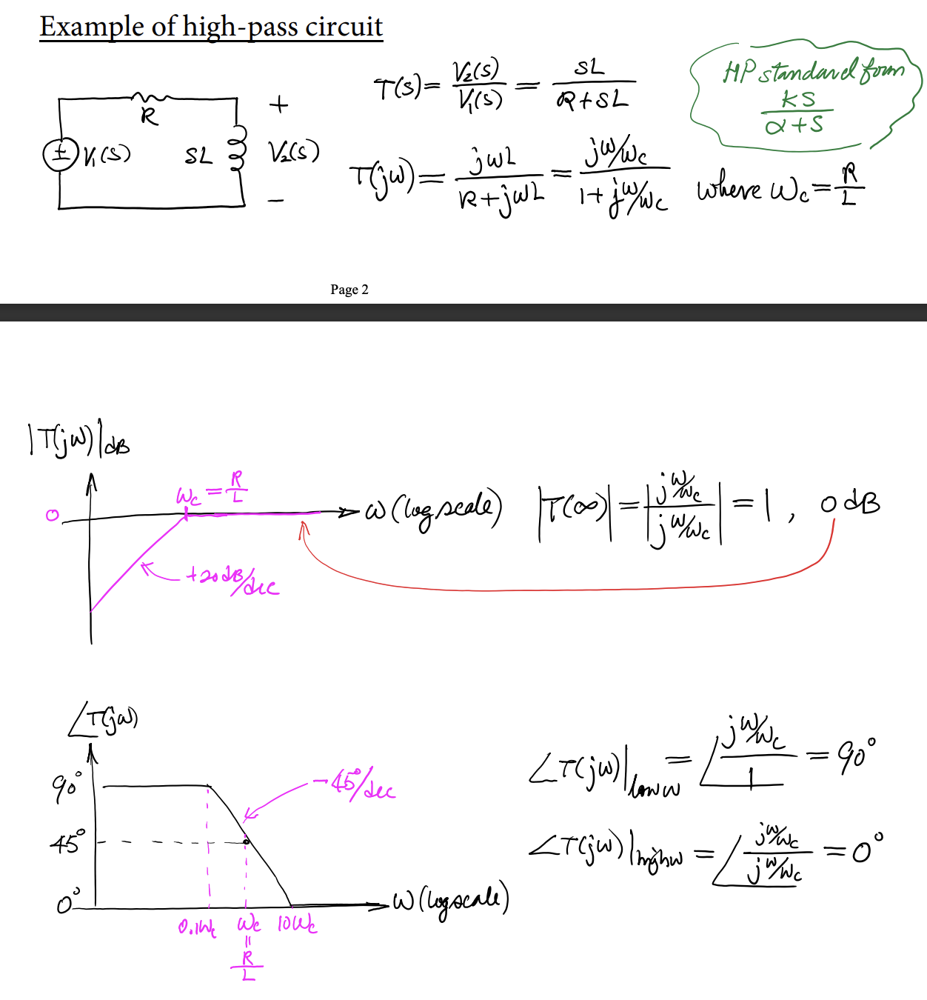

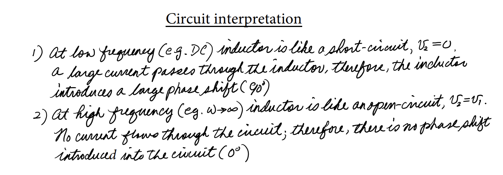

# High-pass and Low-pass cascade

The overall system is formed by a **series connection of High-pass and Low-pass filter**

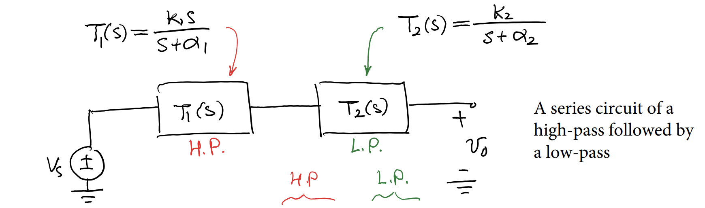

Thus we can get the overall **Transfer function** as the **multiplication of two functions**

$$
T(s) = T_1(s) \cdot T_2(s) = \frac{K_1 s}{s + \alpha_1} \cdot \frac{K_2}{s + \alpha_2}
$$

Whereas its **Frequency response** is 

$$
T(j\omega) = \frac{K_1 j\omega}{j\omega + \alpha_1} \cdot \frac{K_2}{j\omega + \alpha_2}
$$

## Magnitude Response of the Cascade Transfer function

Starting with the **low frequency:**

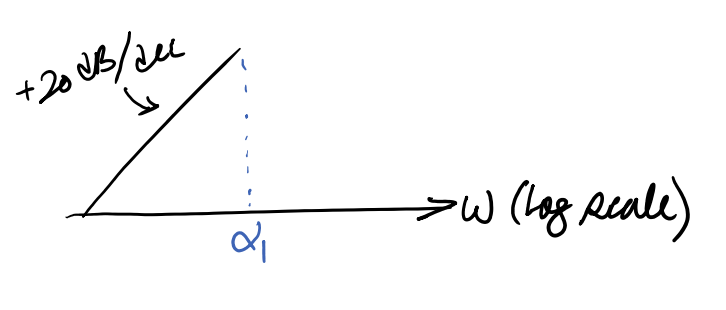

- ****$\omega \ll \alpha_1$: $|T(j\omega)|=\frac{|K_1|\omega}{\alpha_1} \cdot \frac{|K_2|}{\alpha_2}$, $|T(j\omega)|_{\text{dB}} = \left| \frac{K_1 K_2}{\alpha_1 \alpha_2} \right|_{\text{dB}} + 20 \log \omega$

Then the **high frequency**: 

- $\omega \gg \alpha_2$: $|T(j\omega)|=\frac{|K_1|\omega}{\omega} \cdot \frac{|K_2|}{\omega} = \frac{|K_1 K_2|}{\omega}$, $|T(j\omega)|_{\text{dB}} = |K_1 K_2|_{\text{dB}} - 20 \log \omega$

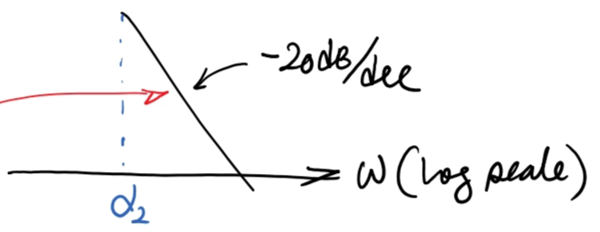

Lastly the **band pass region** $\alpha_1 \ll \omega \ll \alpha_2$:

- $T_1(j\omega)\rightarrow \frac{|K_1|\omega}{\omega} = |K_1|$
- $T_2(j\omega)\rightarrow \frac{|K_2|}{\alpha_2}$

Thus the **overall Magnitude response** is 

$$
|T(j\omega)| \to \frac{|K_1 K_2|}{\alpha_2},\quad G = |K_1 K_2|_{\text{dB}} - |\alpha_2|_{\text{dB}}
$$

## Circuit Realization of Band-pass filter

The **series connection** of **a RC circuit and Op Amp forms a Band-pass filter**

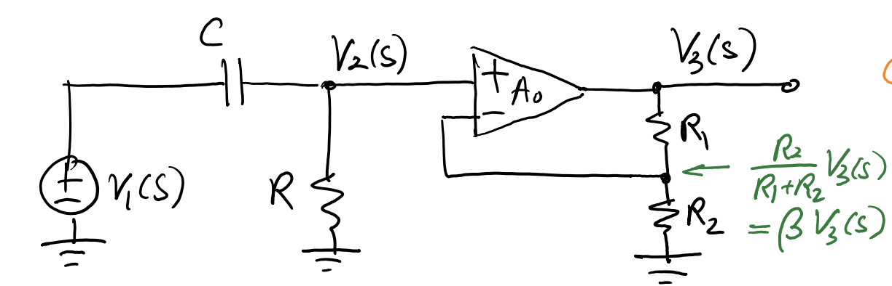

Whereas the **High-pass** part is the **RC filter**, and **low-pass** is the **Non-inverting Amplifier**, thus the overall **Transfer function** is 

$$
T(s) = T_1(s) \cdot T_2(s)
$$

### High-pass part

- **Transfer function**: $T_1(s) = \frac{R}{R + \frac{1}{sC}} = \frac{s}{s + \frac{1}{RC}}$
- **Frequency Response**: $T_1(j\omega) = \frac{j\omega}{\frac{1}{RC} + j\omega}$
- **Cut-off Frequency:** $f_{c_1} = \frac{\omega_{c_1}}{2\pi} = \frac{1}{2\pi RC}$

### Low-pass part

- **Frequency Response**: $T_2(j\omega) = \frac{\text{DC gain}}{1 + j\omega / \omega_{cl_0}} = \frac{A_0 / (1 + \beta A_0)}{1 + j\omega / (\omega_c(1 + \beta A_0))}$
- **Cut-off Frequency (Angular)**: $\omega_{c_2} = \omega_c(1 + \beta A_0)$
- **Cut-off Frequency**: $f_{c_2} = \frac{\omega_{c_2}}{2\pi} = f_c(1 + \beta A_0)$

---

Thus the overall **Transfer Function (Frequency Response)** is then

$$
T(j\omega) = T_1(j\omega) T_2(j\omega) = \frac{j\omega}{\frac{1}{RC} + j\omega} \times \frac{A_0 / (1 + \beta A_0)}{1 + j\omega / (\omega_c (1 + \beta A_0))}
$$

When the whole system is in the band-pass region ($\frac{1}{RC} \ll \omega \ll \omega_c(1 + \beta A_0)$), this becomes

$$
|T(j\omega)|_{\text{mid-range}} \approx 1 \times \frac{A_0}{1 + \beta A_0} = \text{Passband Gain}
$$

### Ex. Band-pass Filter Example

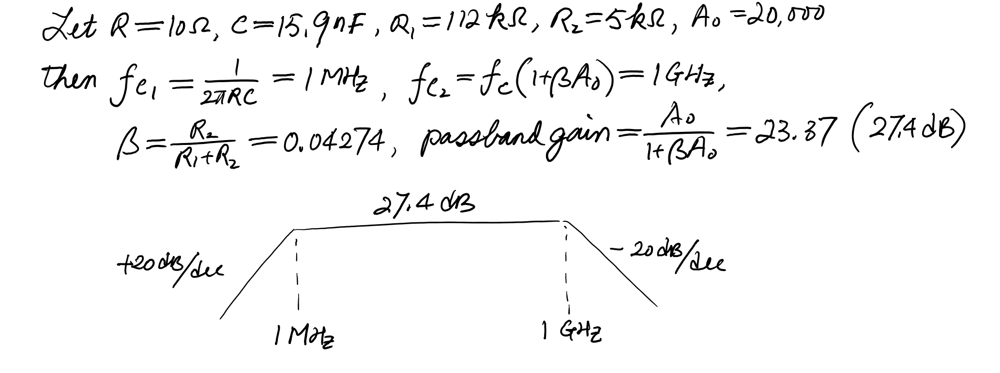

# Band-stop Response

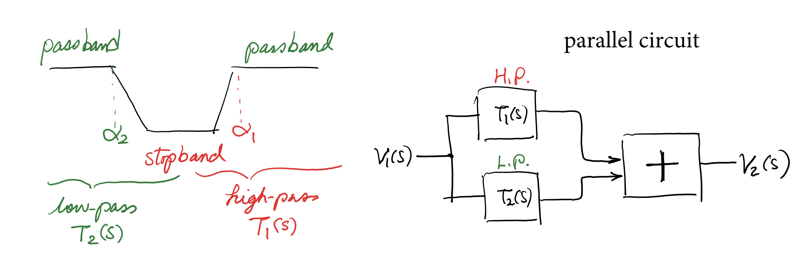

Band-stop response is a **parallel connection** for **a High-pass and Low-pass filter**, and the overall **Transfer function** becomes 

$$
T(s) = T_1(s) + T_2(s)
$$

> **Notice: Series Cascade is multiplication, Parallel Cascade is addition**
> 

We can also get the Frequency response and the Magnitude response

$$
T(j\omega) = \frac{j\omega K_1}{\alpha_1 + j\omega} + \frac{K_2}{\alpha_2 + j\omega},\quad |T(j\omega)| = \frac{\omega K_1}{\sqrt{\alpha_1^2 + \omega^2}} + \frac{K_2}{\sqrt{\alpha_2^2 + \omega^2}}
$$

Then we can start analysing Transfer function under different frequencies

---

Staring with **Low Frequency:**

- $\omega \ll \alpha_2$: $|T(j\omega)| \approx |T_2(j\omega)| = \frac{K_2}{\alpha_2}$

Then is the **High Frequency**:

- $\omega \gg \alpha_1$: $|T(j\omega)| \approx |T_1(j\omega)| = K_1$
- Design choice, it’s **suggested if we can make two band’s gain the same**, in which $K_1 = \frac{K_2}{\alpha_2}$

Lastly the Mid Frequency:

- $\alpha_2 < \omega < \alpha_1$: $|T_1(j\omega)| = |T_2(j\omega)|, \quad \frac{K_1 \omega}{\alpha_1} = \frac{K_2}{\omega}, \quad \frac{K_1 \omega}{\alpha_1} = \frac{K_2}{\omega}, \quad \omega = \sqrt{\alpha_1 \alpha_2}$, thus the stopband gain is $\frac{K_1 \sqrt{\alpha_1 \alpha_2}}{\alpha_1} = K_1 \sqrt{\frac{\alpha_2}{\alpha_1}} \quad \text{or} \quad \frac{K_2}{\sqrt{\alpha_1 \alpha_2}}$

## Circuit Realization for Band-stop Response

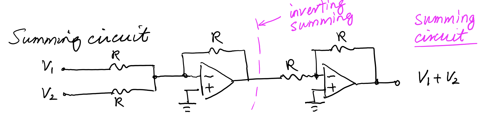

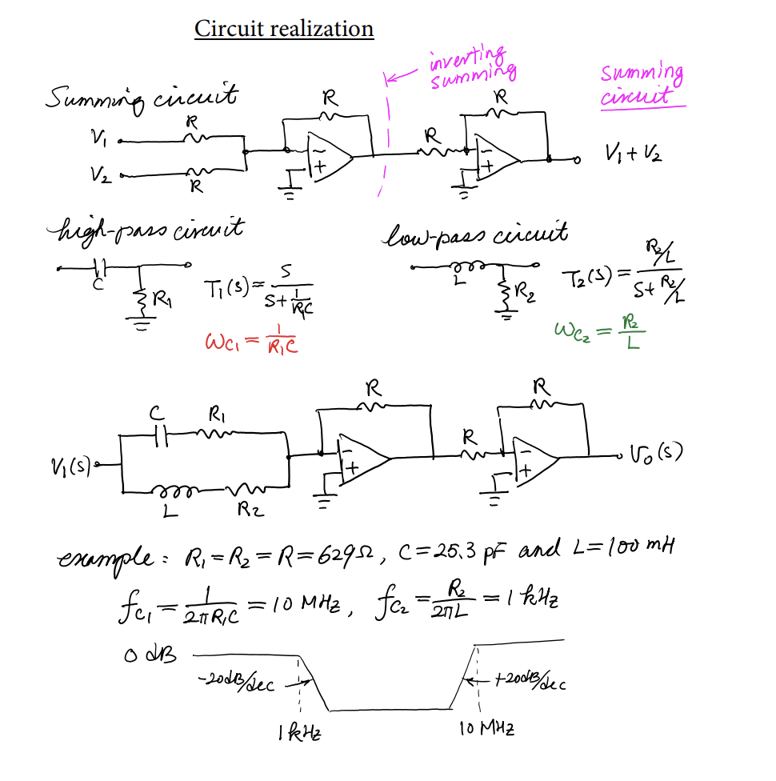

LEc 31