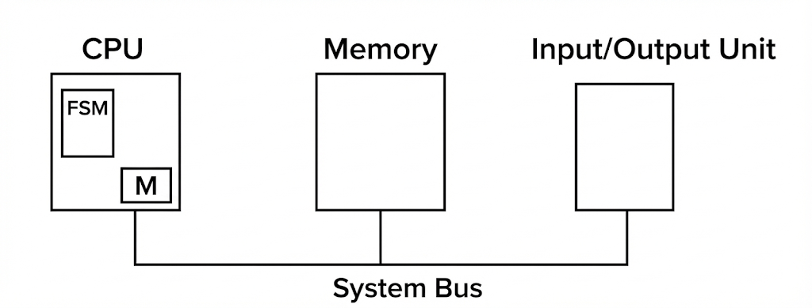
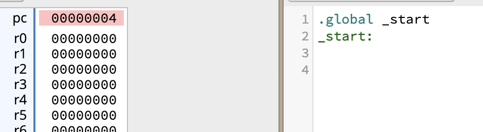

> Last Edit: 1/12/26

> Last Edit: 1/12/26
> 

# Parts of Computer

Modern Computer contains three parts, **CPU, Memory and Input/Output**, they are connecting by the System Bus



## CPU - Central Processor Unit

CPU basically contains a FSM - Finite State Machine, that controls

- What happens
- When it happens
- Arithmetic Logic Unit (ALU): Unit that computes (i.e. Add or Subtract)

---

All things on CPU are being compute on Registers 

The Processor we used is called AHero Mros V, it has Thirty Two, 32 bits Register

- Registers are named x0 → x31
- And Each of those have a second name, that’s x0 is called $zero$, $x1$ is called ra, $x2$ is called $sp$ … and x31 is called $t6$

## Memory

Memory is the place where computer store data, it has

- Approximately 1 billion bytes, while each of those has a separate address
- The most frequency operation inside Memory is the conversion between base 2 and base 16
- Memory stores
    - data, variables, and data structures
    - Program being executed by computer

## Processor

Processor are being programmed in Assembly Language, which is the thing that translate human instructions into machine Code

## Assembly Language

For us, human, we know English as our language, things like Add, Subtract, Load makes sense to us, however for machine, they only know 0 and 1, thus 0 and 1 is not only the way it stores data, but also it’s way to read instruction

- While Assembly Language is the bridge in between
- We named each instruction in binary one English word, i.e. `00000` is `add` , `00001` is `subtract`
- In this way, every time we write `add` , the machine knows exactly we mean `00000` , thus can run the things we expected then

## C Language

The following session will show a example of C Language code in different aspects

| C Language | Assembly Instruction | Function of Instruction |
| --- | --- | --- |
| `int A,B,C,D` | No Instruction |  |
| `A = 1` | `li t0,1` | Register `t0 <- 1` |
| `B = 8` | `li t1,8` | Register `t1 <- 8` |
| `C = A + B` | `add t2,t0,t1` | `t2 <- t0 + t1` |
| `D = B - A` | `sub t3,t0,t1` | `t3 <- t1 - t0` |
|  | `i loop: j iloop` | Infinite Loop |

> `i loop: j iloop` : The Processor doesn’t actually stop, so we need to create a infinite loop to stop the program there
> 

# Compile Sequence

When we are trying to “run” the program on the processor, we actually need steps in between to make it work

1. `gmate program` : Turns FPGA into computer
- FPGA can be turned into anything wanted, and this firstly turn the hardware into a computer
1. `gmate complie` : Compile the Assembly Language into machine code
2. `gmate download` : Download the Machine Code on the board
3. `run GDB` : Start tracking things happening on the board

# Branch

Branch is just like the `if-else` , it help the program to run different task under different conditions

- A example would be `i loop: j iloop` mentioned before, this `j` is jump, thus this is a branch with the function of, when seeing `i loop` , then jump to `i loop` (Infinite Loop)

### Labels

Labels are the name for a specific Address, for example inside `i loop: j iloop` , `i` is just a label, it’s just a name and can be anything else

## Conditional Branch

This is really the `if-else` , only go to one label under given condition

- If the condition doesn’t meet, simply go to the next in sequence

### Ex. A counter using Conditional Branch

The thing we are trying to implement here is `for(int i = 1;i=4;i++);` in assembly language

```nasm
.global start
_start: li t0,1
				li t1,4
myloop: add t0,t1,1
				ble t0,t1,myloop
				fin: j fin
```

- `.global start` : The entry point of the program
- `li t0,1` : Load `t0 <- 1`
- `add t0,t1,1` : Add `t1` and `1`, and store the result to `t0`
- `ble t0,t1,myloop` : The `ble` here stands for branch less or equal to, so if `t0 <= t1` , the jump to `myloop` , otherwise go to the next in sequence which is `fin`

---

So after finish analysis the codes, we can now look the whole program once

- Firstly `t0` is given 1, `t1` is given 4, then we will go through
1. `1 <= 4` 
2. `2 <= 4` 
3. `3 <= 4` 
4. `4 <= 4` 
5. `fin: j fin`
- Thus is a counter from 1 to 4

## Instruction

Every line above inside the code bar are instructions, each instruction is 4 bytes length



- The Address of instruction is reflected by `pc`