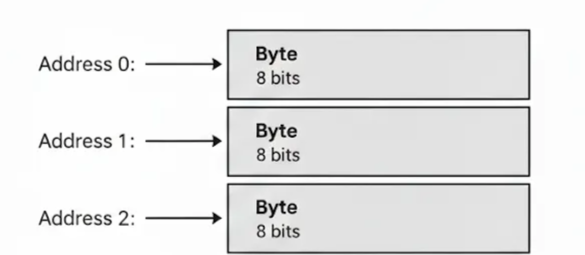
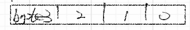
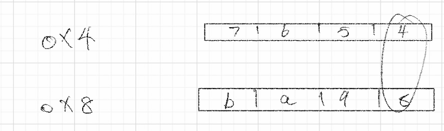

> Last Edit: 1/13/26

> Last Edit: 1/13/26
> 

The Processor we are working with is called Nios V Processor

# Nios V Processor

This is a processor from Intel with RISC-V Architecture

- This is a 32 bit processor, that’s because it’s 32 bits wide
- Thus the address sent to memory is also 32 bits, this means that there are $2^{32}$ address locations

> We said that the **word size** of processor is 32 bits
> 
- In this case, the most information can be accessed is 32 bits, but we can access 16 bits (Halfword), or 8 bits

## Byte Addressable

In modern Computer, we give **one Byte one Address**

- Image Memory as a lot of boxes, each box’s size is 8 bits, 1 Byte, in this case, each box will be given one unique **Index (Address)**



---

As mentioned, the processor we are using are 32 bits wide, that means each time it’s going to get 4 bytes, that is $4\times 8 =32$



- So each time we access memory, we will get this 32 bits (4 Bytes) Bar,



## Ex. A program that add three numbers from Memory

Now we have three numbers on Memory, that are `10,20,30` on `(0x2C),(0x30),(0x34)`

```nasm
.data
list:   .word 10, 20, 30      # Define an array of 3 words (4 bytes each)
answer: .word 0               # Reserve space for the final result

.text
.globl _start

_start:
    # --- PHASE 1: LOAD DATA FROM MEMORY ---
    la t0, list               # Load base address of 'list' into t0
    lw t1, 0(t0)              # Load 1st element (10) into t1
    lw t2, 4(t0)              # Load 2nd element (20) into t2 via offset 4
    lw t3, 8(t0)              # Load 3rd element (30) into t3 via offset 8

    # --- PHASE 2: PERFORM CALCULATIONS ---
    add t2, t2, t1            # t2 = t2 + t1 (20 + 10 = 30)
    add t2, t2, t3            # t2 = t2 + t3 (30 + 30 = 60)

    # --- PHASE 3: STORE RESULT BACK TO MEMORY ---
    la t0, answer             # Load address of 'answer' into t0
    sw t2, 0(t0)              # Store the final sum (60) into memory at 'answer'

done:
    j done                    # Infinite loop to terminate execution flow
```

- The `la` and `lw` Instructions are called Executable Statements
- The `.word 10` , is Assembler Directive

### Executable Statements

Those are the instructions CPU will do when the program is running

### Assembler Directive

Assembler Directive are the things to show to Assembler, it means to **Put Constant into memory** into 32 bits at the next available location

---

In this case, we have

| `0x2C` | `list =` | `.word 10` |
| --- | --- | --- |
| `0x30` |  | `.word 20` |
| `0x34` |  | `.word 30` |
| `0x38` | `answer:` | `.word 0` |

---

- `la t0,list` : Load Address (`t0 <- list = 0x2c` )
    - The `la` instruction actually include **two encoded instructions**, that is because both the **instruction and the address are 32 bits**, that makes we can’t give the 32 bits address and instruction at once, so we need two encoded instead

> Imagine this scenario, you ask a guy to take you to an address with 32 bits, however you only got 32 bits length of word to tell him, in this case you can’t give the **Instruction of “Take me there” + “Address”** at once
> 
- `lw t1,(t0)`: Load the word from memory beginning at address given by `t0`
    - So `t1 <- (t0) = (0x2c) = 10`

> `()` is just like Dereferencing a Pointer
> 
- `lw t2,4(t0)` : When we use `4(t0)` , this is like a **Index Offset,** similar to the concept of array in C, `t0` stores an address, and `4(t0)` is then just referencing the word in `0x2c + 4`
    - So `t2 <- (0x30) = 20`
- `lw t2,8(t0)` : The same `t3 <- (0x34) = 30`

---

Now we are going to add those

```nasm
add t2, t1, t2   # t2 = 10 + 20 = 30
add t2, t2, t3   # t2 = 30 + 30 = 60
la t0,answer
sw t2,(t0)
```

- `la t0,answer` : load the Address of `answer` in Memory to Register `t0` in Processor
- Then Store Word in `t2` to the “Dereferenced Pointer” `(t0)`

> The reason why we can’t use `sw t2,(answer)` is because RISC-V only allows Register in brackets
> 

# Accessing Half Words & Bytes

As NIOS-V are byte accessible processor, that means we need to at least get one byte once

- However, the fact that processors are all 4 bytes (32 bits) makes it hard to store more than one Half Word (2 Bytes) or Byte (1 Byte) into a Register
- So that means no matter the length of data we are choosing, i.e. Full Word, Half Word, or Byte, it’s gonna take the whole Register

---

Recall that we Load Word using `lw t2,(t3)` , that is load the word `t3` register is pointing to in the memory to register `t2` 

- We can do the same with Half Word using `lh t2,(t3)`
- Though as indicated, a Register is 32 bits, with only 16 bits stored, that makes the rest 16 bits left empty, so that we need to use **Sign Extension** to deal with the rest

## Sign Extension

When we want to increase the digit of a Binary Number without changing its value and Sign

- Looked at the old Binary’s highest digit (Sign Digit)
- Change all before to the same value

For example having `0000 0101` , that’s +5, if we want to extent it to 16 bits, it should be `0000 0000 0000 0101`

---

So that’s what we do when storing Half Word into a Register

- Though there are also method to leave the rest of Register unsigned, using `lhu A,(B)`

## Store Data from Register to Memory

The way storing Word, Half Word, and Byte into memory is kind of the same, which is using `sw` , `sh` ,and `sb`

### Address for Data in Memory

If needed to store a word in memory, then its address need to be divisible by 4

- Assume having a Memory with Address 0,1,2,3
- If we want to store a word, then it’s address has to start on 0, 4, 8, 12, and **can’t** start with 1,2,3
- The same apply for Half Word and Byte, Half Word has to start on 0,2,4,6, but Byte can be on any

# Move Instruction

## Move Instruction

`mv t3,t2`  allows us to move the data in one Register `t2`  to `t3` 

- Having the General Form of `mv rd,rs #rd <- rs`

## Store Constant

If we want to store a constant for example `44` into Register, the we should use command `li s3,44 #s3 <- 44` 

- This constant `44` will be Encoded by assembler into 32 bit number and store into Register
- While this `44` is called Immediate Constant

## Immediate Constant

When dealing with constants, the command usually ends with a `i` 

- For example `addi rd,rs,const #td <- ts + const`

## Load Instruction

`lw rd,D(rs1) #rd <- (rs1+D)`

- This load a 32 bit number into `rd` from memory address @ `rs1+D`
- `D` is also a 12 bit signed Immediate Constant encoded & Sign Extension

## Storing a Register

`sw rs2,D(rs1)` 

- Copy `rs2` into Memory at address `D+rs1`

## Logic Instruction

Logic & Shift Instruction are bitwise, they compare each bit one by one for the result

`xxx rd,rs1,rs2` , `xxxi rd,rs,Immed` 

- `xxx` : one of AND, OR, XOR

### Ex. Logic AND Instruction

$$
\begin{aligned}
&\text{and} \quad t_3, t_1, t_2 \\ \\
&001 \quad 011 \quad (t_1) \\
\text{AND} \quad &001 \quad 101 \quad (t_2) \\
\hline
&001 \quad 001 \quad (t_3)
\end{aligned}
$$

---

### Ex 2. Logic OR Instruction

$$
\begin{aligned}
&\text{ori} \quad t_2, t_1, 0x7 \\ \\
&010 \quad 101 \quad (t_1) \\
\text{OR} \quad &000 \quad 111 \quad (0x7) \\
\hline
&010 \quad 111 \quad (t_2)
\end{aligned}
$$

## Shift Instruction

Shift Instruction are just like the `>>`  in c++

`srli t2,t1,3` 

- Shift right `t1` by Immediate Constant of digits
- i.e. if `t1` is `110...110` , then it becomes `000110...` , which means that the last three bits has been discarded after

`sll rd,rs1,rs2` 

- There’s also a Shift Left Command

`sra rd,rs1,rs2` 

- Keep the highest digit when shifting right