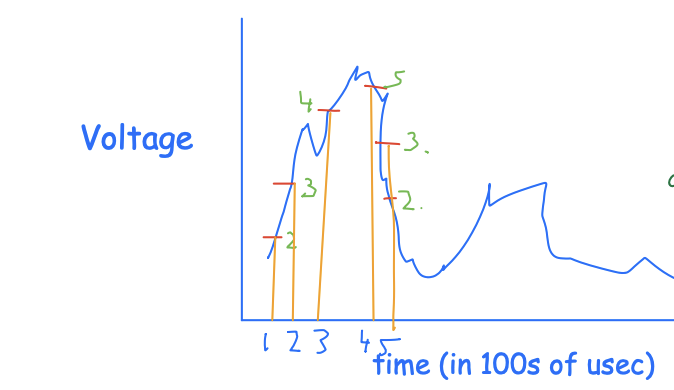
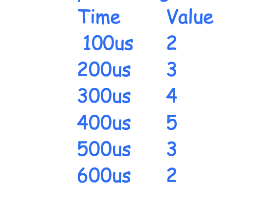
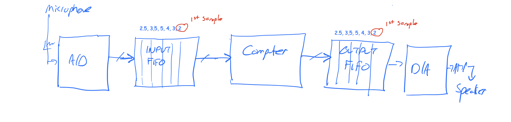
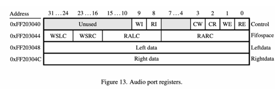

> Last Edit: 2/23/26

Learning Assembly is about to know what happens underneath, while C Language is more readable and faster

# Compilation of C

Starting from C Language, it have the file type of `.c` , we use `gcc` to compile it into Assembly

Then we have Assembly with `.s` , we use `gnuas` to make it to Machine Code

Then we have Machine Code with all `1` and `0`, that have file type of `.o` 

## Linker

If there’s more than one file for C language, then we need to link all the `.o` files together into one machine code

## Start Up Code

Actually the program doesn’t start at the `main` function, instead it has a `start up code` , it 

- Set up stack pointer
- Set un-initialised variables

# Using I/O Devices in C

Recall the way we did in Assembly to copies the things on Switches into LEDs

```nasm
.equ LEDs, 0xFF200000
.equ SW, 0xFF200040

_start: la t0, LEDs       # get LED address into t0
        la t1, SW         # get SW address into t1

# loop to copy from the switches into the LEDs

loop:   lw t2, (t1)       # load the 10 switches value into t2
        sw t2, (t0)       # store the 10 values into the LEDs

        j loop            # do it over and over
```

 The same can be done in a better way in C

```nasm
int main (void)
{
    volatile int *SW_ptr = (int *) 0xFF200040;
    volatile int *LEDR_ptr = (int *) 0xFF200000;

    int value;

    while (1) {                   // infinite loop

        value = *SW_ptr; // Get Switches - dereference SW_ptr - lw t2,(t1)

        *LEDR_ptr = value;// Put to LEDs - dereference LED_ptr - sw t2, (t0)
    }
}
```

Notice there’s a `volatile` inside, this tells the compiler to keep reading the memory instead of the register as the Compiler will think keep reading Register is easier, but the truth is that the things in memory will change

# Audio In and Output

Starting from the Original Sound, microphone will transfer those into Voltage Signal, then go through Amplifier, then goes to Analog to Digital Converter



That is sampling in short intervals, and this is a 24-bit Digital Values

## Sample Rate

If we are sampling 10000 times in one sec, that’s a 10kHz sampling rate, and the samples are



just voltage values for each time

## Sound Output Process

The processor will transfer the same 24 bit thing back (24 bits means 8kHz), then D/A will convert the discrete voltages into continuous voltage, then go through amplifier then to speaker

## Buffering

There’s two problem for CPU when dealing with microphone and speaker

- For input microphone, it’s generating new signal every $100\mu s$
- For output speaker, it’s requiring signal every $100\mu s$ too

Thus if the CPU is busy doing other things and forget to deal with those two, then a lag will occur

---

The way we overcome this issue is then by FIFO Hardware



The size of FIFO however, isn’t infinity large, with only 128 sampling points, thus if there comes the 129’s signal, it will be discard

## FIFO

- There’s only two operation for FIFO, Load and Store
- Even though FIFO is a hardware circuit, system will give it a virtual address, thus accessing this FIFO is same as accessing the memory
- The Processor only talks to the input FIFO and output FIFO instead of directly to the A/D, or D/A

## Audio Memory Mapped Registers



### Left and Right data Register

The `Leftdata` and `Rightdata` are connected to the FIFO, that getting one sample from queue

The same holds for storing, it stores a sample into the Output FIFO

### Fifospace Register

Indicates how empty or full the in/output FIFOs are 

- RALC: Number of Input Left FIFO used
- RARC: Numbers of Input  Right FIFO used
- WSLC: Numbers of Output Left FIFO empty
- WSRC: Numbers of Output Right FIFO empty
- Thus we can see, if it’s clear, then Input FIFO `RALC = RARC = 0` , and the Output FIFO `WDRC = WSLC = 128`

### Control Register

A status Register

- Write 1 into `CR` clears the Left and Right Input FIFO
- Write 1 into `CW` clears the Output FIFO
- `RE` and `WE` bits are about interrupt that we don’t need
- `RI` if the input FIFO is 75% full or more, shows up 1
- `WI` if the output FIFO is less than 25% full, shows up 1

## Code Example

```c
#define AUDIO_BASE    0xFF203040

int main(void) {
    // Audio codec Register address
    volatile int * audio_ptr = (int *) AUDIO_BASE;

    // intermediate values
    int fifospace;

    // This is an infinite loop checking the RARC to see if there is at least one
    // entry in the input FIFOs. If there is, just copy it over to the output fifo.
    // The timing of the input FIFO controls the timing of the output, which
    // makes this easier than the other parts of the lab.

    while (1) {
        fifospace = *(audio_ptr + 1); // read the audio port fifospace register

        if ((fifospace & 0x000000FF) > 0) // check RARC to see if there is at least one sample input
        {
            // load both input microphone channels - just get one sample from each
            int left = *(audio_ptr + 2);  // read the leftdata register - input FIFO
            int right = *(audio_ptr + 3); // same for rightdata

            // note that these removes the samples from the FIFO

            // store both of those samples to output channels
            *(audio_ptr + 2) = left;  // storing to the leftdata adds to output FIFO
            *(audio_ptr + 3) = right;
        }
    }
}
```