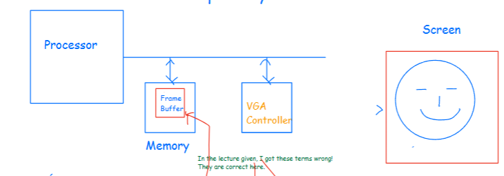
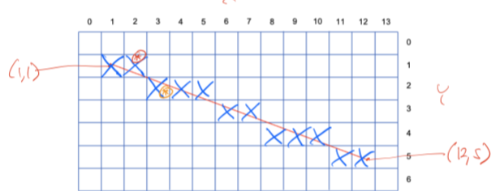
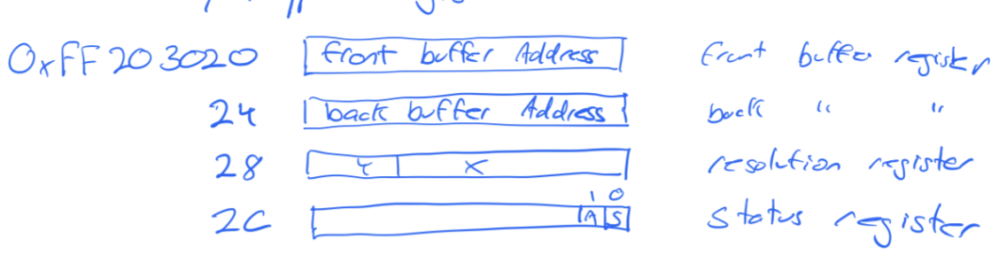

> Last Edit: 3/9/26

# Intro to Low-Level Graphics



Starting from the structure of the De1-SoC, different parts have own role on Graphics

- Processor: Take and decided where and which to show on each pixel
- Memory (Frame Buffer): A specific space in Memory to store the value of each pixel
- VGA: Continuously read from the **Frame Buffer** and send it to screen

## Coordinate System

The screen has been divided into boxes with 320 x 240 pixels

And the origin is at the left top, this means that the right down corner is then $(319,239)$

## Pixel Encoding - RGB565

On the screen, each box is representing one pixel, while each pixel is encoded using 16 bits

- The 16 bits components are R: 5 bits, G: 6 bits, B: 5 bits

> This is because human are more sensitive to green
> 

## Address Mapping

As memory is 1 Dimension but Screen is 2D, so we’ve design a way to representing 2D

So as the De1-SoC is a 32 bit system, we will divided this 32 bits into

- Base: 14 bits
- Y Coordinate: 8 bits, cause $2^8=256$
- X Coordinate: 9 bits, cause $2^9=512$
- Ending 0: 1 bit, this 0 is always here, as there’s 2 bytes representing one pixel, this means that the starting address of each pixel has to be an even number
    - By leaving a 0 in the end of the bit is equivalent to timing a 2 in decimal number

Thus overall we can conclude the formula for calculating the Address’s corresponding pixel

$$
\text{address} = \text{base} + (y \ll 10) + (x \ll 1)
$$

### Ex. Calculating the Pixel Address

- $(0,0)$: Origin, is the base address `0x08000000`
- $(1,0)$: One pixel to the right, that’s x =1, which is `0x08000002`
- $(1,1)$: One pixel to the right, then down, is `0x08000402` (1024 = `0x400` )
- $(319,239)$: Right Down Corner, is `0x0803be73`

## Code Example

```c
/* program to draw four green pixels into the middle of the screen */

void plot_pixel(int x, int y, short int line_color); // plots one pixel
void clear_screen();                                // clears whole screen

int pixel_buffer_start; // global variable location of frame buffer

int main(void)
{
    volatile int * pixel_ctrl_ptr = (int *)0xFF203020;  // pointer to the base register of controller

    /* The default base of the frame buffer is int VGA controller */
    /* That default address is stored in the base register of the VGA controller port/interface */
    /* so the next statement gets it, leaving pixel_buffer_start = 0x08000000 */

    pixel_buffer_start = *pixel_ctrl_ptr;

    clear_screen();

    plot_pixel(160, 120, 0x07E0);
    plot_pixel(161, 120, 0x07E0);
    plot_pixel(162, 120, 0x07E0);
    plot_pixel(163, 120, 0x07E0);
}

// code not shown for clear_screen() and draw_line() subroutines

void plot_pixel(int x, int y, short int line_color)
{
    volatile short int *one_pixel_address;

    one_pixel_address = pixel_buffer_start + (y << 10) + (x << 1);

    *one_pixel_address = line_color;
}

void clear_screen()
{
    int y, x;

    for (x = 0; x < 320; x++)
        for (y = 0; y < 240; y++)
            plot_pixel(x, y, 0);
}
```

# Drawing Lines on Screen

Known that the boxes one screen are discrete, thus drawing a straight lines are hard 



Things like this case will occur which is called aliasing, but that’s already the best approximation 

The way we calculate it is by the slope $slope = \frac{y_2 - y_1}{x_2 - x_1}$

- This method best work for steep lines with slope less than 1

# Animation

The animation is just 1. Draw lines, 2. Erase Lines, 3. Repeat, here’s more detail of approach

## Buffer Register

Front Buffer stores the starting address of the current image

- The Screen’s image can be changed immediately by changing Buffer Register

## Flickering

If there’s no new image after the old one has been removed, then flickering will occur that there’s a blank or broken image

## Vertical Synch

The VGA controller will scan the screen from left to right, up to down

- Vertical Retrace: While there’s a delay after the whole progress was done and return to origin
- Thus the updates can be done during the Vertical Retrace period, and there’ll be a register called `status register` in charge of the state

## Double Buffering

The ultimate solution for animation, thus set two buffer regions, `Front Buffer`  and `Back Buffer` , and the update steps will be 

1. Remove and draw the new shape inside `Back Buffer` 
2. Wait for the Vertical Synch Signal
3. Swap

## VGA Controller Memory Mapped Registers



- **Front Buffer Address Register**: Storing the current image’s starting address
    - It’s a read-only reg that only change when there’s a `swap` instruction
- **Back Buffer Address Register:** Storing the starting address of back buffer
    - Its a write reg
- **Status Register**: The lowest bit is S (Status Bit)
    - When we write a 1 into the `Front Buffer Reg` , a swap will occur and this Status Bit will be set to 1 representing the change is in progress
    - Whereas after the swap is finished, then `S` bit will return to 0 again
- Note that the De1-SoC’s VGA controller can only access the `SDRAM` address staring with `0x00` , while can’t access the `DDR3` starting with `0x04`

---

## Process of swapping to avoid Flickering

### Initiate

At the beginning, the processor will send a 1 into the `Front Buffer Reg` that tells `VGA` controller to swap when ready

While in this case, the `S` bit in `Status Reg` will swap to 1, meaning the swapping is in progress

### Wait for V-Sync

The swap won’t happen immediately, that’s because if the screen is at its middle of scanning, the upper and lower part of the screen will occur flickering

Thus only run swap when V-Sync is ready

## C Language Code for `wait_for_vsync()`

```c
void wait_for_vsync() {
    // Base Address for VGA Controller
    volatile int * pixel_ctrl_ptr = (int *) 0xff203020; 
    int status;

    // Wrtite a 1 into the Front Reg
    *pixel_ctrl_ptr = 1;

    // Read the status Reg
    status = *(pixel_ctrl_ptr + 3);

    // Polling until the last bit becomes 1
    while ((status & 0x01) != 0) {
        status = *(pixel_ctrl_ptr + 3);
    }
    // If it goes to 0, auto break
}
```

### Poll

The processor will then use polling to check the bit `S` to see when the swapping is finished, so it can start drawing the next frame

## Frame Per Second

So 60 FPS means the processor can render one frame less than $1/60$ s, if something went wrong that it requires more than $1/60$  s to render a frame, then we want to keep the frame frequency lower but keep the overall animation contingence

# Bouncing Boxes