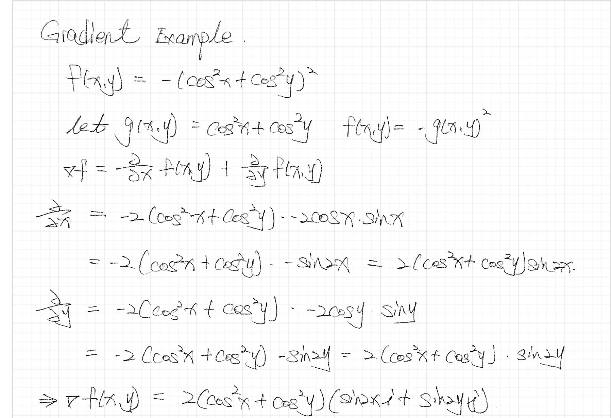

> Last Edit: 1/13/26

> Last Edit: 3/23/26
> 

# Scalar Field

$$
f: \mathbb{R}^n \to \mathbb{R}
$$

- Scalar Field is used to describe the distribution of Scalar in space $\mathbb R^n$

## Gradient of Scalar Field

$$
\nabla f(p) = \frac{\partial f(x, y, z)}{\partial x} \hat{x} + \frac{\partial f(x, y, z)}{\partial y} \hat{y} + \frac{\partial f(x, y, z)}{\partial z} \hat{z}
$$

- Taking the Gradient turns the Scalar Field into a Vector Field $\nabla f: \mathbb{R}^n \to \mathbb{R}^n$
- Then the vector is pointing to the direction **Having the largest rate of change**

### Ex. Finding the Gradient of a Scalar Field

## Electric Field & Electric Potential

$$
\vec{E} = -\nabla V
$$

- $V$ (Electric Potential): Scalar Field
- $\vec E$ (Electric Field): Vector Field

# Divergency of a Vector Field

Divergency is a scalar representing the strength of Divergency or Convergency at a given point

$$
\text{div } \vec{F} = \nabla \cdot \vec{F} = \frac{\partial F_x}{\partial x} + \frac{\partial F_y}{\partial y} + \frac{\partial F_z}{\partial z}
$$

- $\nabla \cdot \vec{F}: \mathbb{R}^n \rightarrow \mathbb{R}$: Process of finding Divergency is finding a Scalar Field
- $\nabla \cdot \vec{F} > 0$: Source are going out at this point
- $\nabla \cdot \vec{F}< 0$: Sources are coming in at this point

## Gauss’ Divergence Theorem

$$
\iiint_V \text{div } \vec{F} \, dv = \oiint_S \vec{F} \cdot d\vec{S}
$$

<aside>
❗

Divergence Theorem connect the **Source inside the volume & Flux passing through the surface** 

</aside>

### Divergency Theorem Example

Evaluate $\iint \vec{F} \cdot d\vec{S}$  where $\vec{F} = xy\hat{x} - \frac{1}{2}y^2\hat{y} + z\hat{z}$ and the surface consists of the three surfaces of cylinder defined by $0 \le \rho \le 1, 0 \le \phi \le 2\pi, 0 \le z \le 1$

# Curl of a Vector Field

$$
\nabla \times \vec{B} = \left( \frac{\partial B_z}{\partial y} - \frac{\partial B_y}{\partial z} \right) \hat{x} + \left( \frac{\partial B_x}{\partial z} - \frac{\partial B_z}{\partial x} \right) \hat{y} + \left( \frac{\partial B_y}{\partial x} - \frac{\partial B_x}{\partial y} \right) \hat{z}
$$

<aside>
❗

Curl is a Vector, **it represent the Strength and the Direction of Circulation at a point**

</aside>

## Curl of a Electric Field

$$
\nabla \times \vec{E} = 0
$$

- Electric Field‘s Direction is either point to or away from the source, thus it doesn’t have any Circulation, thus having a Curl of zero

## Stokes’ Theorem

$$
\iint_S (\nabla \times \vec{B}) \cdot d\vec{S} = \oint_C \vec{B} \cdot d\vec{l}
$$

<aside>
❗

Stokes’ Theorem connect **every point’s Curl and total Circulation around the boundary of the Surface**

</aside>