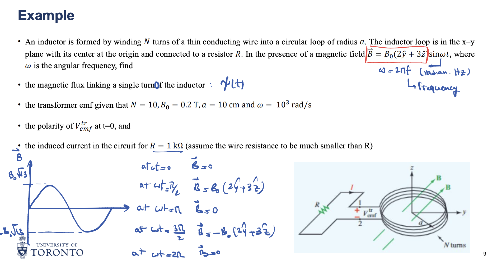
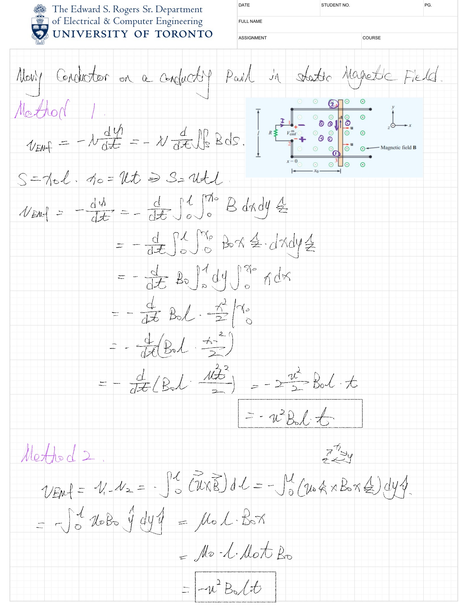
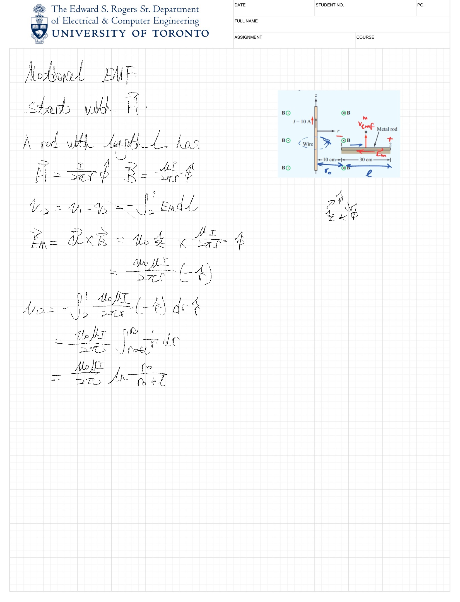
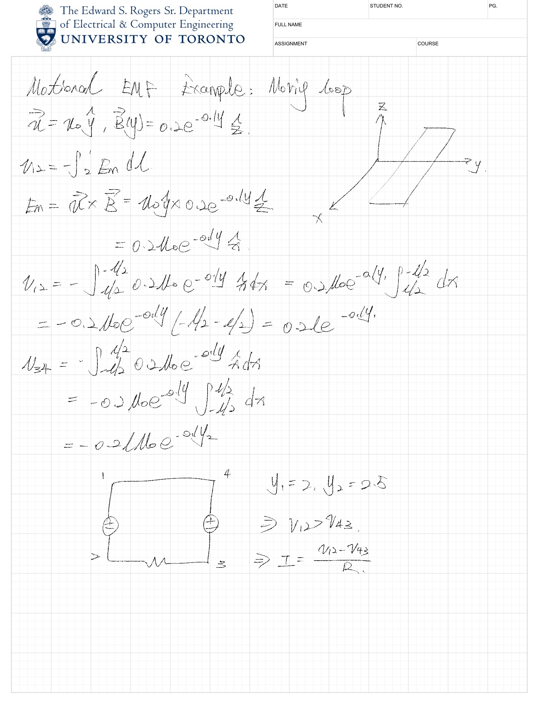
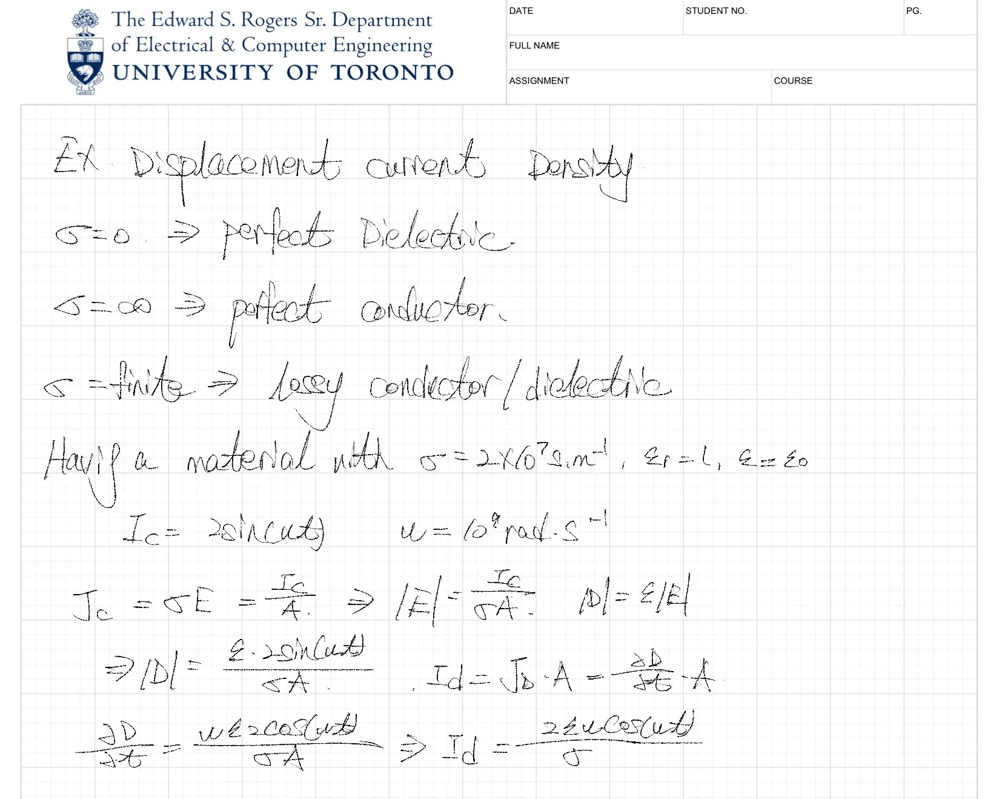

> Last Edit: 4/20/26

# Faraday’s Law

$$
\Psi = \iint \vec{B} \cdot d\vec{s}
$$

Magnetic Flux is the integral of Magnetic Strength $B$ in area $s$

## Electromotive Force (EMF)

$$
V_{emf} = - \frac{d}{dt} \Lambda = - \frac{d}{dt} (N \Psi)
$$

# Time-varying Magnetic Flux

Starting from Faraday’s Law $\Psi = \iint \vec{B} \cdot d\vec{s}$, we can get there’s three term that can change

$$
V_{emf} = -N \left[ \iint \frac{d|\vec{B}|}{dt} ds \cos\alpha + \iint |\vec{B}| \frac{d(ds)}{dt} \cos\alpha - \iint |\vec{B}| ds \sin\alpha \frac{d\alpha}{dt} \right]
$$

## Stationary Loop in a Time-varying Magnetic Field

This is the can when **loop doesn’t change, but field is**

$$
V_{emf}^{tr} = -\iint \frac{d\vec{B}}{dt} \cdot d\vec{s}
$$

## Lenz’s Law

Based on Lenz’s Law, the induced current is to **oppose the change of flux** 

### Ex.

# Faraday’s Law Relates Electric and Magnetic Fields

In Electrostatic, we have $\nabla \times \vec{E} = 0$, but its complete formula is $\nabla \times \vec{E} = - \frac{\partial \vec{B}}{\partial t}$, thus this meas that changing Magnetic Field will induced a Electric Field

$$
V_{emf}^{tr} = - \iint \frac{\partial \vec{B}}{\partial t} \cdot d\vec{s}
$$

## Moving Conductor in a Static Magnetic Field

This case is when a wire is moving in a uniform Magnetic Field

## Moving Conductor on a Conducting Rail in a Static Magnetic Field

## Motional EMF

## Ex. Moving Loop

# Electromagnetic Generator

When a loop is rotating with angular frequency of $\omega$ in a static magnetic field

## Transformer & Motional EMF

When there’s two kind of EMF at the same time, then we have 

$$
V_{emf} = V_{emf}^m + V_{emf}^{tr}
$$

## Eddy Currents

Eddy currents are circulating currents induced inside a conductor **when it experiences a changing magnetic field**

# Ideal Transformer

## Voltage and Current Relations

# Displacement Current

## Conduction & Displacement Current in PP Capacitor Circuit

### Ex. Displacement Current Density

## Angular Frequency

### Ex.  Electric & Magnetic Fields Between Capacitor Plates

