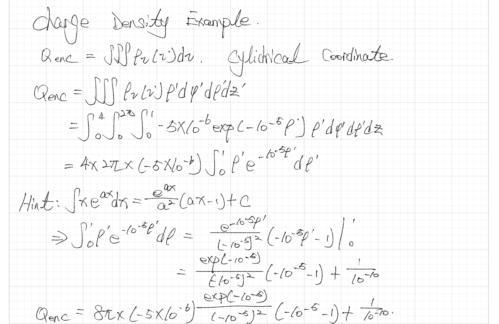

> Last Edit: 1/13/26

> Last Edit: 23/3/26
> 

**Maxwell’s Equations described how Charge and Current form Electric and Magnetic Field, while indicate how Electric and Magnetic Field transfer into each other and how they propagate**

# Maxwell’s Equations

Maxwell’s Equations are actually the combination of four equations, each have their own name

## 1st: Gauss’s Law

<aside>
❗

**Gauss’s Law: Charge forms Electric Field**

</aside>

$$
\nabla \cdot \vec{D} = \rho_v, \quad \nabla \cdot E = \frac{\rho_{v}}{\varepsilon_0}
$$

- $D$: Electric Flux Density $(c\cdot m^{-2})$
- $\rho_v$: Volumetric Charge Density ($c\cdot m^{-3}$)

---

**Important Concept:** $\vec D$ is the Electric Flux Density, it’s the real Field created, whereas $\vec E$ is the actual forced applied, they have the relationship of

$$
D = \varepsilon_0 E + P
$$

- In this formula, we treat the Displacement as the addition of two terms

---

$$
\vec D = \varepsilon_0 \varepsilon_r \vec{E}
$$

- $\varepsilon_0$ : Free space Permittivity, a constant
- $\varepsilon_r$: Relative Permittivity, varies in different materials
- In this formula, we treat Displacement as the scaling of E after entering a material

## 2nd: Gauss's Law for Magnetism

<aside>
❗

**Gauss's Law for Magnetism: There’s no signal Magnetic Pole**

</aside>

$$
\nabla \cdot \vec{B} = 0
$$

- This law states that Magnetic Field Line is always a **closed contour**

---

**Important Concept**: $\vec H$ is the Magnetic Field Strength, and $\vec B$ is the Magnetic Flux Density they are just same with the $\vec D$ and $\vec E$, having the relationship of

$$
\vec{B} = \mu_0 (\vec{H} + \vec{M})
$$

- Treat $\vec B$ (Total Magnetic Field) = $\mu_0\vec H$ (Magnetic Field in vacuum) + $\mu_0\vec M$ (The contribution of material after being magnitized)

---

$$
\vec B = \mu_0 \mu_r \vec H
$$

- $\mu_r$: Relative Permeability
- Or the Scaling of Magnetic Field after entering the material

## 3rd: Faraday's Law of Induction

<aside>
❗

Faraday's Law of Induction: **Changing Magnetic Field will create Electric Field**

</aside>

$$
\nabla \times \vec{E} = -\frac{\partial \vec{B}}{\partial t}
$$

- $\vec B$: Magnetic Flux Density ($T$)

## 4th: Ampere-Maxwell Law

<aside>
❗

Ampere-Maxwell Law: **Changing Electric Field will create Magnetic Field**

</aside>

$$
\nabla \times \mathbf{H} = \mathbf{J_f} + \frac{\partial \mathbf{D}}{\partial t}
$$

- $\vec J_F$: Free Current
- $\frac{\partial \mathbf{D}}{\partial t}$: Displacement Current

---

**Important Concept**: Here there’s two kind of current, knowing their difference is crucial for understanding this law

- Starting with $\vec J_F$: this is formed by the **free charges flowing inside wires**, this will obviously creates a Magnetic Field around it
- Secondly, the $\frac{\partial \mathbf{D}}{\partial t}$, this is the **Electric Field Changed due to time**, as this will **also creates a Magnetic Field**, we manually **define this as the Displacement Current**, where it’s actually a changed of the Electric Field

## Maxwell Equation under Static Case

This static means all terms with $\frac{\partial}{\partial t} = 0$ is now zero, and the **Equations will be simplified into two separate fields: Electrostatic and Magnetrostatic**

### Electrostatic

$$
\nabla \cdot \mathbf{D} = \rho_v
$$

- The same

---

$$
\nabla \times \mathbf{E} = 0
$$

<aside>
❗

Static Electric Field is Irrational Field

</aside>

---

### Magnetostatic

$$
\nabla \cdot \mathbf{B} = 0
$$

- The same

---

$$
\nabla \times \mathbf{H} = \mathbf{J_F}
$$

- As there’s no Electric Field change anymore, only current creating Magnetic Field is then the Free Current

---

**So under the assumption of Static, we can start with Electrostatic and Magnetostatic**

# Electrostatics

Now recall the **1st: Gauss’s Law: $\nabla \cdot \mathbf{D} = \rho_v$**, this is the **Differential Form** of Gauss’s Law

## Integral Form

Starting from the formula $\nabla \cdot \vec{D} = \rho_v$, take integral on both side to get

$$
\iiint_V (\nabla \cdot \vec{D}) dV = \iiint_V \rho_v dV
$$

- We known that the **Divergence Theorem** states that $\iiint_V (\nabla \cdot \vec{D}) dV = \iint_S \vec{D} \cdot d\mathbf{s}$, thus

$$
\iint_S \vec{D} \cdot d\mathbf{s}=Q_{enclosed}\Rightarrow \iint \mathbf{E} \cdot d\mathbf{s} = \frac{Q_{enclosed}}{\varepsilon_r \varepsilon_0}
$$

- That is just the **Most Common form of Gauss’s Law**

<aside>
❗

**Gauss’ s Law (Integral Form): The Electric Flux pass through a surface only depends on the charges enclosed by this surface**

</aside>

---

Before applying this Integral Form of Gauss’s Law, we first need to figure out the Charge Distribution problem on the RHS, that’s $Q_{enclosed}$, we can apply integral to solve it

### Ex. Charge Distribution Problem

An electron beam has a volumetric charge density described by $\rho_v = -5 \times 10^{-6} \exp(-10^{-5} \rho) \text{ C/m}^3$ over the region $0< \rho < 1$ and $0 < z < 4$

---

---

# Magnetostatics

Starting from the **Ampère's Circuital Law with Maxwell's Correction** $\nabla \times \vec{H} = \vec{J}$

## Integral From

Apply the same methodology, take the integral on both side of $\nabla \times \vec{H} = \vec{J}$ to get

$$
\iint_S (\nabla \times \vec{H}) \cdot d\vec{s} = \iint_S \vec{J} \cdot d\vec{s}
$$

- Notice the LHS can be substitute by **Stokes’ Theorem** into $\oint_L \vec{H} \cdot d\vec{l}$, thus

$$
\oint_L \vec{H} \cdot d\vec{l} = I
$$

- And this is just **Ampere’s Law**, meaning that **Current forms Magnetic Field surrounding it**

## Current Density

Here we are still under the **Static Maxwell’s Equation** that the **Ampère's Circuital Law with Maxwell's Correction**

$$
\nabla \times \mathbf{H} = \underbrace{\mathbf{J}_{cond} + \mathbf{J}_{conv}}_{\mathbf{J}_f (\text{Real Charge Movement})} + \underbrace{\frac{\partial \mathbf{D}}{\partial t}}_{\text{Changing Electric Field}}
$$

can be simplified into $\nabla \times \mathbf{H} = \mathbf{J}_f=\mathbf{J}_{cond} + \mathbf{J}_{conv}$

- Here the **$\vec J_f$
 is actually the addition of two kinds of currents**, **Conduction and Convection Current**

### Conduction Current

This current occurring **inside conductor,** **it’s like elevator transferring charges**  

$$
\vec J =\sigma \vec E
$$

- The key point is that the **Conduction Current Magnitude** is depending on the $\sigma$, which is the **Conductivity of material**

---

### Convection Current

This Current is the **movement of Charged Partial through vacuum space**

$$
\vec{J}_{convection} =\frac{dQ}{dt}=\frac{\rho_vdx}{dt}= \rho_v \vec{v}
$$

- It follows the **Kinetic Rules**, that’s **related to speed and density**