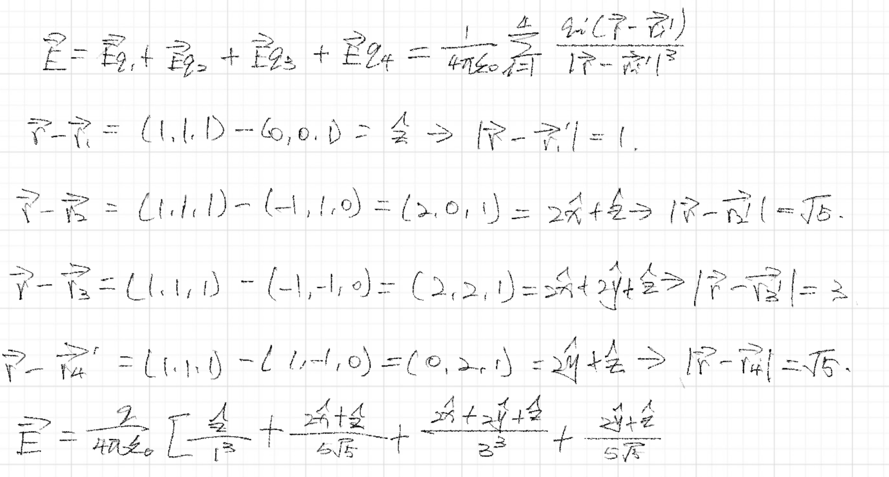

> Last Edit: 1/19/26

> Last Edit: 23/3/26
> 

# Coulomb’s Law

**Coulomb’s Law** reveals the **Force between two point Charges**, it can be written in vector form

$$
\vec{F}_{12} = \frac{1}{4\pi\varepsilon_0} \frac{|q_1 q_2|}{r_{12}^2} \frac{\vec{r}_{12}}{|\vec{r}_{12}|} = \frac{1}{4\pi\varepsilon_0} \frac{q_1 q_2}{|\vec{r}_{12}|^3} (\vec{r}_1 - \vec{r}_2)
$$

# Electric Field by Point Charge

Point Charges will creates **Electric Field** and that field have the **Magnitude of Electric Force F**

$$
\vec{E}_q = \frac{\vec{F}_{qq_t}}{q_t} = \frac{1}{4\pi\varepsilon_0} \frac{q}{r^2} \hat{r}
$$

- And the result is given putting one **Test Charge inside the Electric Field**, and we can state that the **Point Charge $q_t$ is in the presence of a Electric Field**

## **Superposition of Electric Fields**

For several Electric Field, it follows the rule of **Vector Addition**

- While each Charge’s effect on that reference point will be

$$
\vec{E} = \frac{1}{4\pi\epsilon_0} \frac{q}{|\vec{r} - \vec{r}'|^3} (\vec{r} - \vec{r}')
$$

- By adding up those vectors, we can get he **Total Electric Field**

$$
\vec{E}_{total} = \vec{E}_{q_1} + \vec{E}_{q_2} + \dots + \vec{E}_{q_n}
$$

### Ex. **Superposition of Electric Fields**

## Electric Field due to Continuous Charge Densities

A Point Charge is being defined as **a point with no volume and with charge $q$**, its Electric Field is

$$
\vec{E} = \frac{1}{4\pi\epsilon_0} \frac{q}{|\vec{r} - \vec{r}'|^3} (\vec{r} - \vec{r}')
$$

- When the Charges are no longer a point, but being described as Charge Density that evenly or unevenly distributed along a line, a surface or a volume, this **Electric Field then need to be evaluate by the Integral,** we get the **Volume Charge Density’s Electric Field** is

$$
\vec{E} = \frac{1}{4\pi\epsilon_0} \iiint \frac{\rho_v(\vec{r}') (\vec{r} - \vec{r}')}{|\vec{r} - \vec{r}'|^3} dv'
$$

- They same apply on **Surface and Line**

$$
\vec{E} = \frac{1}{4\pi\epsilon_0} \iint \frac{\rho_s(\vec{r}') (\vec{r} - \vec{r}')}{|\vec{r} - \vec{r}'|^3} ds',\quad \vec{E} = \frac{1}{4\pi\epsilon_0} \int \frac{\rho_l(\vec{r}') (\vec{r} - \vec{r}')}{|\vec{r} - \vec{r}'|^3} dl'
$$

### Ex. The Electric Field of a Continuous Line Charge Density

