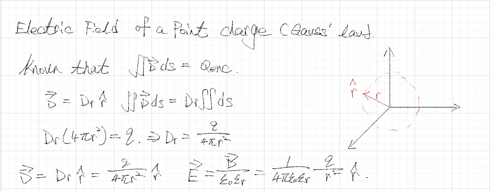
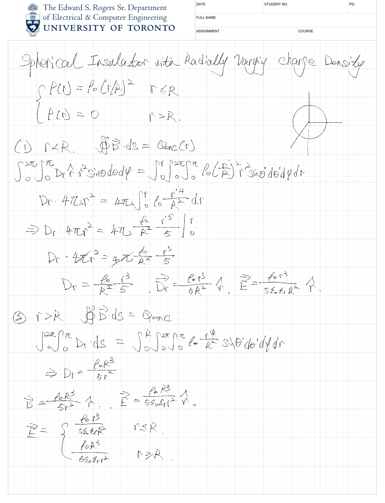

> Last Edit: 1/21/26

> Last Edit: 23/3/26
> 

Recall Gauss’s Law in Integral Form: **The Electric Flux pass through a surface only depends on the charges enclosed by this surface**, in the form of

$$
\oiint_S \vec{D} \cdot d\vec{s} = Q_{enclosed}
$$

<aside>
❗

**Gauss’s Law** is used to **simplify the calculation of Electric Field by Symmetry**

</aside>

- If there’s no Symmetry, then we have to use **Coulomb’s Law** which is the **operator of Vector that is normally harder**
- The commonly seen Symmetry Types are **Spherical, Cylindrical, and Planar**

## Electric Field of a Point Charge

- So we can summarise the Electric Field created by a **Point Charge** as

$$
\vec{D} = D_r \hat{r} = \frac{q}{4 \pi r^2} \hat{r},\quad \vec{E} = \frac{\vec{D}}{\varepsilon_0 \varepsilon_r} = \frac{1}{4 \pi \varepsilon_0 \varepsilon_r} \frac{q}{r^2} \hat{r}
$$

## Electric Field of Infinite Long Charge Line

- So the Electric Field created by **Infinite Long Charge** is

$$
\vec{D}_\rho = \frac{\rho_l}{2 \pi \rho} \hat{\rho},\quad \vec{E} = \frac{\rho_l}{2 \pi \varepsilon_0 \varepsilon_r \rho} \hat{\rho}
$$

## Electric Field of Infinite Uniform Surface

- So the Electric Field for **Infinite Uniform Surface** is

$$
\vec{D}_z = \frac{\rho_s}{2} \hat{z},\quad \vec{E} = \frac{\rho_s}{2 \varepsilon_0 \varepsilon_r} \hat{z}
$$

## Electric Field for Parallel Sheets

## Electric Field of a Radially Varying Charge Density

Having a non-conducting sphere of radius R that has charge density varies with distance

$$
\begin{cases} \rho(r) = \rho_0 (r/R)^2 & \text{for } r \leq R \\ \rho(r) = 0 & \text{for } r > R \end{cases}
$$

