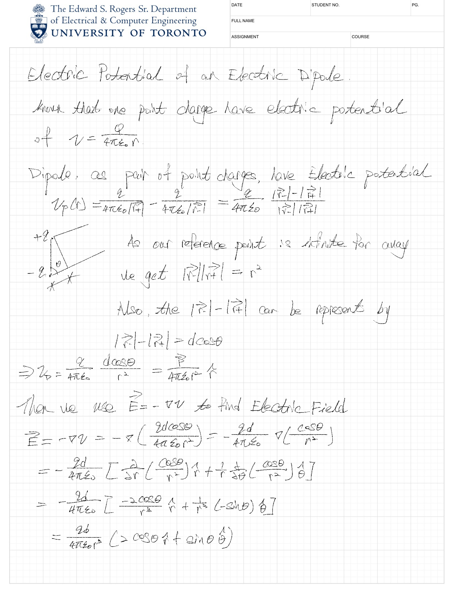
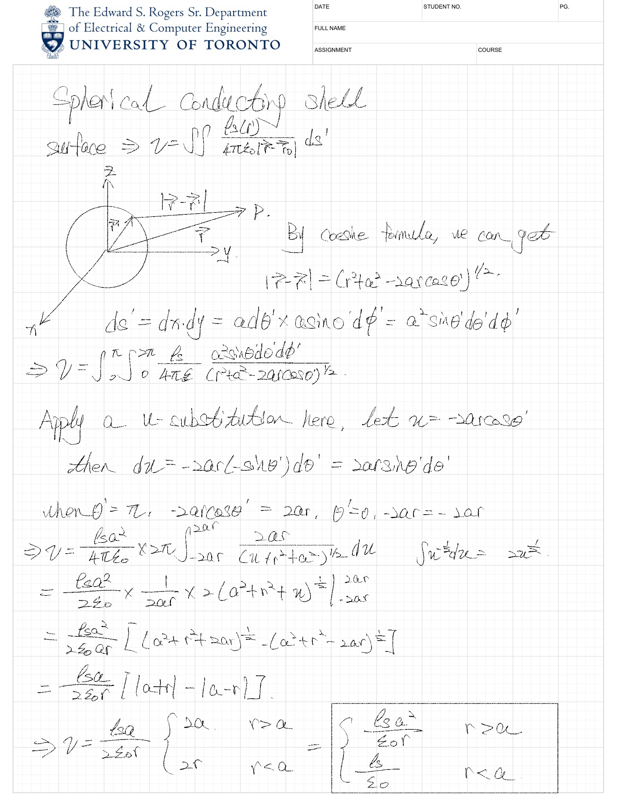
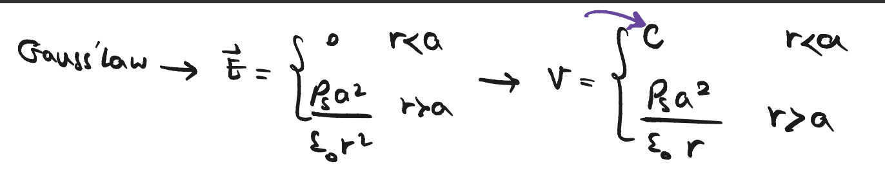
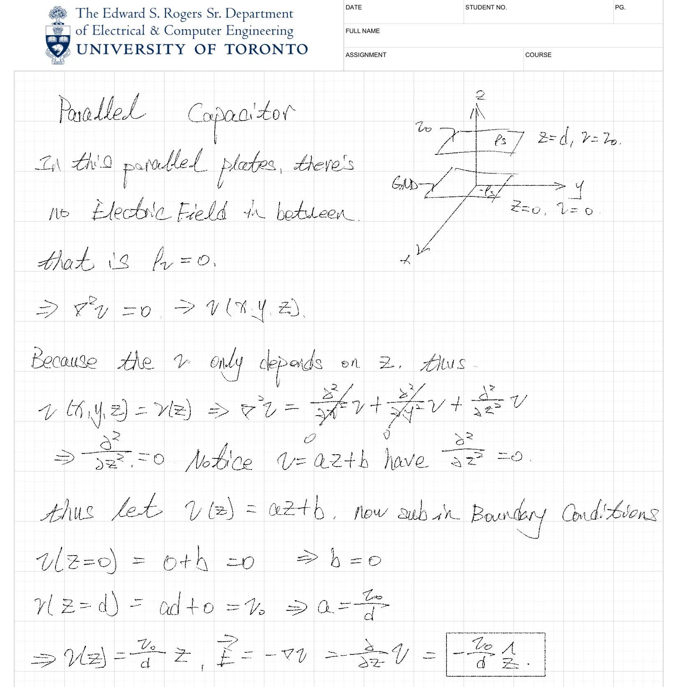
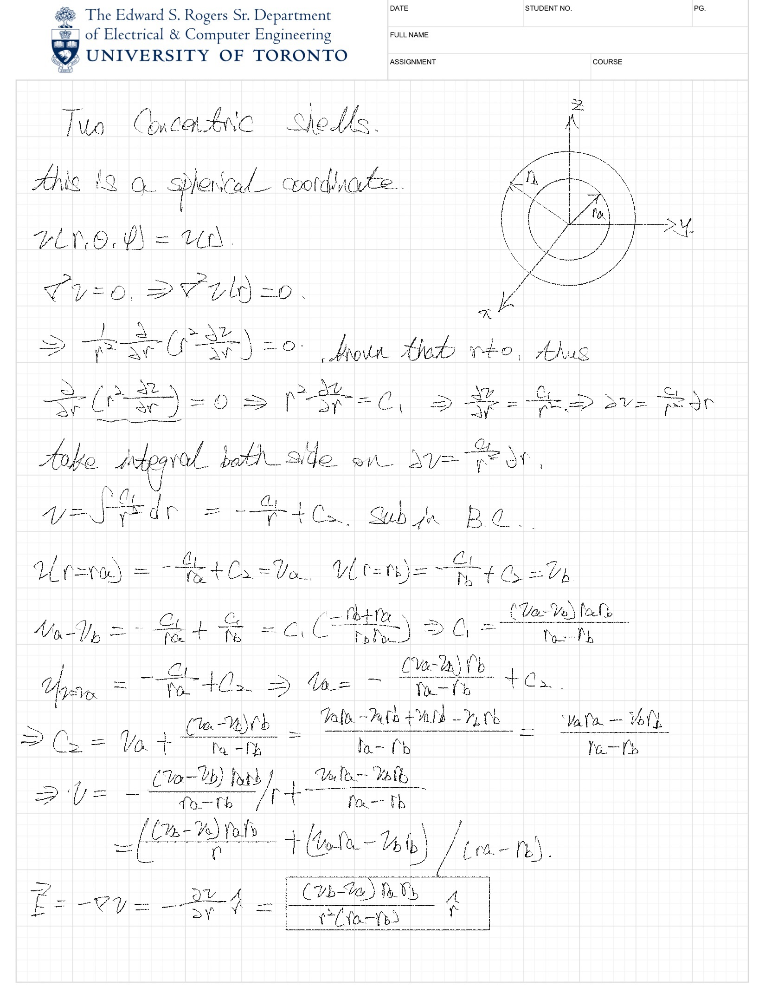

> Last Edit: 1/27/26

> Last Edit: 23/3/26
> 

# Electric Potential (Scalar)

The definition for **Electric Potential** is the **work required to move a unit positive charge from A to B**

$$
V_B - V_A = -\int_A^B \vec{E} \cdot d\vec{l}
$$

## Electric Potential by Point Charge

As Electric Potential is a work, we start with **Work Done formula**

$$
W = \int_{r_A}^{r_B} -q \vec{E} \cdot d\vec{l}=\int_{r_A}^{r_B}-qE(r)\hat rdr\hat r
$$

- Known that the **Electric Field** created by **Point Charge** is $\vec{E} = \frac{Q}{4\pi\epsilon_0 r^2} \hat{r}$

$$
W = -\int_{r_A}^{r_B} \frac{qQ}{4\pi\epsilon_0 r^2} dr=-\frac{qQ}{4\pi\epsilon_0 }\int_{r_A}^{r_B}  \frac{1}{r^2}dr= \frac{qQ}{4\pi\epsilon_0} \left( \frac{1}{r_B} - \frac{1}{r_A} \right)
$$

- And the **Potential Difference** is the **Work Done by Unit Charge**, which is

$$
V_{AB} = V_B - V_A = \frac{W}{q}=\frac{qQ}{4\pi\epsilon_0} \left( \frac{1}{r_B} - \frac{1}{r_A} \right)/q
$$

- Thus we can get the **Potential Difference** between **two Point Charge** is

$$
V_B - V_A = \frac{Q}{4\pi\epsilon_0} \left( \frac{1}{r_B} - \frac{1}{r_A} \right)
$$

### Absolute Electric Potential

Just like the GND in circuit, we always want to set up **a reference point for Potential**, that could be the point when $V_A =0$, which is $r_A\rightarrow \infty$

In such case, we will get the **Potential Difference at a point** as

$$
V(r) = \frac{Q}{4\pi\epsilon_0 r}
$$

## Relation between Electric Field & the Electric Potential

**Electric Field is a Vector Field**, which is defined as the the **opposite direction of gradient** of **Electric Potential Field**

$$
\vec{E} = -\nabla V
$$

So if we want to **find the Electric Field of Point Charge** what we should do is 

- Start with the **Electric Potential of Point Charge** $V(r) = \frac{Q}{4\pi\epsilon_0 r}$, then find its Gradient

$$
\vec{E} = -\nabla \left( \frac{Q}{4\pi\epsilon_0 r} \right)=-\frac{Q}{4\pi\epsilon_0}\nabla \left( \frac{1}{r} \right) =-\frac{Q}{4\pi\epsilon_0} \left( -\frac{1}{r^2} \hat{r} \right) = \frac{Q}{4\pi\epsilon_0 r^2} \hat{r}
$$

<aside>
❗

The property $\vec{E} = -\nabla V$ connects **Electric Field** and **Electric Potential**

</aside>

## Conservation Property of the Electrostatic Field

<aside>
❗

**Voltage difference is the same regardless of the integration path**

</aside>

## Equipotential Lines & Surfaces

Based on the property that

$$
V=\frac{Q}{4\pi\epsilon_0r}\hat r
$$

- We know that as long as $r$ is the same, then $V$ remains constant, **which is then a Equipotential Line & Surface**

# Electric Potential of Different Model

## Electric Potential of a Point Charge

Known from above that

$$
V(r) = \frac{Q}{4\pi\epsilon_0 r}
$$

Electric Potential of **Point Charges**, is the **Scalar Addition of Point Charges**

$$
V(\vec{r}) = \sum_{i=1}^{N} \frac{Q_i}{4\pi\epsilon_0 |\vec{r} - \vec{r}'_i|}
$$

## Electric Potential of an Electric Dipole

Notice there’s a Equation about $\nabla$ in **Spherical Coordinate**, which is

$$
\nabla f = \frac{\partial f}{\partial r} \hat{r} + \frac{1}{r} \frac{\partial f}{\partial \theta} \hat{\theta} + \frac{1}{r \sin \theta} \frac{\partial f}{\partial \phi} \hat{\phi}
$$

- This **Jacobian term** will be mentioned again later

## Electric Potential of Continuous Charge Distributions

By using Integral, we can deal with **more complicated Charge Distribution models**

$$
V = \iiint \frac{\rho_v(\vec{r}') \, }{4\pi\epsilon_0 |\vec{r} - \vec{r}'|}dv'
$$

$$
V = \iint \frac{\rho_s(\vec{r}') \, }{4\pi\epsilon_0 |\vec{r} - \vec{r}'|}ds'
$$

$$
V = \int \frac{\rho_l(\vec{r}') \, }{4\pi\epsilon_0 |\vec{r} - \vec{r}'|}dl'
$$

## Electric Potential of a Conducting Shell (Surface)

 The result can be verified by the **Gauss’s Law** that 

## Gradient Operator in Different Coordinate Systems

<aside>
❗

In **Cylindrical** or **Spherical** Coordinates, the **Unit Vector’s Direction** depends on the **current position**, which is not identical as Cartesian, **the axis itself is changing**. Under this case, **we need to include extra term to fix this directional change, and that’s why there’s difference in Gradient (and other) Operator in different Coordinate Systems**

</aside>

### Cartesian Coordinate

$$
\nabla f = \frac{\partial f}{\partial x} \hat{x} + \frac{\partial f}{\partial y} \hat{y} + \frac{\partial f}{\partial z} \hat{z}
$$

### Cylindrical Coordinate

$$
\nabla f = \frac{\partial f}{\partial r} \hat{r} + \frac{1}{r} \frac{\partial f}{\partial \phi} \hat{\phi} + \frac{\partial f}{\partial z} \hat{z}
$$

### Spherical Coordinate

$$
\nabla f = \frac{\partial f}{\partial r} \hat{r} + \frac{1}{r} \frac{\partial f}{\partial \theta} \hat{\theta} + \frac{1}{r \sin \theta} \frac{\partial f}{\partial \phi} \hat{\phi}
$$

# Electrical Field

There’s **several ways we define Electrical Field** so far

## 1. Coulomb’s Law

Using the **Charge Density Distribution** $\rho_v$, while there’s **no Symmetry** for **Gauss’s Law**

$$
\vec{E} = \iiint \frac{\rho_v(\vec{r}')(\vec{r} - \vec{r}')}{4\pi\epsilon_0 |\vec{r} - \vec{r}'|^3} d v'
$$

## 2. Gauss’s Law

When there’s a Symmetry, the **Coulomb’s Law will be simplified into**

$$
\oint_S \vec{D} \cdot d\vec{s} = Q_{enc} 
$$

- We first know the Charge Enclosed $Q_{enc}$
- Then we find a Symmetry to **simplify the integral $\oint_S \vec{D} \cdot d\vec{s}$ into $D_{\hat{u}} \cdot A_{Gauss}$**
- Then we can use $D = \frac{Q_{enc}}{A}$ to get the value of D, and **Electric Field** $\vec E$

## 3. Gradient of Electric Potential

This method start with **Electric Potential** and find its Gradient to find the **Vector Field** $\vec E$

$$
\vec{E} = -\nabla V
$$

Whereas the **Electric Potential** can be find by 

$$
V = \iiint \frac{\rho_v(\vec{r}') dv'}{4\pi\epsilon_0 |\vec{r} - \vec{r}'|}
$$

## 4. Boundary Conditions

If we know the **Boundary Conditions**, **then we can use the $\nabla^2 V$  to find V, then $\vec E$** 

# Poisson’s & Laplace’s Equations

Starting from the **Electrostatic Functions** in **Maxwell’s Equation**

$$
\nabla \times \vec{E} = 0,\quad \nabla \cdot \vec{E} = \frac{\rho_v}{\varepsilon_0 \varepsilon_r}
$$

The first equations $\nabla \times \vec{E} = 0$ indicates that **Electric Field is a Conversation (Irrational) Field**, that its independent of the Path C, so that

$$
-\int _C\vec E\cdot \vec{dl}=\Delta V\Rightarrow \vec E= -\nabla V
$$

Whereas for the second equation $\vec{E} = \frac{\rho_v}{\varepsilon_0 \varepsilon_r}$, if we **plug in** $\vec E= -\nabla V$ , we get

$$
\nabla \cdot (-\nabla V) = \frac{\rho_v}{\varepsilon_0 \varepsilon_r}\Rightarrow \nabla^2 V = -\frac{\rho_v}{\varepsilon_0 \varepsilon_r}
$$

## Poisson’s Equation

$$
\nabla^2 V = -\frac{\rho_v}{\varepsilon_0 \varepsilon_r}
$$

**Poisson’s Equations** tells us that **if there exist Free Charges $(\rho_v \neq 0)$,** then **the Rate of Change of Rate of Change of Electric Potential is depend on them**

## Laplace’s Equation

Whereas if there’s **no Free Charges** $(\rho_v=0)$, then Poisson’s Equation simplified into

$$
\nabla^2 V = 0
$$

Then the **Electric Potential** is then **smooth over this region** that the vacuum place’s Electric Potential Value equals to its Boundary’s average

## Laplacian Operator in Different Coordinate Systems

Same as Gradient, **Laplacian Operator** has the same **Jacobian terms**

### Cartesian

$$
\nabla^2 f = \frac{\partial^2 f}{\partial x^2} + \frac{\partial^2 f}{\partial y^2} + \frac{\partial^2 f}{\partial z^2}
$$

### Cylindrical

$$
\nabla^2 f = \frac{1}{r} \frac{\partial}{\partial r} \left( r \frac{\partial f}{\partial r} \right) + \frac{1}{r^2} \frac{\partial^2 f}{\partial \phi^2} + \frac{\partial^2 f}{\partial z^2}
$$

### Spherical

$$
\nabla^2 f = \frac{1}{r^2} \frac{\partial}{\partial r} \left( r^2 \frac{\partial f}{\partial r} \right) + \frac{1}{r^2 \sin \theta} \frac{\partial}{\partial \theta} \left( \sin \theta \frac{\partial f}{\partial \theta} \right) + \frac{1}{r^2 \sin^2 \theta} \frac{\partial^2 f}{\partial \phi^2}
$$

# Electric Field calculated by Laplacian Operator

Here are some example model’s Electric Field calculated by using **Laplacian Operator**

## Parallel-Plate Capacitor

## Two Concentric Shells

## Two Planes

