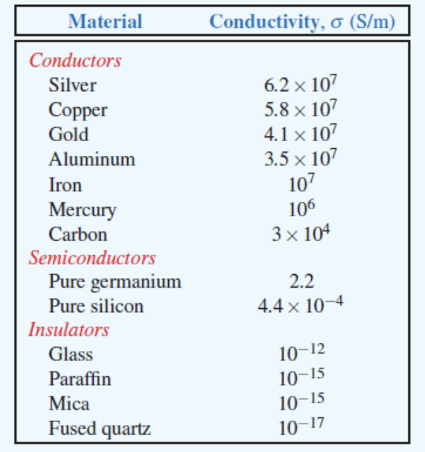

> Last Edit: 2/3/26

# Current and Current Densities

This unit is about Displacement Current, Convection Current and Conduction Current

## Displacement Current

This is the current under **Insulator**, it is caused by the **rate of change of the Electric Field**

$$
\vec{J}_D = \frac{\partial \vec{D}}{\partial t}
$$

## Convection Current

Current cause by the movement of Free Charges in space

$$
\vec J_{con}=\frac{\rho_v\Delta S\cdot \Delta l/\Delta t}{\Delta S}= \rho_v\cdot \vec u _v
$$

- $\rho_v$
: Charge Density
- $u_v$: Charge Drifting Speed
- This means $Current ~Density = Charge~Density * Velocity$

## Conduction Current

The Current cause by the **moving Charge Carriers in conductor**

$$
\vec{J}_{conduction} = \rho_{ve} \vec{u}_e + \rho_{vh} \vec{u}_h=\rho_{ve} (-\mu_e \vec{E}) + \rho_{vh} (\mu_h \vec{E}) = (-\rho_{ve} \mu_e + \rho_{vh} \mu_h) \vec{E}
$$

That’s the **movement of Electron and Holes**, we can simplify this into

$$
\vec{J} = \sigma \vec{E}
$$

Whereas **$\sigma$  is Conductivity, $\vec E$ is Electric Field**

# Property of Materials

We characterise material by **Conductivity $\sigma$**: **The ability for material to conduct current**

## Conductor

Conductor is the material having **$\sigma >>1$**

### Perfect Conductor

Perfect Conductor have $\sigma \rightarrow \infty$

As $\vec{J} = \sigma \vec{E}$, as **Current Density** **has to be some finite number** (Because the Energy need to be finite), thus as **$\sigma \rightarrow \infty$, $\vec E \rightarrow 0$** 

- This concludes that inside **Perfect Conductor**, **there’s no Electric Field inside**, while all **Net Charges are on the surface**

## Dielectric

Dielectric  is the material having **$\sigma <<1$**

### Perfect Dielectric

Perfect Dielectric having $\sigma =0 \Rightarrow \vec J = 0$

- This concludes that **Ideal Dielectric’s Electric Field is zero**

### Dielectric Breakdown

The material will have a **Electric Field Threshold** that **when external Electric Field exceed it, the breakdown in material will occur**

## Semiconductors

$$
\sigma = (N_e \mu_e + N_h \mu_h) e
$$

This means that the Semiconductor’s conductivity is depend on the **density of Electric and Hole**, and the N

## Ex.

# Behavior of materials under external Electric Field

**Different material** will present different behavior **under an external Electric Field**

## Perfect Conductor under external Electric Field

**Perfect Conductor** has the **property of $\sigma =\infty$**, thus under Electric Field, this will creates **two Electric Field** in this case, **an Internal one and a External one**

- The first $\vec E$ is pointing to the right, this will create a $-\vec F_E$ for **Electrons in conductor**
- As all the **Electrons** has **been moved to the left side of conductor**, this creates a second **Internal** $-\vec E$, thus the **$\vec E_{net}$ is now zero**

And all the charges will distributed on the **surface of the conductor**

## Conductor under external Electric Field

Unlike perfect conductor, we now **only have finite $\sigma$** , the first thing to notice is that **Internal Electric Field is no longer zero**

As not all the Electrons can be pushed to the other side, **this will cause $|\vec{E}_{int}| < |\vec{E}_{ext}|$**, in order to measure the ability of this conductor blocking Electrons, we introduce **Resistance**

## Resistance

The basic definition of **Resistance is $R = \frac{V}{I}$**, whereas

- $V$: is the **potential difference between two points**, is the integral of two points

$$
V = V_{P_+} - V_{P_-} = -\int_{P_-}^{P_+} \vec{E} \cdot d\vec{l}
$$

- $I$: is the **integral of current density across conductor cross area A**

$$
I = \iint_A \sigma\vec{E} \cdot d\vec{s}
$$

## Conductance

Conductance is just the **reciprocal of Resistance**

$$
G=\frac{1}{R}=\frac{I}{V}
$$

- Unit Conductance: Use **Conductance to divided by length** to get Unit Conductance

$$
G' = \frac{G}{l} = \frac{I}{V_{ab} \cdot l}
$$

## Joule's Law

Joule’s Law indicate how Power dissipated in a conducting medium in the presence of
an electrostatic field

$$
P = \iiint \sigma |\vec{E}|^2 dV
$$

## Behavior of Dielectrics

Inside Dielectrics, charges don’t move, but under the External Electric Field, it will cause a displacement, which is called Polarization

While there are two kinds of Molecules, Polar and Non-Polar ones, they also have different behavior under Electric Field

### Polar Molecules

### Non-Polar Molecules

When Non-Polar Molecule in under Electric Field, it will be extract into a Dipole

- Notice that this $\vec P$ is parallel to the Electric Field $\vec E$

### Polar Molecules

At the begining, there’s already a $\vec P$ in present, while after the effect of the Electric Field, there will be a Torque that spin the $\vec P$ to be parallel to the Electric Field

## Dielectric Constant

Inside a conductor, the charges inside will be canceled out, where as the edges doesn’t, which forms the Bounded Charges $Q'$

This Bounded Charges can be further defined as Unit Bounded Charges $P$

## Dielectric Breakdown

$$
\vec{P} = \varepsilon_0 \chi_e \vec{E}
$$

## Energy

When Electric Field is applying on a material, is the energy stored or lost?

### Dissipation

For **Conductors**, under the collision of free electrons (that is the movement of them to form the current), this will transform electric potential into heat and deplete

$$
P = \iiint_V \sigma |E|^2 \, dv
$$

- Thus the Electric Field will loss energy inside Conductor

### Storage

For **Dielectrics**, there’s no free electrons that the present of Electric Field only makes the molecules polarized, which after the disappear of Electric Field will retain balance

$$
W = \frac{1}{2} \iiint_V \vec{E} \cdot \vec{D} \, dv
$$

- Thus energy will be stored inside Dielectrics

<aside>
❗

Notice this is similar to the Hook’s Law

</aside>