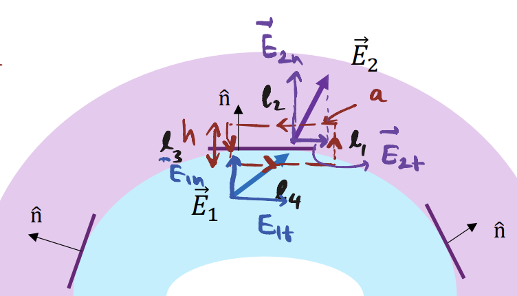

> Last Edit: 2/6/26

# Electric Field Boundary Conditions

## Dielectric – Dielectric Interface – Tangential Components

Known that Electric Field has the Conservative Property, that is

$$
\nabla \times E=0
$$

Thus based on Stokes’ Theorem, this means that $\oint_C \vec{E} \cdot d\vec{l} = 0$

In order to analysis the condition around the margin, we first construct a square contour 

This is just the sum of four contours, and known that their sum is zero

$$
\int_{l_1} + \int_{l_2} + \int_{l_3} + \int_{l_4} = 0
$$

Notice that both $l1$ and $l3$ is equal to zero if we make the height h to be zero, thus

$$
\int_{l_2} \vec{E}_2 \cdot d\vec{l} + \int_{l_4} \vec{E}_1 \cdot d\vec{l} = 0
$$

As they are in different directions, thus

$$
-E_{2t} \cdot a + E_{1t} \cdot a = 0\Rightarrow E_{1t} = E_{2t}
$$

This is saying that when entering from one material to another, the Perpendicular Electric Field might change, but the Parallel one won’t

## Dielectric – Dielectric Interface – Normal Components

Known that $\nabla \cdot \vec{D} = \rho_v$, which is $\oiint \vec{D} \cdot d\vec{s} = Q_{enc}$

Now we are using a model of a Pillbox

We are assuming that $h\rightarrow 0$, to get the Normal Boundary condition

Notice that when this cylindrical is now a circle having Surface Charge Density which only have flux on the top and bottom

$$
\iint\limits_{\text{Top}} \vec{D} \cdot d\vec{s} + \cancel{\iint\limits_{\text{Side}} \vec{D} \cdot d\vec{s}} + \iint\limits_{\text{Bottom}} \vec{D} \cdot d\vec{s} = Q_{\text{enc}}
$$

As all the Area is just $\Delta s$,the equation can be simplified to 

$$
\varepsilon_2 E_{2n} - \varepsilon_1 E_{1n} = \rho_s
$$

## Example

Assuming two Electric Fields

$$
\vec{E_1}=E_{1x}\hat x+E_{1y}\hat y+E_{1z}\hat z
$$

$$
\vec{E_2}=E_{2x}\hat x+E_{2y}\hat y+E_{2z}\hat z
$$

The x and y component are always the same as the Tangent, whereas the Normal one have

$$
\varepsilon_2 E_{2n} - \varepsilon_1 E_{1n} = \rho_s
$$

If we assume $\rho_s = 0$, then $\varepsilon_2 E_{2n}  = \varepsilon_1 E_{1n}$

## Dielectric – Perfect Conductor Interface – Tangential Components

A special case for conductor is that it’s interior Electric Field is zero, that is $E_1= 0,D_1=0$

Thus if the boundary is between a conductor and a Perfect Conductor, thus

- The 1st B.C, $E_{1t}=E_{2t}=0$
- The 2nd B.C. $E_{2n}=\frac{\rho_s}{\varepsilon _2}$

## Conductor – Conductor Interface

As the previous ones $E_{1t}=E_{2t}$ for the 1st B.C., however as there’s current passing by in the Conductor, we need to take care of Current Density J, as $J=\sigma E$, we have

$$
\vec{J}_{2t} = \frac{\sigma_2}{\sigma_1} \vec{J}_{1t}
$$

---

For the 2nd B.C., as $D_{2n} - D_{1n} = \rho_s$, and $D = \varepsilon E$, $E = J/\sigma$, thus we have

$$
\varepsilon_2 \frac{J_{2n}}{\sigma_2} - \varepsilon_1 \frac{J_{1n}}{\sigma_1} = \rho_s
$$

Whereas at the steady state, we have $J_{1n} = J_{2n}$, thus 

$$
J_{1n} \left( \frac{\varepsilon_2}{\sigma_2} - \frac{\varepsilon_1}{\sigma_1} \right) = \rho_s
$$

# Capacitance

In this course, Capacitance is being defined as the place where any two conductors sperate by insulator

In this course we start with formula $C=Q/V$, by Gaussian’s Law we define Q as

$$
Q_{enc} = \oint_S \vec{D} \cdot d\vec{s} = \oint_S \epsilon_r \epsilon_0 \vec{E} \cdot d\vec{s}
$$

While we can use the Line Integral to define V as

$$
V = -\int_-^+ \vec{E} \cdot d\vec{l} = V_+ - V_-
$$

And we can get he formula of C as

$$
C = \frac{\oint_S \epsilon \vec{E} \cdot d\vec{s}}{-\int_-^+ \vec{E} \cdot d\vec{l}}
$$

## Property of Capacitance

Capacitance only depends on following properties

- Shape of the conductors
- Distance b/w the conductors
- Permittivity ($\epsilon$)

## RC Coefficient

## Recall

Based on the Conductivity $\sigma$  we can classify the materials 

Nevertheless, there’re no perfect Capacitor in real life, thus we need to analyse the real behavior

---

There’s two ideal material, Conductors and Dielectrics, one have the $R=0$, the other have $R=\infty$, as the Capacitance is not ideal in real life, we treat it with as a identical Parallel Capacitor and Resistor

Since we define the Resistor R as $R=V/I$, we can write it as

$$
R = \frac{V}{I} = \frac{-\int \vec{E} \cdot d\vec{l}}{\iint \vec{J} \cdot d\vec{s}}
$$

In the same way, we can write Capacitor as

$$
C = \frac{Q}{V} = \frac{\iint \epsilon \vec{E} \cdot d\vec{s}}{-\int \vec{E} \cdot d\vec{l}}
$$

Notice if we multiply those two we will then get

$$
RC = \left( \frac{-\int \vec{E} \cdot d\vec{l}}{\iint \sigma \vec{E} \cdot d\vec{s}} \right) \cdot \left( \frac{\iint \epsilon \vec{E} \cdot d\vec{s}}{-\int \vec{E} \cdot d\vec{l}} \right)=\frac{\epsilon}{\sigma}
$$

<aside>
❗

Using this equation, we can get the R and C of the Capacitor as long as we know one of those

</aside>

## Ex. Parallel-Plate Capacitor

As indicated, in real life we deal with non-ideal Capacitor, and we wish to find that Leakage Resistance and the Capacitance

In this given example, we can start with $C=Q/V$

$$
C = \frac{Q}{V} = \frac{\iint \varepsilon \vec{E} \cdot d\vec{S}}{-\int_{-}^{+} \vec{E} \cdot d\vec{l}}
$$

As both integral requires Electric Field, we can find E first, and there’s basically two methods

1. Using the known formula for parallel plates
2. Using Laplace’s Equation and B.C.
- Now we can sub in $\vec{E} = -\frac{\rho_s}{\varepsilon} \hat{z}$

$$
C = \frac{\iint \varepsilon \left( -\frac{\rho_s}{\varepsilon} \hat{z} \right) \cdot dS (-\hat{z})}{-\int_{0}^{d} -\frac{\rho_s}{\varepsilon} \hat{z} \cdot dz \hat{z}}= \frac{\rho_s \cdot A}{\frac{\rho_s}{\varepsilon} \cdot d} = \frac{\varepsilon A}{d}
$$

Once known the Capacitance, we can then find R using the RC formula

$$
R = \frac{\epsilon}{\sigma} \cdot \frac{d}{\epsilon A} = \frac{d}{\sigma A}
$$

## Ex. Coaxial Cable Capacitor

As usual, find the C first using $C=Q/V$, then we need the Electric Field Again, and this Example we can approach by either Laplacian or Gauss’s Law, and it will be 

$$
\vec{E} = \frac{-\rho_s a}{\epsilon r} \hat{r}
$$

Sub in this E back and we will get

$$
C = \frac{\rho_s \cdot 2\pi a \cdot l}{-\int_{a}^{b} \frac{-\rho_s a}{\varepsilon r} \hat{r} \cdot dr \hat{r}} = \frac{\rho_s \cdot 2\pi a \cdot l}{\left. \frac{\rho_s \cdot a}{\varepsilon} \ln r \right|_a^b} = \frac{2\pi l \varepsilon}{\ln(\frac{b}{a})}
$$

And using we RC formula we can also get

$$
R = \frac{\epsilon}{\sigma} \cdot \frac{1}{C} = \frac{\ln(b/a)}{2\pi \sigma l}
$$

## Capacitor with Stacked Dielectrics

When we put two Capacitors in Series or Parallel, its ability to store charge will change, based on the formula

$$
C = \varepsilon \cdot \frac{A}{d}
$$

Where in this formula, the coefficient $\varepsilon$ is used to describe the scale of that ability, but if we still want to use the same formula after stacked two capacitors, we need to adjust this $\varepsilon$ 

> Similar to mixing the juice, say we have apple juice and orange juice each has their own scale of sugar, if we combine them together, we will need a new way to describe the mixture of their sugar under the volume v.s. sugar
> 

### Stacked in Series

$$
\frac{1}{C} = \frac{1}{C_1} + \frac{1}{C_2} = \frac{d_1}{\varepsilon_1 A} + \frac{d_2}{\varepsilon_2 A} \Rightarrow C = \frac{A \varepsilon_1 \varepsilon_2}{d_1 \varepsilon_2 + d_2 \varepsilon_1}
$$

Now we want this formula back to the form of $C = \varepsilon \cdot \frac{A}{d}$, thus we divided by $A/d$

$$
\varepsilon_{eff,s} = \frac{\varepsilon_1 \varepsilon_2 (d_1 + d_2)}{d_1 \varepsilon_2 + d_2 \varepsilon_1}
$$

### Stacked in Parallel

$$
C = C_1 + C_2 = \frac{1}{d} (\varepsilon_1 A_1 + \varepsilon_2 A_2)
$$

In Parallel, the Capacitance is simply addition, and the adjusted coefficient will be 

$$
\varepsilon_{eff,p} = \frac{\varepsilon_1 A_1 + \varepsilon_2 A_2}{A_1 + A_2}
$$

## Ex. Spherical Capacitor

As