> Last Edit: 2/23/26

# Magnetic Force

## Lorentz Force

$$
\vec{F}_m = q \vec{u} \times \vec{B}
$$

$\vec u$: The Velocity Vector of the charge

- Recall that Cross Product’s magnitude is $|\vec{a} \times \vec{b}| = |\vec{a}| |\vec{b}| \sin(\theta)$

## Work Done by Magnetic Force

Start with reviewing the work done by Electric Force first

$$
W_e = \int \vec{F}_e \cdot d\vec{l} = q\int \vec{E} \cdot d\vec{l}
$$

Apply the same to Magnetic Field

$$
W_m = \int \vec{F}_m \cdot d\vec{l} = \int q(\vec{u} \times \vec{B}) \cdot (\vec{u} dt)
$$

Known that the Crossed Vector $\vec{u} \times \vec{B}$ has to be perpendicular to $\vec{u}$

- Thus the Work Done by Magnetic Field is ALWAYS zero

## Magnetic Force on a Straight Current Carrying Wire

In a Current Carrying Wire, there’s Current $I = \frac{dq}{dt}$, as the speed is $\vec{u} = \frac{d\vec{l}}{dt}$, thus we can get $I d\vec{l} = dq \vec{u}$

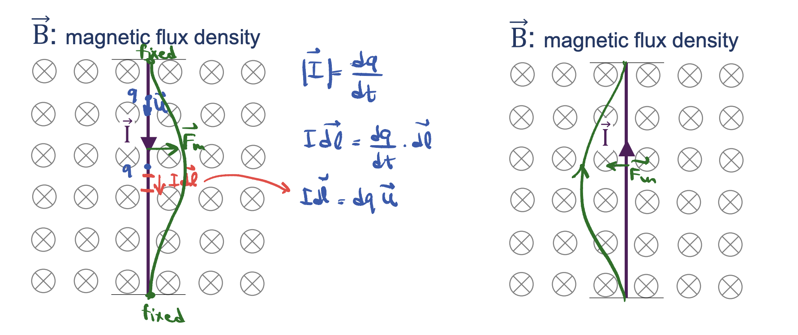

Thus there will be a curve for those Current Carrying Wire then

## Magnetic Force on a Current Carrying Wire

Starting from Lorentz Force Equation $d\vec{F}_m = dq (\vec{u} \times \vec{B})$, use the equation mentioned above $dq \vec{u} = I d\vec{l}$, we can get $d\vec{F}_m = I d\vec{l} \times \vec{B}$

Thus if we want to know the total Lorentz Force on the wire, we just need to take the integral

### Any Counter

$$
\vec{F}_m = \int_{a}^{b} I d\vec{l} \times \vec{B}
$$

Under an uniform Magnetic Field, the integral is path independent, meaning the Integral only depends on the starting and ending point

### Closed Loop

$$
\vec{F}_m = \oint_C I d\vec{l} \times \vec{B}
$$

Under a uniform Magnetic Field, the total force will always be zero

> But it will create a Torque, this will be cover later
> 

### Ex. Lorentz Foce on a Semicircle

> Note: In a uniform Magnetic Field, the total Lorentz Force should be zero in a Closed Contour
> 

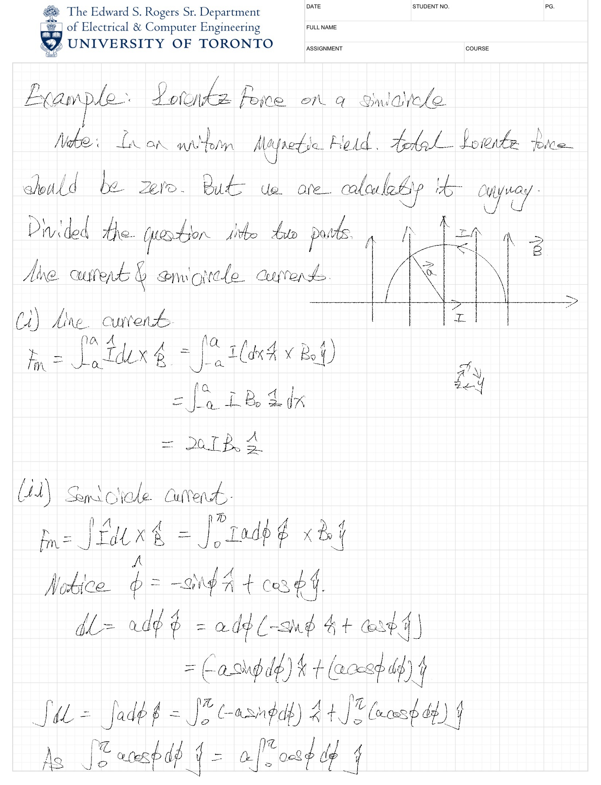

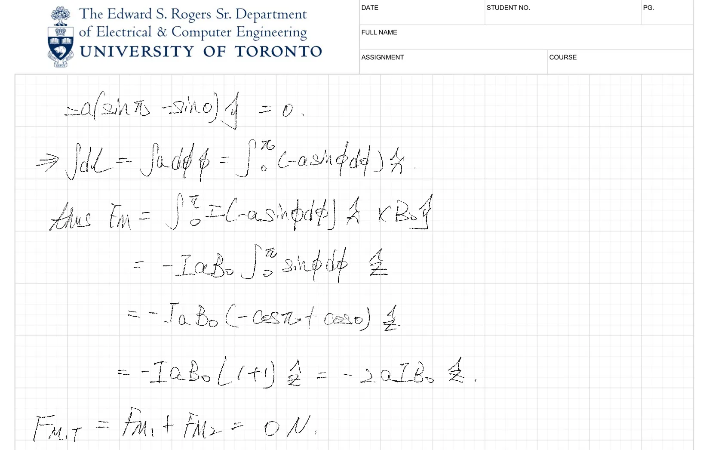

# Types of Current Distributions

## Line Current

$$
I d\vec{l}
$$

## Surface Current

$$
I d\vec{l} = \left( \int \vec{J_s} \cdot d\vec{w} \right) d\vec{l}
$$

## Volume Current Density

$$
I d\vec{l} = \left( \iint_S \vec{J} \cdot d\vec{s} \right) d\vec{l}
$$

## Linear Integrals to Calculate Magnetic Force

Known that the basic Magnetic Force current have inside magnetic field is $\vec{F}_m = \int I d\vec{l} \times \vec{B}$

- This formula will be $\vec{F}_m = I \left( \int d\vec{l} \right) \times \vec{B}$ if B is a uniform field
- Whereas $\int_a^b d\vec{l} = \vec{L}$, thus we then get

$$
\vec{F}_m = I \vec{L} \times \vec{B}
$$

# Magnetic Force in a System

## Total Magnetic Force on a Closed Current - Case 1

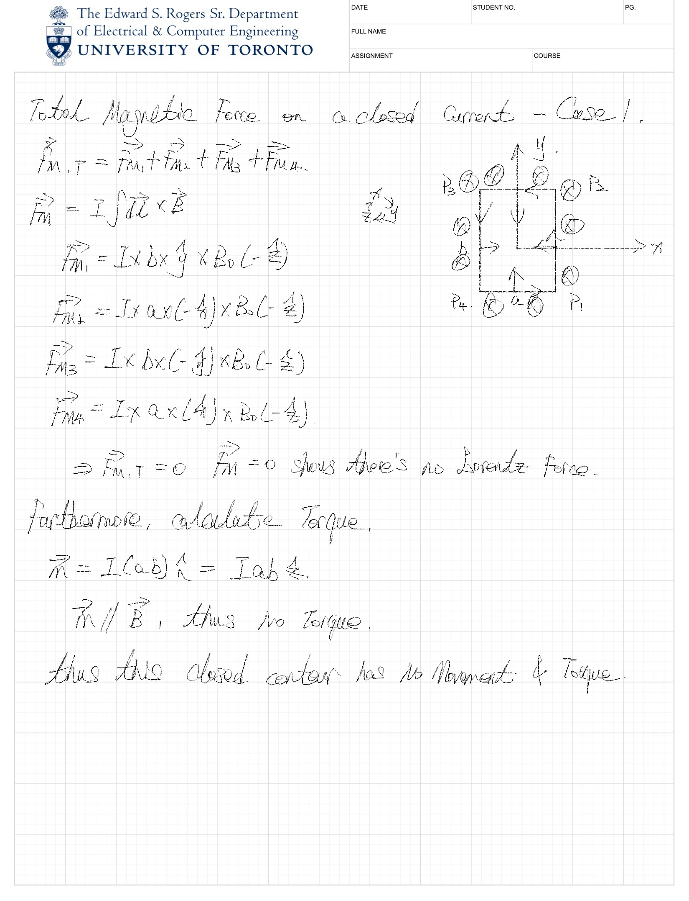

## Total Magnetic Force on a Closed Current - Case 2

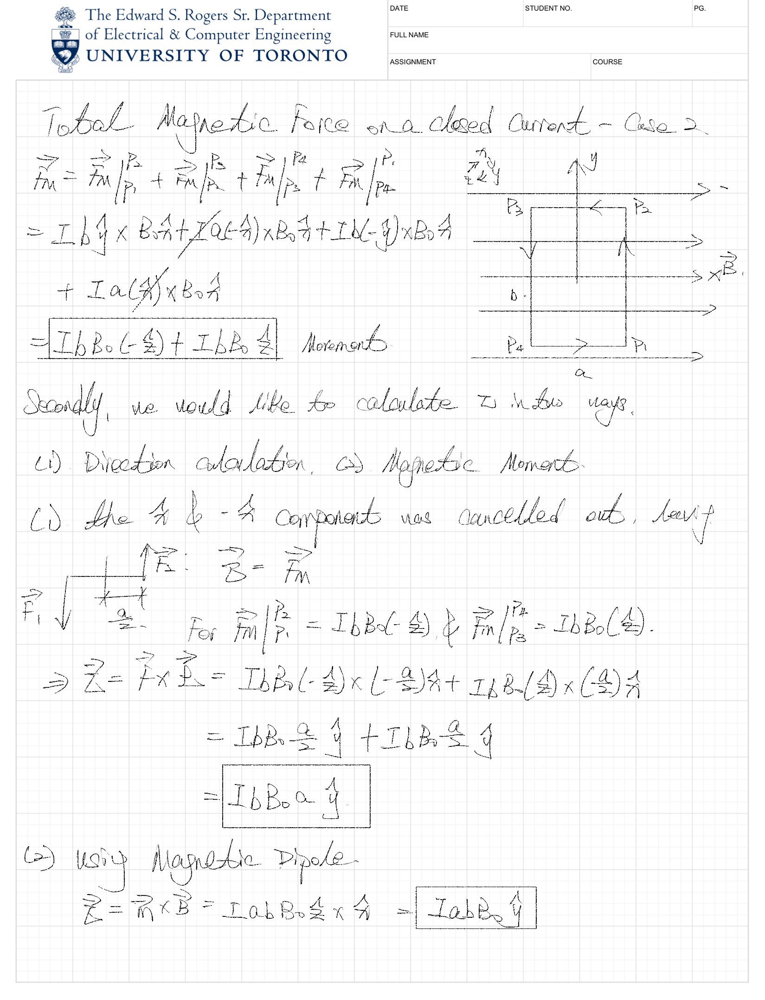

## Total Magnetic Force on a Closed Current - General Case

When we put a Closed Current inside the Magnetic Field, it usually created a Torque that make itself spin inside the Magnetic Field

$$
\vec{\tau}_m = \vec{m} \times \vec{B}
$$

- $m$: Normal Vector of the Closed Current plane, $m=I\cdot A$
- $B$: External Magnetic Field

Thus the Magnetic Torque can be represented by

$$
|\tau| = Iab \cdot B_0 \sin\theta
$$

<aside>
❗

All things above are about how Closed Current response under the Magnetic Field, whereas things below will describe how Current Create Magnetic Field

</aside>

# Biot-Savart’s Law

In Coulomb’s Law, it describe how Charges creates the Electric Field, whereas the Biot-Savart’s Law describe how Current creates the Magnetic Field

|  | Electric Field | Magnetic Field |
| --- | --- | --- |
| Source | **Point Charge Q** | **Small Current I$d\vec{l}$** |
| Filed Equation | $\vec{E} = \frac{Q \hat{R}}{4\pi\epsilon R^2} = \frac{Q \vec{R}}{4\pi\epsilon R^3}$ | $d\vec{H} = \frac{Id\vec{l} \times \hat{R}}{4\pi R^2} = \frac{Id\vec{l} \times \vec{R}}{4\pi R^3}$ |

<aside>
❗

This indicate that Magnetic Field is formed by moving charge, and it’s a curl shape from current

</aside>

Thus having the formula of

$$
d\vec{H} = \frac{Id\vec{l} \times \hat{R}}{4\pi R^2} = \frac{Id\vec{l} \times \vec{R}}{4\pi R^3}
$$

## Magnetic Filed of an Infinite Current Line

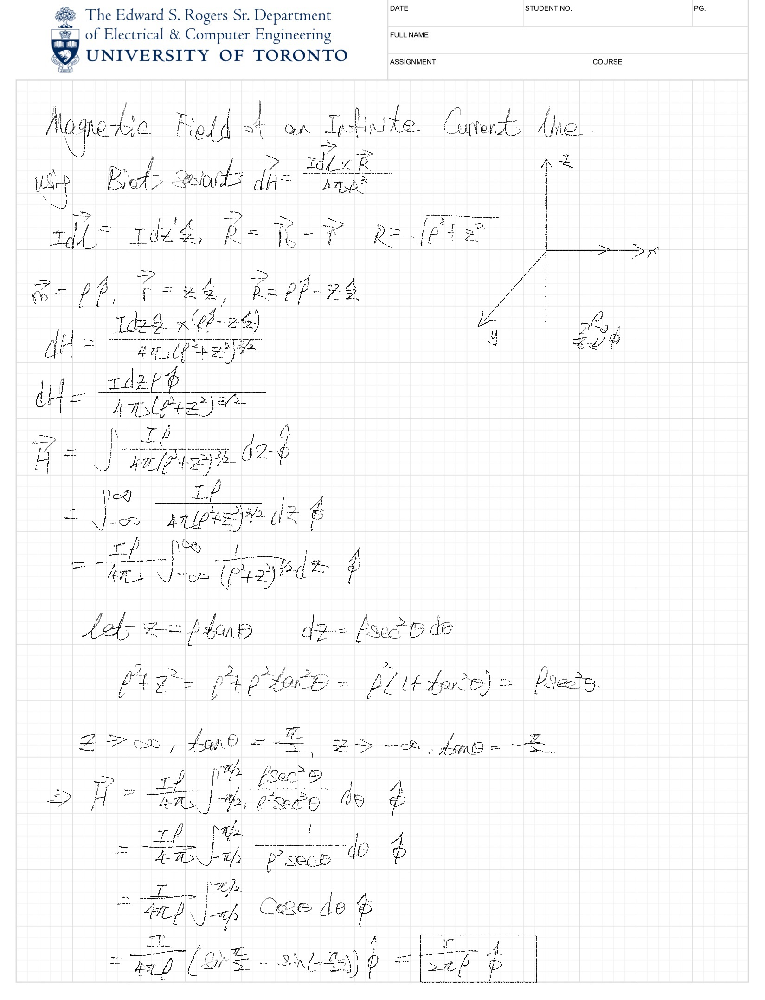

## Ex. Magnetic Field of a Finite Current Line

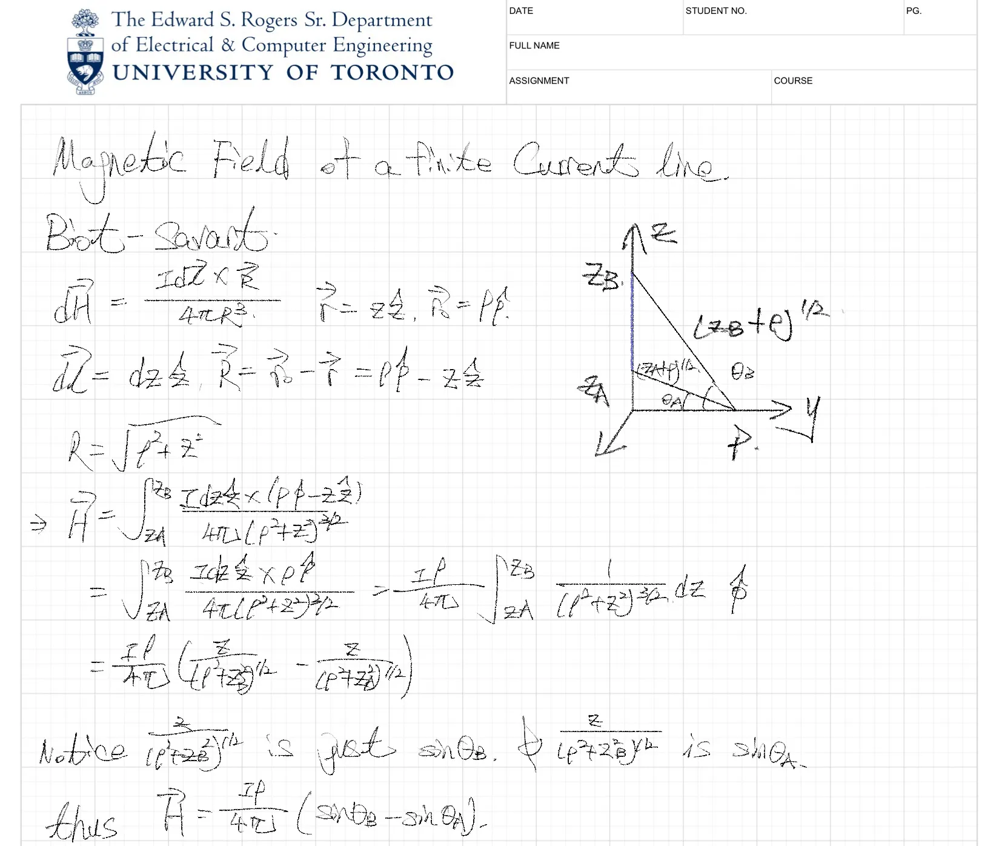

## Ex. Magnetic Field of two Semi-Infinite Current Traces

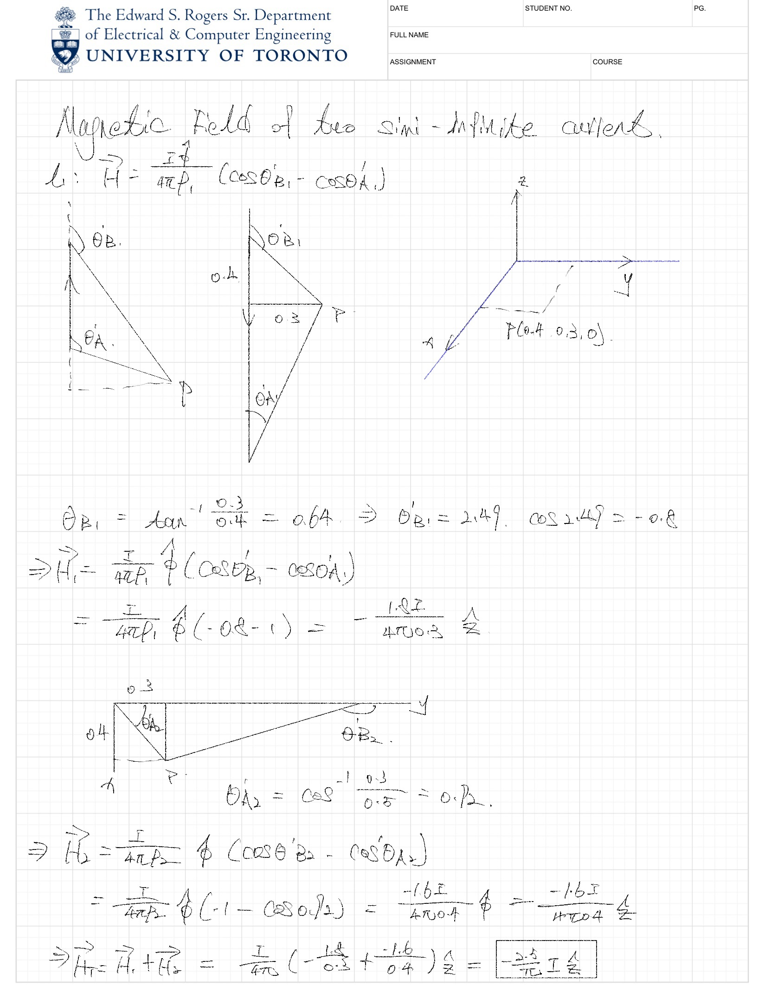

## Ex. Magnetic Field of Circular Current Loop on Its Axis

# Magnetostatic Maxwell’s Equations

There’s two basic physic principle for Magnetic Field

## Gauss’s Law for Magnetism

$$
\nabla \cdot \vec{B} = 0
$$

This states that the divergency of Magnetic Field is zero, thus by Divergency Theorem we knows that any closed Integral’s Magnetic Field will be zero $\oint_S \vec{B} \cdot d\vec{s} = 0$

> This reflect that the magnetic equivalence of an electric point charge doesn’t exist in nature
> 

## Amphere’s Law for Magnetism

$$
\nabla \times \vec{H} = \vec{J}
$$

This indicates that the Magnetic Field’s strength is formed by the Current Density $\vec J$, thus current is the source that produce Magnetic Field

By Stokes’ Theorem, we can get that

$$
\oint_C \vec{H} \cdot d\vec{l} = \iint_S \vec{J} \cdot d\vec{s} = I_{enc}
$$

Which means that the Line Integral along Magnetic Field is equal to the Net Current $I_{enc}$ crossed the surface 

# Ampere’s Law

$$
\oint_C \vec{H} \cdot d\vec{l} = \iint_S \vec{J} \cdot d\vec{s} = I_{enc}
$$

## Ampere’s Law Contour Choice

To make the calculation simple, there’s four suggestion on choosing the Contour

1. Choose Contour parallel to Magnetic Field H that makes $H\cdot dl=1$ 
2. If parallel is not possible, then choose perpendicular ones to make it zero
3. Make sure the Magnetic Field $H$ is Equivalent among the contour, so the H can be get out of the Integral
4. Use RHR to get directions

# Magnetic Field Calculation Summary

## Biot-Savart

Similar to Colomb’s Law, where there’s no symmertry

$$
\vec{H} = \int_{\vec{r}'_{source}} \frac{I d\vec{l} \times \vec{R}}{4\pi R^3}
$$

## Ampere’s Circuital Law

Similar to Gauss’s Law

$$
\oint_C \vec{H} \cdot d\vec{l} = I_{enc} = \int \vec{J} \cdot d\vec{s}
$$

- The key of this Law is to use Symmetry to get $H$ out of the integral

## Magnetic Field of Infinite thick wire with uniform J

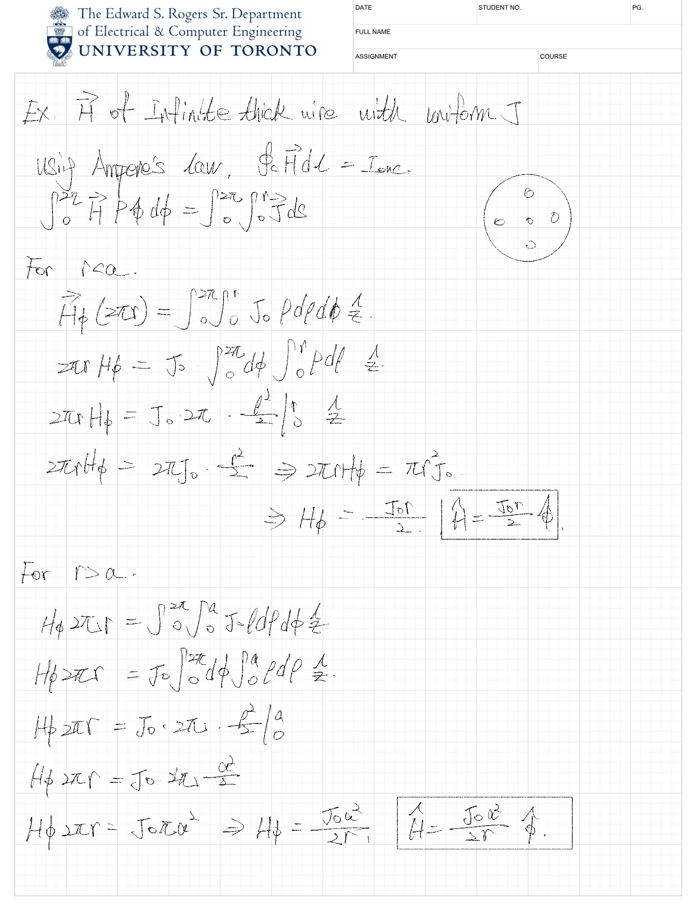

## Magnetic Field of Infinite thick wire with non-uniform J

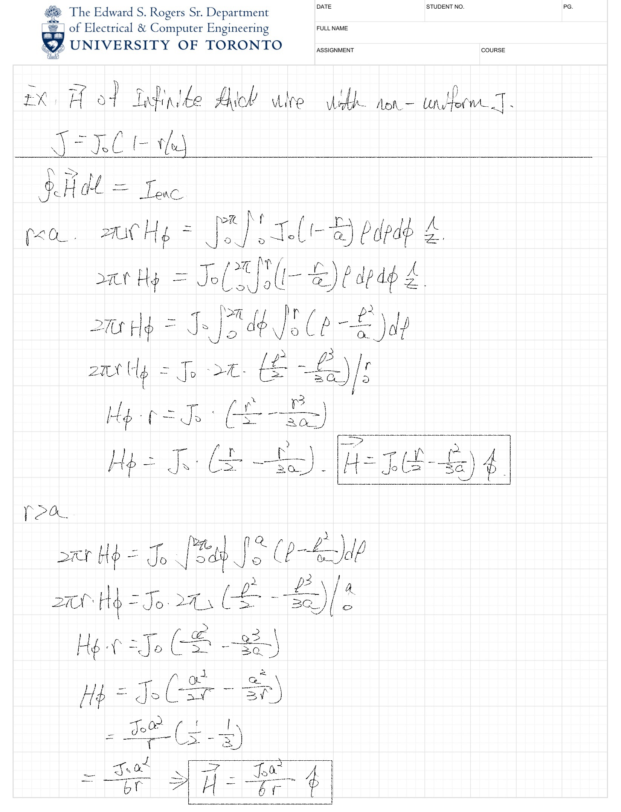

## Magnetic Field of an Infinite Current Sheet

## Magnetic Field of Toroidal Coil in xy-Plane

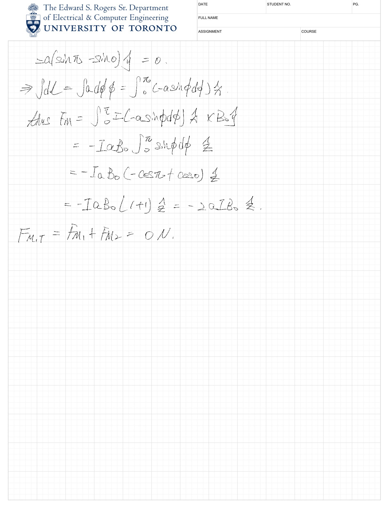

