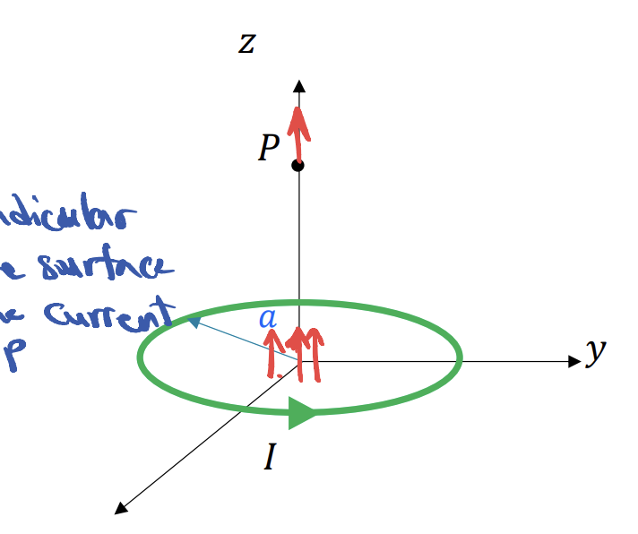
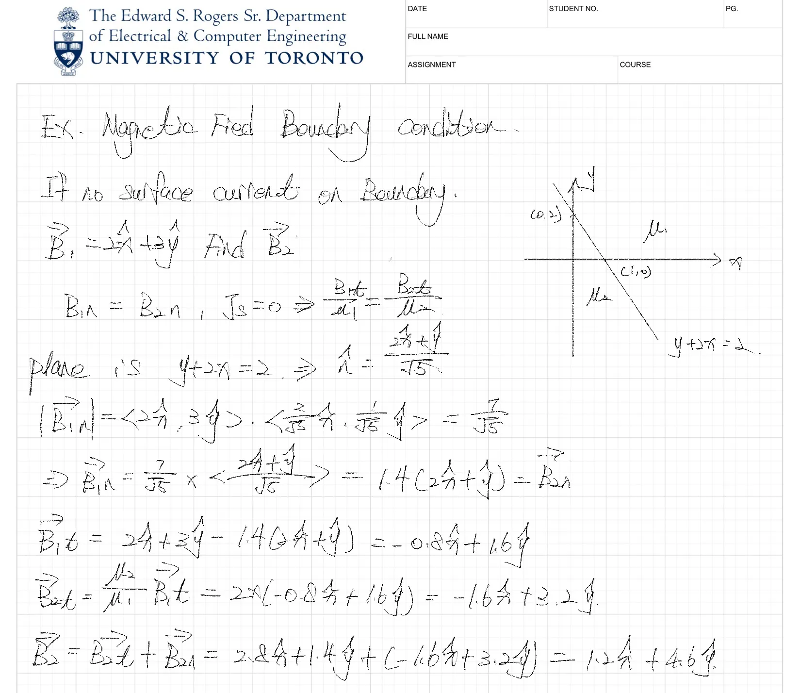
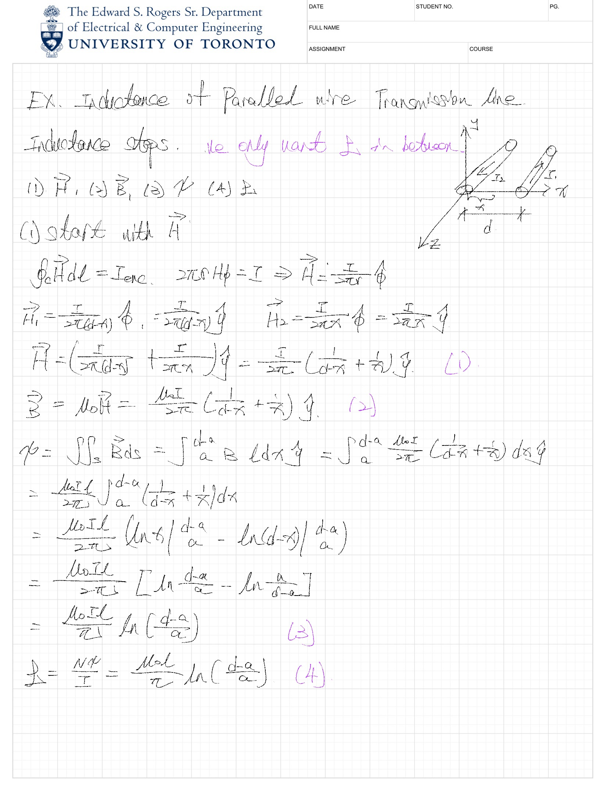
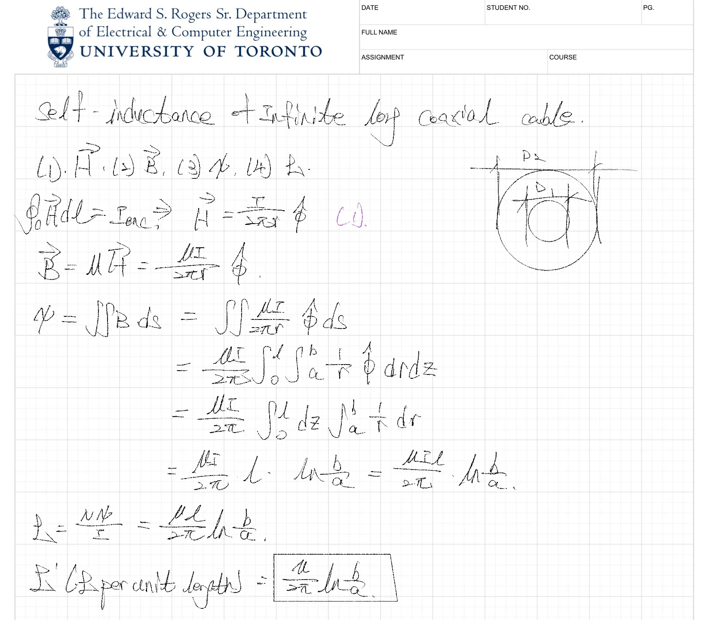
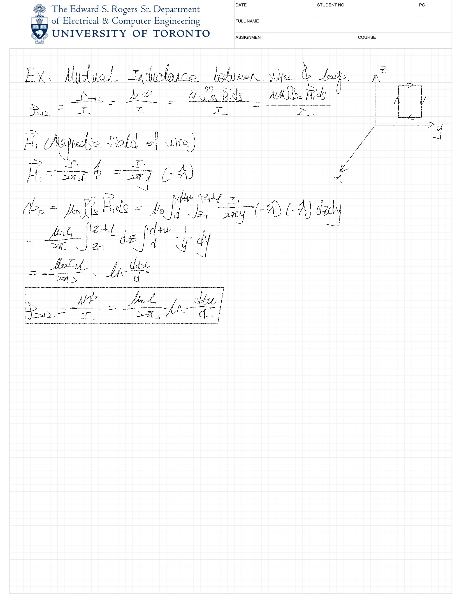

> Last Edit: 3/9/26

# Magnetic Dipole

As Magnetic Field is created by Current, the Magnetic Dipole is thus a Closed Loop Current

This is equivalent to a Magnetic as the $+z$ direction is N, $-z$ direction is S

- While ideally, we assume the radius of Loop to be infinite small thus it becomes a point
- By setting the radius of the loop to $a$, we can get

$$
\vec{H} = \frac{I \pi a^2 \hat{z}}{2 \pi (\sqrt{a^2 + z^2})^3} = \frac{\vec{m}}{2 \pi (a^2 + z^2)^{3/2}}
$$

Whereas the $\vec m$ is Magnetic Dipole Moment having $\vec m = IS\hat n$

- This moment indicate the Normal direction of Loop, and the Magnitude of the Field

There’s basically two kinds of Magnetic Field we have

## Case 1: Point at center of Loop

$$
\vec{H}(0) = \frac{I}{2a} \hat{z}
$$

## Case 2: Point that’s far away on Z-Axis

$$
\vec{H}(z \gg a) \approx \frac{\vec{m}}{2 \pi z^3} = \frac{I a^2}{2 z^3} \hat{z}
$$

## Case 3: Any point in the space

Now consider the point at any point of the space, start with Biot-Sacart too

$$
\vec{H} = \int \frac{I d\vec{l} \times \vec{R}}{4\pi |\vec{R}|^3}
$$

## Duality Between Magnetic Dipole & Electric Dipole

# Magnetic Materials

## Nature of Magnetic Materials

There’s two kinds of movement for electrons in atoms

1. Orbiting Electron: That’s electron spinning around Core and create $m_o$
2. Spinning Electron: The self spin of the electron, creating $m_s$

---

As the magnetic Moment is $m_o = IA_{loop}$, for a circular orbit with radius $r$, it have $A= \pi r ^2$

Whereas the current is the Charge’s rate of change of time, electron has the charge of $-e$, and the time spinning one circle is $\Delta t = \frac{2\pi r}{u}$, that will be $I = \frac{-e}{\Delta t} = \frac{-eu}{2\pi r}$, so we can get 

$$
m_o = \frac{-eu}{2\pi r} \cdot \pi r^2 = -\frac{eur}{2}
$$

Having the Plank Constant and Angular Momentum sub in, our finial conclusion will be 

$$
|m_s| = |m_o| \approx 9 \times 10^{-24} \, \text{A} \cdot \text{m}^2
$$

<aside>
❗

This indicates that the Magnetic from material is from the Orbiting and Spinning of electrons which creates current

</aside>

## Magnetization

Now we are viewing Magnetism under macro perspective

Firstly recall the two kinds of current we have, 1. Free Current and 2. Bounding Current

- Free Current is the charges moving inside wires
- Bounding Currents are then the Spinning ones inside atom

When we are analysing a material with $\Delta V$ as the volume, we assume there’s N Dipoles inside , thus the $m_{total}$ will then be 

$$
\vec{m}_{total} = \sum_{i=1}^{N\Delta V} \vec{m}_i
$$

### Magnetization

This is used to describe the extend how material has been Magnetized

$$
\vec{M} = \lim_{\Delta V \to 0} \frac{1}{\Delta V} \sum_{i=1}^{N\Delta V} \vec{m}_i
$$

It’s definition is the net Magnetic Dipole in unit volume

## Magnetization of Magnetic Materials

Before describing the Magnetic Field inside a Magnetic Material, we shall summarize all things first

- $M$: Magnetization, describe the magnetic field created by the material own
- $H$: External Magnetic Field

Now we define $\chi_m$ to be the Magnetic Susceptibility, which is the response of material under magnetic field

So the total Magnetic Flux Density inside the material will be

$$
\vec{B} = \mu_0 (\vec{H} + \vec{M})
$$

This means that the total Flux will be the External plus Internal, now sub in $\vec{M} = \chi_m \vec{H}$ to get

$$
\vec{B} = \mu_0 (\vec{H} + \chi_m \vec{H}) = \mu_0 (1 + \chi_m) \vec{H}
$$

Now we define $(1 + \chi_m)$ to be $\mu_r$, Relative Permeability, now we can get

$$
\vec{B} = \mu_0 \mu_r \vec{H}
$$

This means that the existence of Magnetic Material changed the distribution of Magnetic Field

## Types of Magnetic Materials

## Magnetic Domains

Imagine the internal structure of material is formed by numbers of chambers which are called **Domains**

When the Domains are having different Magnetic Force directions, externally the $M=0$

Whereas then Domains are aligned, this creates a Magnetic Field

## Magnetic Hysteresis of Ferromagnetic materials

Basically, the Magnetic Material’s Internal magnetic Field has the property of Hysteresis which is like FSM that the current stage depends on previous stage

# Magnetic Field Boundary Conditions

When Magnetic Field coming across two materials, here analyze how it change 

## Magnetic Field Boundary Condition - Normal Components

Based on a long derivation, we get that Normal Component of Magnetic Flux is continuous, but the Magnetic Field is not as

$$
\mu_1 H_{n1} = \mu_2 H_{n2}
$$

## Magnetic Field Boundary Condition - Tangential Components

Based on derivation, we get the Magnetic Field is continuous, but Magnetic Flux isn’t

$$
\frac{B_{t1}}{\mu_1} = \frac{B_{t2}}{\mu_2}
$$

## Magnetic Field Boundary Condition when having Surface Current

This occur when there’s a perfect conductor that makes

$$
H_{t1} - H_{t2} = J_s
$$

Thus the Magnetic Flux will have

$$
\frac{B_{t1}}{\mu_1} - \frac{B_{t2}}{\mu_2} = J_s
$$

## Revisiting Toroidal Magnetic Field

For a Toroid with radius r, it’s Magnetic Field $H$ will distribute in 

- $r<a$: 0 as no current is passing
- $a<r<b$: $\vec{H} = \frac{NI}{2\pi r} \hat{\phi}$
- $r>b$: 0 as the current into is same as out of

---

Now use the B.C. to calculate that again, starting from $H_{t1} - H_{t2} = J_s$, we can get there’s two interfaces, $r=a$ and $r=b$

- $r=a$: $H_{air}=0$, $H_{core} = \frac{NI}{2\pi a}$, and Surface Charge is $J_s = \frac{NI}{l}$
- $r=b$: $H_{core} = \frac{NI}{2\pi b}$, $H_{air}=0$

### Ex. Calculating the Magnetic Field in Boundary Condition

# Magnetic Flux

The Magnetic strength is $\vec{H} = \frac{NI}{2\pi r} \hat{\phi}$, whereas the Magnetic Flux Density will be $\vec{B} = \frac{\mu NI}{2\pi r} \hat{\phi}$, thus the Magnetic Flux will be the integral of B, which is

$$
\Psi = \iint \vec{B} \cdot d\vec{s} = \iint \frac{\mu NI}{2\pi r} \hat{\phi} \cdot d s \hat{\phi} = \frac{\mu NI}{2\pi} \iint \frac{ds}{r}
$$

# Self-Inductance

Recall that Capacitor stores Energy inside Electric Field, whereas Inductor stores Energy in Magnetic Field

The Self-Inductance Coefficient is being defined as

$$
L = \frac{\Lambda}{I} = \frac{N\Psi}{I}
$$

- $\Lambda=N\Psi$: Flux Linage, is the Flux through all Turns

We can extract this formula into 

$$
L = \frac{N \iint \vec{B} \cdot d\vec{s}}{I}=\frac{N \iint \mu \vec{H} \cdot d\vec{s}}{I}
$$

## Self Inductance of a Toroid

First we need to use Amperes Law to get the Magnetic Field Strength in Toroid, which is

$$
\vec{H} = \frac{NI}{2\pi r} \hat{\phi}
$$

Then sub this into the integral to get

$$
\Psi = \int_a^b \frac{\mu NI}{2\pi r} \cdot h \, dr = \frac{\mu NIh}{2\pi} \ln\left(\frac{b}{a}\right)\Rightarrow L = \frac{\mu N^2 h \ln(b/a)}{2\pi}
$$

## Effect if Air Gap in Toroid

## Self Inductance of a Solenoid

- [ ]  

## Self-inductance of a Solenoid – Special Case

- [ ]  

## Inductance of a Parallel-wire Transmission Line

## Self-inductance of Infinitely Long Coaxial Cable

# Mutual-Inductance

Mutual inductance describes the **magnetic coupling between two coils**

$$
M = L_{12} = \frac{\Lambda_{12}}{I_1}
$$

### Mutual-Inductance between Wire and Loop

### Mutual-inductance in Solenoid with Two Solenoids

### Mutual-inductance in Solenoid with Two Discrete Loops

# Magnetic Energy

