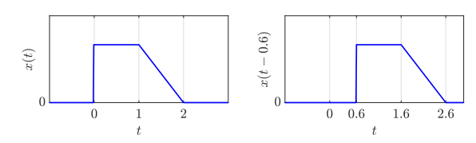
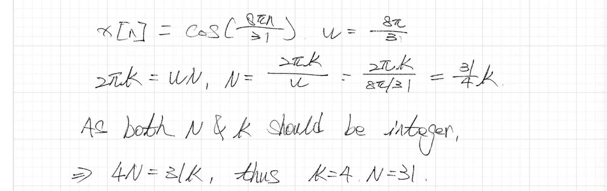
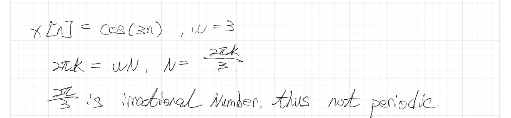

> Last Edit: 1/12/26

> Last Edit: 1/15/26
> 

# Signals

## Continuous-Time Signals

A continuous-time signal is a function of one (or more) independent variables which range over the real numbers $\mathbb R$

## Discrete-Time Signals

A discrete-time signal is a function of one (or more) independent variables which range over the integers $\mathbb Z$

## Time Shift

We can time-shift a CT signal x by $t_0\in \mathbb R$ to obtain $x(t − t_0)$

- The same applies on DT signals

### Signal Convention

- In time shift formula $x(t-t_0)$, or speicifcally for $t_0$

> This means that the sign before $t_0$ is being kept as $-$
> 
- $x(t-t_0),t_0>0$ represent **Right Shift**, it’s a **Delay** in time
- $x(t-t_0),t_0<0$ represent **Left Shift**, it’s a **Advance** in time

## Scaling of Signal

we can time-scale a CT signal x by $\alpha \in \mathbb R$ to obtain $x(\alpha t)$

- If $\alpha >0$, then its a Compress
- Otherwise its a Scaling

### Compressing in DT Signal

A issue of Compressing DT signal is that DT signal are only being sampling at $n\in \mathbb Z$

- Thus if we Compress n by $\alpha$, this will create a fraction that no longer works

# Period

## Periodic CT Signals

A CT signal $x$ is **periodic** if $x(t) = x(t + T)$ for some value $T > 0$ and all $t\in \mathbb R$

### Fundamental Period

The smallest such value of T, denoted by $T_0$, is called the fundamental period of x

### Period of a Constant CT Signal

- As for a CT signal that stays constant, we would like to define it as **periodic**, but not with the period of 0, instead, it should have a period of $T_0=0^+$, that’s the limit approaching 0 from RHS

### Period Parameters

Other than period T, we still got other parameters that describe the Period 

- Frequency: $f_0(Hz)=\frac{1}{T_0}$, tells us how fast the signal repeats
- Angular Frequency: $w_0(rad\cdot sec^{-1})=2\pi f_0=\frac{2\pi}{T_0}$

## Periodic DT Signals

A DT signal x is **periodic** if $x[n] = x[n + N]$ for some integer N ≥ 1 and all $n\in \mathbb Z$

The smallest such value of N, denoted by $N_0$, is called the **Fundamental Period** of x

---

<aside>
❗

The addition of Periodic Signals **does not guarantee** a Periodic Signal

</aside>

# Support

## Support of DT Signal

$$
supp(x) = \{n \in \mathbb z~|~x[n] \neq 0\}
$$

The support tells you where the signal is non-zero

## Support of CT Signal

$$
supp(x) = closure(\{t ∈ R | x(t) \neq 0\})
$$

That is the smallest closed set containing the set $\{t ∈ R | x(t) \neq 0\}$

### Ex. Support of CT Signal

- If we a continuous function that is nonzero at $[0,1],[2,3]$, then its support is then

$$
[0, 1] \cup [2, 3]
$$

---

Notice that in this case 

- This function’s zero points are support, as setting them not support will break the continuity of the whole function

# Duration

In many applications, signals begin at some time and then continue

## Right-Sided Signals

### Right Sided CT Signals

Right-sided from time $T$ if $x(t) = 0$ for all $t < T$

### Right Sided DT Signals

Right-sided from time $N$ if $x[n] = 0$ for all $n < N$

---

## Periodic & Sampling

There’s two kind of signals, finite and infinite ones, as indicated, 

## Finite Signal

Finite Signals equals zero outside some bounded time interval

Or equivalently, we can say that $supp(x)$ is contained in a bounded interval

## Sampling from Periodic Signal to Finite Signal

Periodic Signals are Infinite Signals that repeat itself, by sampling one period from it, we can get the Finite Signal

$$
x_{\mathrm{fin}}(t)=\begin{cases}x_{\mathrm{per}}(t), & 0 \le t < T_0 \\0, & \text{otherwise}\end{cases}
$$

## Calculate the Fundamental Period of Periodic Signal

### Ex. Calculate the FP

## Periodic Extension

In the previous part, we’ve discussed about the basic definition of “Periodic”, but actually, we can tread “Periodic” as the concept of addition of **Infinite Finite Signals**

$$
x_{\mathrm{per}}(t)=\sum_{k=-\infty}^{\infty} x\!\left(t-kT_0\right)=x(t+T_0)+x(t)+x(t-T_0)+\cdots
$$

## Odd & Even Signal

Odd & Even Signal’s definition is as same as the definition for odd & even functions

$$
x_{\text{even}}(t)=\frac{x(t)+x(-t)}{2},\quad{\text{odd}}(t)=\frac{x(t)-x(-t)}{2}
$$

Any signal can be decompose into the form of

$$
x =x_{even}+x_{odd}=\frac{x(t)+x(-t)}{2}+\frac{x(t)-x(-t)}{2}
$$

# Measurement

Based on the perspective we treat a signal, we can Measure it in different ways

## Size of Signal

In terms of Size, we can treat signal in Action, Energy and Amplitude

### Action / L1 Norm

$$
\|x\|_1 = \int_{-\infty}^{\infty} |x(t)| dt
$$

- By inspection, this is the Integral of the absolute value of the signal

### Energy / L2 Norm

$$
\|x\|_2^2 = \int_{-\infty}^{\infty} |x(t)|^2 dt
$$

### Amplitude / L_Infinite Norm

$$
\|x\|_\infty = \sup_{t \in \mathbb{R}} |x(t)|
$$

### Supremum

Inside a set, there could be infinite Local Maximum, whereas the smallest Local Maximum is Supremum

## Ex. Calculate the Norms

Given the signal

$$
i(t) = \frac{R_2}{R_1 + R_2}\, I_0(t), \qquad I_0(t) = e^{-2t}, \quad t \ge 0
$$

$$
\| i \|_1= \int_0^{\infty} \frac{R_2}{R_1 + R_2} e^{-2t}\, dt= \frac{R_2}{R_1 + R_2} \left[ -\frac{1}{2} e^{-2t} \right]_0^{\infty}= \frac{1}{2}\,\frac{R_2}{R_1 + R_2}
$$

$$
\| i \|_2^2= \int_0^{\infty} \left( \frac{R_2}{R_1 + R_2} e^{-2t} \right)^2 dt= \left( \frac{R_2}{R_1 + R_2} \right)^2\left[ -\frac{1}{4} e^{-4t} \right]_0^{\infty}= \frac{1}{4} \left( \frac{R_2}{R_1 + R_2} \right)^2
$$

$$
\| i \|_\infty= \max_{t \ge 0} \frac{R_2}{R_1 + R_2} e^{-2t}= \frac{R_2}{R_1 + R_2}
$$

## Size of Periodic Signals

Periodic Signals have infinite length, so when we measure its length, we would like to take only one period and measure

# Unit Step & Delta Function

## Unit Step Function

$$
u(t) = \begin{cases} 1, & t \geq 0 \\ 0, & t < 0 \end{cases}
$$

The main usage for Unit Step Function are

### 1. Form Right-Sided Signal

By multiplying a signal with Unit Signal, this makes it become Right-Sided Signal

### 2. Build Square Signals

By using two Unit Signals and minus them, it form a Square Signal in a given time

$$
u(t - k) - u(t - 1 - k)
$$

## DT Unit Impulse Function

$$
\delta[n] = \begin{cases} 1, & n = 0 \\ 0, & n \neq 0 \end{cases}
$$

As indicated, this function’s value is being define with 1 at time $t=0$, while 0 all other times

- This can be shifted by the shift by Time Shift method

Any DT signal can be treated as the addition of scaling Impulse functions 

### Sampling using Impulse Function

Impulse Function can be apply on signals to sample the value of signal in a given time

## CT Unit Impulse Function

In continuous case, the Impulse Function is unlike DT signal that has a given value of 1 at time t, instead, it’s actually a rectangle with area of 1

- In this given area, first regard the value of $\Delta$, this rectangle’s area is given by

$$
\text{Height} \times \text{Width} = (1/\Delta) \times \Delta = 1
$$

- So we are now sure that under CT signal, this Impulse is just a rectangle with area of 1

---

- Now check out the Height, in CT we **don’t define the function to have a infinite height**
- Instead, we define it as **A Undefined Value**

### Shifting in CT Signal

In DT, we say Sampling, cause sampling is a discrete behaviour, while in CT we use Shifting as its related to Integral and continuous, but they basically means the same

$$
\int_{-\infty}^{\infty} x(t)\delta(t - t_0) dt = x(t_0)
$$

- That is, when we use a signal $x(t)$  to times a Impulse Function at $t_0$ that is $\delta (t-t_0)$, the result will then be $x(t_0)$

### Integral and Derivative of CT Impulse Function

Unit Step function, which looks like 

is just the integral of Unit Impulse function that after $t=0$, the area suddenly becomes 1 and stay at one for the rest

# Complex Signals

When learning about Complex Signals, we always want to start with the unit circle

- The Sinusoidal Signal is being created when spinning around the Unit Circle, and the only variable is $\theta$, where as it’s equal $\omega_0t$, so that the x and y values can also being defined by that $\omega_0t$, thus we have

$$
\theta(t) = \omega_0 t, \quad x(t) = \cos(\omega_0 t), \quad y(t) = \sin(\omega_0 t)
$$

- Whereas $\omega_0=2\pi f_0=\frac{2\pi}{T_0}$

## Phase Shift

When the input is a AC Voltage, Capacitor will create a Phase Shift on its Current and Volatge

- That being said, in this circuit

$$
i(t) = \cos(\omega_0 t),\quad v(t)=\cos(\omega_0 t+\frac{\pi}{2})
$$

- That is Current leads the Voltage

## Complex Number

Skipping the basic property for Complex Number, two formula needed are 

$$
Re\{z\}=\frac{z+z^*}{z},\quad Im\{z\}=\frac{z-z^*}{zj}
$$

## Complex Exponential Signal

The Euler's Formula indicated that 

$$
e^{j\theta}=\cos\theta+j\sin\theta
$$

- Substitue $\theta$  to $\omega_0 t$ to get

$$
z(t) = e^{j\omega_0 t} = \cos(\omega_0 t) + j\sin(\omega_0 t)
$$

- This give the way to express sin and cos by Complex Exponential

$$
\sin(\omega_0 t) = \frac{e^{j\omega_0 t} - e^{-j\omega_0 t}}{2j},\quad \cos(\omega_0 t) = \frac{e^{j\omega_0 t} + e^{-j\omega_0 t}}{2}
$$

## Complex Exponential DT Signals

For Complex Exponential CT Signals, they are always **Periodic,** but for DT signals this doesn’t always hold, consider Signal 

$$
x[n] = e^{j\omega n}
$$

- This signal is periodic when $\omega$ and $2\pi$’s ratio is a **Rational Number**
- See above image, the left signal has Angular Frequency of $\frac2\pi$, and the right’s is $\frac{5\pi}{6}$
- The left side has the ratio of $\frac{\omega}{2\pi} = \frac{\pi/2}{2\pi} = \frac{1}{4}$, and the right is $\frac{\omega}{2\pi} = \frac{5\pi/6}{2\pi} = \frac{5}{12}$

---

Whereas in this case

- The Angular Frequency is $\omega =1$, thus $\frac{\omega}{2\pi} = \frac{1}{2\pi}$

---

A more formal definition for any DT signal  $x[n] = e^{j\omega n}$ to be periodic would be 

$$
e^{j\omega n} = e^{j\omega (n+N)}\quad for ~all ~n\in\mathbb Z
$$

- Expand to get

$$
e^{j\omega n} = e^{j\omega (n+N)}=e^{j\omega n}\cdot e^{j\omega N}
$$

- Known that $e^{j2\pi k} = 1$, thus divided both side by $e^{j\omega n}$ to get

$$
1=e^{j2\pi k} =  e^{j\omega N}\Rightarrow 2\pi k=\omega N\Rightarrow k=\frac{2\pi}{N}
$$

- $k$: Cycles needed in one period
- $N$: Sampled Points in one period

### Ex. Finding the periodicity of Complex Exponential DT Signals

### Ex2. Finding the periodicity of Complex Exponential DT Signals

### Ex3. Finding the periodicity of Complex Exponential DT Signals

## Frequency-periodicity of DT Complex Exponentials

Above section discussed about the Periodicity of DT Complex Exponential $e^{j\omega n}$’s n, $n$ is the way we describe **time** in DT Complex Exponential

Now the Angular Frequency $\omega$ also has that Periodicity, which is

$$
e^{j(\omega + 2\pi)n} = e^{j\omega n} \cdot e^{j2\pi n} = e^{j\omega n}
$$

- This is because no matter what $n$ is, $e^{j2\pi n}$ is always 1
- This states that DT Complex Exponential Signals’ Frequency are periodic with period of $2\pi$
- i.e. $e^{j\frac{5}{6}\pi n} = e^{j\frac{17}{6}\pi n}$

## Aliasing

Different continuous-time signals, when sampled, can produce the exact same discrete-time signal; this phenomenon is called **aliasing**

- Notice that the sampled signal are the same from three different CT signals

## Nyquist Criterion

Aliasing is a problem when we are trying to sample CT signals, thus Nyquist Criterion states the way to sampling while avoiding Aliasing, and the statement is that to 

- Sampling **minimum** **2** **times** in one **period** can guarantee **no aliasing**
- That is $f_s > 2f_{max}$, e.x. If CT signal is T = 1 sec, that is f = 1Hz, so $f_{sam}=2Hz$

## Periodicity of Discrete-Time Frequency

The Discrete Time Frequency is also periodic, that being said

| k | Formula | Sequence |
| --- | --- | --- |
| **$k=0$** | $e^{j0}$ | $[1, 1, 1, 1]$ |
| **$k=1$** | $e^{j\frac{\pi}{2}n}$ | $[1, j, -1, -j]$ |
| **$k=2$** | $e^{j\pi n}$ | $[1, -1, 1, -1]$ |
| **$k=3$** | $e^{j\frac{3\pi}{2}n}$ | $[1, -j, -1, j]$ |
| **$k=4$** | $e^{j2\pi n}$ | $[1, 1, 1, 1]$ |

Discrete-time complex exponential signals are periodic in frequency with a period of $2\pi$, which means that for a signal with a time-domain period of $N_0$, there are exactly $N_0$ distinct frequencies before the patterns begin to repeat