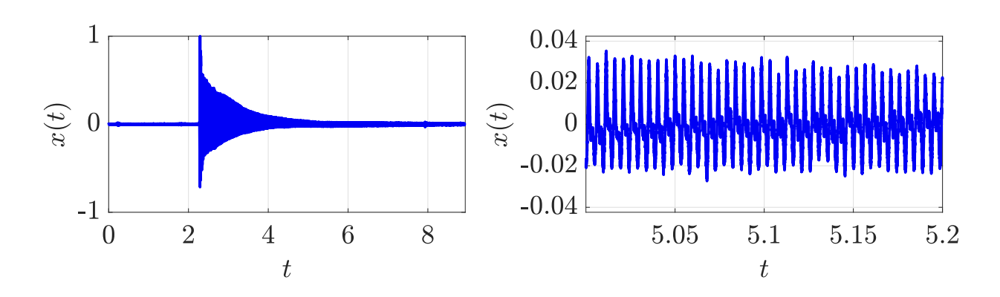
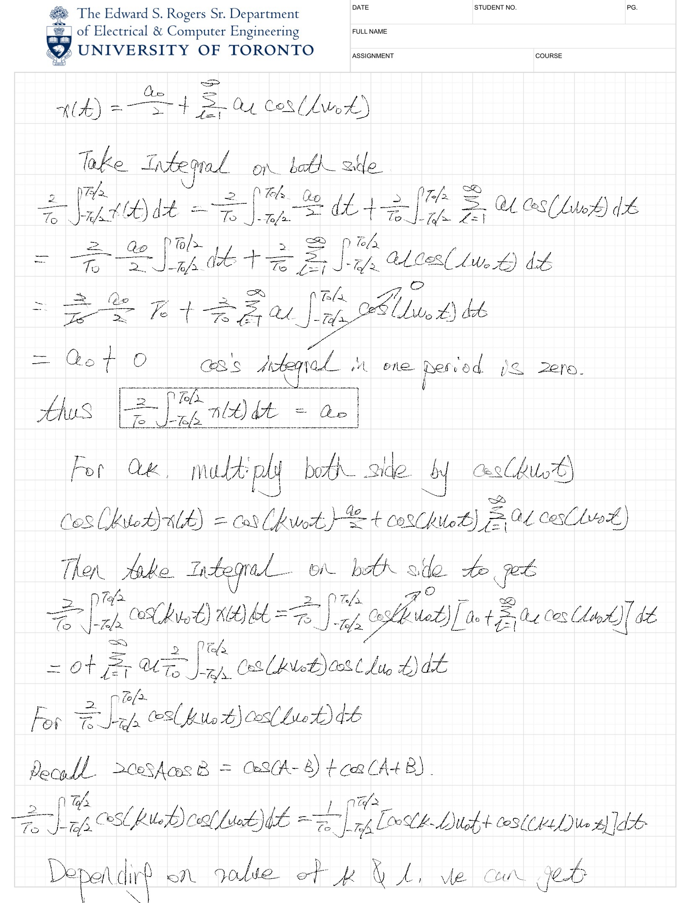
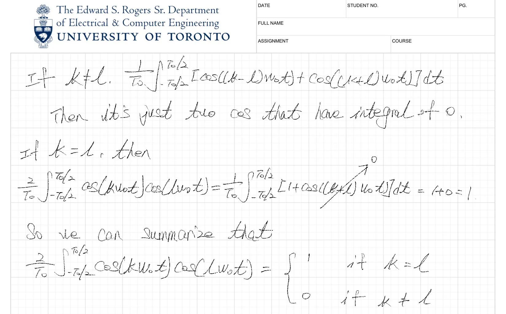
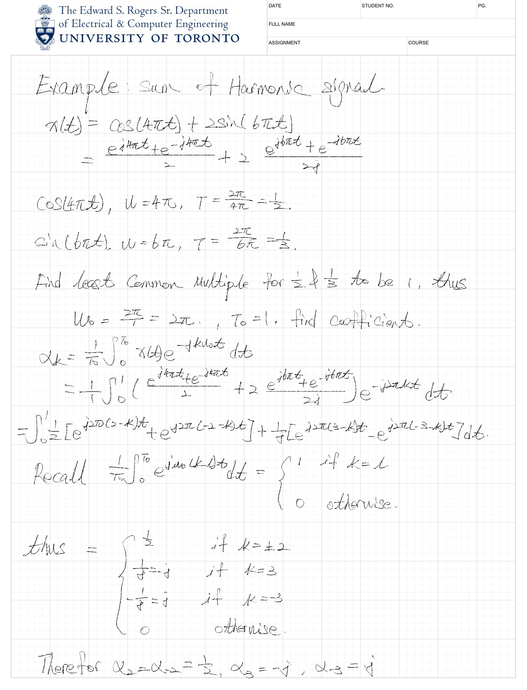
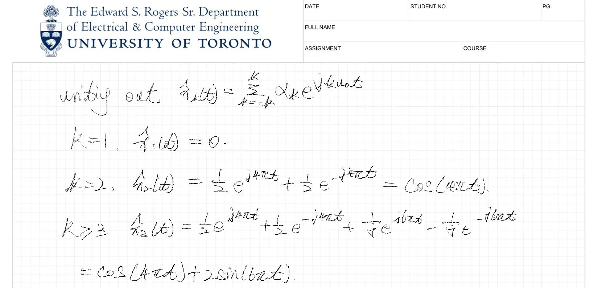
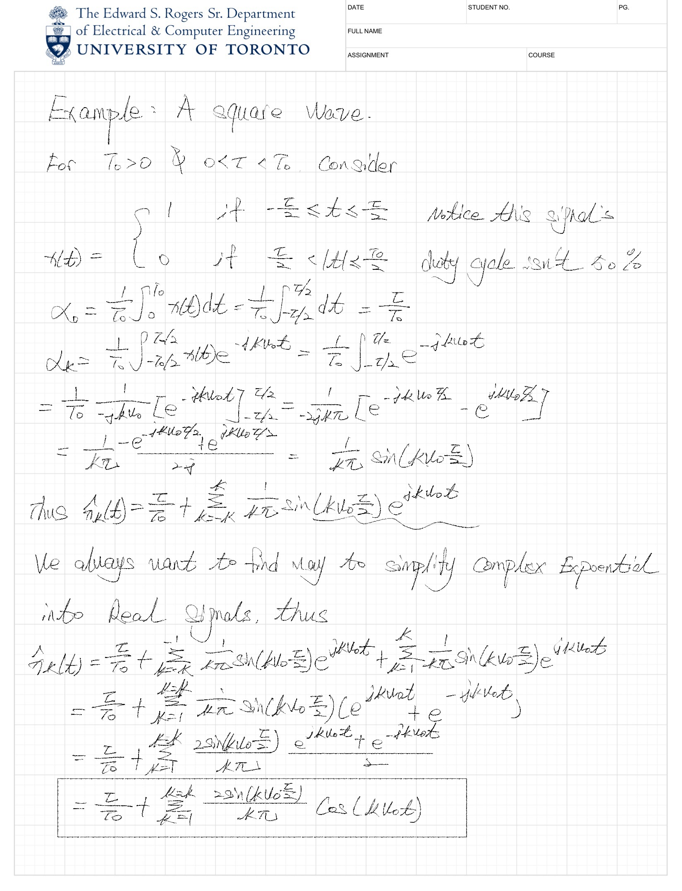
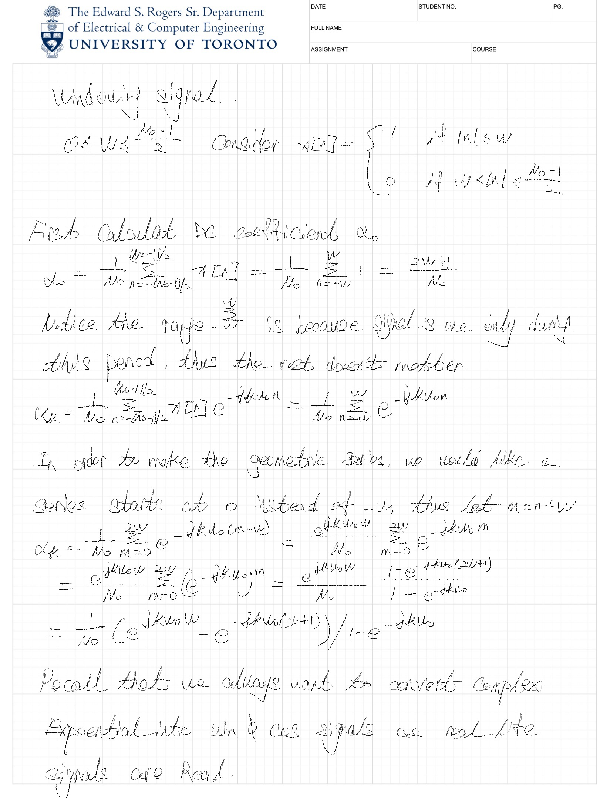
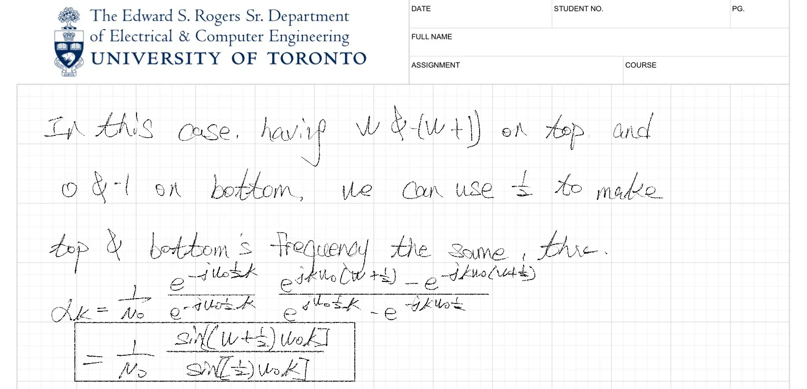

> Last Edit: 1/19/26

> Last Edit
> 

# Fourier Series

Now consider this case

we have being given an oscillation signal of an object after collision

- This signal is kind of hard to be analysis, that it’s a Time Domain Signal with no features
- The way we do is try to build it based on Basis Signals and form a Weighted Sum

$$
\hat{x} = \alpha_0\phi_0 + \alpha_1\phi_1 + \alpha_2\phi_2 + \dots = \sum_{k} \alpha_k\phi_k
$$

- And that is just the Principle of Fourier Analysis: The Transform between Time Domain and Frequency Domain

## Introductory example: An Even Periodic Signal

- This is an **Even Signal,** thus we can choose $\cos$ as the Fundamental Component
- Thus we have $\phi_0(t) = \frac{1}{2}$ as DC Component, $\phi_1(t) = \cos(\omega_0 t)$ as Fundamental Component, and $\phi_2(t) = \cos(2\omega_0 t), \phi_3(t) = \cos(3\omega_0 t), \dots$ as Harmonic Components
- So the whole set to build up this Periodic Signal will then be

$$
\left\{ \frac{1}{2}, \cos(\omega_0 t), \cos(2\omega_0 t), \cos(3\omega_0 t), \dots \right\}
$$

Now we need to find a way to solve for the coefficient for the Linear Combination which is 

$$
x(t) = \frac{a_0}{2} + \sum_{\ell=1}^{\infty} a_\ell \cos(\ell \omega_0 t)
$$

- Thus find those $a_0,a_1,a_2\dots$
    
    
    
    
    
- The Final Result we achieved is that

$$
\frac{2}{T_0} \int_{-T_0/2}^{T_0/2} \cos(k\omega_0 t) \cos(\ell\omega_0 t) \, dt = \begin{cases} 1 & \text{if } k = \ell \\ 0 & \text{if } k \neq \ell \end{cases}
$$

<aside>
❗

This means that except the signal $\cos(k\omega_0t)$, every other signals will become zero after timing the $\cos(k\omega_0t)$ and take Integral

</aside>

So now, for any **Even** Signal $x(t)$, we can apply the same method to extract cos signal at different frequency one by one

### Ex. A Square Wave

Having the Signal $x_{fin}(t)$, we wish to approach this signal by Fourier Series

$$
x_{\text{fin}}(t) = \begin{cases} 1 & \text{if } -\frac{\tau}{2} \le t \le \frac{\tau}{2} \\ 0 & \text{otherwise} \end{cases}
$$

> Notice that this Signal have Duty Cycle less than 1 (Time when signal is 1 is shorter)
> 

First we want to calculate $a_0$, that is

$$
a_0 = \frac{2}{T_0} \int_{-\frac{T_0}{2}}^{\frac{T_0}{2}} x(t) \, \text{d}t = \frac{2}{T_0} \int_{-\tau/2}^{\tau/2} (1) \, \text{d}t = \frac{2\tau}{T_0}
$$

Secondly, find the general solution for $a_k$

$$
a_k = \frac{2}{T_0} \int_{-\frac{T_0}{2}}^{\frac{T_0}{2}} x(t) \cos(k\omega_0 t) dt = \frac{2}{T_0} \int_{-\tau/2}^{\tau/2} \cos(k\omega_0 t) dt 
$$

- The bond for integral is $-\tau/2$ to $\tau/2$ because the function $x(t)$ is 1 during this fragment, and other are just zero that doesn’t change the value of the Integral,
- While the value of function is simply 1, so it can be simplify to RHS

$$
= \frac{2}{T_0 k\omega_0} [\sin(k\omega_0 \tau/2) - \sin(-k\omega_0 \tau/2)] = \frac{2}{\pi k} \sin(k\omega_0 \tau/2)
$$

- Thus eventually we can get the Fourier Series for this signal to be

$$
x(t) = \frac{\tau}{T_0} + \sum_{k=1}^{\infty} \frac{2 \sin(k\omega_0 \tau/2)}{\pi k} \cos(k\omega_0 t)
$$

- And if we are doing an Approximation, that is only k terms of the Series, that will be

$$
\hat{x}_K(t) = \frac{\tau}{T_0} + \sum_{k=1}^{K} \frac{2 \sin(k\omega_0 \tau/2)}{\pi k} \cos(k\omega_0 t)
$$

## Frequency Domain

After we extract the Square Wave from the Fourier Series, we can get its distribution over the frequency domain

- On the right side, it indicate the coefficient of Harmonic Signal along k
- Thus we can use $\{a_k\}_{k=0}^\infty$ as the equivalenty representing of $x(t)$ in the Frequency Domain
- While $\{a_k\}_{k=0}^\infty$ is being called the Spectrum of x

## Fourier Series for odd Periodic Signals

For odd signals, the Series can be represent by similar method, but just that we change sin to cos

$$
x(t) = \sum_{k=1}^{\infty} b_k \sin(k\omega_0 t),\quad b_k = \frac{2}{T_0} \int_{-T_0/2}^{T_0/2} x(t) \sin(k\omega_0 t) \, dt
$$

## Fourier Series for Periodic Signals

For Signals that are neither even or odd, but periodic we can use the **combination** of even and odd, that is 

$$
x(t) = \frac{a_0}{2} + \sum_{k=1}^{\infty} a_k \cos(k\omega_0 t) + \sum_{k=1}^{\infty} b_k \sin(k\omega_0 t)
$$

- However, solving those two integrals turns out to be hard, so we introduce the concept of Complex Exponential Signals

# The Complex Exponential Fourier Series

When dealing with Real Fourier Series, we normally need to solve several equations to get the Series, while in Complex Exponential, instead, we can use Euler’s Formula

$$
e^{jk\omega_0 t} = \cos(k\omega_0 t) + j\sin(k\omega_0 t)
$$

- This formula change the problem from two Separate signal into one Complex Number on the Unit Circle in Complex Plane

$$
\hat{x}(t) = \sum_{k=-\infty}^{\infty} \alpha_k e^{\mathbf{j}k\omega_0 t}, \quad \alpha_k \in \mathbb{C}
$$

- What this Formula States instead of $x(t) = \frac{a_0}{2} + \sum_{k=1}^{\infty} a_k \cos(k\omega_0 t) + \sum_{k=1}^{\infty} b_k \sin(k\omega_0 t)$, is that we no longer use sin and cos as block to build the Signal, instead, we use $\phi_k(t) = e^{jk\omega_0t}$

---

- However, changing into this more easier way, there are two challenges we need to face
1. The fact that $e^{jk\omega_0 t} = \cos(k\omega_0 t) + j\sin(k\omega_0 t)$ has Imaginary Part, while in real life signal, we doesn’t have “Complex” Signal, thus we need to get rid of the Imaginary Part
2. We need to produce both cos and sin, cause as indicated, a Periodic Signal need to be “building” on both cos and sin
- To get rid of the Imaginary Part, notice the fact that we are using the range of $\sum_{k=-\infty}^{\infty}$ to form the series, this means that for each $k> 0$, there will be one $k<0$ to pair with it
- Based on Euler’s Formula, the Positive k will produce

$$
(A+jB)(\cos \omega_0 t + j \sin \omega_0 t) = (A\cos - B\sin) + j(A\sin + B\cos)
$$

- While the Negative k will produce

$$
(A-jB)(\cos \omega_0 t - j \sin \omega_0 t) = (A\cos - B\sin) - j(A\sin + B\cos)
$$

- By adding those up, we will get

$$
2(A\cos \omega_0 t - B\sin \omega_0 t)
$$

> Notice how this range $\sum_{k=-\infty}^{\infty}$ both get rid of Imaginary part and produce both cos and sin
> 

# Continuous-Time Fourier Series (CTFS)

Let x be a periodic CT signal with fundamental period $T_0$ and angular frequency $\omega0 = 2π/T_0$, the complex numbers

$$
\alpha_k = \frac{1}{T_0} \int_{0}^{T_0} x(t)e^{-jk\omega_0t} dt
$$

are called the Fourier Coefficients of x, and 

$$
\hat{x}(t) = \sum_{k=-\infty}^{\infty} \alpha_k e^{jk\omega_0t}
$$

is called the Continuous-Time Fourier Series (CTFS) of x

> The integral can be taken in any interval of length $T_0$
> 

---

## Derivation of the coefficients via Approximation

Assume we don’t know the formula of $\alpha_k = \frac{1}{T_0} \int_{0}^{T_0} x(t)e^{-jk\omega_0t} dt$ so far, we are trying to use approximation to prove that the above formula is the best approximation coefficient

- Consider a Finite number of terms of Fourier Series Expansion that

$$
\hat{x}_K(t) = \sum_{k=-K}^{K} \alpha_k e^{\mathbf{j}k\omega_0 t}
$$

- We use MSE, Mean Square Error to evaluate the error which is

$$
J(\alpha_{-K}, \dots, \alpha_K) = \frac{1}{T_0} \int_{0}^{T_0} |x(t) - \sum \alpha_k e^{jk\omega_0t}|^2 dt
$$

- By some derivation, we will found that

$$
\alpha_k = \frac{1}{T_0} \int_{0}^{T_0} x(t)e^{-jk\omega_0t} dt
$$

- is exactly the CTFS coefficients we want for best possible approximation

> See Appendix A for Derivation
> 

### Example: sum of harmonic signals

Use CTFS to approximate signal

$$
x(t) = \cos(4\pi t) + 2 \sin(6\pi t)
$$

### Example: Square Wave

Notice that it takes high frequencies to make sharp corners

# The CTFS and Signal Manipulations

Suppose having some CTFS Coefficients $\{\alpha_k\}_{k=-\infty}^{\infty}$, we can find the CTFS coefficients of simple manipulations, e.g. $3x(t) + 2$, $x(t - 5)$, $\text{Re}\{x\}$, $\frac{dx}{dt}(t)$ by properties of the CTFS

- For example, $x(t) = \sum_{k=-\infty}^{\infty} \alpha_k e^{j k \omega_0 t}$, then

$$
x(t - t_0) = \sum_{k=-\infty}^{\infty} \alpha_k e^{j k \omega_0 (t - t_0)}= \sum_{k=-\infty}^{\infty} (\alpha_k e^{-j k \omega_0 t_0}) e^{j k \omega_0 t}
$$

- Which in result is just a mutiplication $\beta_k = \alpha_k e^{-j k \omega_0 t_0}$
- All Manipulations can be conclude in this table

# Conjugate-Symmetry for real signals

Known that all signals in real life are **Real-Valued**, that means

$$
x(t)=x(t)^*
$$

Known this property, we can then conclude the Symmetry of Real-Valued Signal in Frequency Domain, recall the CTFS coefficients

$$
a_k = \frac{1}{T_0} \int_{0}^{T_0} x(t)e^{-\mathbf{j}k\omega_0 t} \, dt
$$

- It has the conjugate of

$$
a_k^* = \frac{1}{T_0} \int_{0}^{T_0} x(t)^* (e^{-\mathbf{j}k\omega_0 t})^* \, dt= \frac{1}{T_0} \int_{0}^{T_0} x(t) e^{\mathbf{j}k\omega_0 t} \, dt\
= a_{-k}
$$

- Known that $a_k^* = a_{-k}$, then we know that $|a_{-k}| = |a_k|$, and $\angle a_{-k} = -\angle a_k$

# Existence of  CTFS

Consider this function

$$
x_{\text{fin}}(t) = \begin{cases} \frac{1}{t}, & \text{if } 0 < t \leq 1 \\ 0, & \text{else} \end{cases}
$$

- Notice that when finding the 0th Fourier coefficient, it is

$$
\alpha_0 = \frac{1}{1} \int_{0}^{1} \frac{1}{t} \, dt = \ln(1) - \ln(0) = +\infty
$$

## Existence of the CTFS

If $x$ has finite action, i.e. $x\in L_1^{per}$, then the Fourier coefficients $a_k = \frac{1}{T_0} \int_{0}^{T_0} x(t)e^{-\mathbf{j}k\omega_0 t} \, dt$ are well defined and satisfy

$$
\lim_{k \to \pm\infty} |\alpha_k| = 0
$$

---

This is basically saying signal can’t be Infinite Large in Finite Time, Signal satisfied those conditions’s coefficient will have the following property

- Well-Defined: Every $\alpha_k$ will be a finite value
- Decay: $\lim_{k \to \pm\infty} |\alpha_k| = 0$, that means the higer frequency term’s magnitude will become smaller

# Convergence of the CTFS

Knowing the Existence of CTFS, it means we can write out the coefficient

$$
a_k = \frac{1}{T_0} \int_{0}^{T_0} x(t)e^{-\mathbf{j}k\omega_0 t} \, dt
$$

However, it doesn’t means that this is guarantee to be converge to the original signal, thus need the further property of the Convergence of the CTFS 

---

Let $e_K = \hat{x}_K - x$ denote the error between approximation and original signal, there are three kinds of convergence

- Pointwise at time $t_0$ if $\lim_{k\rightarrow \infty}e_K(t_0)=0$
- Uniformly if $\lim_{K\to\infty} \|e_K\|_\infty = 0$
- In Energy if $\lim_{K\to\infty} \|e_K\|_2 = 0$
- uniformly = amplitude of error goes to zero
- in energy = energy of error goes to zero

---

ALL THOSE Convergence is under the assumption that $x \in L_1^{\text{per}}$

## Pointwise Convergence of the CTFS

(i) If $x$ has a Continuous Derivative at time $t_0\in\mathbb R$, then $\hat x_K$  converges to x pointwise at $t_0$

(ii) Or if the left-side limits and right-side limits all exist at time $t_0 \in \mathbb R$, then

$$
\lim_{K\to\infty} \hat{x}_K(t_0) = \frac{1}{2}(x(t_0^-) + x(t_0^+))
$$

---

(i): Over interval where signal is smooth, then approximation converges pointwise

(ii): At jump discont. approximation converges to mid-point of discont.

### Ex. A Square Wave

- Approximation converges pointwise at all $t\neq\pm0.5$
- Approximation converges to discontinuity midpoint at $t = \pm0.5$, which is 0.5
- At $t=\pm 0.5$, the Ripple is called Gibb’s Phenomenon, it will never goes away

## Uniform Convergence of the CTFS

Uniform convergence requires stronger assumptions, an easy assumption is that the signal has a continuous derivative everywhere

If $x$ has a derivative which is continuous everywhere, then $\hat x_K$ converges to $x$ uniformly.

### Ex. Signals for Uniform Convergence

This is signal $x(t) = t^3 - 3\pi t^2 + 2\pi^2 t$ that satisfies the assumption

However, in this this case , triangle wave doesn’t satisfies the condition, but on its frequency domain, it actually decay nicely as k increases 

- This means that there are weaker conditions for uniform convergence

---

Weaker Condition for uniform Convergence

If x is continuous, and it its derivative is piecewise continuous and has only finitely many jumps of finite size over a period, then $\hat x_K$ converges to $x$ uniformly.

## Convergence in Energy of the CTFS

If $x$ has finite energy, i.e. $x \in L_2^{\text{per}}$, then 

(i) $\hat x_K$ converges to $x$ in energy

(ii) CTFS Coefficients have finite energy, i.e. $\alpha \in l_2$

(iii) The Signal and Coefficients satisfy Parseval’s Relation

$$
\frac{1}{T_0} \int_{0}^{T_0} |x(t)|^2 \, dt = \sum_{k=-\infty}^{\infty} |\alpha_k|^2\quad or \quad \frac{1}{T_0} \|x\|_2^2 = \|\alpha\|_2^2
$$

# The discrete-time Fourier series (DTFS)

Any Periodical DT Signal can be express in a series containing the Complex Exponential Signal, that is we can express $x$ as

$$
x[n] = \sum_{k} a_k \phi_k[n]
$$

- Where as $\phi_k[n] = e^{j k \omega_0 n}$, $\omega_0 = 2\pi / N_0$
- Thus the full DTFS can be written as

$$
x[n] = \sum_{k=0}^{N_0-1} a_k e^{j k \omega_0 n}
$$

- Notice the range of k is from $0$ to $N_0-1$

## Periodicity of DTFS

The reason why we only need $N_0-1$ numbers of k is because 

$$
e^{j(N_0 \omega_0) n} = e^{j(2\pi)n} = e^{j(0)n}
$$

> $\omega_0 = 2\pi / N_0$
> 
- This is saying, when finding the $N_0$  harmonic frequency, its looks exactly the same as the $0$ one on discrete sampling point
- This can be proof by

$$
\begin{aligned}\alpha_{k+N_0} &= \frac{1}{N_0} \sum_{n=0}^{N_0-1} x[n]e^{-\mathbf{j}(k+N_0)\omega_0 n} \\&= \frac{1}{N_0} \sum_{n=0}^{N_0-1} x[n]e^{-\mathbf{j}k\omega_0 n} e^{-\mathbf{j}N_0\omega_0 n} \\&= \frac{1}{N_0} \sum_{n=0}^{N_0-1} x[n]e^{-\mathbf{j}k\omega_0 n} e^{-\mathbf{j}N_0 \frac{2\pi}{N_0} n} \\&= \frac{1}{N_0} \sum_{n=0}^{N_0-1} x[n]e^{-\mathbf{j}k\omega_0 n} \\&= \alpha_k\end{aligned}
$$

## Orthogonality of complex exponentials

$$
\frac{1}{N_0} \sum_{n=0}^{N_0-1} e^{jm\omega_0n} e^{-jl\omega_0n} = \begin{cases} 1 & \text{if } m = l + kN_0,k\in\mathbb Z
 \\ 0 & \text{otherwise} \end{cases}
$$

## DTFS Coefficient

$$
a_k = \frac{1}{N_0} \sum_{n=0}^{N_0-1} x[n] e^{-j k \omega_0 n},\quad k\in \mathbb Z
$$

### Ex. The Repeated Unit Impulse

The DTFS Coefficients are

$$
a_k = \frac{1}{N_0} \sum_{n=0}^{N_0-1} \delta[n] e^{-j k \omega_0 n} = \frac{1}{N_0} (1 \cdot e^{0} + 0 + \dots) = \frac{1}{N_0}
$$

- Notice by Orthogonality of Complex Exponentials, this extracts the value when $n=0$, thus

$$
x[n] = \frac{1}{N_0} \sum_{k=0}^{N_0-1} e^{\mathbf{j} k \omega_0 n}
$$

### Ex 1. A growing Signal

### Ex 2. The windowing Signal

# Application: analysis of a real signal

This is a Signal sample at $f_s =48000~samples\cdot sec^{-1}$, where as the time interval is 2 seconds

If we Compute the DTFS coefficients and plot them, this is the chart

The first thing we notice is that the plot is symmetric about the midpoint

- This is because the original signal $x(t)$ is a Real Signal, thus $|\alpha_k| = |\alpha_{N_0-k}|$