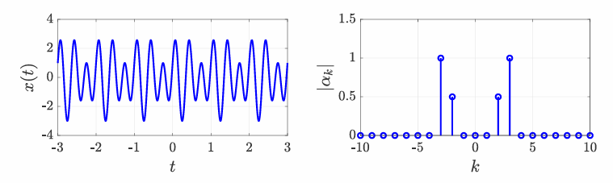
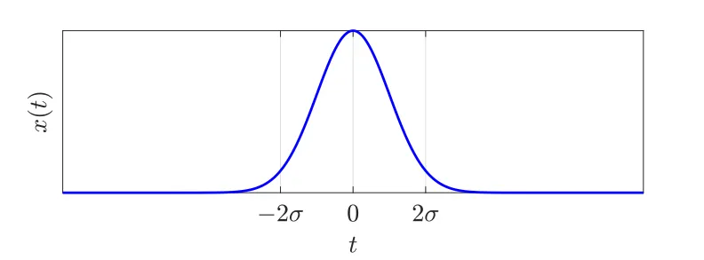

> Last Edit: 2/3/26

We have already know how to use Fourier Series to analyze periodic signals by extract it into frequency domain

But what if the signal is aperiodic?

Then we should apply Fourier Transform instead

# Fourier Transform

## Derivation of the CT Fourier Transform

Suppose having a general CT Signal

Realize that a aperiodic signal is actually a periodic signal with infinite period

So we want to make some thing on the period part, steps we would like to do is

1. Window Signal to $[-T,T)$, then periodize it
2. Compute CTFS of periodized signal
3. Take the limit $T\rightarrow \infty$

<aside>
❗

So far the only “tool” we have is CTFS, so try to convert it into something we know

</aside>

### Windowing

Being with windowed one fragment 

$$
x_{\text{fin}, T}(t) = x(t) \cdot [u(t + T) - u(t - T)]
$$

### Periodize

The repeat that fragment for infinite times

$$
x_{\text{per}, T}(t) = \sum_{m=-\infty}^{\infty} x_{\text{fin}, T}(t - m(2T))
$$

### CTFS

As the signal we have now is periodic, we can use CTFS now

Begin the CTFS with the Fundamental Frequency $\omega_0=2\pi/2T=\pi/T$

As always, the coefficient is

$$
\alpha_k = \frac{1}{2T} \int_{-T}^{T} x(t) e^{-jk\omega_0 t} dt
$$

Now we would like to define a function $X_T$

$$
X_T(\mathbf{j}\omega) = \int_{-T}^{T} x(t)e^{-\mathbf{j}\omega t} \text{d}t
$$

We notice that the CTFS coefficient is just sampling on this $X_T$ while divied by $2T$

$$
\alpha_k = \frac{1}{2T} X_T(jk\omega_0)
$$

Now put this Coefficient back into the Fourier Series, which substitute $\frac{1}{2T} = \frac{\omega_0}{2\pi}$

$$
x_{\text{per}, T}(t) = \frac{1}{2\pi} \sum_{k=-\infty}^{\infty} X_T(\mathbf{j}k\omega_0)e^{\mathbf{j}k\omega_0 t}\omega_0
$$

Notice this could be a Riemann Sum over the Frequency Domain

Here the Height is $X_T(\mathbf{j}k\omega)e^{\mathbf{j}k\omega t}$, while is in frequency domain

As all Riemann Sum can goes to Integral using limit, when $T\rightarrow \infty$, $\omega_0=\frac{2\pi}{T}\rightarrow 0$ this Riemann Sum then becomes to

$$
\lim_{T \to \infty} x_{\text{per}, T}(t) = x(t) = \frac{1}{2\pi} \int_{-\infty}^{\infty} X(\mathbf{j}\omega)e^{\mathbf{j}\omega t} \text{d}\omega
$$

Recall the function $X_T$ has been defined as $X_T(\mathbf{j}\omega) = \int_{-T}^{T} x(t)e^{-\mathbf{j}\omega t} \text{d}t$, so as $T\rightarrow \infty$, this function then becomes

$$
X(j\omega) = \int_{-\infty}^{\infty} x(t)e^{-j\omega t} dt
$$

## The CT Fourier Transform (CTFT)

The CTFT of a CT signal x it he complex-valued signal $X:\mathbb R\rightarrow\mathbb C$ defined pointwise by

$$
X(j\omega) = \int_{-\infty}^{\infty} x(t)e^{-j\omega t} dt
$$

## Inverse CT Fourier Transform (Inverse CTFT)

The Inverse CTFT of a CT signal x it he complex-valued signal $X:\mathbb R\rightarrow\mathbb C$ defined pointwise by

$$
x(t) = \frac{1}{2\pi} \int_{-\infty}^{\infty} X(\mathbf{j}\omega)e^{\mathbf{j}\omega t} \text{d}\omega
$$

### CTFT Example

$$
x(t) = e^{-at}u(t), \quad a > 0
$$

- As the result is a Complex Number, we want to analyze it using Magnitude and Phase

$$
|X(j\omega)| = \frac{1}{\sqrt{a^2 + \omega^2}}, \quad \angle X(j\omega) = 0 - \tan^{-1}(\omega/a) = -\tan^{-1}(\omega/a)
$$

Notice this general property that Amplitude is Even symmetry, whereas Phase is Odd Symmetry

### CTFT Example: two-sided windowing signal

Consider the signal $x(t) = u(t + \frac{\tau}{2}) - u(t - \frac{\tau}{2})$, using CTFT we get

Signals of the form $\sin(x)/x$ is call the $sinc$ signal

### CTFT Example: Shifted Impulse

Consider the delayed impulse $x(t)=\delta(t-\tau)$, its CTFT is 

Having the amplitude of 1 and Phase of $-\omega\tau$

<aside>
❗

If x is very concentrated in the time domain, the spectrum X will be very spread out the in frequency domain.

</aside>

## Inverse CTFT

Now having the Square Signal in **Frequency Domain**, we would like to do the inverse CTFT to find its signal in **Time Domain**

$$
\begin{aligned}
X(\mathbf{j} \omega) &= u(\omega + \omega_{\text{b}}) - u(\omega - \omega_{\text{b}}) \\
&= \begin{cases} 
1 & \text{if } -\omega_{\text{b}} \le \omega < \omega_{\text{b}} \\
0 & \text{otherwise}
\end{cases}
\end{aligned}
$$

## Partial Fraction Expansion

Sometimes Complex Rational Function need to be expand into those simple form, and this can be done by Partial Fraction

$$
X(\mathbf{j} \omega) = \frac{\mathbf{j} \omega}{(1 + \mathbf{j} \omega)(2 + \mathbf{j} \omega)}
$$

Notice that if the nominator is greater than the denominator, than we should first subtract one the do the Partial Fraction on the rest

# Existence of the CTFT for Finite Signals

Unfortunately, some CT signals do not have a spectrum, for example $x(t) = e^{at}u(t)$

$$
\begin{aligned}
X(\mathbf{j} \omega) &= \int_{-\infty}^{\infty} e^{at} u(t) e^{-\mathbf{j} \omega t} \,\mathrm{d}t = \int_{0}^{\infty} e^{(a-\mathbf{j} \omega)t} \,\mathrm{d}t \\
&= \left. \frac{1}{a - \mathbf{j} \omega} e^{(a-\mathbf{j} \omega)t} \right|_{0}^{\infty} = \infty
\end{aligned}
$$

## Existence of the CTFT for finite action signal

If x has finite action, i.e., $x \in L1,$ then the CTFT $X(jω)$ is well-defined and satisfies $\lim_{\omega\rightarrow \pm \infty} |X(j\omega )|=0|$

> This is a Sufficient but not Necessary condition
> 

## Existence of the CTFT for finite-energy signals

If $x$ has finite energy, i.e. $x \in L2$, then

- X is well defined and has finite energy, $X \in L2,$ and
- The signal and its spectrum satisfy Parseval’s Relation

$$
\int_{-\infty}^{\infty} |x(t)|^2 dt = \frac{1}{2\pi} \int_{-\infty}^{\infty} |X(j\omega)|^2 d\omega
$$

> A beautiful and surprising relationship between the energy of the signal and the energy of its spectrum
> 

### CTFT Example: The Complex Exponential

As both above are just sufficient condition, we will now analyse one does not have finite action nor finite energy, but is nonetheless CTFT-able

Consider the spectrum $X(j\omega)=2\pi\delta(\omega-\omega_0)$, we compute its CTFT to be 

$$
x(t) = \frac{1}{2\pi} \int_{-\infty}^{\infty} 2\pi\delta(\omega-\omega_0)e^{j\omega t} d\omega=e^{j\omega_0t}
$$

Thus those are a pair of CTFT

$$
x(t) = \underbrace{e^{\mathbf{j}\omega_0 t}}_{\text{spread out in time}} \stackrel{\text{CTFT}}{\longleftrightarrow} X(\mathbf{j}\omega) = \underbrace{2\pi\delta(\omega - \omega_0)}_{\text{concentrated in frequency}}
$$

### CTFT Example: A Periodic Signal

Let $x$ be a periodic CT signal with fundamental period $T_0$, and $\omega_0=2\pi/T_0$, we now represent x using the CTFS

$$
x(t) = \sum_{k=-\infty}^{\infty} a_k e^{j k \omega_0 t}
$$

Going term by term, the CTFT spectrum must be 

$$
X(j\omega) = 2\pi \sum_{k=-\infty}^{\infty} a_k \delta(\omega - k \omega_0)
$$

## Relationships between CTFT and CTFS

# The CTFT and Signal Manipulations

Now we have calculated the spectrum X of some signal x, and we want to shift, scale or differential it 

So we can use the properties of the CTFT to do shortcuts

### Ex.

Since $x(t) = \frac{1}{2\pi} \int_{-\infty}^{\infty} X(j\omega)e^{j\omega t} d\omega$, thus $x(t-t_0)$  is                                                                  

$$
x(t - t_0) = \frac{1}{2\pi} \int_{-\infty}^{\infty} X(j\omega)e^{j\omega (t - t_0)} d\omega= \frac{1}{2\pi} \int_{-\infty}^{\infty} \left( X(j\omega) e^{-j\omega t_0} \right) e^{j\omega t} d\omega
$$

## CTFT Property: Magnitude and Phase

Here we mainly focus on Conjugation and Time-Scaling, that is 

- $x(t)^*. =X(-j\omega)^*$
- $x(at)=\frac{1}{|a|} X(\mathbf{j}\omega/a)$

Now using the example of a song, we we play it backwards, that is $b(t) =s(-t)$

$$
B(\mathbf{j}\omega) = S(-\mathbf{j}\omega) = S(\mathbf{j}\omega)^* \implies |B(\mathbf{j}\omega)| = |S(\mathbf{j}\omega)|
$$

This means that the Magnitude Spectrum of two song are same while the Phase, which indicate the time the frequency exist is unique

### CTFT Example: Gaussian Distribution

For $\sigma >0$, consider the signal

$$
x(t) = \frac{1}{\sigma\sqrt{2\pi}}e^{-\frac{1}{2}(t/\sigma)^2}
$$

Knowing the fact that this Gaussian Distribution always have the area of 1

And this Function has the derivative of $\dot{x}(t) = x(t) \cdot \left( -\frac{t}{\sigma^2} \right) \implies \dot{x}(t) = -\frac{t}{\sigma^2}x(t)$

From the Table we can get two properties

- $\dot{x}(t) \longleftrightarrow (j\omega)X(j\omega)$
- $tx(t) \longleftrightarrow j\frac{d}{d\omega}X(j\omega)$

Then we can take CTFT on both side of Gaussian Distribution

$$
x(t) = \frac{1}{\sigma\sqrt{2\pi}}e^{-\frac{1}{2}(t/\sigma)^2} \stackrel{\text{CTFT}}{\longleftrightarrow} X(\mathbf{j}\omega) = e^{-\frac{1}{2}(\sigma\omega)^2}
$$

Thus we can get

$$
X(j\omega) = e^{-\frac{1}{2}(\sigma\omega)^2}
$$

---

So what this section is trying to say is that if Gaussian Distribution is thick in Time Domain, then it will be Wider in Frequency Domain

## CTFT Properties: Conjugate Symmetry

If x is a real signal, meaning $x(t) ∈ R$ for all $t \in \mathbb R$, then the spectrum $X(jω)$ is conjugate symmetric, meaning $X(jω)∗ = X(−jω)$ for all $ω ∈ R$

Thus Magnitude is an Even Function, where Phase is an odd function

## CTFT Properties: Multiplication

If we multiply two Signal $x(t)$ and $\hat x(t)$, then the new signal in time domain will then be 

$$
y=x(t)\hat x(t)
$$

Whereas its CTFT in Frequency domain will be 

$$
Y(j\omega) = \frac{1}{2\pi} \int_{-\infty}^{\infty} \tilde{X}(j\nu)X(j(\omega-\nu)) d\nu
$$

Which is there Convolution divided by the $2\pi$

### Example of Signal Multiplication: Amplitude Modulation

Having two signals, a Carrier $cos(\omega_ct)$ and a Baseband $x(t)$, their product in time domain is

$$
y(t) = \underbrace{\cos(\omega_c t)}_{\text{“carrier”}} \cdot \underbrace{x(t)}_{\text{“baseband”}} = \frac{1}{2} \left( e^{\mathbf{j}\omega_c t} + e^{-\mathbf{j}\omega_c t} \right) x(t)
$$

Whereas the spectrum of cosine is $C(\mathbf{j}\omega) = 2\pi \frac{\delta(\omega - \omega_c) + \delta(\omega + \omega_c)}{2}$, thus the $Y(j\omega)$ is 

$$
Y(\mathbf{j}\omega) = \frac{1}{2\pi} \int_{-\infty}^{\infty} C(\mathbf{j}\nu) X(\mathbf{j}(\omega - \nu)) \mathrm{d}\nu = \frac{1}{2} (X(\mathbf{j}(\omega - \omega_c) + X(\mathbf{j}(\omega + \omega_c))))
$$

In the figure above, $x(t)$ is the Baseband with the actual information we want to transfer, whereas the Modulated Signal is one with higher frequency but having the shape of $x(t)$

## CTFT Properties: Convolution in time domain

Previously we mentioned the Multiplication in time domain is the Convolution in Frequency Domain

Now the Convolution in time domain just means the Multiplication in Frequency Domain

$$
Y(\mathbf{j}\omega) = \int_{-\infty}^{\infty} \left[ \int_{-\infty}^{\infty} x(\tau) \tilde{x}(t - \tau) \mathrm{d}\tau \right] e^{-\mathbf{j}\omega t} \mathrm{d} t=X(\mathbf{j}\omega) \tilde{X}(\mathbf{j}\omega)
$$

# Discrete-Time Fourier Transform (DTFT)

Do the same thing as CTFT

1. First window the duration of $2N+1$
2. Periodize it
3. Compute the DTFS
4. Take the limit

Then we can get DTFT as

$$
X(e^{j\omega}) = \sum_{n=-\infty}^{\infty} x[n]e^{-j\omega n}
$$

Also the Inverse DTFT is 

$$
x[n] = \frac{1}{2\pi} \int_{-\pi}^{\pi} X(e^{j\omega})e^{j\omega n} d\omega
$$

### Ex.

### Ex. Right-sided decaying exponential

## Periodic of DTFT Spectrum

# Comparison of CTFT vs. DTFT

# There is only one Fourier transform