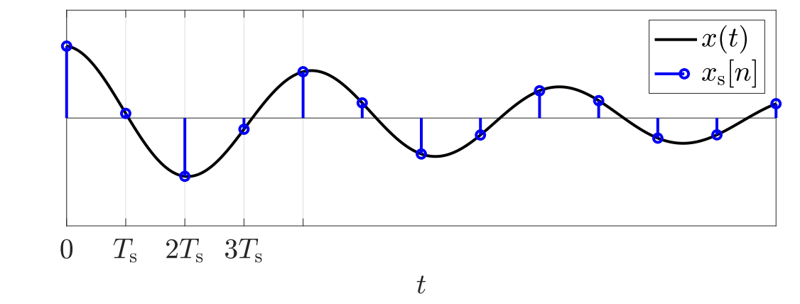

> Last Edit: 2/23/26

# Sampling

Sampling means to collect a measurement of a signal

- If there’s too few samples, then there’s a little we can learn
- If there’s “enough”, then we may be able to figure out the original one

## The sampling function

The sampling function is defined as 

$$
s(t) = \sum_{n=-\infty}^{\infty} \delta(t - nT_s)
$$

Where $T_s>0$ is the Sampling Period

Mathematically, sampling is done by multiplying the original signal and the sampling function 

$$
s(t)x(t) = \sum_{n=-\infty}^{\infty} \delta(t - nT_s)x(nT_s)
$$

This will give a product of a **weighted sum of impulses**

## CTFS of the Sampling Function

Firstly having $s(t)$ as a Impulse Train, with the period of $T_s$, we can get its harmonic angular frequency as $\omega_s=\frac{2\pi}{T_s}$, then we can get CTFS Coefficient to be

$$
\alpha_k = \frac{1}{T_s} \int_{-T_s/2}^{T_s/2} s(t)e^{-j k \omega_s t} dt
$$

Where as here $s(t)$ is $\sum_{n=-\infty}^{\infty} \delta(t - nT_s)$, that is

$$
\alpha_k = \frac{1}{T_s} \int_{-T_s/2}^{T_s/2} \sum_{n=-\infty}^{\infty} \delta(t - nT_s)e^{-j k \omega_s t} dt
$$

As the outer Integral only contains the period from $T_s/2$ to $-T_s/2$, the inner n can only be zero, in such way, the CTFS Coefficient will be simplified into 

$$
\alpha_k =\frac{1}{T_s}  \int_{-T_s/2}^{T_s/2} \delta(t) e^{-j k \omega_s t} dt\Rightarrow a_k = \frac{1}{T_s}e^{-jk\omega_s(0)} =\frac{1}{T_s}
$$

Notice this Coefficient is no long depend on k, thus every harmonic will have the same amplitude, and such the $s(t)$ can be represented by

$$
s(t) = \frac{1}{T_s} \sum_{k=-\infty}^{\infty} e^{j k \omega_s t}
$$

## CTFT of the sampling function

Known before that CTFT of a periodic signal is

$$
x(t) = \sum_{k=-\infty}^{\infty} \alpha_k e^{\mathbf{j} k \omega_0 t} \implies X(\mathbf{j}\omega) = 2\pi \sum_{k=-\infty}^{\infty} \alpha_k \delta(\omega - k \omega_0
$$

Therefor we can get the same for $s(t)$

$$
s(t) = \frac{1}{T_{\mathrm{s}}} \sum_{k=-\infty}^{\infty} e^{\mathbf{j} k \omega_{\mathrm{s}} t} \implies S(\mathbf{j} \omega) = \frac{2\pi}{T_{\mathrm{s}}} \sum_{k=-\infty}^{\infty} \delta(\omega - k \omega_{\mathrm{s}})
$$

<aside>
❗

Notice the CTFT of the Sampling Function is also a Sampling Function

</aside>

This is then called Picket Fence Miracl

## Picket Fence Miracle

# Band-Limited Signals

## Definition

A CT signal is band limited with bandwidth B > 0 if its CTFT Spectrum satisfies $X(j\omega)=0$ for all $|\frac{\omega}{2\pi}|\geq B$

This $|\frac{\omega}{2\pi}|\geq B$ requirement also means that the Spectrum is zero outside $[-2\pi B,2\pi B]$

Now if we sampled this Band_Limited siganal

## Sampling of Band-Limited Signals

As we have use mathematic ways to describe Sampling Function, and we interoperate the action of “sampling” as multiplication, in such way, recall the property that **Multiplication in time-domain is convolution in frequency-domain**

Thus the Spectrum of Sampled Signal $x_s(t)=x(t)s(t)$ is then

$$
\begin{aligned} X_{\mathrm{s}}(\mathbf{j}\omega) &= \frac{1}{2\pi} \int_{-\infty}^{\infty} S(\mathbf{j}\nu) X(\mathbf{j}(\omega - \nu)) \,\mathrm{d}\nu \\ &= \frac{1}{2\pi} \int_{-\infty}^{\infty} \left[ \frac{2\pi}{T_{\mathrm{s}}} \sum_{k=-\infty}^{\infty} \delta(\nu - k \omega_{\mathrm{s}}) \right] X(\mathbf{j}(\omega - \nu)) \,\mathrm{d}\nu \\ &= \frac{1}{T_{\mathrm{s}}} \sum_{k=-\infty}^{\infty} X(\mathbf{j}(\omega - k \omega_{\mathrm{s}})) \end{aligned}
$$

- the spectrum of the sampled signal is a periodised version of the spectrum of original signal, with period ωs in the frequency domain

---

Thus if $\omega_s \geq 4\pi B$, then there won’t be overlapping in frequency domain to make the signal aliasing

# Nyquist-Shannon Sampling Theorem

Let $x$ be a bandlimited CT signal with bandwidth B. If $x$ is sampled with sampling period of $T_s$ satisfying $T_S<\frac{1}{2B}$, then $x$  can be exacly recoved from the samples in the way of 

$$
X(j\omega) = T_s \cdot X_s(j\omega) \cdot [u(\omega + 2\pi B) - u(\omega - 2\pi B)]
$$

## Nyquist Frequency

The sampling frequency satisfied Nyquist-Shannon is then

$$
\omega=4\pi B
$$

## Aliasing

As the Sampling Frequency is too slow, it no longer recovers the original spectrum 

