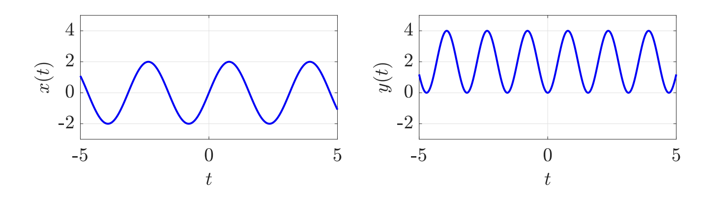

> Last Edit: 3/8/26

# Continuous-Time System

A CT system takes a CT input and produces a CT output

## Pointwise Definition of CT system

Given the output of the system $y(t)=T\{x\}(t)$ it’s determined by an explicit formula from $\{x(t)\}_{t\in \mathbb R}$

### Ex. Pointwise CT System

$$
y(t) = (x(t))^2
$$

## CT System Property: Linearity

<aside>
❗

NOT all System are Linear

</aside>

A Linear System has two properties, 1. Homogeneity and 2. Additivity, which can be written as

$$
T\{\alpha x + \tilde{\alpha}\tilde{x}\} = \alpha T\{x\} + \tilde{\alpha} T\{\tilde{x}\}
$$

### Zero input in Linear System

Based on Homogeneity: $T\{0 \cdot x\} = 0 \cdot T\{x\}$, thus a zero input always have a zero output

### Example: The Squaring System

A squaring System is $y(t) = (x(t))^2 \text{}$, sub in to get

$$
T_{\text{sq}}\{\alpha x + \tilde{\alpha}\tilde{x}\}(t) = (\alpha x(t) + \tilde{\alpha}\tilde{x}(t))^2 \text{}= \alpha^2(x(t))^2 + \tilde{\alpha}^2(\tilde{x}(t))^2 + 2\alpha\tilde{\alpha}x(t)\tilde{x}(t) \text{}
$$

This is not equal to adding their output separately

$$
\alpha T_{\text{sq}}\{x\}(t) + \tilde{\alpha}T_{\text{sq}}\{\tilde{x}\}(t) = \alpha(x(t))^2 + \tilde{\alpha}(\tilde{x}(t))^2 \text{}
$$

## CT System Property: Time-Invariance

A time delay in CT system is defined as $x_\tau(t) = x(t - \tau)$, a system is Time-Invariance if

$$
y = T\{x\} \implies y_\tau = T\{x_\tau\}
$$

> 
> 
> 
> Physical meaning: an experiment on the system tomorrow will produce the same results as an experiment on the system today
> 

### Example: The Squaring System

Sub in the time delay in the Squaring System $y(t) = (x(t))^2$, notice 

$$
T_{\text{sq}}\{x_\tau\}(t) = (x_\tau(t))^2 = (x(t - \tau))^2
$$

Thus that the Squaring System is a Time-Invariance System

## CT System Property: Causality

A CT System is causal if for all $t\in \mathbb R$, the output $y(t)$ depends only on the past and present input values $\{x(\tau)\}_{\tau\leq t}$

### Equivalent Definition

A CT system T is causal if for any time $t_0$ and any two inputs $x$, $\tilde{x}$ satisfy $x(t)=\tilde{x}(t)$ for all $t\leq t_0$, then their ouputs $y=T\{x\}$ and $\tilde{y}=T\{ \tilde{x} \}$ should also be the same

## CT System Property: Memoryless

A CT System is memoryless if for all time $t\in \mathbb R$, the output $y(t)$ only depends on input $x(t)$ at the same time

<aside>
❗

Memoryless is a special case for Causality

</aside>

## CT System Property: Invertibility

A CT system is invertible if

$$
T_{\text{inv}}\{T\{x\}\} = T\{T_{\text{inv}}\{x\}\} = x
$$

## CT System Property: Stability (Linear System Only)

### Recall Bounded Signal

A CT signal is bounded if $\|x\|_\infty = \max_{t \in \mathbb{R}} |x(t)|$ is a finite value, thus it’s max amplitude will be a finite value

### BIBO Stable

A linear CT system T is **B**ounded-**I**nput **B**ounded-**O**utput if there’s a constant $K\geq 0$ such that $\|y\|_\infty \leq K\|x\|_\infty$

### Ex. Stable CT system

A Integrator is not a BIBO Stable System, as if the input is a step function, the output goes to infinity, which is not bounded

## Summarize

# Linear Time-Invariant (LTI) System

LTI system are both Linear and Time-Invariant

## Recall: CT unit Impulse

$$
\int_{-\infty}^{\infty} x(t)\delta_\tau(t) \, dt = x(\tau) \text{}
$$

---

## The Impulse Response for a LTI System

Given the CT unit Impulse as the input of the LTI System, we can then get the $h(t)$ which is the Impulse Resposne for the System

## The Response of an LTI System

As we know the LTI system’s Impulse Response, we can then calculate its response under any input signal, here’s proof

---

Known that $x(t) = \int_{-\infty}^{\infty} x(\tau)\delta(t-\tau) d\tau$, $x(\tau)$ represent the Magnitude of signal at that time, and $\delta(t-\tau)$ selected that time, by adding those all together, we can recover the original signal

Secondly, we are going to apply the Linear Property that

$$
y(t) = T\left\{ \int_{-\infty}^{\infty} x(\tau)\delta_\tau d\tau \right\} = \int_{-\infty}^{\infty} x(\tau) T\{\delta_\tau\} d\tau
$$

If we define the Response of LTI System under Impulse as $h(t)$, then based on the Time-Invariant Property, we get 

$$
T\{\delta(t-\tau)\} = h(t-\tau)
$$

Put this back into the $\int_{-\infty}^{\infty} x(\tau) T\{\delta_\tau\} d\tau$, we can then get

$$
y(t) = \int_{-\infty}^{\infty} x(\tau)h(t-\tau) d\tau
$$

Which is just he Convolution Integral

---

<aside>
❗

This implies that, once we give LTI system a Unit Impulse Signal $\delta(t)$, to get its response $h(t)$, we can then use this $h(t)$ to get all the its output using the Convolution

</aside>

# Convolution

The convolution of two signals can be defined as

$$
y(t) = (h * x)(t) = \int_{-\infty}^{\infty} h(t - \tau)x(\tau) \text{d}\tau
$$

## Observations of Convolution

### Convolution is about Period

At any time t, the output $y(t)$ depends on the input $x$ and $h$’ s entire signal instead of pointwise property

### Steps to Calculate Convolution

1. Time Reverse h
2. Shift Forward
3. Multiply Pointwise 
4. Integrate over all $\tau$

## Property of CT Convolution

## Limitation of Convolution

A case where Convolution doesn’t work can be $v(t)=1$, and 

$$
(v * v)(t) = \int_{-\infty}^{\infty} (1)(1) \, d\tau = \int_{-\infty}^{\infty} 1 \, d\tau = +\infty
$$

A result of Infinite doesn’t make sense, such is then undefined

## Conditions for existence of Convolution

### Convolution Example: Integrator System

Now using the Step Function as the input of an Integrator, we have $x(t)=u(t)$, also known that the Impulse Response of an Integrator is $h(t)=u(t)$, thus this a convolution between two Step Functions, we can thus get

$$
y(t) = \int_{-\infty}^{\infty} x(\tau)h(t-\tau) \, d\tau = \int_{-\infty}^{\infty} u(\tau)u(t-\tau) \, d\tau
$$

As Step function is piecewise function, we are analysing in two segments

- For $t<0$: No Value
- For $t\geq0$: $y(t) = \int_{0}^{t} (1 \cdot 1) \, d\tau = \tau \Big|_0^t = t$

Thus we have

$$
y(t) = \begin{cases} 0, & t < 0 \\ t, & t \ge 0 \end{cases}
$$

## Convolution Example: Gaussian and Wavelet

# LTI system properties and the impulse response

<aside>
❗

Basically Summary for above

</aside>

The key property for LTI system is that the output of any LTI system is given by the convolution
of the impulse response with the input signal

$$
y(t) = \int_{-\infty}^{\infty} h(t - \tau)x(\tau) \text{d}\tau
$$

Whereas we can use $h(t)$  to classify the system property

## Causality

Causal if and only if $h(t) = 0$ for all $t < 0$

### Memoryless

Memoryless if and only if $h(t) = αδ(t)$ for some $\alpha \in \mathbb R$

> The Response only depends on current input, a scalar
> 

### BIBO Stable

BIBO Stable if $\int_{-\infty}^{\infty} |h(t)| \text{d}t < \infty$, equivalently

$$
\|y\|_\infty \le \|h\|_1 \|x\|_\infty
$$

---

-6-286