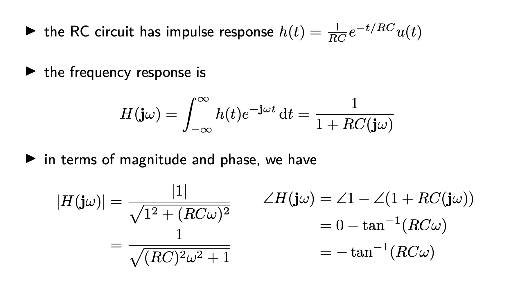

> Last Edit: 3/11/26

# LTI systems with Complex Exponential Inputs

Known that a for a LTI system $T$, its output is the Convolution of input and Impulse Response

$$
y(t) = \int_{-\infty}^{\infty} h(\tau)x(t-\tau) d\tau
$$

Now we are considering case where the input is a Complex Exponential $x(t) = e^{j\omega_0 t}$

## Complex Exponential Inputs

Sub in the $x(t) = e^{j\omega_0 t}$ to get the output as

$$
y(t) = \int_{-\infty}^{\infty} h(\tau) e^{j\omega_0(t-\tau)} d\tau= \left[ \int_{-\infty}^{\infty} h(\tau) e^{-j\omega_0 \tau} d\tau \right] e^{j\omega_0 t}
$$

Which is just $h(t)$’s CTFT at $\omega_0$, $H(j\omega)$

This helps us conclude some property of the System

- If input is with frequency $\omega_0$, then output is still $\omega_0$
- There will be a shift for Magnitude and Phase of the input

## Frequency response of a LTI system

$$
H(j\omega) = \int_{-\infty}^{\infty} h(t)e^{-j\omega t} \text{d}t
$$

This is Frequency Response of the system, that can be represent in Polar Form which is

$$
H(j\omega) = |H(j\omega)| e^{j\angle H(j\omega)}
$$

- **$|H(j\omega)|$:** Magnitude, determine Amplitude scaling of input Frequency
- **$\angle H(j\omega)$:** Phase, the Phase Change to the input frequency

<aside>
❗

The Effect of LTI system to a input frequency is only Scaling its amplitude and Shifting its Phase

</aside>

### Ex. RC Circuit

## Car suspension System

## Response of a LTI System to a periodic Input

Starting with a Periodic CT Signal with period $T_0 = \frac{2\pi}{\omega_0}$, its CTFS is

$$
x(t) = \sum_{k=-\infty}^{\infty} a_k e^{j k \omega_0 t}
$$

Then use CTFT to transfer it into Frequency Domain

$$
X(j\omega) = 2\pi \sum_{k=-\infty}^{\infty} a_k \delta(\omega - k\omega_0)
$$

Multiply it to the System to get its output $Y(j\omega) = H(j\omega) X(j\omega)$ which is 

$$
Y(j\omega) = H(j\omega) X(j\omega)= 2\pi \sum_{k=-\infty}^{\infty} a_k H(j k \omega_0) \delta(\omega - k\omega_0)
$$

Then do the inverse CTFT to get back in Time Domain

$$
y(t) = \sum_{k=-\infty}^{\infty} \underbrace{a_k H(j k \omega_0)}_{b_k} e^{j k \omega_0 t}
$$

Now take a look at this output $y(t)$, it means, the output of the LTI system is the Scaling and Shifting of Components one by one based on their frequency

## Response of a LTI system and the CTFT

Notice in the previous part “Response of a LTI System to a periodic Input”, we used the CTFT and i-CTFT to only do calculations in Frequency Domain, this is because it’s more easy to do multiplication in Frequency Domain than do Convolution in Time Domain, as

$$
y(t) = (h \* x)(t) \iff Y(\mathbf{j}\omega) = H(\mathbf{j}\omega)X(\mathbf{j}\omega)
$$

### Ex. Computing the output for the RC circuit

# LTI System and Invertibility

A LTI system with impulse response h is invertible if there exists an impulse response $h_{inv}$ such that $h ∗ h_{inv} = \delta$

---

It’s kind of strange for the condition $h ∗ h_{inv} = \delta$, but if we take CTFT, this then becomes

$$
H(j\omega) H_{\text{inv}}(j\omega) = 1
$$

Thus we can get the Frequency Response for Inverse Response as

$$
H_{\text{inv}}(j\omega) = \frac{1}{H(j\omega)}
$$

## Condition for LTI System to be Invertible

As $H_{\text{inv}}(j\omega) = \frac{1}{H(j\omega)}$, this means if and only if $H(j\omega)\neq 0$, then the system is Invertible

### Ex. Invertible LTI System

### Ex. Invertibility and Feedback Interconnections

## Filtering via LTI systems

Filter is the progress of **selecting desired frequencies**, and there’s basically four kinds of filters

- **Low-Pass Filters** (Remove all **high** **frequency** content)
- **High-Pass Filters** (Remove all **low frequency** content)
- **Band-Pass Filters** (Remove all content **outside** a band)
- **Band-Stop Filters** (Remove all content **inside** a band)

Filters can be conveniently designed using **LTI systems** through an **appropriately chosen Frequency Response**

That being said, as the **input signal** was $x(t)$, and the **Response of System** is $H(j\omega)$, then **the output spectrum $Y(j\omega)$ is $Y(j\omega) = H(j\omega)X(j\omega)$**, in this case, if we want to design a **Low-Pass Filter**, we just need a **LTI System** **having $|H(j\omega)| \approx 1$ and $|H(j\omega)| \approx 0$** 

## The Ideal Low-Pass Filter

For $\omega_c>0$ consider the **Frequency Response**

$$
H(j\omega) = \begin{cases} 1 & \text{if } -\omega_c \le \omega < \omega_c \\ 0 & \text{otherwise} \end{cases}
$$

This System **perfectly passes frequencies $|\omega|<\omega_c$,** while its **Impulse Response** is 

$$
h(t) = \frac{\sin(\omega_c t)}{\pi t}
$$

### Not Causal Problem

Notice the Filter in **Time Domain**, which is a **sinc function**

Notice there’s value at $t<0$, this makes the LTI System a Not Causal, thus this can’t be apply in **Real Time** application

Instead of Ideal Filter, we often prefer **Non-ideal but Causal filters** for two reasons

1. Can be **modelled** **using Differential Equation**
2. Can be easily **implemented in hardware/software for real-time use**

---

In addition, the use of Ideal Low Pass Filer **makes the output signal Oscillates** as it’s a **sinc** function, that creates **Gibbs Phenomenon** 

<aside>
❗

**The more Perfect on Frequency Domain, the more Complicated on Time Domain**

</aside>

## Non-Ideal LPF - RC circuit

RC Circuit is a **non-Ideal but Causal Low-Pass Filter**, known that it have a Frequency Response

$$
|H_{\text{RC}}(j\omega)| = \frac{1}{\sqrt{1 + (RC\omega)^2}}
$$

Notice on the top we define the **Cut-off Frequency** as $\frac{1}{RC} = \omega_c$

This **Frequency Response** is just **$h_{\text{RC}}(t) = \frac{1}{RC}e^{-t/RC}u(t)$ in time domain**

From the figure, **notice all parts before $t=0$ is just 0**, this makes the function a **Causal System**

## Comparison of RC circuit and Ideal LPF

Here we are going to use a example to show the **difference** of **Ideal & Non-Ideal Filter**

The Cut Frequency has been set to $\omega_c=2~rad/s$

### Ideal Filter

- **Anticipate** the input change (**As it’s not Causal**)
- Perfectly removes the oscillatory **component above $\omega_c$**

### RC Circuit

- Reacts **only after the input changes**
- **Attenuates (decay)** the oscillatory component, but **can’t remove it**

## The Ideal High-Pass Filter

The **HPF** has the **Frequency Response**

$$
H(j\omega) = \begin{cases} 1 & \text{if } |\omega| > \omega_c \\ 0 & \text{otherwise} \end{cases}
$$

While this **HPF** has the **Impulse Response of $h(t) = \delta(t) - \frac{\sin(\omega_ct)}{\pi t}$** 

## Non-Ideal HPF - RC circuit

Still using RC circuit, known that **A Capacitor** will **block the high frequency and pass the low frequency**, thus if we use the **Resistor Voltage** as **output instead of Capacitor Voltage**, then this RC circuit will become a **High-pass Filter**

The High-pass Filter’s Frequency Response is

$$
|\tilde{H}(j\omega)| = 1 - \frac{1}{\sqrt{1 + (RC\omega)^2}}
$$

This will given the output Signal of

