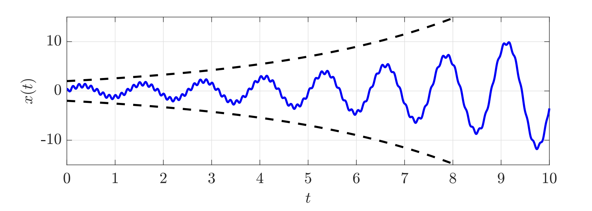

> Last Edit: 3/24/26

# LTI System with Complex Exponential Inputs

Recall a LTI System with **Impulse Response of $h$**, its output in **Time Domain** is 

$$
y(t) = \int_{-\infty}^{\infty} h(t-\tau)x(\tau) \, d\tau\quad or\quad y(t) = \int_{-\infty}^{\infty} h(\tau)x(t-\tau) \, d\tau
$$

Now if the input $x(t)$ is a **Complex Exponential Signal $e^{st}$**, then the output is

$$
y(t) = \int_{-\infty}^{\infty} h(\tau)e^{s(t-\tau)} \, d\tau = \left[ \int_{-\infty}^{\infty} h(\tau)e^{-s\tau} \, d\tau \right] e^{st}=H(s)e^{st}
$$

Whereas the $H(s)$ is being defined as the **Transfer Function**

# Motivation for transfer function methods

The Transfer Function we just defined is in the form **$H(s) = \int_{-\infty}^{\infty} h(t)e^{-st} \, dt$** 

Comparing it to the original **CTFT** one $H(j\omega)$ what’s the difference?

---

Mainly, the **CTFT is not always well-defined** (Case when the integral diverge), but $H(s)$ turns out can be existed in many situations where $H(j\omega)$ doesn’t

Although the Transfer Function can be developed, **here we only analysis cases when**

1. CT Signals that are **Right-Sided**
2. CT Signals that are **LTI and Causal**

# Signals of Exponential Class

A Right Sided CT signal $x$ is of Exponential Class if $|x(t)| \le Me^{\sigma t}$ for $t\geq 0$, $M>0$, $\sigma\in \mathbb R$, where the smaller $\sigma$ is labelled $\sigma^\*(x)$

## The right-sided Laplace Transform

Suppose x is of exponential class, and let $\mathcal{R}_x = \{s \in \mathbb{C} \mid \text{Re}(s) > \sigma^\star(x)\}$. The Laplace Transform of $x$ is the complex-valued function

$$
X(s) = \int_{0^-}^{\infty} x(t)e^{-st} \, dt
$$

- We used $0^-$ to include **CT impulse at $t=0$**
- **$X(s)$ is only defined for $s \in \mathcal{R}_x$,** the **Region of Convergence**

## Existence of the Laplace Transform

### Ex. LT of right-sided exponentials

For $a>0$, consider two signals $x_1(t) = e^{-at}u(t)$ and $x_2(t) = e^{at}u(t)$

## Connection between LT and the CTFT

**CTFT is the special case of LT in Imaginary Axis**, only when system’s **ROC** contains the I**maginary Axis of Complex Domain**, we can then use the **algebric substitution** to **change LT into CTFT**

Recall the previous example signal $x_1$, the **ROC** of that signal **contains the whole Imaginary Axis**, thus its legal to **directly sub in the $s=j\omega$ into $X_1(s)$**
 

$$
X_1(s) \Big|_{s=j\omega} = \frac{1}{s+a} \Big|_{s=j\omega} = \frac{1}{j\omega + a}=X_1(j\omega)
$$

## Important Laplace transforms

## Properties of the Laplace transform

## Response of a causal LTI System and the LT

The Response of a causal **LTI System under LT** is just the same as the case in **CTFT** in **mathematic form**, however **there do exist some differences**

---

If $T$ is a **causal** LTI, with **impulse response** $h$ and LT $H(s)$ and **RoC** $\mathcal R_h$, and $x$ is a **right-sided** signal with LT $X(s)$ and RoC $\mathcal R_x$, **then the Response of the system is**

$$
Y(s) = H(s)X(s), \quad s \in \mathcal{R}_y \supseteq \mathcal{R}_h \cap \mathcal{R}_x
$$

And it’s **Time-Domain** Expression would **then be a Convolution**

$$
y(t) = \int_{0^-}^{t} h(t - \tau)x(\tau) \, d\tau, \quad t \geq 0
$$

### Ex. Use LT to find the response for RC circuit

# Analysis of LICC-ODEs via Laplace Transform

Recall the **LICC-ODE**

$$
Q(D)y(t) = P(D)x(t)
$$

For every unique input $x(t)$ it will give a unique output $y(t)$, whereas the **$Q(D)$ and $P(D)$ are two Linear Differential Operators** $Q(D) = D^n + a_{n-1}D^{n-1} + \dots + a_1D + a_0$ and $P(D) = b_mD^m + b_{m-1}D^{m-1} + \dots + b_1D + b_0$

Here we also defined $D\xi(t) = \frac{d\xi(t)}{dt}$ as the **dervative operation**

---

We are going to use **Laplace Transform** to **compute the Impulse Response** of this causal LTI System, and the key idea is to take the LT of both sides, thus we get

$$
(s^n + a_{n-1}s^{n-1} + \dots + a_1s + a_0)Y(s)=(b_ms^m + b_{m-1}s^{m-1} + \dots + b_1s + b_0)X(s)
$$

Rearrange them to get

$$
H(s) = \frac{Y(s)}{X(s)} = \frac{b_ms^m + b_{m-1}s^{m-1} + \dots + b_1s + b_0}{s^n + a_{n-1}s^{n-1} + \dots + a_1s + a_0} = \frac{P(s)}{Q(s)}
$$

Thus we can conclude that the transfer function of an LTI system defined by a **LICC-ODE** is **very easy to find**, and is often the preferred way for us

Furthermore, we want to translate this $H(s)$ back to **Time Domain**, as the $H(s)$ is now in rational form, we need to 

1. Factoring the denominator
2. Partial Fraction Expansion
3. Inverse Laplace Transform term by term

If $m\leq n$, then we will get the Impulse Response in the form of

$$
h(t) = b_0\delta(t) + \left[ \sum_{k=1}^{n} b_k t^{m_k} e^{p_k t} \sin(\omega_k t + \phi_k) \right] u(t)
$$

### Ex. The Series RLC circuit

## Steady-State Interpretation of the frequency response

In the previous part, we defined **Frequency Response $H(j\omega)$** as the response of a LTI System to two-sided Complex Exponential, i.e. $x(t) = e^{j\omega_0 t}$ is a two sided signal and its resposne is $y(t) = H(j\omega_0)e^{j\omega_0 t}$

But now the input has become **right-sided and causal**, like $x(t) = e^{j\omega_0 t}u(t)$

---

Here we first assume impulse response $h$ has finite action, so $T$  is BIBO stable ($x(t) = e^{j\omega_0 t}u(t)$), and **its result would be** 

$$
y(t) = H(j\omega_0)x(t) - F(t)x(t)
$$

- $H(j\omega_0)x(t)$: **The Steady-State Response**, indicates that if the system has runed for enough time, then the output will be a signal with **same frequency, amplitude scalling $|H(j\omega_0)|$ and Phasor shifting $\angle H(j\omega_0)$**
- $F(t)x(t)$: **The Transient Response**, as our signal **is right-sided and causal**, thus there need to be a **transient feedback for system** then it first get the input, and this term **$F(t) \to 0$ as $t\rightarrow \infty$**

### The convergence of F(t)

As long as the system is **BIBO Stable**, we can **prove that $F(t)$ will eventually become zero**

### Ex. Steady-state response of RC circuit

# Steady-state interpretation of the frequency response

For a causal and BIBO stable CT LTI system

1. The response to a sinusoidal input is sinusoidal in steady-state
2. the s.s. response has the same frequency as the input
3. the s.s. response amplitude is the input amplitude times $|H(j\omega_0)|$
4. the s.s. response phase is the input phase plus a shift of $\angle H(j\omega_0)$

To measure that BIBO steady system, we can apply a sinusoidal input and record the output