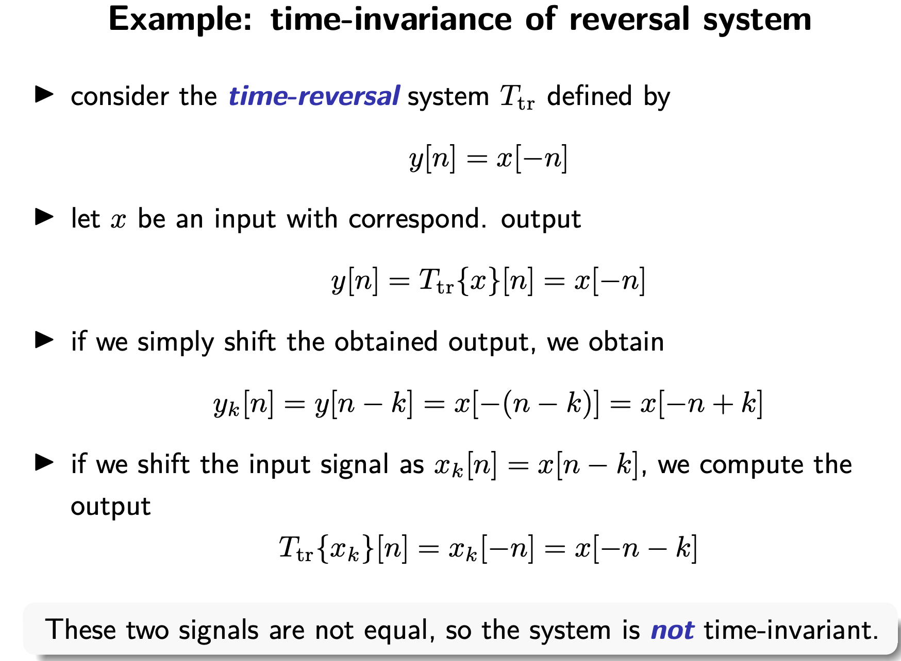

> Last Edit: 3/26/26

# DT System

The DT system gets in a DT input and **produces exactly one DT output**

- $T\{x\}[n]$ is the value of the output signal at time $n\in \mathbb Z$

While CT systems is more align to **physics**, DT system tend to come from **engineering processes**, such as

1. Discretisation of CT systems
2. Digital filtering or signal processing
3. Economic/ Financial models

## Properties of DT systems: Linearity and Causality

### Linearity

A DT system $T$ is **linear** if for any two input signals $x, \tilde{x}$ and any two constants $\alpha, \tilde{\alpha} \in \mathbb{C}$ it holds that **$T\{\alpha x + \tilde{\alpha}\tilde{x}\} = \alpha T\{x\} + \tilde{\alpha} T\{\tilde{x}\}$** 

### Causality

A DT system $T$ is **causal** if for all $n \in \mathbb{Z}$, the output value $y[n]$ depends only on the present and previous input values $\{ \dots, x[n-2], x[n-1], x[n] \}$ 

## Property of DT systems: Time-Invariance

A DT system T is **time-invariant** if for any input signal $x$ with output signal $y = T\{x\}$, it holds that $y_k = T\{xk\}$ for all possible time shifts $k \in \mathbb{Z}$

<aside>
❗

**Physical meaning:** **an experiment on the system tomorrow will produce the same
results as an experiment on the system today**

</aside>

### Ex. Time-invariance of reversal system

## Properties of DT systems: memory and invertibility

### Memoryless

<aside>
❗

**Only depends on current value**

</aside>

A DT system T is **memoryless** if for all times $n \in \mathbb{Z}$, the output value $y[n]$ depends only on the input value $x[n]$

### Invertible

A DT system T is **invertible** if there exists another DT system $T_{inv}$ such that **$T_{inv}\{T\{x\}\} = T\{T_{inv}\{x\}\} = x$** for all inputs $x$

## Property of DT system Stability (linear systems)

A signal is **Bounded** or having **Finite Amplitude** if $||x||_\infty = \max_{n \in \mathbb{Z}} |x[n]|$, i.e. the amplitude of the signal has a maximum over the whole period

### Bounded-Input Bounded-Output Stable

If there’s a constant $K\geq 0$ s.t. $||y||_\infty \le K||x||_\infty$ for all $y = T\{x\}$

## Properties of DT systems: LTI

### The Impulse response of a LTI system

**Impulse response $h$** of a **DT LTI system $T$** is the response $T\{δ\}$ to a unit impulse δ input applied at $n = 0$, i.e., $h = T\{δ\}$

- Get the Impulse Response by simply **substitute the function** into **Impulse Function $\delta (t)$**

### Response of a DT LTI system

Known the input $x$ can be expressed in **DT as $x = \sum_{k=-\infty}^{\infty} x[k]\delta_k$**, known its output is **$y=T\{x\}$**, thus we can sub in the input to get 

$$
y = T\{x\} = T \left\{ \sum_{k=-\infty}^{\infty} x[k]\delta_k \right\} = \sum_{k=-\infty}^{\infty} x[k]T\{\delta_k\}
$$

and as this is a **Time-Invariant System**, we can get 

$$
y[n]=\sum_{k=-\infty}^{\infty} h[n - k]x[k]
$$

## Properties of DT convolution

### Ex. DT convolution and polynomial multiplication

# LTI System Properties and the Impulse Response

Overall, to summarise, the output of **DT LTI system** is the **convolution of impulse response with input signal $y = h \* x$**

$$
y[n] = \sum_{k=-\infty}^{\infty} h[n - k]x[k]
$$

And the Impulse Response $h$ actually determines a lot of properties for System

### Ex. Bank Account Model

# Finite impulse response (FIR) systems

Finite Impulse Response is a DT LTI system of the form

$$
y[n] = \sum_{k=0}^{M} b_k x[n - k] = b_0 x[n] + b_1 x[n - 1] + \dots + b_M x[n - M]
$$

- $x[n]$: Present output
- $x[n-k]$: Past outputs

This means that the **current output value is a finite linear combination of past and present input values**

## Impulse response of FIR system

The impulse response of an FIR system is calculated to be 

$$
h[n] = \sum_{k=0}^{M} b_k \delta[n-k] = \begin{cases} b_n & \text{if } 0 \le n \le M \\ 0 & \text{otherwise} \end{cases}
$$

Conclusion: the **number of nonzero terms for FIR system is limited**, thus named **Finite Impulse Response**

## Properties of LTI FIR system

Thus we can conclude this system is 

1. Causal: As $h[n]=0$ for all $n<0$
2. BIBO stable: since

$$
\sum_{k=-\infty}^{\infty} |h[n]| = \sum_{k=0}^{M} |b_k|<\infty
$$

# Difference Equations and DT systems

In the following part, we are going to analysis the case of **linear, inhomogeneous, constant-coefficient difference equations**

---

We now called this long difference equation the LICC-DE, having the form

$$
a_0y[k] + a_1y[k-1] + \dots + a_ny[k-n] = b_0x[k] + \dots + b_mx[k-m]
$$

- $x$: Input Signal
- $y$: Output Signal
- $n,m$: Nonnegative Int
- $a_i,b_j$: Real Constant Coefficient
- we assume $a_0=1$ for **not losing generality**

<aside>
❗

**This system is depending on both past input and output**

</aside>

---

Now we define a operator $D^\ell y[k] = y[k - \ell]$, the power of $D$ is just the number of step $D$ going backwards, thus we can get two equation of left and right side

$$
Q(D) = 1 + a_1D + a_2D^2 + \dots + a_nD^n
$$

$$
P(D) = b_0 + b_1D + b_2D^2 + \dots + b_mD^m
$$

Now the LICC-DE then becomes

$$
Q(D)y[k] = P(D)x[k]
$$

## LICC-DEs define LTI DT systems

As LICC-ODEs for CT systems, we only consider right-sided inputs and outputs 

### Ex. Discretised RC circuit

# DT LTI system with complex exponential inputs

Setting the input to be $x[n] = e^{j\omega_0 n}$, then

$$
y[n] = \sum_{k=-\infty}^{\infty} h[k]e^{j\omega_0 (n-k)} = \left[ \sum_{k=-\infty}^{\infty} h[k]e^{-j\omega_0 k} \right] e^{j\omega_0 n}
$$

We can see the output of this Complex Exponential is

- Also a complex Exponential
- Same Frequency
- Scaled by the DTFT of $h$

Here we define the DTFT as the frequency response of system, that $H(e^{j\omega}) = \sum_{n=-\infty}^{\infty} h[n]e^{-j\omega n}$

<aside>
❗

**Recall Frequency Response, that’s how system dealing with different system’s frequency scales**

</aside>

When the input is a Complex Exponential Signal $x[n] = e^{j\omega_0 n}$, the output will be 

$$
y[n] = |H(e^{j\omega_0})| e^{j(\angle H(e^{j\omega_0}))} e^{j\omega_0 n}
$$

Thus the conclusion is

<aside>
❗

**A LTI system will Scale the Amplitude and Shift the Phase for any Complex Exponential input**

</aside>